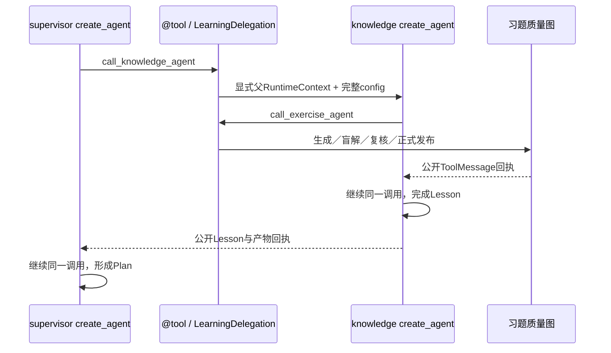

# 01 · 四个角色怎样协作

当前四个角色共享模型配置和[唯一 AgentRunner](../../backend/app/application/agent/runner.py)，通过任务、工具范围、上下文目的和输出契约区分职责。角色名称本身不授予数据库写权限。

## 1. 角色与正式事实的关系

| 角色 | 模型任务 | 业务所有者 |
|---|---|---|
| supervisor | 选择教学动作、调用工具、读取回执、提出 Plan | 规划和正式发布服务校验目标、停点与产物 |
| knowledge | 检索教材／知识结构，输出 Lesson，必要时委派习题 | LearningDelegation 限定范围；已有题帮助状态由服务维护 |
| exercise | 选题、生成、独立求解、复核、题解 | PracticeService 冻结并保存；标准答案留在内部 |
| assessment | 基于真实原答和冻结契约提出诊断 | AssessmentService／BatchAssessmentService 提交证据和领域结果 |

评分、盲解、复核使用直接结构化模型，具有明确输入边界；它们不需要进入自由工具循环来证明“是 Agent”。主助手、知识讲解和需要工具的任务使用标准 create_agent。

## 2. 子 Agent 如何返回原调用者

[真实工具](../../backend/app/application/agent/tools.py)执行函数，[LearningDelegation](../../backend/app/application/learning/delegation.py)检查任务及持久回执，框架完成 ToolMessage 回填和调用方循环。父子 run 通过公开[RuntimeContext](../../backend/app/agent/runtime/contracts.py)显式关联，不再通过私有 ContextVar 传递身份。

## 3. 权限不是提示词

ToolContext 由服务端提供课程、学生、会话和知识点范围；工具参数不能自由覆盖它。按角色工具集决定模型能见到哪些能力，运行边界和领域服务继续校验实际范围。

委派限制角色、嵌套深度、知识点范围与本轮执行权。知识角色可讲解父级明确授权的精确历史例题，但不能由此扩大新题生成范围。写入型委派顺序执行；多题并发在习题子图内部完成。

当前 MAX_DELEGATIONS 为 8，工具调用共享根预算；失败请求的已用委派额度保存在正式请求元数据中，重试不清零。一次 batch 可以产生多个角色 run，不能把 run 数量当成委派次数。

## 4. 为什么模型输出还要经过服务

“已经出题”必须对应正式待答契约；“讲完”只表示流程进度。是否形成掌握证据，取决于学生真实作答、帮助条件、置信度与独立题目归因。工具化子 Agent 和多次模型审查都不能提供数学正确性的形式化证明。

可沿[委派实现](../../backend/app/application/learning/delegation.py)、[习题服务](../../backend/app/domains/practice/service.py)、[评分服务](../../backend/app/domains/assessment/service.py)阅读；[跨进程测试](../../backend/tests/test_native_child_restart.py)使用真实 create_agent 和录制标准模型验证框架恢复，真实 provider 的证据单独记录。
