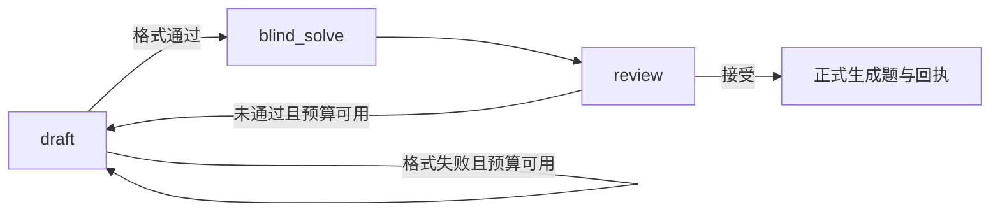

# 05 · 沿真实请求链理解教学流程

源码阅读从[唯一入口](../../backend/app/application/learning/entry.py)和[会话图](../../backend/app/application/learning/graph.py)开始。HTTP 保留原 URL，最终都调用 LearningService.execute；领域内部的 owned 方法不是另一条公开执行路径。

## 1. 普通消息到主助手

1. 校验 v2 事件，claim 当前会话，再重读正式回执和等待点。
2. 同请求已完成则回放；过时 wait 或异输入同 key 拒绝。
3. 检查目标与记忆版本、失效 epoch，选择原线程继续或从正式事实重建安全入口。
4. supervisor 调用规划器和标准 create_agent，按需检索或委派。
5. publish 校验 Plan 并在事务中保存正式回复和完成回执。
6. 有真实待办时进入 await_student，否则 END。

普通函数完成目录读取、上下文投影、目标候选检查和公开序列化，不为它们逐个增加节点。

## 2. 讲解后安排习题

supervisor 可以通过 call_knowledge_agent 委派知识任务。知识 Agent 调用 GraphRAG、教材资源或历史题工具，并可再调用习题工具。子任务输出先成为真实 ToolMessage，知识 Agent 和主 Agent 各自继续读取回执，最后主助手统一提出合法 Plan。

知识讲解、题解和辅助曝光会影响后续独立证据资格。看到讲解内容不能直接增加掌握度。

## 3. 选用已有题

practice_existing 进入 apply_action。目录检查课程、题目可用性和当前讲题状态；选择后由 pose_contract 保存稳定 exercise_id、公开题面、私有冻结契约和待答上下文。

检索仍排除本会话已练习题；原题认知标签 unknown 不会因为本次要求 application 就被伪装为已标注。读取公开候选与读取含答案契约分开。

## 4. 单题与整组共用质量图

草稿先检查题型、选项、知识点范围及文本条件。blind_solve 不接收生成答案或解析；review 对两份真实答案及解析逐份复核，再决定能否接受统一答案。质量重做最多两轮，结构修复仍由模型出口负责。多次同模型审查降低部分错误风险，不能证明数学正确。

整组通过 Send 分发 1～6 个稳定任务，最多并发 3 个，按 task_id 归并后恢复输入顺序。全部通过且没有重复题面才整体发布。已接受 Question 可供同操作恢复，失败不发布半组，不要求把这些正式候选也一起回滚。

## 5. 单题作答

answer → prepare_assessment → commit_assessment → supervisor → publish。

prepare 在评分隔离上下文中形成候选；commit 在事务内再次检查执行权、冻结题与提交前帮助条件，然后写原答、Attempt、合格证据和会话转换。反馈和主助手接续各有稳定产物身份。

已提交评分后主助手失败，重试复用原评分，并继续未完成步骤。当前题目或真实帮助条件已经改变时，不把旧候选当成新作答提交。

## 6. 整组作答

batch_answer 使用完整组身份及逐题原答，一次模型评估形成整组候选，正式事务统一保存全部题目的结果。前端仍整组提交，不能因子图并发而变成逐题独立提交。

低置信、辅助作答或同题重复等不合格项不能产生独立掌握证据；是否允许更新由评分和学生域规则决定。

## 7. 引导讲题

guidance_action 携带 start／reply／hint／explain／transfer／close 等动作及工作区版本，进入单个 guidance 活动。工作区、反馈验证、原答证据和公开过滤继续是普通领域函数。

图保存可恢复边界，领域事务保证重入不重复发布。讲题 close 与 memory/close 含义不同：前者关闭工作区，后者关闭记忆采集；本轮没有新增泛化的会话关闭 API。

## 8. 跳过、断线与重启

skip 同样经过 wait 校验和图入口，清除对应待答状态，不产生评分或掌握证据。浏览器断线只停止临时帧投递，后台任务继续。应用重启后重新 claim 和注入可信上下文，再核对正式回执与实际图栈；不能仅凭旧 next 字段获得写权。

对应验证见[30 号记录](../stem_v1/30_native_remaining_implementation_and_acceptance.md)。隔离测试、真实 provider、实际库迁移分别提供证据，不互相替代。
