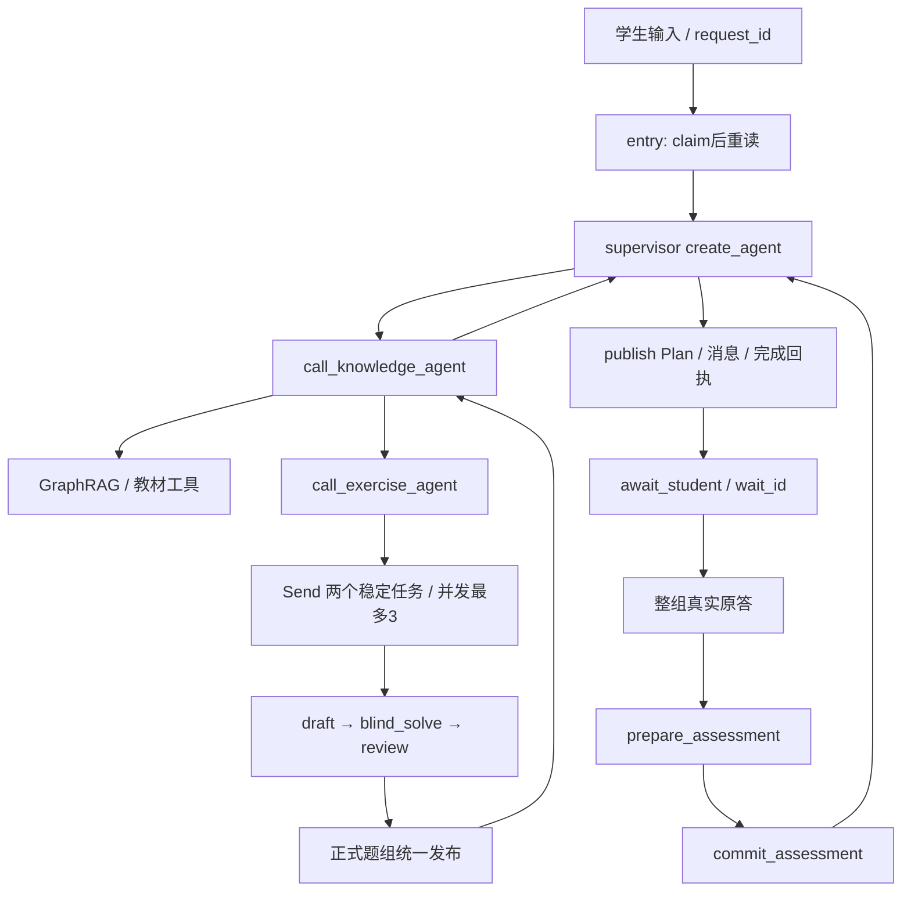

# 15 · 把 LangChain、LangGraph 与教学 Harness 连成一条链

先回答具体问题：学生说“讲解这个知识点，然后给我两道应用题”，系统怎样真正完成检索、讲解、出题、等待、评分和接续？本篇描述当前代码，验证状态以[30 号记录](../stem_v1/30_native_remaining_implementation_and_acceptance.md)为准。

## 1. 三组组件

| 组件组 | 具体文件 | 责任 |
|---|---|---|
| 决策与能力 | [角色工厂](../../backend/app/application/agent/graph.py)、[真实工具](../../backend/app/application/agent/tools.py)、[委派](../../backend/app/application/learning/delegation.py) | 标准模型循环、课程能力、子任务执行和原调用方接续 |
| 事实与执行状态 | [会话图](../../backend/app/application/learning/graph.py)、[正式回执](../../backend/app/application/learning/receipts.py)、[领域模型](../../backend/app/domains/sessions/models.py) | 区分正式题目／原答／目标与图执行位置 |
| 可靠性与展示 | [运行中间件](../../backend/app/application/agent/middleware.py)、[摘要](../../backend/app/application/agent/summary.py)、[存储](../../backend/app/application/learning/storage.py)、[SSE](../../backend/app/api/streaming.py) | 身份、预算、来源、恢复、公开增量与最终消息 |

框架负责通用执行，领域负责教学约束。Harness 是这些边界的组合，项目没有一个包办全部工作的 Harness 类。

## 2. 一张执行图，一张知识图

LangGraph 表达“下一步执行哪个步骤、什么结果需要保存、哪里等待学生”；Neo4j 表达“知识点之间有什么关系、怎样限定材料召回”。两个图的节点和边有不同含义。

会话图只有七类节点：

| 节点 | 为什么需要 |
|---|---|
| supervisor | 标准 Agent 在工具结果上继续决策 |
| prepare_assessment | 保存昂贵评估候选 |
| commit_assessment | 正式作答、证据和会话转换事务 |
| guidance | 可幂等重入的讲题活动 |
| publish | 合法主回复和完成回执提交 |
| apply_action | 显式选题、跳过等受控状态变更 |
| await_student | 独立、无副作用的 interrupt 停点 |

目录查询、评分规则、掌握度归约和公开投影继续作为普通函数。只有分支、并发或恢复需要，才增加节点。

## 3. 一次教学请求怎样走

这是一条可执行路径，不是按用户关键词写死的固定顺序。主 Agent 可以先查目录或澄清；业务层会拒绝没有真实产物却宣称出题完成的 Plan。

## 4. Agent loop 究竟由谁执行

[唯一 Runner](../../backend/app/application/agent/runner.py)准备角色范围和上下文，然后使用[标准 create_agent 工厂](../../backend/app/application/agent/graph.py)。模型真实 function call 调用 @tool；工具完成后，框架按 tool_call_id 填回 ToolMessage，原模型继续。

LearningDelegation 执行知识／习题能力并返回有限公开回执。子 Agent 不复制父完整 messages；它拿到明确任务、可信范围、共享根预算和完整父 config。checkpointer=None 继承父 saver，隔离调用上下文并不放弃调用内恢复。

纯评分、独立求解、复核走标准结构化模型。它们输入被限制，不能为了“更像 Agent”开放不必要工具或读取历史掌握标签来评分。

## 5. 消息为什么只有一份执行所有者

会话 TeachingState 持有跨回合 messages。角色内部由原生 reducer、工具节点和摘要中间件更新，主 Agent 完成后以 Overwrite 接回完整消息结果。

如果把这份完整结果当增量再追加，父图旧前缀可能复活。稳定 message_id 去重不能自动传播删除，所以这里必须明确使用替换语义。

PostgreSQL Message 是学生输入和正式发布记录，不是另一份手工 Agent wire。子图结果中的执行 messages 也不再复制进习题候选回执。

## 6. Harness 的权限和预算

ToolContext 的身份来自服务端；RuntimeContext 保存实际角色、父子关系、预算、服务和公开展示器。工具 Schema 不允许模型自由声明学生／课程身份。

角色工具白名单、参数校验、领域范围和提交前 owner 检查共同限制实际行为。写工具顺序执行，Read 工具有界并发，习题并发在 Send 内处理。Skill 和模型文字不能扩大这些权限。

模型输入预算计入真实工具 Schema 和图片预留。可摘要的闭合历史先压缩，当前原题、原答、帮助快照和目标保持完整；固定任务仍超限时拒绝发送，而非静默截断。

## 7. 正式提交与图保存为什么都需要

设一次逻辑操作为 \(o\)，服务端稳定副作用键为：

\[
k=\operatorname{UUID5}(\text{session},\text{request},\text{operation/task}).
\]

同一 \(k\) 绑定输入指纹。正式效果与回执同事务提交；重复同输入返回原产物，异输入冲突。一次随机 run_id 或 turn_id 不能作为这个键。

业务事务提交后，PostgreSQL Saver 仍可能失败。因此图重入先查正式回执，不重复生成、评分或发布。prepare 与 commit 分开保存候选，正式评分继续核对当前帮助和来源版本。

这个设计没有跨库大事务，也没有任意崩溃位置的 exactly-once 保证。它保证的是已明确实现并验证的业务边界。

## 8. 纠正、遗忘与旧执行状态

长期记忆按学生／课程／知识点聚合。来源 manifest 和失效 epoch 来自正式状态，恢复时不能让已撤销信息通过旧摘要继续发布。目标版本不兼容、等待点改变或旧请求被后续输入终止时，重建安全入口并保留正式效果。

旧请求 received 只证明输入已保存；completed 需要正式产物；abandoned 表示旧计算已终止，原答和已提交结果没有删除。

## 9. 流式文字与最终事实

原生模型事件先经过公开字段白名单，工具参数和内部答案不直接显示。临时正文可以撤回，正式 message 才用于刷新恢复。

SSE 容量 256、心跳 12 秒，断线不取消后台业务。它没有持久逐字日志；前端刷新读取正式会话快照与当前 pending_interaction。

## 10. 用证据结束架构讲解

可以展示实际 create_agent 跨新进程恢复、Send 并发与取消收尾、评分提交后 checkpoint 失败、记忆失效后的旧候选拒绝。隔离框架证据与真实 provider 证据分开。

旧注册表、占位工具、私有身份 ContextVar、独立消息控制器和请求内作答图已物理删除。哪些保留为领域保护、哪些是新增恢复成本及实际行数，由实施记录分别统计；不能只用文件数或 LangGraph import 数量证明简化。
