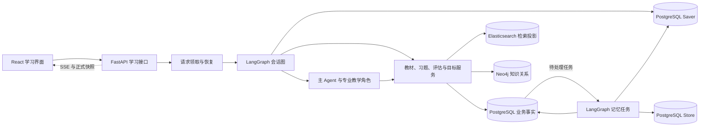

# 理序 · 面向学生的理科学习多 Agent 系统设计总结

本文以 2026-11-22 的工作区源码为设计基线。涉及资源规模、试点或验收的数据均注明记录日期与范围。

用于整理简历时，可直接阅读[第 11 节「项目简历素材」](#11-项目简历素材)。该节提供项目简介、可选贡献条目、验收依据及个人职责填写项。

## 1. 产品定位与学习闭环

理序面向数学、物理等理科学习。学生可以从**课本**出发，按知识点理解定义、性质、例题与方法。也可以从**试卷和习题**出发，定位具体题目，梳理解题条件和思路，再用原题或相近题检验理解。两类任务都从学生的目标开始，使用有来源的材料组织讲解或练习，等待学生作答，再根据证据给出反馈、补讲或回到原目标。

| 学生场景 | 当前产品入口与结果 |
| --- | --- |
| 学习一节课本内容 | 在「教材与方法」浏览可用教材内容和例题，或从「知识地图」选择知识点，在「学习空间」建立目标并接续讲解、问答和练习。 |
| 卡在一道试卷题上 | 在「学习空间」粘贴一道题的文本，说明卡在哪一步。引导讲题保存本题，并在同一工作区承接追问、提示、完整讲解和新题验证。 |
| 查找原题或举一反三 | 在「习题检索」按题号、题干或关键词查询。课程与配置支持时使用语义混合搜索。Agent 可根据任务查找原题、同结构题或同解法题，也可按目标生成练习。 |
| 检查一组知识点 | 提交单题或 1～6 道练习组成的题组，查看反馈和知识点证据。后续教学可以依据正式结果补基础或继续当前目标。 |
| 继续上次学习 | 按课程恢复会话、原题、待答交互和目标，在「学习档案」及会话记忆面板查看已有记录。 |

当前试卷侧以题目和练习组为业务单位。整卷导入与版面拆题、正式套卷实体、考试计时和卷级成绩管理属于产品扩展范围。资源覆盖力学与有限元基础（`mechanics`，MOOCRadar 教学元数据）、小学数学与拓展思维（`math`，XES3G5M 教学元数据）、一元一次方程（`junior_algebra`，OpenStax 选段）和七年级上册教材试点（`junior_math_7a`）。课本与题库覆盖随课程而异，学习档案由系统内新产生的学生记录建立。参见[项目入口](../README.md)、[前端导航](../frontend/src/App.tsx)、[课程目录](../backend/app/domains/courses/catalog.py)。

## 2. 总体架构与技术栈

| 层面 | 技术与职责 |
| --- | --- |
| 前端 | React 19、TypeScript、Vite。通过 React Markdown、remark-math 与 KaTeX 展示 Markdown、理科公式和题干，前端持有流式草稿并用正式会话快照恢复界面。 |
| API 与业务 | Python 3.12、FastAPI、Uvicorn、Pydantic、SQLAlchemy、psycopg。API 管请求协议与公开投影，应用层编排跨域用例，领域服务拥有课程、教材、习题、评分、目标和记忆规则。 |
| 模型执行 | LangChain 1.4.7、LangGraph 1.2.16、langchain-openai 1.7.2。前者承担模型与工具调用，后者承担教学路由、暂停恢复、题组并行和后台记忆流程。配置接入 DeepSeek 兼容聊天接口，嵌入模型通过 DashScope 配置。 |
| 数据与搜索 | PostgreSQL 是业务事实来源，Alembic 管理业务 Schema。Elasticsearch 提供中文全文和向量搜索，Neo4j 提供课程知识关系。可选本地 Qwen 精排在召回之后运行。 |
| 框架持久化 | 官方 PostgreSQL Saver 持久化执行位置和消息状态，官方 PostgreSQL Store 保存长期记忆正文。业务表保留治理版本、来源和可见性指针。 |

后端为按业务域拆分的单体应用。源码依赖方向是 `api → application → domains → agent / infrastructure → shared`。`agent/` 管运行契约、上下文、工具策略和教学 Skill，`infrastructure/` 管数据库、模型、搜索与图谱客户端，应用启动层注入实际依赖。适合从 [应用入口](../backend/app/main.py)、[启动装配](../backend/app/bootstrap.py)、[后端职责](../backend/app/README.md) 和 [域导航](../backend/app/domains/README.md) 顺序阅读。锁定版本见[后端依赖](../backend/requirements.txt)和[前端依赖](../frontend/package.json)。

## 3. 课本学习与教学资源

### 3.1 从原件到可引用材料

教材以课程、文档版本、章节、结构块及题目组织。系统保留版次、来源 URI、内容哈希、解析版本和定位信息。公开结构块可展示定义、定理、规则和技巧，例题由题目投影与教学流程消费。参考答案、解答块和内部分析按独立字段保存，仅在有相应教学权限和场景时使用。

| 入库路径 | 处理流程与当前范围 |
| --- | --- |
| 规则解析导入 | HTML/MathML 和 Markdown 使用文本或原生结构，PDF 可利用原生文字和坐标。解析归一为章节、结构块、公式、题目与来源定位。可疑区域保留待复核信息。相同请求和内容可以重放。解析在写事务外完成，教材快照、目录投影和导入回执一起提交。OpenStax 一元一次方程选段走这条路径。 |
| 多模态教材抽取 | 离线 CLI 将 PDF 原生文本和 Poppler 渲染页图一起送入配置的多模态模型，进行逐页转录、逐页审校、小节整合及来源校验。保存定义与教学模式、原文习题、方法技巧，标注原文转录或模型归纳。人教版七年级上册以 1.1 的原页复核为扩展第一章的门槛，抽取状态和公开状态分别维护。 |

规则导入和离线抽取都保留原文出处。OpenStax 原文例题可从「教材与方法」进入引导讲题。七上抽取目录由单独的只读 API 查询，原页复核后的定义、方法和教学摘要进入课程目录，习题以 `reference_only` 发布。抽取任务复用教材文档、小节快照和共享模型回执，校订生成新快照。教材全文与题目索引有独立构建流程。参见[教材导入服务](../backend/app/domains/materials/textbooks.py)、[多模态抽取服务](../backend/app/application/textbooks/extraction.py)、[抽取内容发布](../backend/app/domains/materials/extraction/catalog.py)、[教材抽取接口](../backend/app/api/routes/textbook_extraction.py)。

### 3.2 从学生目标到教学活动

1. 学生指定课程、知识点或自然语言目标。主 Agent 判断任务是否足够明确，例如「最难」可能指题目估计难度、先修链位置或自己的薄弱点，目标不同就使用对应的数据。
2. 知识点 Agent 可查目录、教材块、公开例题、先修关系和有限学情记忆，按任务组织基础解释、方法或例题。资源工具检查课程、授权和待答题排除范围。引用回到具体材料或题目，学生可以追溯依据。
3. 会话维护根目标、子目标、依赖、当前活动节点及补救返回栈。补讲先修内容时保留原活动和待答题。补救结束后返回原路径，变更总目标需要当前学生明确表达。
4. 教学进度记录已完成的活动和下一步。真实作答走评分和证据准入，能力变化由评估链路给出。

课本例题和外部粘贴题可进入通用引导讲题。历史专用方程求解器及逐步数学核验是旧试点，当前通用讲题使用模型分析、结构约束、来源约束与发布校验。参见[目标服务](../backend/app/domains/sessions/goals.py)、[学习进度](../backend/app/domains/learning/progress.py)、[教材页面](../frontend/src/features/TextbooksPage.tsx)、[通用讲题服务](../backend/app/application/guidance/service.py)。

## 4. 试卷题讲解、题库检索与练习组

### 4.1 单题引导与迁移验证

学生粘贴题干，或由教材题发起讲题。服务冻结当前题的身份与版本，保留工作区、当前互动焦点和帮助历史。学生可以提交自己的推导或追问，也可主动索取提示、完整讲解和新题。系统将澄清题意、学生尝试、解释和辅助动作分别记录，发布前核对引用、原答以及实际公开内容。只表达「懂了」按课堂互动处理，学生真正写出的步骤才可能进入观察记录。

新题验证有独立与辅助两种发布方式。独立发布只给新题题干和中性作答邀请，辅助发布会记录针对新题的提示曝光。原题和新题各自记录帮助条件，原题完整示范和新题同轮发布时按辅助处理。同题追问始终对应工作区的原有题目身份。引导讲题的作答观察用于接续与学情记忆，正式掌握度更新沿单题或题组评分账本写入。参见[讲题工作区](../backend/app/domains/guidance/workspace.py)、[反馈校验](../backend/app/domains/guidance/feedback.py)、[帮助曝光](../backend/app/domains/guidance/exposure.py)、[讲题入口](../frontend/src/components/NewProblemEntry.tsx)。

### 4.2 题库能力和来源约束

`Question` 保存题干、选项、题型、课程和知识点、来源、题图、答案、解析及版本。题库统一策略判断某题能否搜索、公开阅读、独立作答或用于题解。缺关键图的题可作为有限参考，练习资格由统一策略判定。前端及搜索索引使用公开题面，评估使用服务端冻结的内部题目契约。生成题与课程原题带各自来源标识，会话生成题的使用范围由题库和练习服务控制。参见[题库策略](../backend/app/domains/courses/questions/policy.py)、[公开题面与内部契约](../backend/app/domains/courses/catalog.py)。

| 检索方式 | 用途与执行逻辑 |
| --- | --- |
| 精确题号与关键词 | 精确题号优先通过 PostgreSQL 校验课程、题目身份和可见性。关键词通道使用 Elasticsearch BM25，教材及题库全文字段使用 IK，索引分词 `ik_max_word`、搜索分词 `ik_smart`。 |
| 语义混合搜索 | 在启用的课程使用文本向量、BM25 及可选多模态召回。候选接受主库当前版本、课程、知识点、题型、排除项和公开状态校验。支持 `exact`、`isomorphic`、`same_method` 等意图，候选相似度用于排序，原题身份由明确的题号或来源校验确认。 |
| Qwen 本地精排 | 默认从合格候选保留文本向量前 12 道，再由 BM25 去重补到 20 道，候选不足时从剩余召回补齐。纯文本批次用 Qwen3-Reranker-0.6B，查询或任一候选含公开题图时用 Qwen3-VL-Reranker-2B。精排异常时按 RRF 排序返回并保留通道信息。 |
| 课程 GraphRAG | 显式知识点、目录名称匹配或初步检索结果提供种子，Neo4j 扩展本课程的相关节点，系统在扩展范围内再次检索教学材料。目录父子、关联和先修以不同的关系类型表达。图服务异常时在种子范围做普通检索并报告降级。 |

倒数排名融合（RRF）以各召回通道的排名来合并候选。设候选 $d$ 在通道 $i$ 的去重结果 $L_i$ 中的名次为 $r_i(d)$，当前实现对各通道等权，默认取 $k=60$。

$$
\mathrm{RRF}(d)=\sum_{i:\,d\in L_i}\frac{1}{k+r_i(d)}.
$$

一道题在同一个通道只贡献一次倒数排名。在线候选和精排使用公开题面、选项及通过资产校验的图示。题目专用查询接口接受已有题图资产 ID，学习入口中新粘贴题以文本传入。离线作业生成题目检索表示和索引代次，再执行发布。回读主库可拦截已撤回、变更或越域的索引结果。题目难度使用单题内容估计的 0～100 分，供本课程筛选和排序，未知或题面变化后的旧分数保留为空。参见[题目混合检索](../backend/app/application/question_retrieval/service.py)、[RRF 实现](../backend/app/domains/courses/retrieval/fusion.py)、[精排](../backend/app/application/question_retrieval/rerank.py)、[课程检索与 GraphRAG](../backend/app/domains/courses/retrieval/service.py)、[题目难度](../backend/app/domains/courses/difficulty/service.py)、[IK 配置](../deploy/elasticsearch/ik/README.md)。

### 4.3 从找题、出题到整组交卷

- **题库选题**按当前课程和题目能力读取原题，核对是否可独立练习，发布后冻结所见题面、答案契约与版本。开始正式练习后，题目切换和跳过经会话操作执行。
- **生成练习**由习题 Agent 按知识点、题型和认知目标提出任务。生成支持单选、多选及单空填空，可指定记忆、理解或应用层次与难度目标。单题与题组单项共用 `draft → blind_solve → review`。盲解独立读取题面，复核判断答案、推导和选项是否一致，允许经复核的等价表达或可兼容解法。每个生成任务最多尝试两次。
- **题组编排**通过 LangGraph `Send` 分发 1～6 个子任务，并发上限为 3，通过任务 ID 汇总回执，全部通过检查后按计划顺序发布整组。学生可保存草稿或跳过整组。正式提交时，每题恰好提供一份非空答案，并绑定当前题组与等待点。
- **整组评估**先冻结原答、每题帮助快照和评分输入，获取一次整组结构化评估，再用同一事务提交题组结果、逐题作答与证据。汇总分取已评分题目的均值，同时返回已评分题数和总题数。未达证据准入条件的作答可以保留反馈。正式结果交回主 Agent 接续原学习目标。

参见[生成与题组子图](../backend/app/application/learning/subgraphs/practice.py)、[整组发布](../backend/app/domains/practice/batches.py)、[语义复核](../backend/app/domains/practice/reviews.py)、[整组评估](../backend/app/domains/assessment/batch.py)。

## 5. 多 Agent 分工、工具和 LangGraph

| 角色 | 职责 | 运行方式 |
| --- | --- | --- |
| 主 Agent `supervisor` | 理解学习意图，处理澄清与目标，通过工具调用专业 Agent，结合子任务回执或正式评估接续学习。 | LangChain `create_agent`，受控工具，结构化教学计划。 |
| 知识点 Agent `knowledge` | 查找教材、课程概念、知识关系和学情证据，按需要组织讲解、例题和补救教学。 | `create_agent` 与只读教学工具，必要时再委派习题 Agent。 |
| 习题 Agent `exercise` | 按任务找题、选题、讲题、发起生成或生成题组。通用引导讲题也利用受限的习题角色执行。 | `create_agent`，受限检索、讲题或出题工具，调用练习质量子图。 |
| 学生评估角色 `assessment` | 生成预测或诊断候选，正式评分流程据冻结题目与真实原答给出结构化评估。 | 无业务工具的严格 JSON mode。选择题等可确定规则与模型候选共同进入领域校验。 |

角色由提示词、可用 Skill、工具白名单、上下文和输出契约区分，共享标准模型接入。主 Agent 可委派知识或习题 Agent，知识 Agent 可再委派习题 Agent，委派深度最多为 2。工具通过 `ToolRuntime` 读取服务端注入的会话、学生、课程和资源范围，父子角色默认共享 24 次工具调用额度。专业 Agent 的结果是带 `tool_call_id` 的真实工具回执，返回原调用模型形成「模型 → 工具或子 Agent → 原模型」的闭环。教学 Skill 提供方法，作用域、版本、预算和写权限由服务端校验。参见[角色工厂](../backend/app/application/agent/graph.py)、[Agent Runner](../backend/app/application/agent/runner.py)、[教学工具](../backend/app/application/agent/tools.py)、[委派服务](../backend/app/application/learning/delegation.py)。

### 5.1 会话图的七类节点

| 节点 | 在什么情况下运行 |
| --- | --- |
| `supervisor` | 普通对话、目标规划和评分之后的教学接续。 |
| `prepare_assessment` | 单题或整组提交，准备并保存昂贵的评分候选。 |
| `commit_assessment` | 对照原答、冻结题和帮助条件提交评分与反馈，再回到 `supervisor`。 |
| `guidance` | 开始或继续引导讲题、提示、新题验证及结束讲题。 |
| `apply_action` | 选择题库已有题做练习，以及跳过当前交互。 |
| `publish` | 校验并保存教学建议对应的正式消息、目标和待答状态。 |
| `await_student` | 需要学生输入时用 `interrupt` 保存停点。有效新输入用 `Command(resume=...)` 接续。 |

会话图处理业务分流与可恢复提交，角色执行图负责模型和工具循环，练习图负责候选质量与并行生成，记忆任务用独立图处理后台归纳。普通数据校验和事务写入留在领域服务。会话状态包含执行消息、输入、候选、停点和目标或记忆版本。`RuntimeContext` 持有本次执行权限、服务、工具预算和输出观察器，恢复时重新装配。Neo4j 中的知识关系用于检索，会话目标树用于教学进度与补救返回，LangGraph 的执行图用于推进调用和提交。参见[会话图](../backend/app/application/learning/graph.py)、[执行上下文](../backend/app/agent/runtime/contracts.py)。

## 6. 学情评估与掌握证据

学习档案分别展示学习过程、作答记录、掌握证据和教学记忆。一次讲解完成或学生查看了答案，可以更新互动与学习进度。掌握状态由通过准入的真实原答证据驱动，未知维度显示为未评估。

1. **固定证据对象。** 提交绑定原题版本、学生原答、当前等待点和本次帮助条件。评分包保存题目与原答指纹、总体结果、置信度、逐知识点评分项及原答引用片段。程序可确定的选择题判分优先，复杂填空或开放作答由结构化模型候选和业务规则共同决定。
2. **按可核查的原答归因。** 单概念题可使用整题证据。综合题需要命中冻结评分要点，并让引用精确落在学生原答中。某个概念缺少直接依据时记为 `not_observed`，总分不会摊给所有知识点。
3. **控制独立证据准入。** 掌握度更新要求服务记录的本题提交前无帮助，结果可评分，总体置信度与局部置信度均至少为 0.8，归因直接且局部结果与分值相符。这个门槛依据系统内可见的帮助历史和模型输出，用于控制账本更新。
4. **按账本归约水平。** `StudentState` 使用 `beginner`、`advanced`、`proficient` 三个维度。对每个知识点，按实质题目 `canonical_item_id` 和维度去重，重评替换旧贡献。首次独立证据按正确、部分正确、错误初始化为 0.50、0.25、0.00。后续分别累加 0.15、0、−0.15，并按同一维度的独立题数 $n$ 设置上界 $u(n)$。

$$
u(n)=\begin{cases}
0.5,&n=1,\\
0.8,&n=2,\\
1,&n\ge 3,
\end{cases}
\qquad
m_n=\operatorname{round}\!\left(\min\{u(n),\operatorname{clip}(m_{n-1}+\Delta,0,1)\},3\right)\quad(n\ge 2).
$$

例如，学生在同一知识点的同一维度第一次独立答对，估计值为 0.50。换一道实质不同的题再独立答对，值为 0.65。系统用该启发式分值组织学情与后续教学，真实学习效果和分数校准需要专门数据验证。参见[评分服务](../backend/app/domains/assessment/service.py)、[冻结评分与证据](../backend/app/domains/assessment/evidence.py)、[掌握度归约](../backend/app/domains/students/mastery.py)、[学习档案](../frontend/src/features/ProfilePage.tsx)。

## 7. 上下文预算与三级长期记忆

**会话上下文。** 当前题、学生原答、目标、当前任务及成组的工具调用和返回有明确边界。挂载在 LangChain Agent 上的摘要中间件在预算水位触发时压缩已闭合的旧消息组，保留来源关系和近期完整交互。摘要只服务于后续模型输入，持久原题和原答继续从业务记录读取。设 $C$ 为当前单请求上限、$O$ 为输出预留、$S$ 为安全量、$I$ 为可选的额外输入上限，输入预算为

$$
B_{\mathrm{in}}=\min\{I, C-O-S\}.
$$

未配置 $I$ 时取 $C-O-S$。文本、消息封装、工具 Schema 和图片预留都占用该预算，使用本地保守估算。固定任务仍超预算时返回可处理的错误，保留题面与原答完整性。参见[摘要中间件](../backend/app/application/agent/summary.py)、[请求预算](../backend/app/shared/llm_budget.py)。

**长期记忆。** 正式消息、真实作答和帮助事件先形成 `MemoryFact`，再抽取会话内知识点观察，逐级归纳为知识点、课程、学生总体记忆。知识点层可保存有来源的具体误解和帮助反应，课程层归纳适用于本课的学习表现，总体层可记录学生明确表达的全局偏好及具有跨课依据的模式。归纳保留来源、反例、版本与可见性。在线教学读取当前学生、当前课程和最多三个知识点的有效正文，记忆投影预算通常为输入预算的 20%，上限为 4,000 Tokens。正式评分仅使用当前评分契约需要的材料。

**治理和恢复。** 后台任务按 `memory:{job_id}` 保存执行位置，经过冻结、生成、验证、复核、预写 Store、发布指针和后续调度。更正、遗忘与停录会更新作用域状态或来源屏障，在读记忆、恢复图和发布时检查。撤销后旧来源无法通过原检查点重新进入正式结果。语义记忆的更正与能力账本重评通过各自的业务操作完成。参见[记忆读取](../backend/app/domains/memory/context.py)、[记忆流程](../backend/app/domains/memory/workflow.py)、[记忆治理接口](../backend/app/api/routes/memory.py)、[三级记忆说明](learning_harness/09_student_learning_memory.md)。

## 8. 数据所有权、幂等与恢复

| 存储 | 业务所有权 |
| --- | --- |
| PostgreSQL `public` | 课程、教材、题库、会话、消息、目标、冻结题与结果、作答与评分证据、学生状态、执行回执、记忆事实及治理指针。按 2026-10-26 迁移口径为 27 张业务 ORM 表，另有 Alembic 版本表。 |
| PostgreSQL `langgraph_checkpoint` | 官方 `AsyncPostgresSaver` 保存会话与记忆任务的执行状态，包括消息、节点位置、待响应停点和图候选。 |
| PostgreSQL `langgraph_store` | 官方 Store 保存带哈希的长期记忆正文，业务表 `document_key` 和治理状态决定哪个版本可见。 |
| Elasticsearch、Neo4j、本地资源 | 可重建的全文与向量索引、课程知识关系投影，以及可校验的题图、教材渲染缓存等资源。题目、资料的合法性与当前版本以业务数据为准。 |

业务 Schema 按共享实体和生命周期拆分。题库题目、会话冻结契约、正式作答和知识点证据有各自状态，联系通过版本、身份和引用表达。新增教材和记忆功能也复用课程、资源、任务和会话等基础结构。参见[模型注册](../backend/app/application/model_registry.py)、[业务迁移](../backend/alembic/versions/20261026_02_memory_documents.py)、[Store 适配](../backend/app/infrastructure/persistence/memory_documents.py)。

会话写请求经统一入口领取执行权。`request_id` 确定一次业务输入，`wait_id` 绑定它所回复的正式待答交互，`operation_id` 标识可重放的业务效果，`thread_id` 标识图执行历史。重复请求先核对输入指纹和正式回执，已完成则回放，未完成则在许可条件下恢复。旧等待点、错误题号、版本或上下文归属冲突由服务拒绝。慢模型计算在短写事务外执行，提交前重新检查 owner、题目、帮助、目标或失效版本。

业务表、Saver 和 Store 各自提交。例如评分已入库而后续 checkpoint 尚未写入，重入时通过同事务保存的正式效果定位结果，避免再产生一份评分。记忆先写入不可变文档，再由业务事务发布有效指针，避免将只有 Store 预写的候选暴露给教学。若旧图状态失去恢复条件，可以依据正式事实重建安全入口。参见[请求入口](../backend/app/application/learning/entry.py)、[正式回执](../backend/app/application/learning/receipts.py)、[等待点](../backend/app/domains/sessions/interactions.py)、[Saver 与冷线程维护](../backend/app/application/learning/storage.py)。

## 9. 前端交互、流式公开与运行方式

| 主要接口 | 业务职责 |
| --- | --- |
| `/api/courses`、`/api/concepts`、`/api/graph` | 读取课程、知识点和课程知识地图。 |
| `/api/textbooks`、`/api/teaching-packs` | 浏览可读教材与例题引用。离线多模态抽取另有 `/api/textbook-extraction` 读接口。 |
| `/api/search/questions`、`/api/sessions/{session_id}/exercise-search` | 题库浏览与搜索，以及绑定会话的相似题、带题图查询。 |
| `/api/sessions/{session_id}` 及其 `/messages`、`/guidance`、`/practice`、`/answers`、`/batch-answers` | 读取正式快照，以及提交对话、讲题、练习、单题和整组作答。 |
| `/api/student`、`/api/sessions/{session_id}/memory` | 读学习档案与会话作用域记忆，记忆子路由支持更新、纠正、遗忘和停录。 |

具体请求结构与注册路径见[路由入口](../backend/app/api/router.py)、[学习接口](../backend/app/api/routes/learning.py)、[题目检索接口](../backend/app/api/routes/question_retrieval.py)。

- **客户端交互。** 学习空间显示对话、等待卡片、单题和题组、引导讲题、目标和记忆。前端按课程和会话处理请求，避免切换课程后用过期结果覆盖当前视图。请求与待答身份随提交传回后端。
- **SSE。** 普通教学正文通过字段白名单逐段发送，校验失败的草稿可重置。通用讲题采用 `validated_publication`，先校验并保存公开内容，再分段发送。正文、运行进度与工具诊断使用不同事件，普通非习题角色的部分工具完成事件可携带工具参数。服务端临时队列上限为 256，空闲心跳为 12 秒。断线或慢消费结束临时流后，后台业务可继续。浏览器刷新使用持久会话快照和请求状态恢复，恢复粒度是正式消息和业务结果。
- **本地部署。** 本机 Windows 脚本管理独立前端、FastAPI 后端及可选的本地 Qwen 服务。使用环境配置指定 PostgreSQL、Elasticsearch、Neo4j 与模型服务。首次用维护脚本建库、升级 Alembic 并初始化 Saver 和 Store，启动时检查版本及依赖。`/api/health` 汇总业务库、检索和图谱状态，可选诊断日志与调用指标用于定位预算、失败和降级。
- **部署边界。** 当前面向本机个人使用，Web 服务监听环回地址。PostgreSQL advisory lock 保护同一业务库的单应用 worker 执行权，课程与会话归属用于本地业务校验。学校级应用所需的账号认证、多租户权限和跨 worker 调度属于部署扩展。启动维护只清理满足结束条件的 30 天冷会话线程，保留正式学习记录。

参见[浏览器会话与流式交互](../frontend/src/App.tsx)、[客户端恢复](../frontend/src/streaming/recovery.ts)、[SSE 通道](../backend/app/api/streaming.py)、[工具事件](../backend/app/application/agent/middleware.py)、[健康接口](../backend/app/api/routes/health.py)、[初始化脚本](../scripts/maintenance/prepare_postgres.py)、[启动脚本](../scripts/start.ps1)。

## 10. 验证记录与适用范围

| 证据 | 已验证的范围 |
| --- | --- |
| 2026-10-26 PostgreSQL 迁移验收 | 迁入 13,493 行教学资源，覆盖当时 4 门课程、1,386 个知识点、7,982 道题、1,457 条材料、2,362 条知识关系及相关资源记录。旧学生、会话、作答和运行数据留在备份。该轮后端 865 项、前端流式恢复 15 项及前端构建通过。 |
| 同轮真实依赖验证 | PostgreSQL Saver 进程重启恢复、Store 同步与异步互读、撤销后的版本可见性、真实模型三级记忆、两轮摘要、固定题与固定查询回放、Neo4j 扩展均有验收记录。 |
| 教材与引导讲题试点 | 已有小节抽取、原页复核、公开目录与前端讲题的阶段报告。七上第一章共 9 个单元、52 个源页的抽取记录，1.1 有逐页复核和修订快照，报告所列其余 8 个单元处于待复核状态。 |
| 检索对照实验 | 已有语义向量、BM25、融合和多模态精排的离线对照。Qwen 记录使用 100 道题与 24 条查询，部分结果只比较共有标注测试子集，适合作为对应样本排序证据。 |

以上数字来自各自的历史验收。本次为按当前工作区源码撰写的设计总结。系统当前的证据可用于核对教学流程、恢复协议、资源发布和固定样本检索。跨教材与新题族泛化、模型教学与诊断准确率、真实学生学习增益以及多用户并发容量，均需要对应的独立测量。

参见[PostgreSQL 迁移验收](stem_v1/32_postgresql_langgraph_memory_implementation_and_acceptance.md)、[Learning Harness 验证指南](learning_harness/11_harness_review_and_acceptance.md)、[教材抽取试点记录](stem_v1/16_textbook_multimodal_extraction.md)、[检索实验](../evaluations/retrieval/README.md)、[本地 Qwen 对照](../evaluations/retrieval/QWEN_RERANK.md)。

## 11. 项目简历素材

### 11.1 一段可直接使用的项目简介

> **理序｜面向学生的理科学习多 Agent 系统**
>
> 面向数学、物理学习，支持学生从课本知识点或试卷单题发起学习，结合可追溯教材与题库，完成分步讲题、针对性练习和作答反馈。主 Agent 按目标协同知识讲解、习题和评估角色，系统保留学习停点及作答依据，支持下次继续学习。

项目技术栈可按岗位选用 `Python`、`FastAPI`、`LangChain`、`LangGraph`、`PostgreSQL`、`Elasticsearch`、`Neo4j`、`React`。介绍时可以用一个具体场景串起来。学生学习去括号时，可以先看教材例题，再练一道试卷里的同类题。系统要持续知道学生在回答哪一道题、提交前看过哪些提示、原答能够说明哪一项知识。即使学生刷新页面或隔天回来，也要把教学接到正确的待答点上。这些约束决定了题目冻结、证据准入和会话恢复的设计。

### 11.2 可选贡献条目与验证依据

下列条目陈述仓库可核对的项目工作。写入个人简历时，从本人能说明决策、实现和验收的工作中选取 3～4 条，再使用与实际职责相符的动词。每条保留一个主要难点、一个关键机制和一个可核对结果。

#### 可信作答与逐知识点评估

- **简历示例。** 构建基于冻结题目、学生原答片段与提交前帮助快照的逐知识点评估，按实质题目去重并支持重评重算。回归覆盖综合题局部正确、缺少局部证据及辅助作答等场景。
- **面试展开。** 综合题只给一个总分，会掩盖学生已经做对的步骤。固定测试中，整题判错，但原答中有正确的分配律步骤，等价变形缺乏直接证据，因此只更新分配律维度。另一测试保留受助原答与评分，掌握账本维持原值。这些结果验证证据准入规则。参见[冻结证据实现](../backend/app/domains/assessment/evidence.py)、[综合题及重评回归](../backend/tests/test_concept_evidence.py)。

#### 可恢复的教学编排与练习流水线

- **简历示例。** 基于 LangGraph 编排教学委派、学生停点和评分接续，使用输入指纹与同事务回执实现完成结果重放。单题与每组 1～6 道题的练习共用生成、独立盲解和语义复核流程，整组通过后统一发布。
- **面试展开。** 题目已经发布或评分已经提交时，模型后续调用、图落盘或 HTTP 响应仍可能中断。业务回执回答「这个操作正式生效了吗」，Saver 回答「图走到哪了」。恢复先查原请求及业务回执，再决定沿原停点继续还是回放完成结果。2026-10-23 原生化阶段使用 SQLite Saver 进行真实模型隔离验收，两题练习组使用一次整组诊断，提交 2 条作答记录和 1 条题组评分记录，同请求重放新增模型调用为 0。当前 PostgreSQL Saver 的独立进程恢复见后续迁移验收。参见[请求与恢复](../backend/app/application/learning/entry.py)、[原生化阶段验收](stem_v1/30_native_remaining_implementation_and_acceptance.md)、[真实模型验收明细](../data/reports/native_remaining/real_model_clean_final.json)、[PostgreSQL 迁移验收](stem_v1/32_postgresql_langgraph_memory_implementation_and_acceptance.md)。

#### 带来源及撤销能力的长期学习记忆

- **简历示例。** 实现从会话观察到知识点、课程和学生总体的三级学习记忆，使用 LangGraph Saver 保存归纳候选、Store 保存不可变正文，由业务指针和版本控制发布与撤销。独立 PostgreSQL 库的真实模型验收覆盖连接重开及遗忘后旧版本失效。
- **面试展开。** 学生更正一项偏好时，相关后台任务可能已在生成正文。将来源、任务候选和发布版本各自持久化，发布前复核来源与撤销状态，才能阻止旧正文重新生效。上述验收用自编素材形成 4 个知识点、2 个课程和 1 个学生总体作用域的记忆。连接重开后正文一致，并核对了遗忘后旧版本不可见。连续摘要另有独立验收，可用于说明会话压缩如何保留原题与原答。参见[记忆工作流](../backend/app/domains/memory/workflow.py)、[真实记忆验收](../data/reports/postgresql_memory_migration/real_memory.json)、[连续摘要验收](../data/reports/postgresql_memory_migration/real_compaction.json)。

#### 面向原题、同构题和同解法的图文检索

- **简历示例。** 实现 Elasticsearch BM25、向量召回、题目级 RRF 与本地 Qwen 精排，支持公开题图及题目版本校验。在候选固定为每条 20 道的离线对照中，10 条具有共同标注覆盖的测试查询上，RRF 与图文 Qwen 精排的 nDCG@5 分别为 0.5861 和 0.8190。
- **面试展开。** 一道正确的同解法例题可能因措辞不同，在 BM25 中排得很低。已有诊断记录了文本向量排在前列的同解法题被融合挤到后排的情况。构建精排候选时分别保留文本向量头部和关键词候选，再在同一候选集合内比较不同排序。上述数据来自 100 道题、24 条查询的冻结诊断集，其中 10 条测试查询用于这组比较。参见[融合失败诊断](../evaluations/retrieval/HYBRID_DIAGNOSIS.md)、[精排实现](../backend/app/application/question_retrieval/rerank.py)、[Qwen 固定候选对照](../evaluations/retrieval/QWEN_RERANK.md)。
- **选型追问。** PostgreSQL 管业务事实、题目版本及权限。Elasticsearch 复用既有 IK 中文分词、文本向量及检索服务，候选回到主库核对。保留这条链路使数据库迁移和检索改动可以分别验证。若面试官问为什么不合并到 PostgreSQL，可讨论减少服务数量与保留既有检索行为的取舍，检索性能比较需要同样的题目、查询、相关性标注和机器配置。参见[课程检索](../backend/app/domains/courses/retrieval/service.py)、[迁移回放](../data/reports/postgresql_memory_migration/resources.json)。

#### PostgreSQL 迁移与可验证的数据切换

- **简历示例。** 将业务资源与 LangGraph 持久化迁至 PostgreSQL，通过 Alembic 管理结构，设计资源白名单、空库事务导入和规范化内容哈希比对，迁移并逐表核对 13 张资源表、13,493 行记录。
- **面试展开。** 数据库切换要保留稳定题目 ID、可见性、外部索引引用和原查询语义。迁移独立保留旧学生与运行档案，检索回放复用已有 ES 和 Neo4j 投影。实际发现 PostgreSQL 默认筛选行为与原库不一致，使用 `icontains` 保留知识点和题干的英文大小写兼容。2026-10-26 迁移轮次后端 865 项、前端流式与恢复 15 项及构建通过。参见[迁移脚本](../scripts/maintenance/migrate_postgres.py)、[迁移实施与兼容修复](stem_v1/32_postgresql_langgraph_memory_implementation_and_acceptance.md)、[验收总表](../data/reports/postgresql_memory_migration/acceptance.json)。

#### 有出处的教材抽取与发布

- **简历示例。** 构建教材规则解析与 PDF 多模态抽取链路，保存页图定位、原文证据及版本，基于复核结果发布课程资料。七上教材试点抽取第一章 9 个目录单元、52 个源页，并完成 1.1 节逐页复核和修订存档。
- **面试展开。** 同样的题目条数仍可能漏掉数列中的一项，模型审校也可能误改符号。将抽取、审校、原页复核和发布独立记录，既能定位原件，也能在修订后撤回旧投影。该阶段报告中，其余 8 个单元为待复核。参见[多模态抽取编排](../backend/app/application/textbooks/extraction.py)、[教材抽取与原页复核](stem_v1/16_textbook_multimodal_extraction.md)。

### 11.3 按岗位选取与补全个人信息

| 简历方向 | 可选组合 |
| --- | --- |
| AI 应用或 Agent 开发 | 可恢复编排、逐知识点评估、长期记忆。若岗位强调多模态应用，可选图文检索或教材抽取。 |
| 搜索或 RAG | 图文检索、教材抽取或 GraphRAG，再加一条资源治理或后端恢复，体现候选策略、评测及服务运行边界。 |
| 后端工程 | 可恢复编排、PostgreSQL 迁移、记忆发布治理。可用重复请求、版本撤销、跨存储提交三个具体故障展开。 |

写成个人项目经历前还需要补齐下列信息。验证日期可直接引用第 10 节，项目起止和个人分工由项目参与者确认。

| 待补全的信息 | 可以填入什么 |
| --- | --- |
| 项目身份、周期与协作方式 | `[项目类型]`、`[YYYY.MM–YYYY.MM]`、`[个人或团队规模]`、`[本人角色]`。 |
| 本人完成的部分 | 每条选中的工作写清 `[本人作出的设计决策]`、`[实现的模块或接口]`、`[本人参与的验证或排查]`。涉及协作时写清交付边界。 |
| 个人贡献凭证 | 可追溯的 `[提交或 PR]`、`[本人撰写的设计记录]`、`[测试或验收产物]`。模块路径说明实现位置，提交或协作记录帮助确认贡献归属。 |
| 对外展示 | 可公开的 `[仓库地址]`、`[演示链接]` 或一段可本机复现的学习流程。使用自编题、模拟学生输入和可公开素材即可演示。 |

一份项目经历可由第 11.1 节的简介加上 3 条有贡献依据的条目组成。量化数据优先用能随条目解释清楚的结果。13,493 行是资源迁移规模，865 项是特定版本的后端回归数量，检索分数对应固定离线样本。关于教学效果，当前可以引用作答、帮助与证据核验的案例。真实学生学习增益、长期保持和诊断准确率需要相应的独立测量。参见[教学效果验证思路](project_reflections/01_intelligent_tutoring_core_value.md)、[业务记忆与证据面试问答](interview/02_business_memory_and_evidence.md)。
