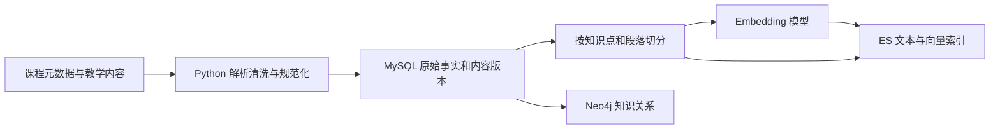

# RAG 与 Graph RAG 及题目检索

[返回开发计划](README.md)

## 第一版范围

普通 RAG、Graph RAG、题目快速搜索均纳入第一版，由 Python 后端封装成受控工具。Agent 根据任务选择工具，检索工具返回带来源的证据，Agent 再基于证据讲解、出题或诊断。

Embedding 由配置中的 `text-embedding-v4` 生成；Elasticsearch 保存文本、元信息和向量，并执行关键词、过滤及近邻检索；Neo4j 保存知识关系；MySQL 保存课程、题目、内容版本与学习业务事实。

这四个组件分别负责向量生成、内容检索、关系检索和业务持久化。ES 与 Neo4j 均可从规范化业务数据重建。

## 工具接口与分工

| 工具 | 主要输入 | 输出 | 使用场景 |
|---|---|---|---|
| `rag_retrieve` | query、course_id、concept_ids、top_k | 文本片段、来源、召回方式、版本 | 找定义、解释、例题和教学依据 |
| `graph_rag_retrieve` | query、course_id、seed_concept_ids、relation_types、max_hops、top_k | 知识关系路径及其关联文本证据 | 找先修、联系多个知识点、解释错因 |
| `search_exercises` | query、course_id、concept_ids、coverage、question_type、cognitive_type、difficulty、mode | 题目卡片、匹配依据、知识点、来源 | 找原题、找相似题、按条件选练习 |
| `get_concept_details` | concept_id | 版本化知识点详情 | 读取已确定知识点 |
| `get_knowledge_structure` | concept_ids、relation_types、max_hops | 结构化关系 | 展示知识图或检查具体依赖 |

`coverage` 明确区分题目覆盖任一目标知识点与覆盖全部目标知识点。未标注的难度保持未知，不能直接将数据集的 `cognitive_dimension` 当成难度。`mode` 支持 keyword 和 hybrid，空查询可以只执行结构化过滤。

所有检索工具都由服务注入并检查课程范围、会话状态和可见性，LLM 不能通过传入参数扩大权限。主 Agent 用于规划，知识点 Agent 用于教学，习题 Agent 用于选题和生成参考，评估 Agent 用于核对知识依据；检索出的教材不能被当作学生已经掌握的证据。

工具返回统一的 `RetrievalResult`：items、citations、channels_used、degraded、reason、timings。每项包含稳定 ID、course_id、concept_ids、source_ref、content_version、content_origin、evidence_kind；图证据另含关系类型、方向、路径和推断状态。ES 分数和融合分数仅用于排序。

## 离线构建

知识点说明、例题解析等材料按语义段落切分，保留标题、所属知识点、来源和偏移。公式与代码块尽量完整保留，超长内容分段并保留父文档引用。题干和选项作为一个题目检索单元，长解析单独作为受控材料块；不能将题干、答案、解析和学生作答混成一个向量。

课程元数据未提供知识点详细说明时，优先利用已有解析与有来源的教学材料。模型补充内容标为生成内容并保存版本，不因写入 RAG 索引而成为已核实资料。文本 embedding 不会理解图片像素；图题只能基于可用文字检索，缺少必要图示理解时不能声称已完成解题校验。

批量调用 embedding，每批不超过当前 v4 接口的 10 条限制，并控制每条长度。缓存键包含模型、维度、预处理版本及文本哈希；内容不变不重复向量化。失败条目可单独重试，索引任务保存进度和错误，不要求整库重做。

## ES 索引

第一版设置独立命名空间和两个索引，应用通过别名访问：

| 索引别名 | 内容 | 关键字段 |
|---|---|---|
| `stem_tutor_materials` | 知识点说明、教学材料、例题解析块 | chunk_id、parent_id、concept_ids、text、embedding、source_ref、origin、visibility |
| `stem_tutor_questions` | 题干、选项和查题元信息 | question_id、source_id、course_id、concept_ids、stem、options_text、question_type、cognitive_type、difficulty、embedding |

实体 ID、课程 ID、概念 ID、类型、来源和状态用 keyword 等结构化字段；中文题干及正文用 text 字段。默认从 ES 自带的 CJK 分析器开始，结合课程术语、别名和代码符号的独立字段做验证。当前 ES 没有安装额外插件，不能直接配置依赖 IK 或 ICU 插件的分析器。

向量显式映射为 `dense_vector`，`dims=1024`、`similarity=cosine`、`index=true`。HNSW 及量化参数根据本机 9.3.2 的实测确定，不沿用更新版本文档的隐式默认值。查询与文档必须使用相同模型、维度和预处理策略；更换模型即使维度相同也需要重建相应向量索引。

每条索引记录保存 content_version、embedding_model、embedding_dimensions、text_hash 和 index_schema_version。查询响应只返回需要的字段，默认不返回向量。参考答案不进入公开题目卡片，解析访问由后端决定。

## 普通 RAG 的在线流程

1. 校验课程和访问范围，识别题号、知识点名、公式、代码符号等精确信号。
2. 生成查询向量，与关键词 BM25 检索并行执行；结构化过滤同时施加于两条召回路径。
3. 按稳定 ID 去重，使用 Python 服务层的 RRF 合并排名；可选的小候选重排作为后续质量优化。
4. 在上下文预算内返回有来源的片段，由调用 Agent 组织回答并引用证据。

BM25 分数与向量相似度量纲不同，不直接做未经校准的相加。第一版使用排名融合：

\[
\operatorname{RRF}(d)=\sum_{r\in\{\mathrm{keyword},\mathrm{vector}\}}
\frac{1}{k_0+\operatorname{rank}_r(d)}.
\]

某路没有召回文档时，该路贡献为零。\(k_0\) 是平滑参数，可从 60 开始验证；它不会把排序分数变成正确率。当前 ES 为 Basic 许可，融合由 Python 实现，不将尚未验证的 ES 原生 RRF 能力设为依赖。

## Graph RAG 的在线流程

1. 根据明确的知识点 ID 或 ES 检索结果定位种子节点；同名概念在课程内消歧。
2. 在 Neo4j 中按白名单关系扩展，默认 1 跳，最多 2 跳，并限制节点和路径数量。
3. 将扩展出的知识点和题目 ID 映射回 ES 中的材料，取回真正的内容片段。
4. 按相关性、路径距离和来源状态筛选，返回文本与可解释的关系路径。
5. Agent 引用文本证据，并区分已确认关系与推断关系。

例如“虚位移原理和力的平衡有什么联系”：普通 RAG 可以找到两者的解释；Graph RAG 额外检索它们在当前课程中的关系与关联例题，用具体片段支持讲解。缺少关系证据时，不为了形成路径而补造边。

第一版采用课程知识图谱上的局部扩展检索。分类 `CONTAINS`、同题共现 `RELATED_TO`、题目考查 `ASSESSES`、先修 `PREREQUISITE_OF` 分别处理。旧推断先修关系只能作为带标签的参考，不能仅凭图邻接就降低学生掌握度或锁定学习路径。

Neo4j 使用参数化查询模板，Agent 只能传递种子、范围和关系类型，不能执行任意 Cypher。图查询返回一堆节点名称不算完成 Graph RAG；必须返回相关内容证据及来源。

## 题目的快速搜索

查题页通过 FastAPI 直接调用检索服务，不必先经过主 Agent 的模型推理。Agent 的 `search_exercises` 工具复用同一服务。

| 查询方式 | 路径 |
|---|---|
| 题号、原始 ID | keyword 精确查询 |
| 题干片段、关键词 | BM25 与短语匹配 |
| 选课程、知识点、题型 | 结构化过滤，可与关键词组合 |
| 描述题意、找语义相似题 | embedding 与 BM25 混合检索 |
| 根据已有题找相似题 | 复用已有题目向量，并排除原题和已知重复题 |

前端做短防抖与请求取消；接口限制页大小，按需要使用 search_after 游标。热门查询和查询向量可缓存，缓存键必须包含课程、过滤条件、内容版本和可见性；缓存命中后仍检查当前会话的答案可见性。

第一版不为简单搜索调用生成模型。高级混合搜索可能包含外部 embedding 延迟，需与 ES 查询耗时分别统计。“快速”通过真实题库的延迟和命中质量验证，而不是仅引用 ES 返回的 took。

## 一致性与答案可见性

内容变更先写 MySQL，并在同一事务中记录索引任务。ES 和 Neo4j 分别按实体版本消费并确认，失败可重试；只有两侧达到所需版本才将该版本标为检索就绪。异步索引延迟需要在状态接口中可见。

题目发给学生前冻结题目版本和答案契约。等待独立作答时，所有检索路径统一排除当前题及已识别重复题的答案与解析，包括 Graph RAG 扩展回来的材料。客户端传入 `include_answer=true` 不能解除限制。用户明确请求当前题讲解时，先将该次活动标记为辅助学习，再开放对应解析。

`content_origin` 区分原始资料、模型生成和已校验内容；`visibility` 控制可展示范围；两者不能互相替代。检索权限不是只在网页渲染时隐藏字段，而是在召回过滤、结果回取和工具上下文组装时共同执行。

## 故障与验收

Embedding 服务不可用时可以降级为关键词检索，返回实际 channels_used；Neo4j 不可用时返回图功能不可用，并可提供普通 RAG 结果；ES 不可用时可提供有限的数据库精确查询，但不能宣称完成混合检索。降级路径不伪造向量或关系结果。

在至少一门完整课程上先完成以下验收，再扩展到四门课程：

- 确认真实向量生成、ES 写入、关键词查询、带过滤的 kNN 和融合结果串通。
- 准备人工确认相关题目的查询集，覆盖精确题干、改写描述、同义词、公式、PHP 符号、多概念及无匹配请求；报告 Recall@10 和 MRR@10。
- 分别记录关键词、混合检索和 Graph RAG 的总耗时 p50/p95；拆出 embedding、ES、图查询和可选重排耗时，注明数据规模、并发和缓存状态。
- 验证课程过滤在 BM25、kNN 和图扩展中均生效；验证 any/all 概念覆盖条件及答案访问限制。
- 验证图返回的关系类型、方向、推断标记与最终文本来源对应；没有支持材料时降低结论强度。
- 验证重复导入、内容更新、删除、索引重建及两侧同步失败恢复。

## 当前验证与依据

2026-10-19 已实测：ES 9.3.2、单节点、green、Basic 许可、无额外插件；`text-embedding-v4` 一次请求成功返回两条 1024 维非零有限向量，约 0.73 秒、27 输入 Tokens。该测试仅验证服务连接和维度；尚未建本项目索引，也未验证实际题库搜索或完整 Graph RAG。

- [ES dense_vector](https://www.elastic.co/docs/reference/elasticsearch/mapping-reference/dense-vector)：显式向量映射与相似度。
- [ES kNN](https://www.elastic.co/docs/solutions/search/vector/knn)：向量检索与文档查询模型一致性。
- [ES 语言分析器](https://www.elastic.co/docs/reference/text-analysis/analysis-lang-analyzer#cjk-analyzer)：CJK 基础分析器与 ICU 插件区别。
- [阿里云文本向量 API](https://help.aliyun.com/en/model-studio/text-embedding-synchronous-api)：v4 模型的维度、批大小和请求协议。

本地检查记录：`data/reports/es_environment_probe.json`、`data/reports/embedding_probe.json`。后续索引和查询测试使用当前安装的 9.3.2 实测确认，不仅依赖滚动更新的在线文档。
