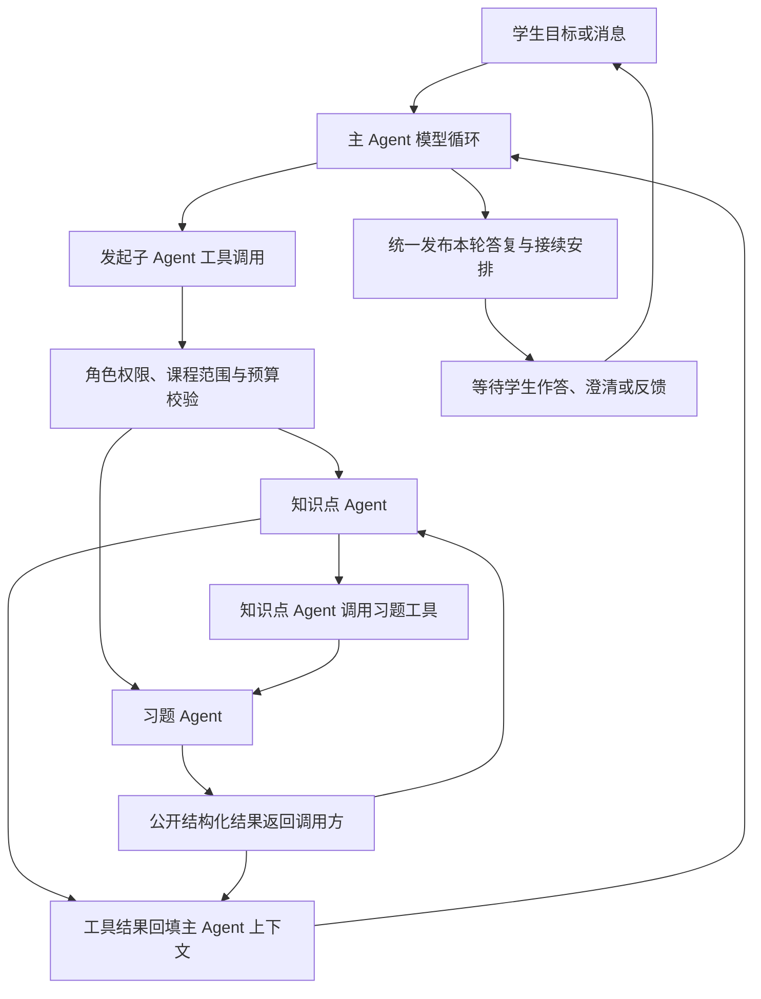

# 子 Agent 工具返回与主 Agent 接续

更新时间：2026-10-20（Asia/Shanghai）。

本轮将知识讲解、习题讲解和出题封装为受约束的子 Agent 工具。父 Agent 发起调用，等待子 Agent 返回公开结果，再在**同一个模型工具循环**中继续判断下一步。Python 后端继续使用本项目的运行时，没有引入 Pi 的 SDK、CLI 或进程依赖。

## 实际调用链



主 Agent 可以直接调用知识点或习题 Agent；知识点 Agent 需要练习或题解时，也可以调用习题工具，读取结果后继续完善讲解。子 Agent 完成不等于整个学习目标完成，最终面向学生的答复由 `supervisor` 统一发布。教学正文保留 `lesson`、`explanation` 等类型；单题的根展示消息使用 `exercise_delivery`，练习组使用 `exercise_batch`，网页按相应题卡展示。独立冻结的 `kind=question` 记录与面向学生的展示消息分开保存。

| 模块 | 职责 |
|---|---|
| [`application/agent/agent_tools.py`](../../backend/app/application/agent/agent_tools.py) | 注册委派工具，校验参数和角色权限，整理调用链轨迹 |
| [`agent/runtime/invocations.py`](../../backend/app/agent/runtime/invocations.py) | 使用任务局部上下文记录父运行、根运行、角色与深度 |
| [`agent/runtime/runner.py`](../../backend/app/agent/runtime/runner.py)、[`agent/runtime/loop.py`](../../backend/app/agent/runtime/loop.py) | 执行子角色，把工具结果按调用标识回填原调用方，再继续模型请求 |
| [`application/learning/delegation.py`](../../backend/app/application/learning/delegation.py) | 绑定当前会话的业务委派，提交出题效果、保存公开产物检查点，组织主 Agent 最终展示 |
| [`domains/learning/progress.py`](../../backend/app/domains/learning/progress.py) | 保存学习流程进度，与题目契约切换共同维护恢复上下文 |

模型看到的工具结果是可序列化的业务 JSON，而不是运行时对象。工具返回成功产物或错误信息后，由调用方继续选择行动；不再将“安排习题”仅作为未执行的自然语言建议。最终决策还需通过服务端可执行性校验，例如要求练习时必须已经实际准备题目，存在待答题时不能宣称目标完成。

## 权限、范围与预算

| 调用角色 | `call_knowledge_agent` | `call_exercise_agent` |
|---|---|---|
| 主 Agent | 允许 | 允许 |
| 知识点 Agent | 不允许 | 允许；新题限受委派概念，已有例题按精确记录授权 |
| 习题 Agent | 不允许 | 不允许 |
| 评估 Agent | 不允许 | 不允许 |

`call_exercise_agent` 支持选择原题、生成单题、生成练习组或讲解会话内习题。评估 Agent 仍由作答与评估服务调用，不作为模型可自由委派、可直接改写学生状态的工具。

- 课程、会话和学生身份来自可信 `ToolContext`，不允许模型参数覆盖；新题知识点范围与历史例题的讲解授权分别检查。
- 调用根深度为 0，最多经过两层委派：主 Agent → 知识点 Agent → 习题 Agent。不会让习题 Agent 再递归创建业务 Agent。
- 一次业务轮次合计最多 6 次子 Agent 委派；到达上限后，调用方依据已有结果结束或等待学生。每个 Agent 原有模型轮数、工具调用和超时预算继续生效，不要求用满预算。
- 同一父调用中的业务效果串行提交，嵌套调用使用各自的锁，避免父等子时共用同一把锁造成死锁。已有待答练习不能被新的出题调用覆盖。

当前教学知识点与一个已有例题的原始标签可能不同，不能仅凭两组标签没有交集就拒绝正常教学。父级可以通过服务注入的 `explanation_exercise_ids`，明确授权知识点子 Agent 讲解某条具体的冻结例题记录；子任务也可以讲解本次刚准备的例题。这是对**具体题解记录**的授权，不是扩大知识范围：新题仍受原 `concept_ids` 约束，不允许借例题标签生成范围之外的新题，不跨课程、会话或学生，也不允许模型自由拼接任意历史习题 ID 来取得授权。

冻结题目契约、标准答案字段及评估内部数据保留在后端，不进入通用公开工具结果和网页待答结构。公开结果只提供教学产物、公开题卡、来源、运行标识与等待状态。显式请求题解时，服务先标记辅助作答，再提供相应讲解，防止将看过题解后的回答记为独立掌握证据。

## 学习进度与等待点

会话公开返回可选的 `learning_progress`：

```text
objective        当前学习目标
status           awaiting_student / awaiting_clarification / completed
current_step     当前流程进度
next_step        接下来要做什么
completed_steps  已推进的流程步骤
```

知识讲解、检索或出题结束后，主 Agent 读取返回结果，更新当前进度并交代下一步。需要真实作答时保存 `awaiting_student`，需要确认目标时保存 `awaiting_clarification`，然后结束当前业务轮次，等用户输入后接续。这里的 `completed` 表示本次流程计划完成，不能由此推断学生已经掌握知识；掌握估计仍只接受经过校验的作答证据。

网页在原学习路径旁显示“当前进度”和“接下来”。`agent_returned` 事件说明子结果已返回，活动文案继续显示主 Agent 接续决策；知识点 Agent 内部调用习题 Agent 返回时，也不会把它显示为整个学习任务完成。旧会话没有进度字段时，继续保留原学习路径，不编造历史步骤。

这是一条有停止条件的教学流程，不是后台无限自动学习循环。系统不会替学生生成真实作答，也不会在等待状态下不断调用模型。

长期目标与当前步骤分开保存。真实验证还发现模型有时会仅为润色措辞而填写 `goal_update`，这会触发旧进度重置。现在更换整体目标必须同时提交 `goal_update_request`，引用当前用户消息中的更换要求；普通阶段推进只更新 `continuation`。此前这一问题的运行记录保存在 [目标保护前的验收](../../data/reports/agent_continuation_acceptance.before_goal_guard.json)。这条校验提供可追溯的用户原话，具体目标意图仍由主 Agent 理解。

## 会话归属与恢复检查点

业务轮次开始时通过行锁占用 `active_turn_id`，模型运行期间不持续持有数据库行锁。委派执行前后及产物提交时，再核对课程、学生、会话与当前 `turn_id`，防止失去会话归属的旧任务继续写入。

完成的子 Agent 公开产物保存在 `delegation_checkpoint`，以本轮 `request_id` 关联。父 Agent 后续失败时，使用同一请求标识重试可以复用参数一致的已完成产物，避免重新出题或重复运行相同子任务。题目状态切换保留流程进度与检查点，但不会延续旧题私有契约或过期澄清内容。

单题 `pose_contract` 将待答状态与一条独立的冻结 `Message` 在同一事务中保存：消息为 `kind=question`、`record_only=true`，包含本次公开题目快照，并在后端保留私有契约。根 Agent 最终发布的题卡消息为 `kind=exercise_delivery`。前端隐藏仅用于记录的消息，避免正常完成时出现两份题卡；若父 Agent 在出题后失败，还没有根展示消息，工作台仍通过 `pending_question` 兜底显示待答题，后续追问和评估继续使用该冻结版本。

检查点不是无限后台任务调度器，也不宣称任意进程崩溃下都能恰好执行一次。未完成的模型运行、未知外部效果与取消仍需按现有中断恢复规则处理；已保存的题目、证据和公开步骤是恢复依据。

## 真实验证暴露的边界与报告状态

首轮真实模型验收并未全部通过：A01 完成了知识子 Agent 返回主 Agent 的检查，A02 的“知识点 → 习题 → 知识点 → 主 Agent”嵌套返回检查失败。实际调用被过严的标签交集限制拦截，外层因此没有获得一次成功的习题委派。首轮记录保留在 [初次真实验收报告](../../data/reports/agent_continuation_acceptance.initial.json)，其中 `complete=false`；它不是完整成功验收，也不会被最终结果覆盖。

修正针对父级明确提供的冻结例题增加精确讲解授权，同时保留新题范围和课程、学生隔离。另增加一条“教学标签与例题标签不同”的本地回归，覆盖这次真实运行暴露的情况。

| 验证范围 | 当前文档记录状态 |
|---|---|
| 最终版本真实 Agent 验收 | 4/4 通过：知识点返回、真实嵌套返回、评估后接续、重复提交回放；源码指纹一致 |
| 完整隔离回归 | 174/174 通过，覆盖工具回传、嵌套返回、精确例题授权、冻结快照、检查点重试、旧任务围栏、目标保护及既有功能 |
| 前端 TypeScript 与生产构建 | 通过；包含进度展示和隐藏冻结记录后的待答兜底 |

后续结果以 [本轮真实验收报告](../../data/reports/agent_continuation_acceptance.json) 的完整运行状态、逐项结果与源码指纹为准。首轮失败与修正后重跑属于不同版本证据，不能混合统计。验证目标是有界的模型工具接续、学生等待点及恢复边界，不包括后台无限自动续跑，也不证明所有自然语言教学任务都能正确完成。

## 与 Pi 官方实现的关系

Pi 官方当前子 Agent 示例使用注册工具的 `execute()` 等待独立 `pi` 子进程，收集事件后返回 `content` 与 `details`；核心将结果包装成与原 `toolCallId` 对应的 `toolResult` 消息，加入父上下文并继续父循环。本项目采用这一“调用、返回、同轮继续”的控制方式，在 Python 内执行角色调用，没有照搬子进程方案。

- [Pi 子 Agent 执行与独立上下文](https://github.com/earendil-works/pi/blob/main/packages/coding-agent/examples/extensions/subagent/index.ts#L267-L424)
- [Pi 单任务工具结果返回](https://github.com/earendil-works/pi/blob/main/packages/coding-agent/examples/extensions/subagent/index.ts#L686-L711)
- [Pi 结果包装与调用标识](https://github.com/earendil-works/pi/blob/main/packages/agent/src/agent-loop.ts#L930-L944)
- [Pi 父循环继续与停止条件](https://github.com/earendil-works/pi/blob/main/packages/agent/src/agent-loop.ts#L258-L320)
- [Pi 工具结果内容、详情及终止提示契约](https://github.com/earendil-works/pi/blob/main/packages/agent/src/types.ts#L424-L445)

Pi 的普通工具返回不自动提供学习目标管理、学生等待点或业务数据库恢复。这些约束由本项目领域服务实现；也不依赖提示词来代替权限检查和掌握证据规则。以上为实现机制说明，具体测试结果由本轮独立验收记录提供。

## 本轮验证汇总与复现

[实现与验收汇总](../../data/reports/agent_tools_refactor_summary.json) 记录最终源码指纹、174 项隔离测试、前端构建和 4 项真实模型场景。真实嵌套路径为主 Agent → 知识点 Agent → 习题 Agent → 知识点 Agent → 主 Agent；最终验证还确认辅助作答不增加独立掌握证据，重复提交不增加 AgentRun。所有真实用例使用独立 `evaluation_*` 档案。原有 20 项力学模型评测是较早版本记录，本轮没有重新执行该完整集合。

在项目根目录执行：

```powershell
backend\.venv\Scripts\python.exe -m pytest backend\tests -q -c backend\pyproject.toml --basetemp=data/tmp/pytest-agent-tools
# 以下通过本机服务调用真实模型，创建独立验收档案。
backend\.venv\Scripts\python.exe scripts\evaluation\check_agent_continuation.py
```

真实验收脚本默认覆盖最终报告；需要保留旧运行时，先复制报告。模型结果仍有随机性，若新运行失败，应按具体工具回执排查，不能只把脚本再次运行到通过。
