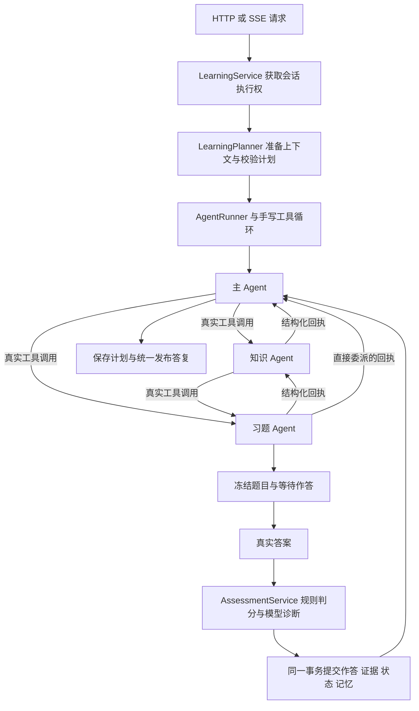
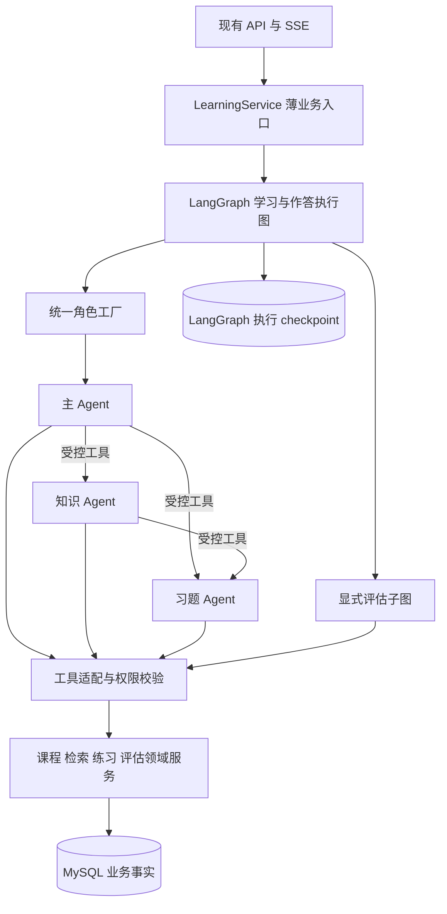

# Tutor Harness 框架迁移与简化计划

日期：2026-10-20。状态：**历史提案，实施范围已由 23 号统一简化计划取代，未实施**。

2026-10-23 更新：后续以[系统与数据库简化计划第 13 节](23_core_system_simplification_plan.md#13-langchainlanggraph-替换自定义-agent-底座)为准，保留六项核心能力，按 F0～F4 替换底座。本文中的评估预测反思子图、额外通用操作账本、旧规模预算和持久化扩张不自动纳入新范围；尤其不得据此恢复新计划 S09 已取消的呈题前预测。下文保留原提案以便追溯，不作为另一份并行实施清单。

本文保留 2026-10-20 的框架迁移提案，不代表框架替换已经实施。2026-10-21 至 22 完成的是目录和依赖方向重构，当前结构、回调和验证见[单向依赖说明](../learning_harness/14_dependency_direction.md)。源码链接已迁移到现有位置，不再保留过期行号。

## 1 结论与实施范围

**可以简化，但主要收益是减少自维护的执行机制和跨模块调用关系，不能承诺明显减少整个项目的文件数量。推荐以 LangChain `create_agent` 统一模型与工具循环，以 LangGraph 管理业务执行步骤和恢复；第一轮不将 Deep Agents 设为必需依赖。**

当前已经是四个业务角色共用一个执行器，并不是四套独立 Agent 系统。把这些角色换成四个框架配置，不会自动减少角色数量。真正需要替换的是模型工具循环、消息拼接、通用结构校验修复和部分执行状态管理；题目、评估、学习证据、权限和事务仍由领域服务负责。

默认实施以下主线：

1. 建立当前行为基线，验证模型适配器。
2. 在保持四角色行为的前提下替换通用 Agent 执行器。
3. 建立稳定操作标识和业务幂等，再把学习与作答流程接入 LangGraph。
4. 验证恢复、流式展示和真实模型行为后删除旧执行路径。
5. 将评估能力实现为参考 LEARNERCOMPASS 的显式 LangGraph 子图：先迁移现有评估行为，再单独验收粗粒度诊断、汇总与有界预测反思循环。该子图属于默认实施范围，具体规格见第 7.5 节。主 Agent 与知识 Agent 合并、完整引入 Deep Agents，仍为后续可选方案。

本计划延续本机个人使用、现有课程和学习记录的产品范围。保留 FastAPI、React、MySQL、Elasticsearch、Neo4j、现有题库与检索方式，不同时更换模型、向量模型、数据库或前端协议。缺失的课程能力不通过本次迁移顺带补齐。

本文的文件数量来自当前源码统计；目标数量是按下述目录设计推算的预算，不是迁移结果。性能与质量必须由实施阶段的对照实验确认。

## 2 当前项目的真实结构

### 2.1 源码规模

统计口径为 `backend/app` 内的 Python 文件，不含测试、技能 Markdown、前端、数据、缓存、虚拟环境和第三方依赖。行数包含空行与注释。

| 范围 | 文件数 | 行数 | 解释 |
|---|---:|---:|---|
| 后端应用全部 Python | 74 | 10,162 | 包含 12 个 `__init__.py` |
| 后端非初始化 Python | 62 | — | 更适合衡量业务模块规模 |
| 本次主要改造集合 | 20 | 3,582 | 清单见第 8 节 |

这 20 个文件包含一部分必须保留的领域逻辑，不能将 3,582 行全部计为框架可替代代码。其余文件大多处理课程、题库、评分、批量练习、检索、索引和数据模型。

### 2.2 当前调用链



这里的委派已经是真实执行：子 Agent 的结果返回发起调用的同一模型循环，父 Agent 可以继续调用工具并形成最终答复。迁移不能退回“主 Agent 输出 action，服务执行一次子任务后直接结束”的旧式分发。

| 现有组件 | 当前责任 | 对迁移的意义 |
|---|---|---|
| `agent/runtime/runner.py` | 角色运行入口、超时、AgentRun、调用链与事件 | 改为薄入口，审计另行保留 |
| `agent/runtime/loop.py` | 模型调用、工具回填、最终 JSON 校验与修复 | 最主要的框架替换对象 |
| `agent/runtime/tool_batch.py` | 并发、按位置分配预算、工具回执顺序、技能去重 | 框架执行工具，项目保留必要调度政策 |
| `application/learning/service.py` | 会话占用、消息、出题冻结、作答及接续 | 分离执行图与领域提交 |
| `application/learning/planning.py` | 主 Agent 输入、目标保护、计划校验和保存 | 删除循环胶水，保留领域校验 |
| `application/learning/delegation.py` | 委派权限、范围、去重、已完成回执、业务执行与展示 | 不能整体删除 |
| `application/learning/materials.py` | 来源重读、公开资料投影、版本哈希、传递回执 | 属于项目的证据与隔离规则，继续保留 |
| `application/agent/registry.py` | 工具描述、角色白名单、参数与范围检查、服务调用 | 用框架工具声明简化描述，保留实际执行检查 |
| `domains/assessment/service.py` | 规则与模型诊断结合、原子提交真实学习证据 | 不交给通用 Agent 任意写入 |
| `agent/runtime/streaming.py` | 仅提取允许公开的结构化正文字段 | 框架的原始 token 流不能直接替代 |

### 2.3 现有恢复能力和缺口

当前已经具备：

- 按消息 `request_id`、作答 `idempotency_key` 回放结果。
- `delegation_checkpoint` 保存部分已经完成的子任务。
- `active_turn_id` 检查，阻止若干旧任务继续提交计划和消息。
- 启动时标记中断，保留冻结题目、待答状态和学习进度。
- 浏览器断线后后台任务继续执行，业务事件与正式消息可恢复。

仍需处理的边界：

1. **作答提交后接续失败。** `continue_assessment()` 会保存 `continuation_error`；重试进入 `replay_continuation()`，主要回放已有记录，不等于自动补完未完成的后续安排。
2. **题目已经冻结，委派回执尚未保存。** 出题副作用与 `delegation_checkpoint` 写入不在同一事务，崩溃可能发生在两者之间。需要业务操作记录来辨认已完成效果。
3. **执行器中途状态。** 当前主要保存最终运行记录和已完成业务回执，没有通用的模型轮次和工具步骤 checkpoint。
4. **会话占用不等于完整租约。** 启动恢复会清除遗留占用；不得直接据此扩展为多 worker 恢复。
5. **写入围栏覆盖不一致。** 迁移时要逐个审查所有写入入口。例如单题评估提交目前检查题号与幂等，不能据此假定它已具备与计划、消息相同的执行权校验。

这些是源码级边界分析，不是本次已复现的故障报告。

## 3 三个框架分别承担什么

### 3.1 不是三套并列的调度器

```text
可选的 Deep Agents：成套的上下文、文件工具、技能和子 Agent harness
                       ↓
LangChain：模型、工具、结构化输出、create_agent、中间件
                       ↓
LangGraph：有状态执行、checkpoint、子图、恢复
```

Deep Agents 建在 LangChain 的 Agent 基础之上，并使用 LangGraph 运行时。因此不能分别再建“Deep Agents 调度器”“LangChain 调度器”和“业务自研调度器”三层相互调用。[Deep Agents 官方概览](https://docs.langchain.com/oss/python/deepagents/overview)

### 3.2 能力匹配与决策

| 能力 | 推荐承担方 | 项目仍需实现的内容 |
|---|---|---|
| 自主角色的模型与工具交替执行 | LangChain `create_agent` | 工具集合、预算政策、错误分类；评估子图按显式节点执行 |
| 工具描述与参数 schema | LangChain 工具、Pydantic | 严格参数兼容与领域范围校验 |
| 最终结构化结果 | 显式选择结构化输出策略 | 目标、题目、进度等语义校验 |
| 模型或工具调用上限 | 框架中间件加少量自定义政策 | 原有逐轮限制、全轮委派预算及最后修复机会 |
| 业务步骤 checkpoint | LangGraph | 稳定操作 ID、版本与恢复入口 |
| 论文评估流程 | LangGraph 评估子图与结构化模型节点 | 节点契约、循环终止、候选状态约束和最终领域事务 |
| 子 Agent 独立上下文与返回 | LangChain Agent 作为工具调用 | 受控角色拓扑、公开回执、资料授权 |
| 来源与题目隔离 | 当前领域服务 | 保留 |
| 真实作答、证据与掌握度 | MySQL 与评估服务 | 保留事务与证据规则 |
| 学习目标与跨轮进度 | `LearningSession` 与 `learning_progress` | 保留业务事实；不改成普通聊天摘要 |
| 公共流式文本 | LangGraph 事件加项目 SSE 投影 | 公开字段白名单、草稿失效、去重 |
| 技能加载 | 现有 `SkillLibrary` | 当前实现只有 43 行，优先保留 |
| 通用文件、Shell、开放式子代理 | 第一轮不启用 | 当前教学任务没有证明需要这些能力 |

`create_agent` 返回结构化结果时使用 `structured_response`。提供商原生结构化输出与 `ToolStrategy` 的行为不同，模型还必须支持工具与结构化输出的组合；不能只传一个 schema 就假定当前接口兼容。[结构化输出](https://docs.langchain.com/oss/python/langchain/structured-output)

框架有 `ModelCallLimitMiddleware`、`ToolCallLimitMiddleware` 等能力，但它们的计数范围和超限行为不自动等价于当前实现。[内置中间件](https://docs.langchain.com/oss/python/langchain/middleware/built-in)

### 3.3 为什么第一轮不以完整 Deep Agents 为默认

Deep Agents 对本项目有价值的部分是子 Agent、上下文管理、技能和较长任务的执行支撑。但是：

- 当前 43 行技能加载器与已有上下文裁剪，并不足以单独证明引入完整 harness 划算。
- 默认文件系统和通用子 Agent 要额外收紧；教学系统依赖的是受限领域工具。
- 普通子 Agent 上下文隔离不能替代当前“来源重读、版本检查、公开字段投影、准确例题授权”。
- 自动摘要、任务清单、文件记忆都不能成为掌握度或真实作答的事实来源。
- 自定义子 Agent 的 middleware 等配置不能假设自动继承，需要逐一核验。

官方当前文档提供默认通用子 Agent 的关闭方式、文件工具限制和子 Agent 结构化输出。具体参数依赖版本；实施时锁定实际安装版本，不能照搬旧教程的默认行为。[子 Agent 文档](https://docs.langchain.com/oss/python/deepagents/subagents)、[文件工具与限制](https://docs.langchain.com/oss/python/deepagents/overview#virtual-filesystem-access)

## 4 简化目标和判断标准

### 4.1 文件数量只能小幅下降

按第 8 节的紧凑目录推算：

| 指标 | 当前 | 推荐主线的目标预算 |
|---|---:|---:|
| 原核心集合及新增评估模块的非初始化 Python 文件 | 20 | 基础方案约 21；适配或模块拆分后可能为 22 至 24 |
| 后端全部 Python 文件 | 74 | 基础方案约 75；复杂适配后可能小幅增加 |
| 自维护的完整模型工具循环 | 1 套 | 0 套 |
| 正式运行中的 Agent 执行路径 | 1 套 | 切换完成后仍为 1 套 |
| 业务角色 | 4 | 保留四个业务名称；最终为三个自主 Agent 加一个显式评估子图 |
| API 对具体 Agent 执行机制的直接依赖 | 当前经 LearningService | 继续只经过薄业务入口 |

这里不把第三方依赖文件计入项目源码，但依赖升级、版本兼容和新增 checkpoint 存储仍是维护成本。

纳入论文评估子图后，新增三个有独立职责的 Python 模块，见第 8 节。因此原先仅替换通用运行时所估计的 20 到 18 个文件，不再代表本计划完整范围；本轮以执行机制清晰、领域规则可检查和恢复正确为简化目标。

如果唯一目标是“把 74 个文件压到几十个”，不建议为此做框架迁移。当前多数文件已有独立业务责任，机械合并会损害可读性。

### 4.2 复杂度应按责任衡量

可以用下面的关系做设计检查，而不将它当成精确评分模型：

\[
C_{\text{after}}
=C_{\text{domain}}
+C_{\text{framework integration}}
+C_{\text{remaining policy}}
\]

\[
\Delta C
=C_{\text{removed custom runtime}}
-C_{\text{new integration}}
-C_{\text{new duplicated state}}
\]

迁移有意义的前提是 \(\Delta C>0\)。如果旧循环、旧委派状态机、图状态机和 Deep Agents 的任务状态全部保留下来，再包一层适配器，通常无法满足这个条件。

实施后的简化验收：

1. 删除 `run_agent_loop` 生产调用路径，不再手工驱动完整模型与工具循环。
2. 一个角色只用一个配置入口声明提示、schema、工具和预算。
3. 一种业务事实只有一个权威写入位置。
4. 恢复流程不靠扫描聊天正文推断执行到哪一步。
5. 统计新增和删除的文件、行数、循环与状态结构，分别解释差值。
6. 不通过删测试、删注释、合并不相关文件来完成数字指标。

## 5 目标架构与 Agent 结构

### 5.1 推荐主线保留四个业务角色



这里简化的是结构：不再让业务服务知道 OpenAI 风格消息如何拼接、工具结果如何回填、循环如何推进。业务服务只知道“运行某角色并取得合约结果”。

角色权限维持如下约束：

| 角色 | 可委派角色 | 最终学生消息 | 直接提交学习证据 |
|---|---|---|---|
| supervisor | knowledge、exercise | 统一发布主答复 | 不允许 |
| knowledge | exercise | 返回教学产物，可流式展示公开草稿 | 不允许 |
| exercise | 无 | 返回题目、题解或生成结果 | 不允许 |
| assessment | 无 | 评估服务发布反馈 | 由评估服务校验并提交，不由模型提交 |

习题生成中的独立求解、答案冲突复核是固定的质量步骤，不需要升格为更多自主 Agent。继续使用独立调用上下文，防止“独立求解”读到生成器的答案。

### 5.2 默认实施的显式评估子图

**将 assessment 定义为一个对外稳定的业务能力，内部使用 LangGraph 组织程序节点与结构化模型节点。** 参考论文的 Assessment、Summary、Predict、Tracing 职责，执行第 7.5 节的节点与状态契约；不为这些内部阶段分别建立自主委派循环。

保留 `Prediction`、`Diagnosis`、`BatchDiagnosis` 的公开兼容投影。单题已有作答前预测继续在出题时执行和冻结；事后 Decoder 预测使用独立字段，不能覆盖它。规则判分优先、证据门控和一次原子提交继续由领域服务控制。

实施分为两个独立验收的步骤：先将当前评估迁移成等价图，再增加论文对应的独立归因、汇总、候选预测和反思节点。第二步可能增加模型调用；必须报告质量、延迟与 token 差异，不能将其描述为必然降低调用成本。

### 5.3 可选的主 Agent 与知识 Agent 合并

把 supervisor 和 knowledge 合并为一个 Tutor Agent，再保留习题 Agent 与评估服务：

```text
Tutor Agent ──受控调用──> Exercise Agent
     ↑                      │
     └────结构化回执─────────┘
真实作答 ──> AssessmentService ──> Tutor Agent 接续
```

可能的收益是减少一次委派与父模型接收结果后的综合调用；代价是主上下文更大、工具选择更多、教学与规划提示耦合。总延迟取决于实际模型次数和每次输入规模，不能预先保证下降。

该方案明确改变当前三层嵌套设计，不作为默认执行项。若以后选择它，需要同步：

- 合并两角色技能和公开工具，保留服务端范围控制。
- 以新的“教学产物 + 计划 + continuation”合约替代必须调用知识 Agent 的校验。
- 更新资料传递、审计角色和前端提示。
- 将原有嵌套行为测试改为新拓扑的等价业务验收，不能仅删除失败测试。

## 6 状态与恢复设计

### 6.1 三类状态明确分工

| 状态 | 权威存储 | 可以包含什么 | 不应承担什么 |
|---|---|---|---|
| 学习业务事实 | MySQL | 目标、进度、冻结题、真实答案、Attempt、证据、记忆、公开消息 | 不复制成可由模型随意改写的图字段 |
| 执行状态 | LangGraph checkpoint | 当前节点、模型消息、完成步骤、待提交产物引用、错误与恢复位置 | 不替代业务事务或访问权限 |
| 本次运行上下文 | 服务端构建的 runtime context | 学生、课程、会话、操作标识、角色、执行权和服务依赖 | 不接受模型指定身份，不持久化 ORM Session、锁、HTTP 客户端 |

框架的 `ToolRuntime` 支持注入模型不可见的上下文，但隐藏参数并不构成完整授权。每次工具执行、缓存回放和领域写入都仍需验证范围。[工具运行上下文](https://docs.langchain.com/oss/python/langchain/tools)

当前引用池 `DelegationMaterialStore` 含锁、临时引用和来源信息，不能直接放入 checkpoint。恢复后：

- 已完成子任务优先通过业务效果记录返回已保存回执。
- 尚未完成的资料引用根据持久化来源标识重新读取和验证。
- 无法重新验证的引用明确失效，让子 Agent 重查；不得信任 checkpoint 中任意正文自动恢复授权。

### 6.2 标识分工

建议引入稳定的 `operation_id`，把“业务操作”和“本次进程执行”分开：

| 标识 | 生成方式与作用 |
|---|---|
| `session_id` | 现有业务会话 |
| `operation_id` | 一条消息请求或一次作答对应的持久化逻辑操作，重试不变 |
| `thread_id` | 由服务端从 `operation_id` 派生的图执行标识，重试继续同一图 |
| `execution_id` | 每次实际执行或恢复生成，用于执行权与尝试记录 |
| `logical_invocation_id` | 一次逻辑角色调用，恢复前后稳定，用于子任务关联与预算 |
| `AgentRun.id` | 一次实际运行记录；与上述逻辑调用关联，保留重试审计 |
| `effect_key` | 一次业务副作用的稳定键，如冻结题、发布消息、提交证据 |

本项目已有会话历史作为事实源，因此推荐“一次业务请求一条图线程”。跨用户轮次从 MySQL 构建上下文，避免一条永久图线程无限积累内部工具消息。子 Agent 默认使用每次调用隔离的状态，不另建跨轮永久对话记忆。

`thread_id` 不能由前端任意传入并直接恢复。服务先检查所属会话、课程和学生，再解析具体操作。已有 `student_id` 范围控制也不应描述为已经实现了账号认证。

### 6.3 最小业务操作记录

在现有 `infrastructure/persistence/execution_models.py` 和迁移机制中增加两类记录即可，优先不引入额外通用工作流平台：

- `LearningOperation`：`id`、`session_id`、请求类型、请求键、规范化请求哈希、运行时版本、graph/schema 版本、状态、结果引用、执行权信息、错误摘要。
- `OperationEffect`：`operation_id`、`effect_key`、参数哈希、业务结果引用、状态与创建时间。

至少建立：

\[
\operatorname{Unique}(\text{session},\text{request kind},\text{request key})
\]

\[
\operatorname{Unique}(\text{operation},\text{effect key})
\]

相同请求键携带不同正文、题目或答案时明确拒绝；不能默默返回旧结果。

对生成题等副作用，应先确定稳定的子任务意图或步骤 ID，再执行。不可仅使用每次重试重新生成的模型 tool call ID。保留当前 `semantic_arguments` 的语义：改变选用资料不应被视为另一个出题任务；若确需再生成一题，使用明确的新业务步骤标识。

### 6.4 事务与 checkpoint 的关系

冻结题目、提交 Attempt、发布正式消息等写入，需要把业务事实和对应 `OperationEffect` 放在**同一个 MySQL 事务**内；checkpoint 在事务外保存。

重复执行满足：

\[
\operatorname{apply}(k,x)=
\begin{cases}
\text{返回原结果}, & k\text{ 已提交且参数一致}\\
\text{拒绝}, & k\text{ 已存在但参数不一致}\\
\text{提交事实和效果记录}, & k\text{ 尚未存在}
\end{cases}
\]

发生“业务提交成功、checkpoint 尚未写入”时，图节点可以再次进入，但必须读取效果记录并返回同一业务结果。这里保证的是业务副作用去重，不是保证网络请求或模型推理物理上只执行一次。

不要将“模型生成、预测、冻结、消息发布”全放在一个巨型节点中。对出题至少区分：

```text
选择或生成候选 → 校验或独立复核 → 作答前预测 → 冻结发布
```

节点产物使用可序列化值或受控业务引用；答案和内部契约只进入内部受限状态，不进入通用公开消息投影。

### 6.5 执行权与并发

第一轮仍按单后端实例运行，保留同一学习会话同时只执行一个写业务操作的限制。

- `LearningOperation` 的执行权与 `LearningSession.active_turn_id` 在事务内获取和释放。
- 所有写入事务核验当前执行标识；检查不能只放在调用模型前。
- 当前 `LearningTurnLost` 必须作为不可由模型修复的执行终止信号。
- 模型请求限流器只覆盖网络请求，不覆盖等待整个子 Agent 的时段，否则父等子时可能耗尽全部槽位。
- 工具并发槽位也不能由父委派持有后，再让子 Agent 等待同一批槽位；委派深度预算与底层查询并发额度分开控制，并测试父子嵌套时无死锁。
- 同一会话中产生题目、改变待答状态等副作用串行化；无副作用的查询可并发。
- 恢复和新请求竞争时，只有持有执行权的一方可以继续提交。

如果以后需要多个 worker，再加入持有者、到期时间、心跳和递增 fencing token，并使每次领域提交验证 token。不能继续使用“某个进程启动就清除全部运行占用”的策略。该扩展不纳入本机版首轮交付。

### 6.6 Checkpointer 选择

推荐先使用官方 `langgraph-checkpoint-sqlite` 的异步 saver，数据库放在专用的 `data/runtime` 文件中，服务启动和关闭统一管理连接。这适合当前本机、单进程的执行恢复；业务数据仍在 MySQL。

SQLite 是新增的执行存储，需要一起备份，并验证写入权限、重启恢复和锁竞争。第一轮不因为 checkpoint 改迁业务数据库。

官方提供 SQLite 与 PostgreSQL saver；不要假定业务 SQLAlchemy 引擎可以直接当 checkpointer，也不要假定存在已验证的官方 MySQL saver。若环境要求只能使用 MySQL，应单独评估社区实现的兼容性与维护成本，不能悄悄自写一套 saver 并仍宣称减少了维护代码。[Checkpointer 实现](https://docs.langchain.com/oss/python/langgraph/checkpointers)

关键写步骤采用所锁版本支持的同步 checkpoint 持久化模式；测试验证它的实际行为。即使使用 `sync`，跨 SQLite 与 MySQL 的事务空隙仍需第 6.4 节的业务幂等处理。[持久化模式](https://docs.langchain.com/oss/python/langgraph/checkpointers#durability-modes)

## 7 执行图与学生等待点

### 7.1 学习请求图

```text
加载与验证业务操作
    ↓
构建本次可信上下文
    ↓
主 Agent 子图
    ├─课程和资料查询
    ├─知识 Agent 工具 → 回执 → 主 Agent 继续
    └─习题 Agent 工具 → 回执 → 原调用方继续
    ↓
校验最终计划与所有业务效果
    ↓
提交计划和学习进度
    ↓
幂等发布正式消息与终态
```

Agent 内部的工具选择仍由模型决定，不为每一种自然语言意图设计固定图分支。外层图只明确需要恢复和提交的生命周期边界。

### 7.2 作答图

```text
验证请求键和冻结题目
    ↓
规则判分与诊断上下文
    ↓
评估子图计算和校验诊断与状态提案
    ↓
领域校验与评估事务
    ↓
幂等发布评估反馈
    ↓
主 Agent 接续子图
    ↓
幂等发布后续计划与消息
```

单题和批量题共用上述生命周期，具体判分与原子提交分别复用现有服务。批量题不要改成并行写入共享学生状态；需要保持同组答案、整组反馈和证据更新的一致性。

第一条恢复验收：在评估事务提交后、主 Agent 接续前中断；恢复只完成反馈和接续，不重复 Attempt、状态变化或错因记忆。

### 7.3 不强制把等待学生答案改为 interrupt

推荐第一轮保留现有产品协议：

- 题目冻结成功后，本次学习请求图结束。
- 学习会话保留 `awaiting_answer` 和冻结题目。
- 学生提交答案时创建作答操作图。
- 澄清问题同样保存在业务会话中，下一条消息形成新操作。

这种方式允许学生在答题前追问、查看历史题或跳过，避免把所有聊天强行变成某一个挂起图节点的 resume 数据。LangGraph 先解决服务器执行中断恢复，不必同时重写学生交互协议。

如果后续确有跨节点人工审批或必须恢复同一交互步骤的需求，再使用 `interrupt()`。恢复会从被中断节点开头重跑，之前的副作用必须幂等；不能吞掉框架的控制流异常。[Interrupts](https://docs.langchain.com/oss/python/langgraph/interrupts)

### 7.4 子图继承与可观察性

子 Agent 可通过工具调用独立 Agent 图，使用每次调用隔离并继承父 checkpointer 的方式。它并不意味着子 Agent 自动拥有跨用户轮次的长期记忆。[子图持久化](https://docs.langchain.com/oss/python/langgraph/use-subgraphs)

还要注意：藏在工具函数中的子图不一定能由 `get_state(subgraphs=True)` 静态发现。官方对该限制有说明。因此不能把 LangGraph 状态查看接口当作唯一子调用审计来源；继续保留 `AgentRun`、`agent_returned`、父子调用 ID 与业务效果记录。[子 Agent 模式](https://docs.langchain.com/oss/python/langchain/multi-agent/subagents)

阶段验收必须真实中断两层嵌套，检查恢复、namespace 和已完成回执。若封装方式无法满足所需恢复，调整子图接入边界，不能回退为重复出题或把子任务结果直接当最终回复。

### 7.5 参考论文的显式评估子图规格

本节为默认实施规格，依据 LEARNERCOMPASS 第 3.2 节、Figure 6、附录 A.2.1 和 A.2.2，分别位于 PDF 第 4、16、15 至 18 页，纸面页码 9019、9031、9030 至 9033。源文件为 [LEARNERCOMPASS 论文](C:/Users/admin/Desktop/论文/26年9月/2026.acl-long.408.pdf)。

论文提出 Assessment 与 Summary 组成的粗粒度 Encoder，以及 Predict 与 Tracing 组成的细粒度 Decoder。本方案采用这些职责和条件迭代结构；执行预算、证据门控、幂等和事务规则属于本项目的工程约束，不是论文规定的阈值。仅完成这些节点，不足以宣称完全复现论文或已取得相同诊断效果。

#### 7.5.1 现状与改造目标

当前单题 `predict()` 是独立模型运行，在冻结出题前执行；`diagnose` 的一次模型运行同时输出诊断、`reflection` 和 `suggested_delta`。这不构成独立反思阶段，也没有修正后重新预测的循环。整组当前使用一次 `batch_diagnose`，关闭工具调用，每题 `prediction=None`。

目标是：程序决定节点顺序、循环和写入资格；模型执行有明确输入输出的归因、汇总、预测和修正任务。默认通过显式证据检索节点获取依据，不再让评估模型自由决定是否执行提交或跳过校验。

四个模型阶段均使用统一模型适配、审计和限流能力。它们是评估子图内部函数，不是四个可自主创建子任务、改变目标或操作数据库的 Agent。确有额外检索需求时，经程序校验概念 ID 后进入有预算的只读检索，不扩大当前学生、课程与会话范围。

#### 7.5.2 作答前预测与事后校正分开

作答前链路继续放在学习操作中：

~~~text
加载题目与作答前学生状态 → predict_before_answer → 冻结题目和 prior_prediction
~~~

| 节点 | 类型 | 输入 | 输出与约束 |
|---|---|---|---|
| `load_prior_context` | 程序只读 | 可信身份、题目或练习组、当前学生状态与版本 | `PriorPredictionPacket`；历史截止到当前作答之前，不含本题本次真实答案或事后结果 |
| `predict_before_answer` | 结构化模型 | 上述包中按白名单构造的题目信息、学生状态与允许的历史 | `PriorPrediction`：题号、二值预测、简短依据、观察版本、生成时间和模型运行 ID；由既有冻结事务保存 |

参考答案可作为仅服务端可见的题目属性帮助理解考查内容；禁止进入的是本次学生回答与其实际得分。预测输入和参考答案均不得通过公开 SSE 或主 Agent 通用上下文泄露。

事后链路的所有预测另存为 `candidate_predictions`。其输入中的候选状态已经受到本次作答影响，即使模型没有直接读取真实答案，它也只能用于内部校正；不得作为作答前准确率、学习效果或新增掌握证据。已有 `prior_prediction` 永不覆盖。

旧单题或旧练习组缺少作答前预测时，保存 `prior_prediction=null` 和 `prior_missing_reason`。可以进行事后候选预测，但不能倒填历史预测，不能编造“作答前已预测”的偏差。

#### 7.5.3 事后评估子图

~~~mermaid
flowchart TD
    A[load_assessment_packet] --> B[load_evidence]
    B --> C[grade_response]
    C --> D[assess_causes]
    D --> E[normalize_observation]
    E --> F[summarize_state]
    F --> G[project_and_validate 初始候选]
    G --> H{存在可比较的合法候选}
    H -->|否| N[finalize_proposal]
    H -->|是| I[predict_candidate]
    I --> J[compare_and_route]
    J -->|继续且有预算| K[trace_adjustment]
    K --> L[project_and_validate 修正候选]
    L -->|未终止| I
    L -->|无合法更新或状态循环| N
    J -->|一致或达到停止条件| N
    N --> O[commit_assessment]
    O --> P[publish_feedback]
    P --> Q[外层主 Agent 接续]
~~~

非法身份、错误题目或复用键携带不同答案，在第一个节点拒绝；此时不进入模型。`ungraded`、低置信度或辅助作答可以保留诊断与反馈，但不进入掌握状态校正分支。

#### 7.5.4 节点职责与输入输出

下表的包、提案和回执是需要新增的内部类型，不能直接当作现有公开 API 返回对象。单题也采用按 `question_id` 索引的数据结构，便于与批量共用校验。

| 节点 | 类型与职责 | 主要输入 | 主要输出与不变量 |
|---|---|---|---|
| `load_assessment_packet` | 程序；验证请求、执行权和冻结题 | 服务注入身份、operation、提交键、真实答案、冻结题引用 | `AssessmentPacket`：答案哈希、题目版本、稳定题序、原始学生状态和版本、prior 引用；已完成操作直接回放结果 |
| `load_evidence` | 程序与受限只读检索；构造诊断依据 | Packet 中的已授权知识点、真实历史证据、题目来源 | `EvidenceBundle`：证据 ID、公开来源与版本、关系类型、缺口；分类和共现关系不能充当先修因果证据 |
| `grade_response` | 程序；先运行确定性判分 | 冻结题、真实答案、现有判分规则 | 每题 `ObjectiveVerdict` 或 null；有规则时保存结果、分数、依据与判分置信度，无规则不伪造客观结论 |
| `assess_causes` | 结构化模型；对应论文 Assessment | 题目、真实作答、规则结果、EvidenceBundle、原始状态 | 每题 `CausalDiagnosis`：暂定结果、反馈、观察到的错误、先修假设、层级、诊断 confidence、受限 suggested_delta、引用；先修权重只作解释提案 |
| `normalize_observation` | 程序；确定权威观察与资格 | 规则结果、CausalDiagnosis、题目标注、请求层级 | `ObservedVerdict` 与 `EligibilityReport`；规则覆盖模型分数，非客观低置信度降为 ungraded，限制可更新概念与层级 |
| `summarize_state` | 结构化模型；对应论文 Summary | 归因、权威观察、历史证据、原始学生状态 | `CoarseStateProposal`：概念与层级的五档候选或 unknown、依据和诊断置信度；不能替换规则结果或直接写掌握度 |
| `project_and_validate` | 程序；初始候选和每次修正共用 | 粗粒度或 Tracing 提案、原始状态、证据资格、已提交规则 | `FeasibleCandidate`：逐题净提案账本、按固定题序重放的可实施状态、拒绝理由、状态与账本哈希；无资格维度保留原值，unknown 不转 0 |
| `predict_candidate` | 结构化模型；对应论文 Predict | 题目白名单、FeasibleCandidate、截至作答前的允许历史 | `CandidatePrediction`：候选 ID、逐题二值预测、运行 ID、输入摘要；不接收真实答案、得分、诊断全文或反思记录 |
| `compare_and_route` | 程序；比较并决定边 | 候选预测、ObservedVerdict、候选历史、剩余预算 | `MismatchReport`、最佳候选引用、停止原因或继续标识；模型不能自己决定无限重试 |
| `trace_adjustment` | 结构化模型；对应论文 Tracing | 已评测 best、权威结果、偏差、已验证依据、至多两条本操作反思历史 | `AdjustmentProposal`：题号、概念、层级、方向与幅度、证据 ID、简短理由；不改答案、评分、身份或冻结题 |
| `finalize_proposal` | 程序；选择最终结果并做提交前准备 | 已评测 best 或安全基础账本、基础诊断、拒绝理由与停止状态 | `FinalAssessmentProposal`：兼容 Diagnosis 或 BatchDiagnosis、最终逐题账本、内部校正摘要；没有完成候选预测时标明未评测 |
| `commit_assessment` | 程序与一个短事务；唯一领域提交 | 最终提案、提交键、原始版本、effect key、执行权 | `AssessmentReceipt`：Attempt、实际 state_updates、错因记录、待答状态、效果回执；已提交时返回同一结果 |
| `publish_feedback` | 程序；公开结果投影和交付 | 已提交回执、兼容公开 schema | 原有评估反馈与公开事件；原始内部契约、候选向量、Tracing 全文不进入 SSE；主 Agent 接续交给外层图 |

每个模型阶段都必须校验题号集合与预期集合完全一致，拒绝遗漏、重复和新增题号。普通格式修复留在当前节点的有限调用预算中，不将格式错误误当作一次 Tracing 反思。

#### 7.5.5 图状态与信息隔离

在 `schemas/assessment.py` 定义内部结构和版本。至少包含以下字段组：

| 字段组 | 必要内容 | 写入与用途 |
|---|---|---|
| 逻辑身份 | `operation_id`、`session_id`、`graph_version`、`policy_version`、稳定题序、请求哈希 | 服务设置；模型不能变更 |
| 输入快照 | 受限题目引用与版本、答案引用或受限值、`original_state`、`student_state_versions` | 本操作不覆盖；最终提交检查版本 |
| 两类预测 | `prior_predictions`、`prior_missing_reason`、`candidate_predictions` | 分别记录冻结预测与事后运行，禁止互相回填 |
| 诊断产物 | 规则结果、`observed_verdicts`、`causal_diagnoses`、`coarse_state_proposal`、引用 | 节点结构化输出；带来源和运行 ID |
| 候选与循环 | `initial_feasible_candidate`、`current_candidate`、`best_evaluated_candidate`、`safe_base_ledger`、`candidate_hashes`、`reflection_history`、`reflections_used` | best 初始为 null；候选含逐题账本，分析状态不等于 StudentState |
| 资格与预算 | `eligibility`、拒绝原因、实际模型请求计数、已消费执行时间、`termination_reason` | 程序维护并 checkpoint；恢复不清零 |
| 提交与交付 | `final_proposal`、`commit_receipt`、`feedback_effect_key` | 提交成功后才出现实际应用结果 |

不能把整个图 state 序列化为每个模型的 prompt。为四个模型阶段分别编写输入投影函数，并用模拟模型记录输入验证。Predict 的上下文不包含当前实际回答、ObservedVerdict、带结果的摘要、反思历史或候选选择的目标标签。

候选状态含本题作答推导信息，所以这种输入隔离只能保证任务分工，不能把事后预测变成独立测试。`prior_prediction` 才能用于真实的作答前预测评估。

内部 checkpoint 可能包含敏感的题目答案与学生回答，按后端内部执行数据处理，不开放任意 state 查询给浏览器。只记录结构化提案与简短证据理由，不保存模型隐藏思维；所有原文和正式结果仍保留现有业务权限。

#### 7.5.6 观察结果与候选评分

真实业务结果保持 `correct / partial / incorrect / ungraded` 和原 score。按论文附录二值“能否完整答对”的定义，Decoder 的内部比较使用：

\[
y_i=
\begin{cases}
1, & \text{result}_i=\text{correct},\\
0, & \text{result}_i\in\{\text{partial},\text{incorrect}\},\\
\text{unknown}, & \text{result}_i=\text{ungraded}.
\end{cases}
\]

partial 映射为 0 只用于本子图的完整答对比较，不修改其真实评分，不按 incorrect 的规则更新状态。unknown 不参与偏差计算；辅助作答、低诊断置信度和无合格更新维度也不参与状态拟合，可保留其诊断反馈。

对可比较题集合 \(\mathcal E\)，定义内部偏差：

\[
L_k=\frac{1}{|\mathcal E|}\sum_{i\in\mathcal E}
\mathbf 1[\hat y_i(\theta_k)\ne y_i].
\]

当 \(\mathcal E=\varnothing\) 时直接退出校正分支，不能把损失设为 0 再声称预测一致。该 \(L_k\) 是本次已知作答的内部一致性指标，不是学习效果或预测校准指标。

初始合法候选先保存为 initial_feasible_candidate，仅当其 Predict 成功且题号校验通过时，才设为 best_evaluated_candidate，后文简称 best。后续候选只有在偏差严格下降、且没有把上一最佳候选已经正确预测的题改错时，才替换 best。相同偏差保留旧 best，并将本次提案与拒绝原因供下一次 Tracing 参考。

每次 Tracing 都从已评测 best 及其账本出发，而非从已拒绝候选继续累加；current_candidate 只是本轮待评价产物。无变化相对 best 判断，已拒绝候选只进入历史。重复状态哈希按 Predict 实际可见的规范化状态计算，不纳入运行 ID、理由文字或迭代次数；账本另有哈希用于提交和对账。

normalize_observation 成功后，立即按现有基础诊断和领域规则构造 safe_base_ledger，独立于 Summary 与候选 Predict。若预算在 Summary 或首次 Predict 完成前耗尽，finalize 使用该基础账本并记为 `candidate_not_evaluated`；不把未评测候选标为一致或收敛。若缺少合法基础诊断，则操作失败，不提交掌握度。基础设施失败的重试语义仍按第 7.5.7 节处理，不能自动伪装成预算降级。

Predict 仍存在模型随机性。固定模型、温度和输入版本，只对每个候选运行一次；不因单次一致宣称找到真实认知向量，也不通过重复采样直到碰巧一致来选择候选。停止时即使 best 仍有偏差，也返回 `unresolved_mismatch` 和补测建议。

#### 7.5.7 循环终止条件与预算

以下是本项目首轮工程默认值，配置与实际使用值必须记录到操作审计中：

| 条件 | 默认值或判定 | 结果 |
|---|---|---|
| 全部可比较题一致 | `L_k=0` | `prediction_consistent`；结束内部校正，不标记长期目标或知识点已掌握 |
| Tracing 上限 | `max_reflections=2` | 最多两次反思、三次候选预测；到限返回 `reflection_limit` |
| 连续无改进 | 两次合法提案均未改善 best | `no_improvement`；保留最佳合法候选 |
| 无变化 | 所有可比较数值维度的最大变化小于 `1e-3`，且 unknown 集合不变 | `no_state_change`；停止，无需再次预测同一候选 |
| 重复状态 | 候选的规范化哈希已出现 | `cycle_detected`；停止，不在两个向量间循环 |
| 无合法提案 | 资格门控全部拒绝，或投影后没有受支持的可变维度 | `no_supported_update`；仅交付诊断与允许的业务记录 |
| 无可比较观察 | 全部 ungraded、辅助作答或诊断证据不合格 | `no_comparable_evidence`；不运行或不继续 Decoder |
| 模型请求上限 | 整个事后评估子图最多 8 次实际模型请求 | `budget_exhausted`；单题和一组最多 6 题都共享此上限 |
| 总执行时间 | 子图累计实际执行预算 240 秒，与外层更小预算取最小值 | 到预算前停止新调用，保留已校验产物；节点不得各获 240 秒 |
| 基础设施失败 | 模型不可用、取消、执行权丢失等 | 节点失败或中断；保存可恢复状态，不伪装为诊断收敛 |

正常最大事后模型阶段为：Assessment 1 次、Summary 1 次、候选 Predict 最多 3 次、Tracing 最多 2 次，共 7 次。第 8 次留给一次格式修复或网络重试；所有实际发出的重试都计入 8 次总额度，不叠加默认 SDK 多次重试。作答前预测属于出题操作的独立预算，报告成本时仍计入完整学习链路。

另设整个子图 `max_output_repairs=1`，节点不得各自再获得一次修复。网络重试也占用实际请求额度；剩余额度不足以完成后续阶段时，按已验证产物收尾或明确失败，不超额补齐完整循环。

预算计数必须在发送请求前预留，checkpoint 落后时通过稳定的步骤尝试记录对账；未知是否成功的请求保守计费，不在恢复时赠送新额度。执行时间采用固定的累计运行计时策略，停机和等待学生不计入实际运行时间，但已经消费的时间不得清零。LangGraph 自身递归上限另作防错兜底，不当作业务反思次数。

程序用量到限且已有有效基础诊断时，可进入 finalize，标记未解决偏差；候选预测未完成的修正不得成为 best。若连合法诊断都没有，不提交掌握度，保留失败状态供恢复。执行权丢失和取消必须向外传播，不能转成可由模型修复的普通工具错误。

多个停止条件同时命中时，执行权丢失、取消和基础设施失败优先传播；正常收尾依次选择：无可比较证据、无合法更新、已有完整预测的一致、状态重复或无变化、连续无改进、反思次数上限、请求或时间预算。记录其他同时命中的条件，主停止原因只取一个。请求发送前仍需先检查剩余预算，不能因该优先级额外发起调用。

#### 7.5.8 候选状态与正式状态更新规则

论文的 Summary 对三个认知层次给出五档标签；按正文映射为 \(0,0.25,0.5,0.75,1\)。本项目只将这些值保存为 `coarse_state_proposal`。缺少某层次的观察证据时允许 unknown，不能为了填满论文示例而补成 0。

正式更新仍沿用 `StudentService.apply_evidence` 的证据规则：

1. 辅助作答、ungraded、诊断 confidence 小于 0.8，不新增掌握证据；规则判分可信不等于概念诊断同样可信。
2. 同题不重复形成独立证据。循环次数、节点次数和模型反思不能增加独立题数量。
3. 只更新服务选定、属于冻结题 contract 的有效目标知识点，以及本题支持的认知层级。原始题目类型未知时，用户选择的层级只是上限。
4. Tracing 提出的其他先修薄弱点先保留为假设或补测建议；未经直接证据验证，不顺带更新其掌握度。
5. 同题首份合格证据沿用现有初始化：correct 为 0.5、partial 为 0.25、incorrect 为 0；每个知识点第 1 份独立题证据上限 0.5，第 2 份上限 0.8，更多证据上限 1。
6. 已有数值时，correct 的单次变化限制在 \([0,0.2]\)，partial 限制在 \([-0.05,0.05]\)，incorrect 限制在 \([-0.2,0]\)，并限制结果在 \([0,1]\)。这些是现有工程规则，不是论文的校准结论。

对于已有数值的合格维度，先从相对原始快照的净提案得到 \(\Delta\)，再执行：

\[
\theta_{\mathrm{next}}
=
\min\!\left(
c(n+1),
\operatorname{clip}_{[0,1]}
\left[\theta_0+\operatorname{clip}_{I(r)}(\Delta)\right]
\right),
\]

其中 \(\theta_0\) 始终为本次操作开始时的正式值，\(I(r)\) 是上述结果对应的变化区间，\(c(1)=0.5,c(2)=0.8,c(n\ge3)=1\)。unknown 走明确的首证据分支，不代入该式当作 0。当前实现的证据数量口径仍是每知识点，不擅自改成每层级计数。

将资格与数值约束抽取为可复用的纯计算函数，供 project 和 commit 共用，先以已有测试证明与当前逻辑等价。迭代中每个候选都相对同一原始快照做投影，不能每轮再增加 0.2，使单次作答累计超过限幅。

Tracing 与候选必须维护按 `(question_id, concept_id, level)` 索引的逐题净提案账本。每项包括权威结果引用、诊断 confidence、建议 delta 或明确的首证据分支、证据资格与拒绝原因。兼容层只把通过资格的条目转换成当前诊断与更新参数。同一题对同一知识点默认只应用一个受支持层级；若按知识点分别调用 apply_evidence，必须处在同一外层事务且保证组合去重。不得将一个知识点的 delta 无差别广播到所有目标。

单题按本操作原始快照计算净变化；批量则从原始快照开始，按固定题序重放同一账本，每题以轮到它时的模拟状态执行现有规则。聚合向量只是重放结果，相对原始快照的全局净变化只用于审计，不能作为全部题目的共同 delta。两道题的正负更新即使抵消，也仍是两份独立真实题证据，不能因最终向量不变而丢弃账本。commit 必须消费该账本并取得与 preview 相同的逐题 state_updates。

如果所有数值提案被拒绝，仍可保存真实 Attempt、诊断与规则允许的错因记录，`state_updates=[]`；不能抬高 confidence、改变正确性或扩大目标范围以绕过门控。论文粗粒度数值与最终持久化数值可能不同，公开反馈必须使用实际应用结果。

#### 7.5.9 单题与整组的执行语义

单题使用题号列表长度为 1 的相同契约。整组默认保持一次 Assessment、一次 Summary；每个 Predict 和 Tracing 节点在一次结构化请求中处理本轮题目集合，不扩展为每道题各自 7 次模型调用。

- Packet 中冻结题序，模型阶段按题号校验完整性。使用每题候选预测、每题资格与偏差，不能只返回一个笼统正确率。
- Tracing 只对存在偏差的题提出原因与有证据支持的修正；共享状态发生改变后，Predict 必须重新检查全部可比较题，防止改善 A 题却破坏 B 题。
- 候选构造采用与最终事务一致的稳定题序，逐题纯计算模拟实际 apply_evidence；相同概念的多份真实题证据按该顺序处理。每次循环从原始正式快照重新模拟，不在上次候选上叠加本组全部证据。
- 不并行写同一个 StudentState。可以并行执行无共享副作用的依据读取，模型和最终状态演算仍遵守整个操作预算。
- 部分题 ungraded 时保留其真实诊断与当前批量待答语义，只对其余合格题形成提案；不能把未判定题当作答错。整组请求格式无效时按当前规则拒绝，不提交部分结果。
- 旧批次没有 prior 仍可继续；新批次可以在出题阶段补充批量作答前预测并冻结，但不得在本次作答后生成一个预测冒充 prior。
- 逐题诊断完成只表示内部产物已完成。所有 Attempt、状态、错因、BatchSubmission、消息和待答状态仍按当前整组事务一起提交，失败整体回滚。

#### 7.5.10 原子提交与失败恢复

commit_assessment 必须再次核验会话执行权、冻结题版本、答案哈希、StudentState 版本和幂等记录。状态版本变化时不得将旧净提案直接应用到新状态；暂停提交并在原剩余预算内重新加载与计算，无法重算则返回明确冲突。

单题保留原有 Attempt、掌握证据、错因记忆和待答状态的一次事务；整组继续保留 BatchSubmission、逐题记录、学习状态和已有正式消息的同一事务。对应 OperationEffect 与业务记录一起提交，不能拆成“存答案、存掌握度、存记忆”三个独立写库节点。

图 checkpoint 可保存每轮 proposal_only 产物与已消费预算，但领域读取只认正式业务表。崩溃恢复复用已完成节点；commit 已成功、checkpoint 尚未保存时返回原回执，不再运行反思或重复应用 delta。publish 与主 Agent 接续失败只补交付，不重做评估事务。

对于停止时仍不一致的案例，保存 `termination_reason`、最佳合法候选与实际提交变化，反馈建议补测或澄清，不宣称“已得到精确认知向量”。完整重放使用 operation、graph、policy 和题目版本，不能把新版本图直接套到不兼容旧 checkpoint。

#### 7.5.11 输出兼容与质量判断

新内部契约通过适配产生当前 Diagnosis、BatchDiagnosis 和评估响应；新增校正审计保存在受限运行记录或版本化内部 metadata 中。前端依旧得到真实判分、反馈、实际 state_updates 和下一步建议，不直接展示原始候选状态或模型工具参数。

审计至少区分 Assessment、Summary、candidate_predict、Tracing 四类 phase、各自模型运行 ID、候选 ID、真实调用次数、停止原因、提案与实际更新差异。prior 的准确率仅用冻结的作答前预测计算；内部 \(L_k\) 只用于诊断，不与其混合统计。

若需要证明认知诊断改善，采用后续不同题目的真实回答进行验证，记录题型、概念覆盖与辅助作答条件。没有新题或留出样本时，只能报告当前已知作答的一致性和流程行为，不能以反思次数、五档数值或内部预测吻合证明掌握提升。

#### 7.5.12 实施与验收顺序

P5A 先把当前 predict、diagnose、规则校验、原子提交和反馈接续迁移成等价节点，保持既有调用次数与领域结果。P5B 再加入独立 Assessment、Summary、候选投影、Predict 和 Tracing，验证本节全部契约。两步使用不同源码指纹和验收报告。

新增 `test_assessment_graph.py` 与 `test_assessment_state_policy.py`，测试外部可观测行为而非函数调用顺序的机械镜像：

| 用例 | 核心断言 |
|---|---|
| AG01 预测信息隔离 | 模拟模型记录四阶段输入；Predict 看不到真实回答或反馈，Tracing 可以读取授权的偏差 |
| AG02 两类预测 | prior 不被候选覆盖；无 prior 的旧批次仍可提交且标明来源 |
| AG03 显式阶段 | Summary 真实读取 Assessment 产物，Tracing 读取已完成候选预测；不是一个 JSON 字段冒充多个阶段 |
| AG04 候选一致或无资格 | 一致时停止，全部 ungraded 或不合格时不运行状态拟合；一致不写“已掌握” |
| AG05 有界循环 | 最多两次 Tracing、三次候选 Predict、八次实际模型请求；错误修复和重启不重置计数 |
| AG06 停滞与重复 | 无变化、重复候选、两次无改进都能结束；拒绝后从 best 继续，多个停止条件的优先级确定 |
| AG07 净变化与未知 | 多轮提案不累计突破单次限幅；unknown 不转 0，五档候选不直接覆盖正式值 |
| AG08 更新范围 | 辅助、低置信、重复题无新增证据；先修假设和未验证层级不被写入 |
| AG09 真实判分 | partial 的内部二值比较不改变原 score 和结果；规则判分始终覆盖模型冲突 |
| AG10 批量共享状态 | 共享知识点按同一逐题账本模拟与提交；正负抵消不丢证据；改善一题却破坏已匹配题时不替换 best |
| AG11 原子与重放 | 提交后崩溃只返回原回执；任一证据写入失败整组回滚，模型中间节点不写掌握度 |
| AG12 并发与冲突 | 原始学生状态版本或执行权变化时拒绝过时提交，不能默默重放旧 delta |
| AG13 公开结果 | SSE 与主 Agent 只得到兼容公开投影；模型运行日志含 phase，不含隐藏思维 |
| AG14 未评测候选 | 首次 Predict 前预算到限使用安全基础账本并标明未评测；无合法基础诊断时失败 |

真实模型验收至少包括客观正确、部分正确、错因不明、先修假设、辅助作答、无历史状态、单题和共享知识点批量题。分别报告 P5A 行为等价与 P5B 诊断质量、成本和耗时；框架接入成功不能代替论文机制验证。

## 8 文件级改造清单

以下 20 个文件构成本次统计集合；其中“删除”均以替代路径通过验收并且生产引用清零为条件。

| 当前文件 | 处理方式 | 最终责任与删除条件 |
|---|---|---|
| `agent/runtime/runner.py` | 替换为 `runtime/agents.py` | 统一角色工厂和调用入口；不再自己推进模型工具循环 |
| `agent/runtime/loop.py` | 删除 | `create_agent` 接管循环；语义校验与预算转到政策中间件 |
| `agent/runtime/tool_batch.py` | 删除通用执行实现 | 通过框架工具执行；按位置预算、并发、错误、去重的必要政策放 `policies.py` |
| `agent/runtime/invocations.py` | 合并到 `agent/runtime/payloads.py` | 可信身份、逻辑调用标识和上下文作用域同处；恢复不能只依赖 ContextVar |
| `agent/runtime/payloads.py` | 保留并整理 | 可信上下文、结构类型与输入投影；不改变题目与进度裁剪规则 |
| `agent/runtime/streaming.py` | 保留并适配 | 公共 JSON 字段提取、草稿 ID、reset；不混入数据库审计 |
| `agent/runtime/skills.py` | 保留 | 角色范围内的只读技能发现与加载 |
| `application/agent/prompts.py` | 保留 | 角色配置、提示与 schema 关联，避免为每个角色建一套执行类 |
| `application/agent/images.py` | 保留 | 公开题图验证、正确多模态内容与去重 |
| `infrastructure/clients/llm.py` | 改造 | 实际供应商适配、网络参数和 embedding 缓存；尽量去除手写 chat 协议 |
| `infrastructure/clients/llm_streaming.py` | 有条件删除 | 框架适配器通过工具增量、错误、截断、usage、重试测试后才能删 |
| `infrastructure/clients/llm_metrics.py` | 合并到 `runtime/events.py` | 保留指标语义，缺失值仍未知；如底层采集需独立模块可保留 |
| `application/agent/registry.py` | 改造 | 类型化工具、角色与范围检查、领域服务调用 |
| `agent/tools/validation.py` | 有条件删除 | 严格 Pydantic 参数模型覆盖当前约束；注意拒绝额外参数和不应接受的类型转换 |
| `application/agent/agent_tools.py` | 改为框架工具包装 | 两个明确委派工具及受控回执，不改成任意 agent_name 的开放入口 |
| `application/learning/service.py` | 瘦身 | API 用例入口、执行权、会话操作；多步流程进入图 |
| `application/learning/planning.py` | 保留领域责任 | 目标保护、计划与进度校验、上下文查询；不再持有自研循环知识 |
| `application/learning/delegation.py` | 保留领域责任并减少运行胶水 | 委派范围、例题授权、业务操作、公开展示；执行位置交给图 |
| `application/learning/materials.py` | 保留 | 资料可信来源、版本、哈希、传递预算和恢复失效逻辑 |
| `shared/execution.py` | 保留 | 不为少一个五行文件而制造不合理跨层依赖 |

新增或替换后的主要 runtime 目录：

```text
backend/app/agent/runtime/
  agents.py        角色工厂与结构化任务入口
  policies.py      权限执行钩子 预算 并发控制 语义校验
  context.py       可信上下文 类型与输入投影
  graphs.py        学习图 作答图 与业务步骤连接
  assessment_graph.py  评估子图节点连接 条件边与恢复
  checkpoints.py   Saver 生命周期与图恢复配置
  events.py        运行审计 指标和框架事件投影
  streaming.py     公开结构化正文与草稿失效
  prompts.py       角色配置与提示
  skills.py        只读技能
  images.py        题图与多模态数据
```

以上为 11 个非初始化 runtime 文件，加一个模型客户端、两个工具文件和五个原有相关领域服务，以及下面两个新增评估模块，共约 21 个。若图或政策文件开始容纳互不相关的大段逻辑，就按责任拆开，接受文件数量增加；不能为了文件预算把评估节点全部堆进 `graphs.py`。

论文评估方案新增模块：

| 新增文件 | 责任 | 依赖边界 |
|---|---|---|
| `runtime/assessment_graph.py` | StateGraph 构建、节点包装、条件边、循环计数与终止 | 调用领域诊断计算和提交接口，不重复实现证据规则 |
| `schemas/assessment.py` | Packet、Observation、各阶段提案、候选、内部图状态与回执类型 | 公开兼容投影继续使用 domains/learning/schemas.py；模型字段不能包含可信身份写入权限 |
| `services/assessment_diagnosis.py` | 四个模型阶段的输入投影、结构化调用、证据引用校验和诊断产物组装 | 不直接提交 StudentState；调用统一模型适配与审计 |

集合之外需要编辑但不默认新增文件：

- `main.py`：装配模型、checkpointer、角色工厂和图；统一关闭资源。
- `infrastructure/config.py`：运行时选择、checkpoint 路径、预算配置，沿用现有凭据读取。
- `application/migrations.py`、`infrastructure/persistence/execution_models.py`：操作记录、业务效果与必要索引。
- `domains/assessment/service.py`、`batch_assessment.py`：分离诊断计算与原子提交，供显式评估子图使用；保留单题和整组的事务边界。
- `domains/assessment/rules.py`、`student.py`：抽取候选投影与正式提交共用的纯规则计算，先证明原规则等价，再支持按批准提案应用；不新增第二套独立限幅逻辑。
- `domains/practice/service.py`、`exercise_batches.py`、`exercise_reviews.py`：把需要恢复的产物阶段暴露为明确接口。
- `domains/sessions/service.py`：新操作恢复识别、旧会话兼容和消息幂等。
- `api/router.py`：接入操作标识与恢复入口，保留现有 SSE 外部契约。
- `domains/learning/schemas.py`：保持公开契约，通过适配输出已有 Prediction、Diagnosis 和 BatchDiagnosis。
- `agent/skills/assessment/predict.md`、`diagnose.md`：区分 prior 与 candidate 阶段，移除以一次 reflection 字段充当完整循环的表述；独立归因、汇总、Tracing 提示分别按职责维护。

## 9 模型 工具和流式协议的兼容要求

### 9.1 先验证供应商适配器

当前客户端使用可配置的 Chat Completions 地址，默认模型名为 `deepseek-flash`，显式设置 `thinking: {type: disabled}`。具体服务可能是代理或兼容接口，不能仅凭模型名字认定适配器。

验证顺序：

1. 优先检查供应商专用 LangChain 集成是否覆盖实际接口。
2. 若采用 `ChatOpenAI(base_url=...)`，必须验证非标准字段和 usage，不能只以成功返回文本作为兼容证据。
3. 必要时保留一个薄 `BaseChatModel` 适配，第一阶段包住现有网络客户端，再逐步删除已被覆盖的解析代码。
4. 只有确实等价后才删除旧流式解析；否则修订文件数量预期。

LangChain 官方明确说明 `ChatOpenAI` 面向 OpenAI 标准，不保证保留第三方扩展响应字段，并建议相应场景使用供应商专用集成。[ChatOpenAI 接口范围](https://docs.langchain.com/oss/python/integrations/chat/openai)

模型兼容验收包括：

- 工具调用、多个工具调用、正确关联工具 ID。
- 流式工具参数、JSON 内容、Unicode 与图片输入。
- 当前关闭思考的请求参数，所有角色均覆盖。
- 流式和非流式 usage；缓存字段与未报告字段的处理。
- HTTP 连接复用、`trust_env=False`、实际请求级并发上限。
- 网络失败与 429 等重试；已收到增量后禁止无提示地整段重发。
- 提供商 API 模式保持当前可用接口，不因 SDK 默认设置切到另一套 API。

不要同时叠加 SDK 重试、模型中间件重试、图节点重试和外层操作重试而不计总预算。为每一层指定负责的错误类型。

### 9.2 严格工具参数与权限

将手写 JSON schema 改为 Pydantic 工具参数时，明确配置额外参数拒绝策略，以及需要严格验证的数字、布尔值、数组长度与枚举。

可信身份只来自服务上下文。模型提供的 `course_id`、`student_id`、`session_id`、角色或执行标识即使被夹带到参数或资料正文中，也不能覆盖服务端值。

保留两层限制：

\[
\text{可执行工具}
=\text{角色允许}
\cap\text{课程和学生范围}
\cap\text{当前业务状态允许}
\cap\text{预算允许}
\]

工具列表隐藏只是减少模型误用的第一步，执行前仍要检查。读缓存、重放回执和恢复后调用也必须遵守同样规则。

### 9.3 预算与错误语义

当前默认行为包括主角色 8 轮、其他角色 6 轮、额外有限输出修复、每次角色调用最多 16 个工具、每个学习轮次最多 6 次委派、嵌套深度不超过 2，以及工具并发与模型请求并发的不同上限。

迁移时：

- 按逻辑操作持久化已消费预算，不能通过重启恢复重新获得完整额度。
- 子调用的局部预算与整轮委派预算分开记账。
- 同轮批量工具按声明顺序预留额度，完成先后不决定谁有权执行。
- 业务参数错误可以反馈给模型修正；执行权丢失、取消、图 interrupt 和不可恢复的基础设施错误必须向外传播。
- 到达预算后必须生成合法结果或明确失败，不能把无 schema 的通用中间件结束消息当成合法 `Plan`。

### 9.4 SSE 事件和最终发布

保留当前前端理解的事件，包括角色开始与结束、工具完成、资料回执、计划、题目、评估、正式消息、`text_delta`、`text_reset`、`done` 和 `error`。

框架事件进入一个显式的公开投影层：

1. 不把全部 model message、tool arguments、内部图 state 或 hidden reasoning 转发给浏览器。
2. 保留 `PublicJSONText` 的字段白名单语义。结构化输出若从正文改为特定工具参数流，要先核验工具名与 schema，仅提取允许公开的顶层字段。
3. 错误、输出修复或从草稿改为工具调用时发送 reset；旧草稿不得继续展示成最终正文。
4. 正式消息在校验和幂等提交后发布。
5. SSE 客户端断线不取消已受理的后台业务操作；重启恢复通过操作记录与 checkpoint 完成。
6. 业务事件和终态使用稳定事件键或去重约束；恢复后事件序号从已保存位置继续。临时文本仍可不持久化。
7. `done` 表示本次操作结束，不表示长期学习目标已完成。

现有事件是提交后单独保存的，不能把它描述为与业务事实天然原子。新流程应在图中显式补发缺失事件，或者把关键终态事件与业务效果放同一事务；前端始终能从正式会话快照恢复。

## 10 分阶段实施工作包

### P0 固定基线与依赖策略

**目标：使后续每项变化可以与当前行为比较。**

执行：

1. 检查工作区、当前文档和用户改动。当前目录未识别为 Git 工作树，实施者不能假设能直接建分支；先采用可恢复的源码快照或用户已有版本管理方式。
2. 记录源码指纹、Python 与依赖版本、74 文件统计口径和测试集合。
3. 运行现有后端测试、前端流式测试与构建，记录实际通过、失败和跳过；不能直接沿用历史 174 或 255 的数字。
4. 保存现有真实验收报告副本，禁止新脚本覆盖基线。
5. 在隔离环境验证并锁定 `langchain`、`langgraph`、模型集成和 `langgraph-checkpoint-sqlite`。优先兼容版本，不在计划中填未验证的最新版本号。
6. 将 Deep Agents 排除在默认依赖集合；只在选做实验中安装。

如果要报告迁移前后的时延或成本差异，应在修改前用当前源码重新运行固定的真实任务基线。历史报告只能提供参考，不能代替同一模型配置、同一数据版本下的对照。

交付：基线报告、源码指纹、依赖决策、测试失败归因。已有基线失败应先判明是否与迁移有关。

### P1 验证模型与协议兼容

**目标：确认框架能够驱动当前真实模型。**

执行第 9.1 节的协议测试，先使用模拟 HTTP 响应验证异常边界，再完成一个使用当前模型的最小工具循环。

同时验证：

- `ToolStrategy` 与实际模型组合。
- `Plan` 等 schema 的语义校验如何在同一 Agent 循环内触发修正。
- 非法最终输出时能否继续查询工具。
- 单次请求中工具结果回来后，原模型确实再次运行。
- token 与事件采集没有遗漏或重复。

交付：一个确定采用的适配策略及锁定依赖。若必须保留底层解析器，在报告中明确影响，不提前删代码。

### P2 替换统一 Agent 执行器

**目标：四角色业务行为不变，所有角色改用同一框架入口。**

执行：

1. 引入 `agents.py`、`policies.py` 和事件适配。
2. 角色声明引用现有提示、技能、schema、工具与预算。
3. 新入口暂时兼容 `AgentRunner.run` 的结果形状：`output`、`citations`、`run_id`、父子 ID、`usage` 和 `duration_ms`。
4. 将只需固定模型调用的独立求解与复核接入统一结构化任务入口，不增加 Agent 自主性。
5. 保留一个临时运行时开关，如 `TUTOR_AGENT_RUNTIME=legacy|langchain`。一次操作固定选定版本，不能执行一半切换。
6. 对同一组模拟用例进行两个运行时的行为对照。带写入的真实任务使用不同测试会话，不能在同一真实会话双跑。

交付：正常学习、实际嵌套委派、生成与评估在新执行器上通过；前端 SSE 协议兼容。此阶段可以暂时保留旧实现以便回退。

### P3 统一工具和委派接口

**目标：让框架工具承担执行接口，项目仅维护业务政策。**

执行：

1. 为公开工具建立严格参数模型，移除重复 schema 构造。
2. 使用模型不可见的 runtime context 注入身份与服务。
3. 保留 `call_knowledge_agent` 和 `call_exercise_agent` 两个明确工具入口。
4. 执行子 Agent 并等待真实结果，返回结构化回执；保留父 Agent 再次运行证据。
5. 接入资料选择与回执；运行重放前先做身份检查，完成结果仍优先于失效的临时资料解析。
6. 对副作用委派实施会话级提交互斥；对只读工具保留有界并发。
7. 单独测试框架多工具执行时的预算预留、结果顺序、失败隔离和取消清理。

交付：工具权限、课程隔离、两层委派、资料授权、并发与预算测试全部通过。

### P4 增加业务操作幂等

**目标：任何新恢复机制都不造成重复业务提交。**

执行：

1. 增加 `LearningOperation`、`OperationEffect` 及数据库唯一约束。
2. 为题目冻结、整组题发布、评估、目标计划保存、正式消息分配稳定效果键。
3. 把效果记录和对应业务写入放在同一事务内。
4. 所有写入在提交时验证执行权；单题、批量评估都覆盖。
5. 对旧 `delegation_checkpoint` 设计读取适配，迁移时不丢弃已经冻结的题和已完成子任务。
6. 为继续评估建立明确的 `pending/completed/failed` 操作状态，不仅扫描 `continuation_for` 消息判断。
7. 批量生成按稳定的任务槽位保存已完成候选、独立求解和复核产物引用；整组冻结另有自己的效果键。否则只能做到整组发布去重，无法通过“部分生成成功后只补剩余题”的恢复验收。

交付：在每个提交前后注入异常，重试后的业务计数和结果均正确。此阶段是后续接入 checkpoint 的前置条件。

### P5A 接入 LangGraph 与评估行为等价迁移

**目标：中断后从已完成步骤继续。**

执行：

1. 在 `graphs.py` 建立学习图和作答图；业务服务按“准备、模型计算、校验、提交、发布”提供接口。
2. 先落地评估提交后的接续恢复，再扩展普通学习与嵌套委派。
3. 加入异步持久化 saver、图/schema 版本和稳定线程 ID。
4. 增加操作状态读取与显式重试入口；现有相同 request key 的重试也可路由到恢复。
5. 应用启动标记运行中操作中断并核验执行权，不默认无限自动续跑模型。
6. 用实际进程中断验证持久化，而非只捕获同进程异常。
7. 完成 checkpoint 已存在但业务记录不一致、业务已提交但 checkpoint 落后的对账。
8. 按第 7.5 节搭好评估子图接口，先用现有 predict、diagnose、规则校验与原子提交实现行为等价；本阶段不混入新的 Summary 或 Tracing 模型调用。

交付：第 11 节恢复矩阵全部通过；用户可以继续原操作且不产生重复题、重复评估或重复消息。记录等价迁移的模型调用数与实际领域结果。

### P5B 实现论文对应的有界评估子图

**目标：实现第 7.5 节的独立节点与校正闭环，保持学习证据边界。**

执行：

1. 增加内部评估契约、模型阶段输入投影和独立提示；明确四个阶段的输出可以互相验证。
2. 将证据资格、首证据初始化、方向与幅度约束提取成纯规则函数，用已有状态更新测试证明与当前服务等价。
3. 加入 Assessment、Summary、候选投影、Predict、程序比较和 Tracing；单题与整组均使用同一终止规则。
4. prior 与 candidate 分字段持久化，旧批次 null prior 可继续；新增批量作答前预测只在新出题时生成与冻结。
5. 共用请求与时间预算，检查最多两轮反思、三次候选预测、八次实际事后模型请求，恢复不增加额度。
6. 完成 AG01 至 AG14、既有评估回归和真实模型矩阵；单独对比 P5A 的模型调用、token、耗时与后续新题表现。
7. 校验候选投影与 commit 的实际结果一致，不能以原始五档向量覆盖正式掌握度；把最终更新和操作效果放回现有事务。

交付：节点图、各阶段输入输出样本、全部停止原因的验证结果、未解决偏差案例和实际状态更新回执。P5B 属于已要求的实施范围；质量或成本未满足切换条件时保留已实现功能及隔离报告，说明失败原因，不跳过该工作包或谎称默认切换已完成。

### P6 切换与删除旧路径

**目标：正式系统只保留一套执行入口。**

执行：

1. 在隔离验收档案上运行完整真实任务矩阵。
2. 比较旧新系统的质量、调用数、token、首正文和总耗时。
3. 排查所有旧执行器导入，满足第 8 节条件后删除旧循环及已替代模块。
4. 删除临时双运行时分支，或将尚未结束的旧操作隔离在明确的短期兼容入口；不得无限期保留两套系统。
5. 更新启动、配置、恢复、测试和当前源码学习指南。
6. 输出按同一口径统计的文件和行数差值，说明新增的 checkpoint 维护成本。

交付：切换报告、删除清单、唯一生产调用链、恢复操作说明。

### P7 可选 Agent 结构实验

仅实验第 5.3 节的主 Agent 与知识 Agent 合并。第 5.2 节的显式评估子图已经纳入默认实施，通过 P5A 和 P5B 分别验收，不再作为此处的可选实验。

基线保持同一数据、同一模型、同一测试请求；记录教学完整性、错因有效性、工具选择和引用质量。未通过时保留主线四角色结构，不把角色数量降低本身视为成功。

## 11 验收矩阵

### 11.1 必须保留的业务不变量

| 编号 | 场景 | 验收结果 |
|---|---|---|
| B01 | 普通问候或澄清 | 不强制调用检索或子 Agent |
| B02 | 主 → 知识 → 习题 → 知识 → 主 | 真实执行，回执关联正确，原调用方继续 |
| B03 | 跨课程、学生、会话或角色的伪造参数 | 服务端拒绝，缓存和重放不能绕过 |
| B04 | 未作答题、历史题、题图和解析 | 使用冻结公开题干，内部答案不外泄 |
| B05 | 已有待答题时再次出题 | 不覆盖；明确等待、讲解或按授权跳过 |
| B06 | 同请求重试 | 不重复用户消息、冻结题和正式结果 |
| B07 | 同作答键同答案重试 | 不重复 Attempt、掌握更新和错因记忆 |
| B08 | 同作答键换答案 | 明确拒绝 |
| B09 | 辅助作答、低置信度、无法判分、同题重复 | 不新增独立掌握证据 |
| B10 | 用户未请求更改长期目标 | 只推进 continuation，不擅自改整体 goal |
| B11 | 资料过期、缺失、被篡改、跨调用链引用 | 拒绝或明确返回缺口；不伪造引用 |
| B12 | 两个并发会话 | 预算、上下文、草稿、资料与工具结果互不串用 |
| B13 | 独立求解和冲突复核 | 求解者看不到生成答案；冲突不会被静默忽略 |
| B14 | 批量练习与部分无效答案 | 维持现有整组语义和真实记录 |
| B15 | 多模态题目 | 题图真正进入支持该输入的模型；仅有 URL 不算已读图 |

对应已有测试：

- `test_agent_autonomy.py`、`test_agent_tools.py`、`test_learning_delegation.py`
- `test_delegation_recovery.py`、`test_delegation_materials.py`
- `test_learning_progress.py`、`test_learning_invariants.py`、`test_course_scope.py`
- `test_exercise_context.py`、`test_exercise_batches.py`、`test_exercise_reviews.py`
- `test_tool_concurrency.py`、`test_question_images.py`、`test_runtime_context.py`

已有测试若直接 mock 旧 `ModelClient.chat` 或旧执行器内部，应迁移到公共合约和模拟框架模型；保留测试所验证的事实，不能为了通过而削弱断言。

### 11.2 新增恢复测试

| 编号 | 注入中断位置 | 恢复后必须发生什么 |
|---|---|---|
| R01 | 子 Agent 已完成，父模型尚未继续 | 读取原回执，父模型继续，不重复业务任务 |
| R02 | 单题冻结提交后、效果回传前 | 返回同一 exercise 记录，不新增题 |
| R03 | 练习组生成部分完成 | 复用完成产物，只处理缺失部分，组提交一次 |
| R04 | 评估事务提交后 | Attempt、证据、记忆不变，补完反馈和接续 |
| R05 | 正式消息提交后、SSE 事件前 | 消息只有一条；补事件或从快照恢复 |
| R06 | checkpoint 写入之前进程退出 | 允许节点重进，所有领域效果去重 |
| R07 | 新执行取得会话后旧执行返回 | 旧执行不能提交计划、题目、评估、进度或消息 |
| R08 | checkpoint 中存在旧图版本 | 拒绝不兼容恢复或走明确迁移；不能按新结构盲目反序列化 |
| R09 | 资料池随进程消失 | 完成回执可复用，未完成引用重验或失效 |
| R10 | 预算接近耗尽时重启 | 已消费预算仍生效，不通过重启扩充次数 |
| R11 | 浏览器断开后任务完成 | 后台正常提交，刷新可恢复最终结果 |
| R12 | 同时重试同一操作 | 只有一个执行者获得提交权 |

真实进程中断只在独立测试服务、测试数据库和临时 checkpoint 文件上进行。

### 11.3 流式与模型测试

复用并适配：

- `test_model_streaming.py`、`test_model_metrics.py`
- `test_agent_streaming.py`、`test_streaming_api.py`
- 前端 `tests/streaming.test.mjs`、`tests/recovery.test.mjs`

特别验证正文早于最终完成到达、错误草稿被 reset、工具参数不泄露、失败后流正常关闭，以及最终消息替换草稿时不重复。

### 11.4 真实模型和性能

至少覆盖：

1. 普通知识点讲解。
2. 先澄清再选择学习目标。
3. 带资料选择的两层嵌套委派。
4. 检索题库出题。
5. 生成题、独立求解与冲突复核。
6. 单题和批量作答、反馈及后续学习。
7. 待答题追问与辅助作答标记。
8. 中途失败后恢复。

使用独立 `evaluation_*` 学生与会话。已有 `check_agent_continuation.py`、`check_latency_optimization.py`、`check_streaming.py`、`check_recovery.py`、`check_idempotency.py` 等脚本可作为入口，先核对脚本是否覆盖或覆盖写报告。

每个场景记录：

- 全部模型请求数，包含子 Agent、独立求解、复核、结构化修复。
- prompt、completion、缓存、推理 token；上游未提供的字段记为未知。
- 队列等待、重试次数、失败原因、工具调用与委派次数。
- 首次公开正文时间、整轮时间；不能拿“正在思考”事件代替正文。
- 业务副作用的计数与引用、资料回执、来源有效性。

对时延比较，固定主要输入并做重复样本；样本少时报告每次值及中位数，不宣称稳定 P95 改善。可预设“相同场景中位总时延或 token 增长超过 15% 时必须解释并复核”为工程审查门槛，这只是项目决策阈值，不是统计显著性结论。

无论指标如何，答案隔离、证据唯一性、目标保护和恢复正确性都必须通过。

## 12 旧数据兼容与回退

1. 当前 MySQL 会话、消息、题目冻结、Attempt、StudentState 和 MemoryItem 原样保留；不把旧聊天批量重放进模型。
2. 已结束的旧会话，下次新请求直接从业务快照进入新运行时。
3. 对旧中断任务，读取原 `delegation_checkpoint` 与冻结题；通过兼容入口核对并导入效果引用，或明确让用户基于已保存事实发起新请求。不能伪造不存在的历史图 checkpoint。
4. 新增表和字段采用兼容性迁移，首轮不删除旧 JSON 字段。
5. 操作记录保存运行时和图版本。进行中的操作不能被随意切换到另一实现；新版本不支持时显式中断或执行经验证的迁移。
6. 切换期间回退只影响新操作，已有操作按所属版本完成或停在明确边界。回退不删除真实学习记录。
7. 备份时同时处理 MySQL 与 checkpoint 文件。恢复后以 MySQL 事实和效果记录核对执行状态，不能因缺少图快照重复生成已存在的业务对象。
8. 在兼容窗口结束并通过验收后删除旧执行代码；文档明确仍保留哪些旧数据读取能力及用途。

## 13 Deep Agents 的可选试验

只有未来确实需要大量动态技能、长任务资料工作区、上下文卸载或更多受控专业角色时，再开展此试验。目标是替代现有职责，而不是把 Deep Agents 包在已完整实现的 LangChain Agent 外面。

试验要求：

1. 主 Agent 使用 `create_deep_agent`；底层仍使用同一个模型适配和 LangGraph 持久化方案。
2. 子 Agent 只保留显式允许的 knowledge 和 exercise；按所锁版本关闭默认 general-purpose，禁用动态生成任意子角色。
3. 自定义子 Agent 显式配置工具、middleware、输出格式和资料范围，不依赖不明确的继承。
4. 保留知识 Agent 可调用习题 Agent 的受限拓扑，防止默认 `task` 工具扩大可调用目标。
5. 文件工具只针对隔离的虚拟工作区或受控只读技能目录，不能访问项目环境文件、数据库或学生答案记录。无需文件工具时按版本支持方式隐藏。
6. 若迁移到 Deep Agents 技能机制，将当前每角色 Markdown 改为其支持的目录和元信息格式；统计因此新增的文件，不能只统计被删掉的加载器。
7. 任务清单属于 Agent 执行提示；`LearningContinuation` 才是学习进度事实。两者不互相覆盖。
8. 文件记忆和自动摘要不写入学生掌握度，也不保存未经授权的内部题目答案。
9. 资料来源检查、答案隔离、业务操作幂等和 SSE 公开投影继续存在。
10. 对比默认主线的文件数、政策代码量、真实请求数与行为质量。只有确有净收益时才替换相应主线组件。

若为了满足上述约束需要大规模改写 Deep Agents 内部中间件或复制其源码，则终止这个试验，保留 LangChain 与 LangGraph 主线。

## 14 给执行者的交付约定

### 14.1 默认执行任务

执行 P0 至 P6，其中 P5A 负责评估的等价迁移，P5B 负责第 7.5 节论文对应的显式评估子图；两者分别验收。P7 与 Deep Agents 试验默认不执行，除非后续任务明确选择。遇到供应商适配差异，可在保持契约的前提下保留薄兼容层，并在交付中解释它对简化目标的影响。

不要在本次改造中：

- 更换题库、检索算法、embedding 或既有模型，以免无法区分效果来源。
- 以图状态代替领域数据库。
- 开放模型直接更新掌握度、写真实答案或指定可信身份。
- 用 `todos=completed`、讲解完成或预测正确替代学习掌握证据。
- 删除独立求解、答案冲突复核、引用检查和现有边界测试来减少代码。
- 将整个 LearningService 包成单节点后宣称已完成细粒度恢复。
- 只增加框架包装但保留旧循环作为长期正式路径。

### 14.2 建议检查命令

以下命令在项目根目录运行；测试临时目录应按本次执行使用新的名称，避免覆盖旧验收产物。

```powershell
# 运行后端回归测试，记录本次实际结果
backend\.venv\Scripts\python.exe -m pytest backend\tests -q -c backend\pyproject.toml --basetemp=data/tmp/pytest-harness-migration

# 检查前端流式恢复与构建
npm --prefix frontend run test:streaming
npm --prefix frontend run build

# 切换后确认不再依赖旧循环
rg -n "run_agent_loop|execute_tool_batch|runtime\.runner|runtime\.loop|runtime\.invocations" backend/app
```

最后一条搜索的命中必须逐项解释：临时兼容或文档字符串可能仍命中，但生产运行不得再依赖旧循环。正式删除前还应检查测试和脚本导入。

真实模型脚本要在报告路径隔离和测试服务确认后运行，不能复用真实学生档案。

### 14.3 每阶段交付内容

每个阶段给出：

1. 修改文件、删除文件和变更后的实际调用链。
2. 保留的业务不变量与新增状态。
3. 已执行的验证结果，以及未通过项目的原因。
4. 可回退位置和数据兼容方式。
5. 当前能否进入下一阶段，依据是什么。

最终交付须能明确回答：

- 是否已经删除自研模型工具循环？
- 四个角色是否仍有独立工具权限和上下文？
- 子 Agent 是否真实返回并使原调用方继续？
- 作答提交后崩溃能否只补后续步骤？
- 已冻结题目是否在重试时保持同一身份？
- 原有公开流式输出、题图、引用与学习记录是否完整？
- 实际文件与行数减少多少，新增了什么维护成本？
- 真实模型的成本、时延和任务完成情况发生了什么变化？
- Assessment、Summary、Predict、Tracing 是否真实按节点执行，输入隔离是否通过检查？
- 循环是否按次数、预算、无变化和重复状态停止，prior 与事后校正是否分别统计？
- 多轮候选是否只产生一次真实作答证据，正式更新是否仍符合现有领域规则？

## 15 当前源码与官方依据

### 15.1 当前源码阅读入口

以下位置按制定计划时的源码定位，实施后行号可能变化：

| 入口 | 要核验的事实 |
|---|---|
| [学习入口与委派接续](D:/Projects/tutor/backend/app/application/learning/service.py) | 实际调用、统一发布、作答回放与 continuation |
| [Agent 执行器](D:/Projects/tutor/backend/app/agent/runtime/runner.py) | 公共角色运行合约与审计 |
| [手写工具循环](D:/Projects/tutor/backend/app/agent/runtime/loop.py) | 预算、工具回填和 JSON 修复 |
| [并发工具执行](D:/Projects/tutor/backend/app/agent/runtime/tool_batch.py) | 按位置预算、技能去重与取消 |
| [委派实现](D:/Projects/tutor/backend/app/application/learning/delegation.py) | 两层嵌套、真实回执、已完成结果和执行权 |
| [资料传递](D:/Projects/tutor/backend/app/application/learning/materials.py) | 公开来源、身份、版本和哈希 |
| [工具权限](D:/Projects/tutor/backend/app/application/agent/registry.py) | 参数与范围检查 |
| [计划与目标保护](D:/Projects/tutor/backend/app/application/learning/planning.py) | 明确用户要求、业务校验与保存 |
| [评估与事务](D:/Projects/tutor/backend/app/domains/assessment/service.py) | 规则判分、诊断和原子证据写入 |
| [掌握证据规则](D:/Projects/tutor/backend/app/domains/students/service.py) | 置信度、辅助作答、重复题和更新幅度 |
| [模型客户端](D:/Projects/tutor/backend/app/infrastructure/clients/llm.py) | 思考关闭、流式、重试、usage |
| [公共正文投影](D:/Projects/tutor/backend/app/agent/runtime/streaming.py) | 仅公开顶层白名单字段 |
| [现有运行记录](D:/Projects/tutor/backend/app/infrastructure/persistence/execution_models.py) | AgentRun 与 RunEvent 的持久化边界 |

### 15.2 官方资料

这些链接用于核验框架机制；具体参数以实施时锁定版本的文档和最小验证程序为准。

- [LangChain Agents](https://docs.langchain.com/oss/python/langchain/agents)
- [LangChain 结构化输出](https://docs.langchain.com/oss/python/langchain/structured-output)
- [LangChain 工具与 ToolRuntime](https://docs.langchain.com/oss/python/langchain/tools)
- [LangChain 内置中间件](https://docs.langchain.com/oss/python/langchain/middleware/built-in)
- [LangChain 子 Agent 模式](https://docs.langchain.com/oss/python/langchain/multi-agent/subagents)
- [LangGraph Checkpointers](https://docs.langchain.com/oss/python/langgraph/checkpointers)
- [LangGraph Interrupts](https://docs.langchain.com/oss/python/langgraph/interrupts)
- [LangGraph 子图](https://docs.langchain.com/oss/python/langgraph/use-subgraphs)
- [LangGraph 节点 状态与条件边](https://docs.langchain.com/oss/python/langgraph/graph-api)
- [Deep Agents 概览](https://docs.langchain.com/oss/python/deepagents/overview)
- [Deep Agents 子 Agent 配置](https://docs.langchain.com/oss/python/deepagents/subagents)
- [ChatOpenAI 兼容范围](https://docs.langchain.com/oss/python/integrations/chat/openai)

### 15.3 评估子图的论文依据

[LEARNERCOMPASS 论文](C:/Users/admin/Desktop/论文/26年9月/2026.acl-long.408.pdf) 第 3.2 节提出 Encoder 与 Predict–Reflect–Update Decoder，Figure 6 展示模块关系，附录 A.2.1 和 A.2.2 给出 Assessment、Summary、Predict 与 Tracing 的职责和提示。内部二值完整答对定义参考附录；候选投影、证据门控和本计划的两轮反思等参数属于项目适配，不能引用为论文原始算法配置。
