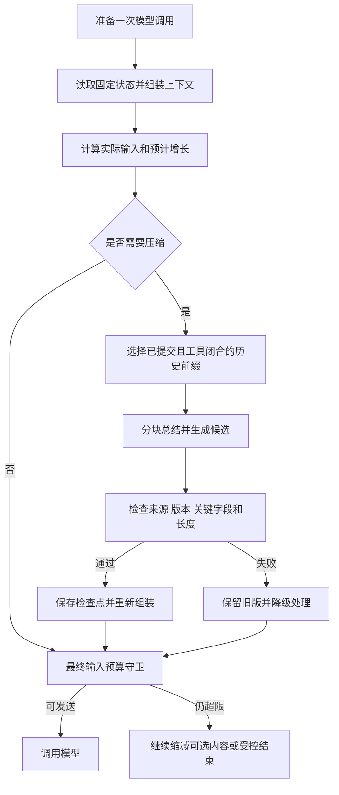

# 学生记忆与会话上下文压缩实施计划

更新日期：2026-10-21。状态：原计划的核心功能已实施，当前实现与验证边界见[实现说明](17_memory_and_context_implementation.md)，面试表达见[问答文档](../interview/01_memory_and_context_compression.md)。

本文保留**实施前基线和当时的原计划**，用于追溯设计理由。后文“当前”“建议”“尚需补齐”均应按原计划制定时的语境阅读，不代表今天的代码状态。实际触发策略、增长预测、估算方法、维护入口及未实现边界以实现说明为准；默认参数的效果校准仍未完成。

本次范围采用最新业务约束：跨会话只保留短小的长期学生记忆和每个会话唯一一份学习经历记忆，二者均由模型提取、整合与总结；目标及子目标只在所属会话内结构化保存。上下文压缩围绕会话接续设计，原始作答和业务状态仍由数据库保存。

## 一 原计划范围与实施前基线

### 范围约束

| 对象 | 生命周期与职责 | 本期边界 |
|---|---|---|
| 长期学生记忆 | 跨会话，保存稳定且有依据的学生特征 | 一份短正文，由模型自动提取和合并；不建设复杂的人格画像 |
| 学习经历记忆 | 每个 session 一份，内容可多次更新 | 描述本次学习内容、方法、表现、未解问题；可以跨会话检索 |
| 会话目标状态 | 与 session 同生存，刷新或重启后可恢复 | 保存目标、子目标、当前步骤和返回点；新会话不继承执行状态 |
| 上下文检查点 | 当前会话内的运行派生数据 | 减少模型输入，可重建；不作为第三种跨会话学生记忆 |
| 原始消息和评估证据 | 可追溯的业务事实 | 保持原有保存方式，压缩不删除或改写它们 |

旧学习经历里的“未完成目标”可以作为历史描述被查询，但不会自动成为新会话的 active goal。学生说“继续上次内容”时，由模型提出当前会话的新计划，服务保存新的会话内目标，并记录历史经历引用。

### 实施前已有的基础

| 实施前能力 | 当时的代码入口 | 原计划需补齐 |
|---|---|---|
| 消息、作答、能力状态与错因记忆 | [learning.py](../../backend/app/domains/sessions/models.py)、[students/service.py](../../backend/app/domains/students/service.py) | 模型维护的短学生记忆和 session 唯一经历 |
| 整体目标和接续步骤 | [learning/planning.py](../../backend/app/application/learning/planning.py)、[learning/progress.py](../../backend/app/domains/learning/progress.py) | 稳定子目标 ID、状态转换、依赖和返回点 |
| 输入字符裁剪 | [context.py](../../backend/app/agent/runtime/payloads.py) | Token 预算、语义压缩、安全切点与质量检查 |
| 模型与工具循环 | [runner.py](../../backend/app/agent/runtime/runner.py)、[loop.py](../../backend/app/agent/runtime/loop.py) | 每一次模型请求前的预算守卫和运行内压缩 |
| 新讲题工作区 | [workspace.py](../../backend/app/domains/guidance/workspace.py)、[service.py](../../backend/app/application/guidance/service.py) | evidence/support_history 的有限输入投影 |

实施前，规划器先取最近十条消息，并将每条正文截为 1800 字符，之后 Runner 再做背景裁剪；新讲题流程保存十二轮 dialogue，但将持续累积的 evidence/support_history 一并送入模型。这是原计划要解决的基线问题。现已改为统一预算投影与摘要，具体差异见实现说明。

## 二 两种记忆的最小设计

### 长期学生记忆

建议使用 `StudentMemory` 保存一份简短 Markdown 正文，内容集中在稳定的学习背景、明确偏好、反复出现且仍需关注的问题、已有依据的教学策略观察。当前待答题、这轮目标和单次错误留在会话经历或业务记录中。

最小字段：`student_id`、`content`、`source_refs`、`version`、`updated_at`。课程相关结论在正文中标明适用课程；短正文按学生整体读取，初期不声称能够在正文内部做确定性的课程过滤。来源引用和版本属于管理元数据，不向学生展示一张复杂画像表。

初始正文目标为 600 Tokens，硬上限 800 Tokens，最多八个要点。每个要点最多保留三个代表性来源，来源元数据进入模型时也计入输入预算。这些是待回放调优的初值，不是已验证的最佳容量。

模型接收“旧正文、本次有依据的新观察、明确的纠正或遗忘要求”，输出合并后的候选正文。合并优先级：保留学生最新明确要求，合并同义内容，限定结论适用范围，删除已被纠正的推断，舍弃偶发细节。达不到长度约束时允许一次定向重写；仍失败则拒绝候选并保留旧版，不直接截断正文。

来源 ID 存在只能证明可追溯，不能证明模型推断正确。提示词要求区分“学生明确表达”和“历史表现提示可能存在”，语义正确性需要回放评审。模型自报 confidence 不作为校准概率。

### 每个会话一份学习经历

建议使用 `SessionExperience`，数据库以 `session_id` 建唯一约束，按学生、课程和知识点建立查询索引。学习过程中更新同一行，修订历史可进入审计记录，不新增第二份正式经历。

最小字段：`session_id`、`student_id`、`course_id`、`content`、`concept_tags`、`source_refs`、`covered_seq`、`version`、`status`、`updated_at`。

正文按以下顺序总结：本次学什么；使用过哪些讲解和练习方式；学生实际作答与帮助条件；观察到的困难和变化；尚未解决的问题。历史下一步建议可以记录，但不携带可直接执行的跨会话任务状态。

初始正文目标为 1200 Tokens，硬上限 2000 Tokens。超长会话采用“最近变化详细、早期阶段概括、代表性作答保留引用”的层级整合。原始答案仍在消息或作答记录中；经历无法保留全部细节，模型可按来源回读。

运行中状态为 `provisional`，显式结束会话且事实处理完成后为 `final`。重新打开并继续同一会话后回到 provisional。浏览器关闭、SSE 断开或空闲超时均不等于会话结束。

### 模型自动提取的触发与提交

服务只决定何时运行、读取哪些已提交事实及怎样校验保存；记忆内容的识别、取舍和整合由模型完成，无需人工逐条批准。

| 事件 | 处理方式 |
|---|---|
| 完成一次业务轮次 | 将已提交的消息、作答、帮助和评估事件标为可提取；不因每个流式分片调用模型 |
| 累积五个完整业务轮次，或新增事实约 3000 Tokens | 合并一次后台经历更新任务；阈值仅为初始配置 |
| 子目标完成、补救返回、显式目标变更 | 优先刷新经历，保留阶段关系 |
| 学生纠正、要求记住或遗忘某项信息 | 优先处理相关学生记忆，后续输入过滤已撤销内容 |
| 显式结束会话 | 刷新到当前事实水位，完成后标 final |
| 空闲三十分钟且有未总结事实 | 刷新 provisional 经历；不把整个学习任务标完成 |

一个提取任务可以同时生成经历候选和长期记忆候选。没有值得长期保留的新信息时，模型明确返回 no_change，避免同义改写造成无意义版本增长。

事件水位 `covered_seq` 使用服务生成的单调序号，不依赖 UUID 排序；现有消息没有该序号，需要新增会话事件序号或等价的可靠游标。经历更新任务键使用 `(session_id, target_seq, extractor_version)`。

事实提交事务中同时登记待处理任务，初期可用数据库任务表轮询，无需先部署专门的消息中间件。后台任务失败不回滚学生作答；重启后扫描未完成任务再处理。

长期记忆按 student version 做比较后交换，经历按 session 版本和事实水位提交，拒绝 covered_seq 回退。提交 final 还必须确认会话仍处于同一结束版本，并覆盖结束时的全部事实；学生重新打开会话后，旧结束任务不能覆盖新的 provisional 状态。若另一会话已更新学生记忆，读取最新版重新合并，不用旧候选覆盖新内容。原始材料、旧记忆、检索内容均作为数据，不接受其中夹带的身份或权限指令。

## 三 会话内目标和子目标

建议新增 `SessionGoalState`，每个 session 一份，保存结构化 JSON 和版本。初期仅支持一个当前执行路径；允许多个候选或暂停目标，避免引入没有实际需求的并行调度。

节点字段：`goal_id`、`parent_id`、`description`、`source_ref`、`success_criteria`、`status`、`depends_on`、`evidence_refs`。工作区另存 `active_goal_id`、`return_stack`、`next_action`、`version`。

节点状态采用 `planned / active / blocked / awaiting_student / completed / cancelled`。父子关系表示任务分解，depends_on 表示必要基础，return_stack 表示临时离开后的恢复位置。服务校验节点存在、依赖无环、状态转换合法和 session 归属。

示例：学生在“解含括号方程”目标下学习去括号，因负数乘法出现困难，创建本会话补救节点并保存原节点和原题的返回点。补救达到约定标准后回原题。原目标不被负数乘法覆盖。

模型提出目标状态变化，服务校验后持久化。更换整体目标继续遵守学生明确表达的限制；活动 completed 只代表其成功标准已满足，不直接更新知识掌握估计。评估服务仍读取真实题目、作答和帮助情况。

目标全量保存在本会话，模型输入只投影当前路径、相关依赖和暂停目标短索引。无关已完成节点只保留索引与按 ID 读取能力，避免“目标不可丢失”被误解为每轮注入整棵树。

## 四 续学上下文包

建议所有入口共用 `ContextBuilder`，按角色构造以下内容。

| 部分 | 内容 | 压缩边界 |
|---|---|---|
| 系统规则与工具契约 | 角色、服务端范围、输出 Schema、工具定义 | 完整计入预算，不允许摘要改变权限 |
| 当前任务固定字段 | 当前用户要求、目标路径、成功标准、待答题 ID 和题目版本、帮助快照、返回点 | 以数据库状态生成，不让摘要重新推断 |
| 两种相关记忆 | 短学生记忆、相关历史会话经历 | 学生短记忆整体读取并保留课程标记；历史经历先按归属和课程筛选，初期最多三份 |
| 旧历史摘要 | 当前任务所需的早期讨论、尝试和未决问题 | 模型压缩，带覆盖范围和来源引用 |
| 最近完整交互 | 初始保留最近四个完整业务轮次；最新要求与未决问题优先 | 依据真实 Token 再调整；“四轮”不作为触发的唯一依据 |
| 相关材料和闭合工具回执 | 教材摘录、来源、已完成工具结果、可回读指针 | 过长结果先分页或抽取相关段落 |

固定字段的“不可丢失”指内容与引用必须准确可恢复，不代表重复注入全部数据库行。评估必须加载原始答案，当前题的必要题干、公式和图像必须完整；不能只给答案记录 ID 再让评估模型猜内容。

历史摘要采用固定 Schema：`covered_from_seq`、`covered_to_seq`、`topic_segments`、`confirmed_findings`、`uncertainties`、`unresolved_questions`、`source_refs`。会话内目标和待答状态来自独立字段，摘要不得提交其新版本。

学习经历和上下文摘要共用事实提取能力，但用途不同：前者概括一个会话，后者服务当前模型任务。上下文检查点不进入跨会话检索。重建时从原始事件分段生成阶段摘要，再整合阶段摘要，避免无休止地对同一段摘要继续改写。

## 五 Token 预算和触发判据

### 预算计算

每一次调用都计算完整输入，包括系统提示、工具定义、JSON Schema、记忆、历史、工具消息和多模态输入。`max_tokens` 是输出预算，不能拿它替代输入计数。

设模型窗口为 \(W\)，服务商单独输入上限为 \(P\)，项目允许的总请求预算为 \(C\le W\)，预留输出为 \(O\)，估算及协议安全量为 \(S\)。可用输入预算为：

\[
H=\min(P, C-O-S).
\]

没有独立输入上限时忽略 \(P\)。如果 \(H\le 0\)，配置无效，应在调用前拒绝。\(W\)、\(P\) 和分词方法来自实际部署模型的配置，不根据模型名猜窗口。

\(T\) 表示当前待发完整输入的保守 Token 估算，\(G\) 表示到下一个安全检查点前可能增加的输入。\(G\) 包括所有将进入后续输入的本次 assistant 输出、整批工具回执、附图或格式修复等，不把已经计入 \(T\) 的内容重复计算。\(O\) 用来预留当前生成，\(G\) 用来预测后续输入，两者承担不同职责；未知的未来用户输入在到来时重新计数。

工具已有确定性返回上限时，用这些上限形成冷启动保护值。积累数据后可用同角色、同工具批次的 P95 增长预测调度时机，但分位数不是绝对上界，每次请求前仍按实际输入重新守卫。没有计数器时只能使用经样本校准的保守估算并增加安全量，不能把字符数当作精确 Tokens。

这里的“实际输入守卫”是对本次最终待发请求重新计数，不是把历史多次调用累计的 prompt_tokens 当作窗口大小。缓存命中的内容仍然占用上下文窗口。对接服务端 usage 后持续记录估算偏差，按高分位正偏差调整安全量；本地估算通过不构成服务端绝不超限的数学保证，仍需处理服务端超限错误。

### 初始水位

| 参数 | 初始值 | 作用 |
|---|---|---|
| 软水位 | \(0.70H\) | 进入提前压缩候选区 |
| 强制预防水位 | \(0.90H\) | 在下一次模型调用前处理增长风险 |
| 压缩后目标 | \(0.55H\) | 留出增长空间，避免每轮重复压缩 |
| 绝对发送边界 | \(T\le H\) | 超过边界绝不发送原请求 |
| 最小收益 | \(\max(1024,0.15T)\) Tokens | 低于该回收量时，非强制场景通常不调用摘要模型 |

这些比例和长度均为初始工程参数，需在会话回放中调优，不是行业标准或已测得最优值。输出预留 \(O\) 会随角色改变，因此 \(H\) 也按调用重新计算。

### 允许 建议 必须和禁止

| 判断 | 可执行条件 | 动作 |
|---|---|---|
| 允许准备摘要 | 存在已提交的完整历史前缀 | 可后台生成候选，尚不替换当前请求 |
| 建议主动压缩 | \(T\ge0.70H\)，到达语义边界且预计收益达标 | 后台准备；下一安全点校验后采用 |
| 必须预防性压缩 | \(T+G\ge0.90H\) | 下一次模型请求前压缩或缩减可选材料；不等待子目标结束 |
| 必须缩小实际请求 | \(T>H\)，或服务商返回上下文超限 | 禁止原样发送或重试；重建、分块或受控结束 |
| 暂不允许替换 | 正在流式输出、工具回执未补齐、事实未提交、固定字段版本失效 | 保持当前执行，完成闭合和提交后重新判断；不再发送超限请求 |

“允许”描述安全性，“建议”和“必须”描述必要程度，不能将其混为一个 Token 百分比。后台可压缩已提交的更早前缀，即使当前正等待工具；但替换发生在两次模型请求之间，并且必须排除尚未完成的工具组和未提交事实。

### 怎样识别较好的时机

语义边界由结构化业务事件决定，模型可以补充标注，不单独决定最终时机。优先顺序：已完成一个子目标；已提交作答与评估且反馈发布完成；进入等待学生状态；补救结束回主线；完成一批资料检索；开始下一次模型调用。

软水位内优先利用这些边界，减少拆散推理过程。触发强制条件时，最后一个“模型调用前”检查点具有优先级，不会为了等一个理想边界而允许超限。

初始保留最近四轮是尾部策略，不是数学推导中间任意截断的许可。未决问题、学生最新要求和当前题的必要内容被固定保留；完整长证明或代码题超预算时按自然结构分块，不能取前若干字符后仍声称完整。

### 可手算的示例

仅举工程预算示例：假定已验证模型窗口足够，设置 \(C=32768\)、\(O=4096\)、\(S=2048\)，且 \(P\) 不更小，则 \(H=26624\)。软水位约 18637，强制预防水位约 23962，压后目标约 14643 Tokens。

| 场景 | 判断 |
|---|---|
| 当前 12000，刚完成子目标 | 可提取经历；无需仅因阶段结束就做上下文压缩 |
| 当前 19500，预测增长 2000，已有完整阶段可回收 5000 | 到达软水位，适合在安全点主动压缩 |
| 当前 22000，下一批工具预测新增 3000 | 总量 25000 超过预防水位，必须提前处理 |
| 当前 27000，下一次调用没有新工具 | 已超过输入预算，仍禁止发送 |
| 当前 24500，但部分工具正在执行 | 不取消或重放未知业务效果；补齐回执后重建，再决定是否调用模型 |

## 六 压缩执行协议



执行顺序如下。

1. 选取已提交历史的切点，记录 session 版本、事件水位、目标版本、题目指纹及规则版本。压缩任务不获得新的业务写权限。
2. 把 assistant 工具调用和相应全部 tool 回执视为一个闭合单元；不切开 tool_call_id 配对，不丢掉尚未消费的结果。原始结果没有持久可回读引用时，不能只留下不存在的指针。
3. 摘要器只读取允许压缩的旧前缀。摘要器也执行自己的输入预算检查；长前缀按完整业务单元分块，先生成阶段事实，再汇总。不递归调用自身压缩来无限逃避超限。
4. 从固定状态重建目标和待答字段；旧摘要只补充背景。校验覆盖区间、来源归属、引用存在、关键事实无遗漏与长度上限。程序可保证字段和引用一致，语义忠实仍需模型复核或回放人工抽样，不能宣称形式化证明。
5. 使用比较后交换提交候选检查点。目标或待答版本变化时重新组装固定状态；来源被纠正、撤销或删除时使候选失效。只在无冲突的稳定前缀上允许追加新尾部。
6. 重新计数，要求实际 \(T\le H\)。尽量达到 \(0.55H\)，且重新估算 \(T+G\) 后不再触发预防水位。如果无法同时满足，降低下一批工具量、分页或减少可选材料；不能反复压缩同一前缀死循环。

例如下一批增长 \(G=4096\) 时，当前输入约达到 19866 Tokens 就会触发预防处理，而不是等到 23962。压后可计算目标 \(K=\min(\lfloor0.55H\rfloor,\lceil0.90H\rceil-G-1)\)；固定任务字段已超过 \(K\) 时应缩小下一批输入。\(0.55H\) 是期望回落值，不能为凑比例丢信息；必要放行条件是任务内容完整、\(T\le H\) 且降低批次后仍满足 \(T+G<0.90H\)。若预防条件仍不成立则拆分任务或受控结束，不暗中放宽水位。

初期每个模型调用前最多两次压缩尝试，第二次用于修复具体校验失败；同一 covered_seq 没有足够新增内容时不重复摘要。前后水位差和最小收益形成回差，避免在阈值附近频繁触发。

### 模型循环内部的接入

首轮在 Runner 建立消息后进行预算检查；后续每轮在 `run_agent_loop` 调用 `models.chat` 前再次检查。仅在用户新消息时压缩，会漏掉同一轮里不断增长的工具和 JSON 修复消息。

工具回执先按领域结构限长：检索返回分页和片段，题干与必要公式保持完整，来源和可回读引用保留。确定性限长减少噪声，模型摘要再概括语义。上下文压缩不重放工具、不改变调用次数账本，也不清空防重复执行记录。

多模态题图按真实接口计费或官方估算方式纳入预算；不要用 Base64 字符长度等同于视觉 Tokens。已清理的图片去重缓存需要与新消息视图对齐，保证重建后仍能加载当前题所必需的像素。

## 七 失败并发和纠正

| 失败或竞争 | 行为 |
|---|---|
| 非强制压缩超时或候选无效 | 保留现有上下文；仅在仍满足预算时继续 |
| 强制压缩失败 | 先移除重复的可选历史资料，按来源分页；必要时用确定性字段和完整当前任务构造最小上下文 |
| 最小上下文仍超限 | 明确要求拆分当前任务或采用分段处理，不发送不完整题目来猜答案 |
| 服务商返回超限 | 重估包含协议和多模态的输入；重建一次后重试，禁止相同载荷盲重试 |
| 学生作答已提交但记忆更新失败 | 作答与评估保留，后台重试记忆，不重复评估或重复记分 |
| 两个会话同时合并学生记忆 | student version 冲突后读取新版本重新合并，不覆盖对方结果 |
| 旧摘要生成期间有新事实 | 固定已提交前缀及其指纹，新事实追加尾部；发生纠正或范围冲突则弃用候选 |
| 学生遗忘或纠正请求 | 先写撤销标记并过滤相关内容，使摘要、缓存与索引失效，再让模型重建有效正文 |

撤销过滤使用来源引用与记忆版本，是必要的管理元数据，不增加第三种学生记忆。移除记忆不会删除原始作答或自动重算掌握度；用户若明确要求删除原始数据，属于单独的数据删除范围。

## 八 工程拆分与交付顺序

建议代码按职责拆分，避免把所有逻辑继续写入一个 context.py。

```text
backend/app/memory/
  schemas.py          两种记忆候选与来源契约
  extractor.py        模型提取和合并提示词及调用
  service.py          幂等 版本 校验和保存
  jobs.py             已提交事实的后台更新与恢复
backend/app/agent/context/
  budget.py           分词估算 模型限额和请求守卫
  builder.py          按角色构造续学上下文包
  policy.py           软水位 增长预测 安全切点
  compactor.py        分块摘要和检查点生成
  validation.py       来源 版本 工具配对与固定字段校验
backend/app/domains/sessions/goals.py
                       会话内目标状态和转换
```

以上为原计划建议的模块拆分；相关模块现已落地，实际文件和职责以[实现说明](17_memory_and_context_implementation.md)为准。下表保留原交付顺序与验收目标，不作为当前完成状态列表。

| 阶段 | 交付 | 完成条件 |
|---|---|---|
| P0 现状基线 | 记录各角色输入组成与 Token 用量，准备长会话回放集 | 能定位膨胀来自历史 工具 证据还是题图 |
| P1 会话目标 | 结构化目标和返回点，兼容现有 continuation | 原题补救返回 刷新恢复 目标更换均正确 |
| P2 记忆闭环 | 两种模型生成记忆 任务水位 并发合并 纠正失效 | session 唯一经历 长期正文限长 失败可恢复 |
| P3 上下文构建 | 统一入口投影 逐调用预算守卫 工具分页 | 普通教学 guidance tutoring 都走统一预算 |
| P4 压缩闭环 | 安全切点 分块摘要 检查点 校验及回退 | 软硬触发 每轮工具增长 超限失败均可验证 |
| P5 回放调优 | 比较固定裁剪与新方案，调节阈值和长度 | 发布实测数据和失败样例后再更新面试成果口径 |

可以先将 ContextBuilder 以 shadow 模式计算输入，不改变正式请求；再切换确定性投影和预算守卫，最后启用语义压缩。模型记忆与压缩使用明确版本，便于回放定位问题。

兼容迁移时，将旧 MemoryItem 的有效错因及来源交给模型形成初版学生记忆和经历，不把原行直接拼接成超长正文。旧表可保留审计，但新路径不再把旧错因列表作为第三类跨会话记忆重复注入。旧 continuation 的步骤先作为历史活动导入，不伪造其成功证据。功能开关可回退读取路径，数据迁移保持可重复执行。

## 九 验收和观测

### 必须覆盖的回放场景

1. 普通教学长会话：整体目标和子目标在多次压缩后保持一致。
2. 方程学习补负数乘法：补救后返回同一原题和原步骤。
3. 当前长答案超过旧 1800 字符阈值：评分读取完整答案，不受背景裁剪影响。
4. 新讲题工作区多次提示：证据与帮助记录存库，模型输入保持有界。
5. 一个模型循环连续检索：首轮未超限，后续工具轮达到强制条件。
6. 多工具回执乱序完成：压缩不拆配对，不重放已完成业务效果。
7. 压缩期间学生纠正目标或记忆：旧候选不能覆盖新状态。
8. 两个会话并发更新同一学生：两次有效变化均保留，没有丢更新。
9. 新会话查询旧经历：能解释历史，但不会自动激活旧目标。
10. 记忆模型超时或后端重启：已提交答案不丢，任务可重试，唯一经历不重复。
11. 当前题含图片和公式：重建后保留必要像素和完整公式。
12. 固定任务内容本身超过预算：走分段或明确缺口，不伪造完整输入。

### 指标定义

| 指标 | 定义与用途 |
|---|---|
| 输入预算违规 | \(T>H\) 仍发送的请求数；确定性测试应为零 |
| 目标与待答恢复 | ID 版本 返回点 帮助状态的正确数及总检查数；分别报告 |
| 摘要事实召回和新增错误 | 人工标注关键事实的保留率，以及无来源断言数 |
| 无证据掌握升级 | 仅由摘要或经历触发的 mastery 更新次数；应为零 |
| 输入缩减率 | \(1-T_{after}/T_{before}\)，同时报告任务正确性，避免只追求短 |
| 总成本 | 正式模型输入输出加记忆和压缩调用成本；单次输入变短不等于总费用下降 |
| 用户延迟 | 首次正文和完整反馈的 P50 P95，区分后台更新与同步强制压缩 |
| 重复压缩与失败 | 触发原因 压前后 Tokens 回收量 耗时 失败原因和回退次数 |

日志只记录必要 ID、版本、计数、原因和耗时，原始学生文本按业务权限管理。零错误的要求是测试集中的验收约束，不代表任意真实对话绝对不会出错。

## 十 参考与面试口径

通用技术参考：[Anthropic 上下文工程原文](https://www.anthropic.com/engineering/effective-context-engineering-for-ai-agents) 将压缩、结构化记事和子 Agent 上下文隔离作为互补手段，并强调避免过度压缩关键细节。本文的两种学生记忆、会话目标边界和所有阈值是本项目的设计选择。

原计划制定时的口径是“基于原始记录、错因记忆和字符裁剪设计两类模型记忆与按预算压缩”。这段历史口径不再用于描述今天的实现。当前可说明已经接入的功能与实际验证范围，参见[实现说明](17_memory_and_context_implementation.md)和[面试问答](../interview/01_memory_and_context_compression.md)；仍不应声称语义零丢失、默认阈值最优或未经测量的收益。
