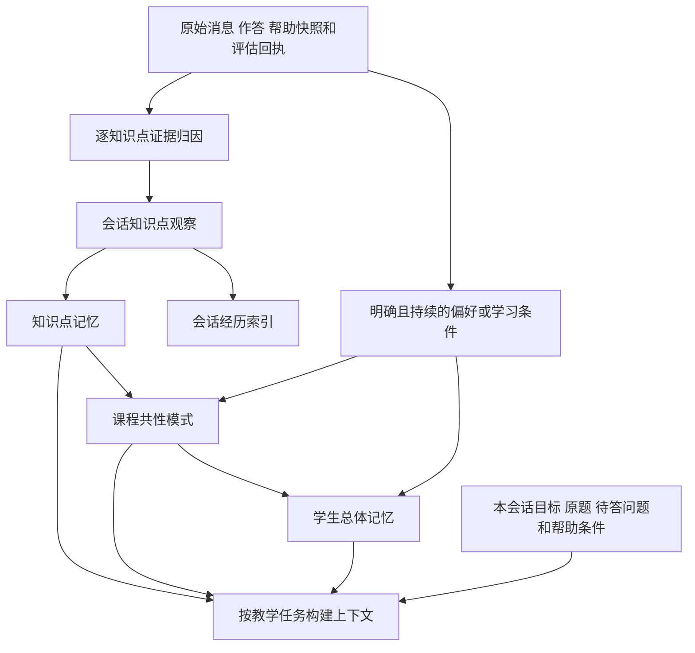

# 按学生 课程和知识点组织记忆的实施方案

更新日期：2026-10-21。本文保留设计方案；本轮运行代码、具体取舍与验收见[业务记忆实现说明](19_business_memory_implementation.md)。上一版两类记忆基线见[17 文档](17_memory_and_context_implementation.md)。下文“当前”与“待改”是制定方案时的状态，不作为新实现说明。

采用四个业务作用域：学生总体记忆、课程记忆、知识点记忆、会话内工作记忆。跨会话学习事实先归入会话与知识点的关联观察，再整合为知识点记忆；课程与学生层按需要提炼适用范围更广的模式。每条教学判断都能回到原始作答、帮助条件和评估方法。

## 一 当前实现与改造理由

| 当前代码 | 已有能力 | 本次需要补充 |
|---|---|---|
| [StudentMemory](../../backend/app/domains/memory/models.py) | 每个学生一份短正文，有来源和版本 | 把课程特定判断下沉，限制总体记忆的泛化范围 |
| [SessionExperience](../../backend/app/domains/memory/models.py) | 每会话一份经历，带课程和concept_tags | 将每个知识点的实际观察单独归属，不能仅给整份经历加标签 |
| [MemoryService](../../backend/app/domains/memory/service.py) | 按课程、标签筛选历史经历，最多三份 | 读取当前课程摘要和相关知识点摘要，按需下钻经历 |
| [StudentState和Attempt](../../backend/app/domains/sessions/models.py) | 知识点状态、原始答案、整题诊断与证据引用 | 逐知识点评估归因，并防止同一作答被多层总结重复计数 |
| [通用讲题证据](../../backend/app/domains/guidance/evidence.py) | 原始输入、提交前帮助快照、模型观察 | 稳定关联到知识点，保留模型观察与正式判分的区别 |

当前单题及整组评估调用 [StudentService.apply_evidence](../../backend/app/domains/students/service.py) 时，会对传入的各目标知识点复用同一整题诊断。整题分数不足以解释每个知识点的表现，改造知识点记忆时必须同时补齐归因协议。

当前在线通用讲题保存模型观察，不直接更新StudentState。已退役的专用方程规则链只保留历史读取，不作为本方案的新接入路径。

## 二 四个作用域分别记什么

| 层级 | 标识 | 记录内容 | 典型用途 |
|---|---|---|---|
| 学生总体 | student_id | 明确的持续偏好、学习条件、有跨课程支持的学习策略观察 | 不同课程共用的交互与教学方式 |
| 课程 | student_id与course_id | 本课程学习背景、跨知识点的共性困难、课程内有效策略 | 本课程安排诊断、讲解与复习 |
| 知识点 | student_id、course_id与concept_id | 多会话中的具体误区、推理障碍、有效帮助方式、待核验假设与变化 | 重学同一概念时接续，解释评估状态的依据 |
| 会话内 | session_id及当前工作区 | 目标与子目标、当前概念、原题、待答问题、帮助状态、返回点、近期原文与阶段摘要 | 继续当前任务和压缩上下文 |

“跨课程”“跨知识点”“跨会话”说明内容可以在哪些场景复用。课程与知识点有归属关系，会话可以涉及多个知识点；因此存储关系不能简单处理成一棵会话树。

总体记忆适合记录“通常先给提示，等待尝试后再展开”。课程层可以记录“代数学习中先解释等价变形，再展示简写更容易接续”。知识点层可以记录“去括号时两次漏乘常数项；分步提示后可修正，尚无新的独立验证”。当前“先解决这道题的第二步”留在会话内。

课程层不计算一个未经校准的“课程掌握百分比”。知识点覆盖情况、正式评估状态与语义观察分开展示；未评估的知识点保持未评估。

## 三 会话与知识点如何关联

新增 `SessionConceptObservation`，一行表示一个会话对一个知识点的当前整合观察，唯一键为 `(session_id, concept_id)`。同一知识点在会话中被反复讨论时，更新这一行，其各条观察仍关联到具体活动和原始事实。

例：一次会话涉及分配律、等式性质和一元一次方程。

| 知识点 | 本会话可记录的内容 | 当前不能推出的结论 |
|---|---|---|
| 分配律 | 某一步漏乘常数项，收到提示后改正 | 已独立掌握分配律 |
| 等式性质 | 学生解释了两边同减，模型认为解释基本成立 | 整个知识点所有情境都掌握 |
| 一元一次方程 | 当前综合题尚未完成 | 所有前置知识点均薄弱 |

`LearningSession.concept_ids` 继续表示计划或选定范围。只选中一个知识点而没有相关作答或讨论时，不生成学习评价。可以从会话计划展示planned关联；持久观察必须有实际来源。贴入新题但尚未关联知识点时，先从当前课程目录检索候选，无法可靠匹配的暂存为unassigned，不强行套入全部会话标签。

观察关联采用三种来源状态：仅接触、存在实际观察、存在正式评估回执。正式评估回执表示发生过判分，不自动等于满足掌握度更新条件。

## 四 事实 观察与评估共用什么

继续保留原始消息、Attempt、通用讲题提交证据及MemoryFact。为事实建立统一引用和版本，增加 `EvidenceConceptLink` 表示一条事实对某个知识点提供了什么依据。

每个关联至少包含：

```text
source_fact_id / source_version / evidence_group_id
student_id / course_id / concept_id
activity_id / question_id / criterion_id / capability_dimension
source_kind / source_span_refs / attribution
help_snapshot_ref / assessment_method / result
```

source_kind区分exposure、self_report、model_observation和graded_attempt。讲解输出只能证明接触过相关内容；“我懂了”属于自述；模型发现的错因可以形成假设；依据题目契约生成的评估回执才属于正式判分。正式判分也保留规则匹配或模型判断的方法信息，不把所有graded_attempt称为程序证明。

attribution使用direct、hypothesis、unresolved。直接归因需要当前作答片段或可核查的评分要点。题目考查范围和知识图谱关系用于确定候选概念，不能代替学生表现证据。

模型可以建议知识点及归因，服务检查课程归属、原文片段、题目版本、评分要点和帮助快照。`eligible_for_mastery`由评估策略计算，模型没有直接授予资格的权限。没有局部证据时，保留“整题出错，具体归因待诊断”。

存量综合题如果没有逐点评分要点，仍可返回整题结果，局部正式结论保持not_observed或归因未确定。模型临时编造的评分要点不能直接授予掌握度贡献；需要新增契约或针对性诊断后再评估。

同一综合题能对多个技能提供直接观察，各技能不需要强行分摊一个总和为1的分数；也不能把整题分数复制给每个知识点。

## 五 语义条目与数据结构

总体、课程和知识点的模型可读正文保持短小。后台候选与来源关系采用条目结构，便于检查适用范围及纠正；学生页面无需展示复杂画像字段。

```json
{
  "claim_id": "claim-17",
  "scope": "concept",
  "course_id": "course-a",
  "concept_id": "concept-distribution",
  "facet": "reasoning_obstacle",
  "text": "本次漏乘常数项，收到分步提示后修正",
  "epistemic_status": "observed",
  "source_refs": ["guidance_response:r1"],
  "counter_source_refs": [],
  "help_condition": "assisted",
  "next_check": "另出一道没有相同提示的新题验证"
}
```

这里observed只确认本次发生了什么。要把它整合成“反复出现的困难”，必须读取更多原始事实。hypothesis、supported、disputed与stale分别表达待验证、有支持、存在冲突与需重建；它们不是数值化置信概率。

claim_id由服务分配，后续模型只能引用服务提供的既有ID或提出新增候选。合并、拆分和撤销保留旧ID及修订关系，不能依赖模型每次重写时自行维持标识。

| 数据对象 | 主键或唯一约束 | 主要职责 |
|---|---|---|
| 现有StudentMemory | student_id | 总体短记忆，兼容旧入口 |
| 新CourseMemory | student_id、course_id | 课程内整合 |
| 新ConceptMemory | student_id、course_id、concept_id | 知识点跨会话整合 |
| 新SessionConceptObservation | session_id、concept_id | 会话对概念的贡献，含claims、covered_seq与版本 |
| 新EvidenceConceptLink | 原始事实、概念、维度及评分要点的关联键 | 证据归因，允许一份事实关联多个概念 |
| 新MemoryDependency | 子来源或记忆版本与父记忆版本的关联键 | 纠正、撤销和更新时定位受影响的派生内容 |
| 现有SessionExperience | session_id | 会话时间线与按需下钻索引 |

各摘要保存content、source_refs、content_version、source_generation、status和updated_at。普通整理可推进处理水位而不改正文版本；来源被撤销时仍必须推进失效版本。提交历史或候选结果保留在任务审计中，保证能解释一个版本的形成依据。

`covered_seq`仅适用于一个会话内。跨会话的ConceptMemory不能取多个会话序号的最大值当处理水位；其任务记录输入的 `(observation_id, version)` 集合及指纹，提交时核验依赖版本。课程与学生层同理。

还需要独立的scope_generation：一个作用域的合格输入集合新增、修改或撤销时，在同一事务中推进该代次。聚合提交同时比较作用域代次和已读取依赖版本，避免只检查旧行版本却漏掉运行期间新增的观察。概念层的输入是会话概念观察；课程与总体层的输入是下层实质变化及明确偏好，不要求每条聊天都触发所有上层更新。

SessionExperience继续保存，不默认再作为一整层全文追加到模型输入。它承担经历浏览和原始过程定位；常规教学优先读取总体、课程和相关知识点记忆。

## 六 如何提取 更新和向上整合



一个完整业务轮次提交后，继续使用现有事实水位和持久任务机制；正式作答完成、知识点阶段结束和子目标变更优先刷新。普通轮次暂沿用五轮或约3000新增估算Tokens的触发策略，后续依据调用成本调整。

第一步从原始事实提取会话内各知识点观察，同时识别学生明确表达的课程或总体偏好。身份和允许的课程、概念范围由服务端提供，模型只返回候选。

第二步仅重建受到新观察影响的ConceptMemory。每个候选同时接收支持证据和反例，例如“上次提示后改正、本次新题独立出错”，不能只保留最早的负面标签或最后一次正确。

第三步按需形成课程共性，再评估是否进入总体记忆。初始晋升规则可配置为：课程能力模式至少涉及两个知识点且有不同实际任务支持；总体能力或策略模式至少有两个课程中的不同事实支持。上述是限制泛化的工程门槛，不证明统计稳定性。同一道综合题同时关联两个知识点，仍不能独自满足“多任务重复出现”。

学生明确且持续的偏好可以直接进入相应作用域，无需等待两门课。一次性要求如“这道题直接给答案”保留在当前会话。一次代数错误不晋升为“数学基础差”，更不晋升为“逻辑能力差”。

首次建设加入独立的晋升审查：只对拟新增或扩大范围的课程、总体条目进行一次小模型审查。审查读取条目及原始证据，只输出保留、下沉或拒绝；不允许再自由生成新的事实。确定性校验负责来源和范围，独立模型检查负责增加语义复核机会，两者均不能保证零错误。

各层并非每轮依次调用。叶子变化不显著时不更新上层；上层复用稳定条目及其原始支持，避免反复摘要同一份长文本。课程和学生聚合任务以scope_key、source_generation和规则版本幂等登记，使用独立于会话序号的任务键。沿用短事务、CAS、正常占用延后和被新水位覆盖后superseded的机制。

## 七 怎样与学生评估结合

知识点学习视图返回两个并列部分：

```text
ConceptProfile
  assessment_state: StudentState及原始评估引用
  learning_memory: ConceptMemory及会话观察
```

记忆可以解释错因、提出先修缺口假设、选择诊断题和教学方式。掌握估计的数值只从StudentState读取，并带版本，不复制到多层摘要中维护另一套数值。

评估分成两个目的明确的阶段：

1. grading阶段依据当前题目、学生原答、评分要点和提交前帮助条件判分；不注入“该学生某知识点薄弱”等历史标签。生成冻结的GradingPacket，包含整题结果、各评分要点的观察或未观察、概念与能力维度、来源片段、帮助快照及评估方法。
2. diagnosis阶段读取本次结果与相关记忆，解释变化、提出错因假设及后续教学建议；不能改写GradingPacket内的整题或局部正式结论，不能改变能力维度或授予状态更新资格。新的正式归因走独立的重评与源版本修订。

Runner新增由服务端确定的 `context_purpose=grading|diagnosis|teaching|memory_extract`。当前运行器会统一注入记忆，因此落地时必须调整输入构建，单改提示词无法实现评分隔离。

逐知识点评估提交的资格由服务端策略计算，可抽象为：

\[
A(e,c,d)=\mathbf{1}[\text{来源有效、对概念}c\text{和维度}d\text{有直接依据、满足帮助及评估准入条件}].
\]

有效事件数量按原始事件集合计算：

\[
N_{c,d}=\left|\{\operatorname{canonical\_evidence}(e):A(e,c,d)=1\}\right|.
\]

一条真实作答出现在观察、概念、课程、总体四处，集合中的同一ID仍只计一次。独立题目数量另按稳定canonical_item_id或实质任务指纹去重；版本用于内容核对和修订，改排版、改解析或版本号本身不增加独立题数。同题多次回答和记忆版本增加都不增加独立题数；不同能力维度分别统计。

评估贡献的幂等键采用 `(student, canonical_evidence, concept, dimension, criterion)`，源版本作为修订信息。重新判分时替换旧贡献，不能把新版本再累加一份。criterion版本也作为修订，而不能通过改变版本号绕过去重。当前模型confidence阈值属于准入启发式，不解释为校准概率。

同一次作答在同一concept与dimension下的多个criterion先形成局部证据集合，再归约为一份状态贡献；不能每命中一个评分要点就重复调用掌握度增量更新。

通用讲题观察可以立即进入描述性记忆。要参与正式状态更新，需要经过新增的评估适配器与上述证据准入；“在本系统记录的无帮助条件下作答”仍不等于没有外部帮助或已经掌握。

补先修采用可验证回路：知识点记忆提出假设，查询已验证先修关系，安排局部诊断，取得新事实后决定补讲，再验证并返回本会话目标。上层题答错不能直接下调所有先修知识点。

## 八 如何读取并控制上下文长度

教学请求按当前业务任务读取：短总体记忆、当前课程记忆、当前概念及少量相关先修概念记忆、正式评估状态、当前会话工作状态。知识点来自当前任务、题目和证据归因，不依赖把整段聊天再分类一次。

常规默认最多读取三个相关ConceptMemory。原始证据、某次会话观察和SessionExperience通过受作用域约束的工具下钻，供解释冲突或追溯使用。读取其它学生、其它课程的具体观察仍由服务拒绝。

教学偏好的默认优先级为：本次明确要求、当前课程内明确偏好、总体默认。概念层的策略观察作为建议，不覆盖学生当前要求；学生要求也不能改变正式评分标准。学生在代数课喜欢看完整例子、在物理课喜欢先看图时，两项课程偏好可以并存。

现有 `/sessions/{id}/memory` 可扩展为返回global、course、concepts及当前会话索引的聚合快照，所属学生和课程从会话解析。新增受控回读工具 `get_concept_profile` 与 `get_concept_observations`；维护接口接收明确scope及claim标识，由服务验证归属和版本，客户端不能替换student_id扩大范围。

初始正文预算建议：总体目标600上限800、课程目标600上限800、每个知识点目标400上限600估算Tokens。含元数据的记忆总输入暂设最多4000且不超过可用输入预算的20%；这些为待调优初值。固定任务和评分契约优先，空间不足时减少可选历史、降低相关知识点数量或按需回读，不截断当前作答。

沿用当前预算守卫与语义压缩器。把新作用域的版本、失效代次和依赖指纹加入检查点键，避免纠正记忆后复用旧摘要。会话目标、原题和帮助条件始终来自业务状态，跨会话记忆中的“下次建议”不自动创建或激活执行目标。

## 九 纠正 遗忘和冲突处理

同一条原始来源可能同时支持多个概念。撤销操作必须包含作用域，区分“忘记本知识点的旧观察”“清空本课程记忆”“忘记总体偏好”和“停止后续记录”，不能把它们统一实现成全学生来源屏蔽。

纠正或撤销时，同事务更新作用域屏障，并沿MemoryDependency标记依赖它的观察和上层摘要失效。读取立即排除被撤销内容，后台再依据剩余有效来源重建。未受影响的概念与课程继续可用；旧任务提交时核验撤销代次和全部依赖版本。

持久撤销记录明确scope_key、目标claim_id或来源集合、原始事实截止水位及撤销代次。聚合与重新提取均检查这道屏障，防止保留的旧作答被再次提取而复活已遗忘内容。“忘记既有历史”允许今后的新事实形成新观察；“停止后续记录”另存该作用域的开关，直到学生重新启用。共享来源在未撤销的其它作用域仍可使用。

普通新观察允许当前模型运行继续使用已读取的版本；显式纠正、遗忘和来源失效需要在下一次调用前检查。持久依赖及支持来源完整保存，模型输入只带代表性引用与必要版本，不因提示长度限制删除审计依据。

记忆遗忘保留原始作答。正式评估证据若被判无效，单独执行评估修订或状态重算，再重建受影响的记忆；不能宣称删除摘要就自动回滚了掌握度。

## 十 实施顺序和模块边界

| 阶段 | 改造内容 | 完成条件 |
|---|---|---|
| P0 证据与归因 | 统一来源适配、EvidenceConceptLink、逐概念诊断契约、grading输入隔离 | 综合题不再向全部目标点广播整题结果；重试与修订不重复贡献 |
| P1 叶子观察和概念层 | SessionConceptObservation、ConceptMemory、当前MemoryExtractor拆分、最小依赖与失效屏障 | 一个会话可形成不同概念观察，多个会话可整合到同一概念；作用域代次、CAS、撤销传播及读取屏蔽先通过，再启用新读取 |
| P2 课程和总体层 | CourseMemory、总体记忆下沉、按需晋升与独立审查 | 单概念错误不泛化，课程偏好不串课，显式总体偏好可直接记录 |
| P3 治理与读取 | 完善作用域维护入口、ContextBuilder、只读工具和页面 | 完整维护流程与预算读取接通；聚合任务键和基础失效能力随相应数据层一起启用 |
| P4 迁移与真实验收 | 旧记录回填、影子读取、真实后端轨迹和报告 | 原始消息和评估状态不被迁移任务改写，来源与版本可审计 |

核心文件分工建议如下，均为待建或待改：

```text
models/                       作用域记忆 逐概念关联和依赖表
domains/memory/concepts/observations.py        从提交事实提取会话知识点观察
domains/memory/concepts/service.py      跨会话整合及反例处理
memory/course_memory.py       课程内共性模式
memory/student_memory.py      总体稳定偏好与晋升
domains/memory/scopes/promotion.py           晋升候选及独立语义审查
domains/memory/scopes/dependencies.py        来源撤销和派生失效
memory/context.py             按用途和预算读取
domains/assessment/evidence.py  逐知识点归因与来源校验
services/assessment*.py        正式评分 诊断与提交
agent/context/builder.py             分层记忆和会话状态的输入投影
```

现有MemoryService保留为门面，事实采集、持久任务、模型客户端和压缩器继续复用。前端分别在学生档案、课程概览和知识点视图展示相应记忆；会话侧栏显示当前任务与相关观察，不同时堆四份全文。

迁移先新增结构并保留旧表。旧StudentMemory按原始来源重新识别作用域，旧SessionExperience的标签仅作回填候选；证据不足时不生成知识点评价。迁移结果进入新版本并保留来源，在影子读取中核对归属、遗漏和重复后切换。历史提取属于显式有界任务，不在应用启动时全库调用模型。对旧评估可能存在的多概念广播单独标记legacy_attribution，不据其生成新的细粒度确定性结论。

## 十一 真实后端验收场景

1. 一个会话覆盖三个概念：原始事实能关联不同概念，未观察的概念不产生评价或分数。
2. 两个会话覆盖同一概念：整合辅助后修正与后续独立失败等不同结果，保留反例及时间条件。
3. 一道综合题的整题结果为错误：有直接依据的局部技能分别处理，归因不明部分保持未知。
4. 同一事实被四层引用及任务重放：原始证据数量和正式状态贡献不增加。
5. 学生在两门课程表达不同教学偏好：课程偏好按作用域生效，总体偏好不覆盖最新局部要求。
6. 纠正一个概念判断：相关上层摘要失效，无关概念可读；旧任务和旧压缩检查点不能重新注入。
7. 评分时存在错误历史标签：grading实际输入不包含该标签，diagnosis可读取并记录冲突。
8. 会话无预选concept、新题无法明确归属：保留未分配观察，不随意创建概念或扩大评价范围。
9. 显式结束、重新打开、并发更新和后台重启：水位、版本和任务终态保持一致。
10. 多层记忆均接近上限：实际请求满足预算，原题、学生当前原话和帮助快照完整。

真实链路分别报告教学运行、叶子提取、各层聚合和晋升审查的用量与耗时。语义评测另做人工标注，检查概念归因、适用范围、反例保持与纠正后复活；结构校验通过不代替这些语义指标。
