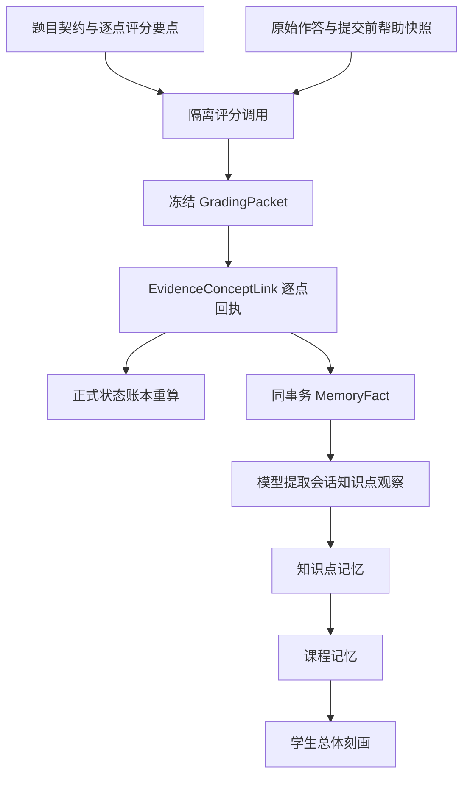

# 业务分层记忆、逐知识点归因与上下文接续

更新日期：2026-10-21。分层记忆已接入本地8008后端，健康检查正常，读取模式为`business-memory-v2`。本文记录本轮实现；[18 方案](18_business_memory_and_assessment_plan.md)保留设计背景，[17 文档](17_memory_and_context_implementation.md)记录上一版两类记忆。最终验证数据见文末，不把代码结构或桩模型测试当成真实模型质量证明。

## 业务边界

| 范围 | 当前对象 | 保存什么 |
|---|---|---|
| 跨课程 | `ScopeMemory(scope_kind=student)` | 总体持续偏好、有跨课程事实支持的教学策略观察 |
| 同一课程内跨知识点 | `ScopeMemory(scope_kind=course)` | 本课程背景、明确课程偏好、有多个知识点支持的共性模式 |
| 同一知识点跨会话 | `ScopeMemory(scope_kind=concept)` | 具体困难、有效帮助、反例与待验证判断 |
| 一个会话对一个知识点 | `SessionConceptObservation` | 本次会话贡献的有来源观察，唯一键为会话与知识点 |
| 会话内 | 现有目标树、讲题工作区、原始消息与压缩检查点 | 目标和子目标、原题、当前回答、帮助条件、待答问题与返回点 |

前三层共用一张有作用域唯一约束的表；并非用三个名称重复存同一段聊天。`SessionExperience`继续作为每会话唯一的经历索引，不再默认向教学模型注入多份完整历史经历。目标体系仍只在会话内执行。

知识记忆与学生记忆分开：教材、题库、知识图谱描述课程知识；本次记忆表描述这个学生实际发生过什么。选择某个知识点不表示已经观察过该知识点。

## 一次作答如何产生逐点证据

`AssessmentService`和批量评估统一选择`context_purpose=grading`，运行器不加载历史记忆、目标、预测状态和资料，不开放工具。评分只依据当前题目、评分要点、原始作答及帮助条件。白名单投影不会把学生答案字典中恰好名为`profile`、`prediction`的答案字段删掉。

`GradingPacket`绑定题目版本、题目和原答指纹、帮助快照及逐知识点结果；原答正文保存在`Attempt.answer_text`，提交前再次核验同一提交快照。综合题局部直接归因要求契约评分要点和准确作答片段；没有依据时保持`not_observed`。单概念题保留`whole_item`整体归因。综合题整题结果不会复制给全部关联知识点。没有逐点评分契约的存量综合题可以返回整题反馈，但不能因此补出全部局部掌握证据。

正式状态更新由服务提交，不使用模型自由提出的掌握度增量。同一次作答、同一知识点、同一能力维度的多条评分要点先归约成一次贡献，独立任务数另按`canonical_item_id`去重；同一次作答的修订不算新证据。任务标识优先使用受信目录中的`canonical_item_id`，否则根据冻结题目内容生成指纹，普通题号不能代替规范身份。

归因服务具备重评替换旧贡献并按账本重算的能力，已有专项测试；当前没有新增重评HTTP或页面入口。现有数值更新与证据次数门槛仍是工程规则，未经学习效果校准，不解释为精确答对概率。旧`StudentState`作为基线保留；本次没有自动修复历史已广播到多个知识点的状态。

当前没有额外加入“读取历史后再次诊断”的第二个模型调用。评分反馈来自隔离评分调用，后续教学可以读取记忆。记忆层不会回写正式判分。

## 模型提取与整合

`MemoryService`继续采集已提交事实并维护会话单调水位；线上装配`BusinessMemoryPipeline`后走新链路，旧`StudentMemory`提取任务会过期收敛，不运行两套总体记忆写入链。

叶子提取读取原始消息、讲题提交、帮助记录和正式局部回执。模型提出观察、引用片段、来源类型和明确持续偏好，服务校验课程归属、逐字片段、来源身份及帮助条件，分配条目ID。接触、自述、模型观察、正式判分分别保存，不能相互升级。无法可靠归属的内容留在`unassigned`。

知识点整合从多个会话观察提炼短记忆，保留支持、反例、帮助条件和下一次核查建议。原始来源与完整依赖保存在后台；教学输入只读取短正文与少量代表引用。模型调用在数据库事务外执行，提交时检查来源集合代次、观察版本及撤销代次，避免旧提取覆盖新事实。

课程模式至少要求两个知识点及两个独立任务；总体模式至少要求两个课程及两个独立任务。多条消息或同一道综合题的多个标签不能替代独立任务数。这些是保守准入门槛，不证明统计上已经稳定。学生明确持续偏好可以直接进入其声明作用域。

持续偏好绑定服务分配的原子`preference_id`，上层只选择本作用域授权条目，由服务复制原子文本和原话，不能借同一条消息的引用扩大范围。任务计数优先规范身份或冻结内容指纹；不能识别实际任务的聊天不拿会话ID凑数。指纹识别规范化后的内容相等，不判断两道题在数学上是否等价。

上层候选另做一次模型复核，只能保留、下沉或拒绝，不能生成新事实。默认复核仍使用同一模型配置的独立调用；支持注入另一配置，但不能把默认行为描述为独立小模型或独立统计证明。

## 有界输入与治理

模型固定读取总体、当前课程和最多三个相关知识点，记忆预算为

\[
B_m=\min(4000,\lfloor0.2B_{input}\rfloor).
\]

按完整可选单元移除，不截断学生当前答案。完整来源清单留在服务端，`model_payload`只含实际预算允许的内容；旧学生观察字段中的重复记忆会被移除，不能绕过预算重复注入。

`get_concept_profile`返回正式状态版本、证据引用和知识点语义记忆；`get_concept_observations`按来源下钻最多三条会话观察。两者要求当前会话学生、课程和前三个目标匹配，与运行器的撤销清单覆盖范围一致，评分角色不能调用。

作用域维护接口从`session_id`推导学生身份：

| 接口 | 行为 |
|---|---|
| `GET /api/sessions/{id}/memory` | 三层正文、会话观察及两级任务状态 |
| `POST .../memory/refresh?wait=true` | 采集并整理，不重提作答 |
| `POST .../memory/correct` | 先撤销指定范围旧依据，再以学生纠正事实重建 |
| `DELETE .../memory/student\|course\|concept` | 作用域遗忘，可指定条目；知识点需`concept_id` |
| `POST .../memory/recording` | 按范围暂停／恢复记录 |

来源撤销会沿当前有效依赖使父级摘要失效，不修改`Attempt`或正式状态。正文版本允许当前运行继续使用冻结快照；撤销代次、启用状态改变则在下一次模型调用前拒绝发送旧输入。压缩摘要不能绕过这个守卫。

当前`claim_id`用于定位要撤销的来源；同一作用域内共享该来源的其他条目也会撤销，尚非精确到原文子句的局部遗忘。任务列表保留旧规则失败审计，判断本次是否成功需结合规则和来源代次，不能只看历史中是否出现过`failed`。

独立待答期间，会话记忆读取及维护接口返回经过隐藏处理的公开投影，前端同时隐藏会话目标提示；教师私有上下文不因此被清空。这不等于已经完成整个产品所有页面的无提示审计。

新版本作用域遗忘相互隔离。旧版学生级遗忘曾阻断所有旧经历回读，因此兼容迁移必须保留其历史广范围屏障；这不意味着新版学生级遗忘也会清空课程和知识点。原始记录继续保留用于审计，遗忘针对记忆派生与使用，不等于删除原始业务数据。

## 保留现有上下文压缩

令请求上限为\(C\)，输出预留为\(O\)，安全余量为\(S\)，输入预算为

\[
B=\min(B_{configured},C-O-S),\quad C\le W.
\]

未单独配置输入上限时使用\(C-O-S\)。`T`包含系统指令、工具Schema、完整当前任务和历史，`G`为保守预测增长：

- 软触发：安全切点上\(T\ge0.70B\)，且可回收历史至少\(\max(1024,0.15T)\)。
- 必须处理：\(T+G\ge0.90B\)或\(T>B\)。
- 默认回落目标：\(0.55B\)。

只摘要已提交、工具调用闭合的历史。当前目标、子目标索引、原题、最新原话、待答问题和帮助条件从业务状态重新注入。失败时回退检查点、降低可选历史／输出预留或关闭新工具；最终仍不能安全发送就阻止请求。阈值与估算方法尚未校准，不承诺固定压缩率或语义零丢失。

本轮真实压缩验收使用更低的测试软水位`0.20`、目标`0.15`、保留近期一轮以在有限对话内触发；生产默认参数保持不变。实际审计事件名是`context_budget`，其`status`包含`compressed`，不是新增一个名为`context_compacted`的事件。

## 可靠性与迁移边界

叶子任务和作用域聚合任务分别持久化，记录模型调用次数、Token、尝试次数、错误类型及输入指纹。短事务领取、租约和有限退避支持单进程重启恢复；叶子成功而父级失败时只重试父级，不重新评估作答。无有效来源或已关闭的旧任务会过期收敛。

会话观察ID和父级知识点记忆ID属于不同层级。模型回传服务已提供的子观察ID时，服务保留其来源身份并分配新父条目ID；未知ID仍拒绝。协议修订使用新规则版本，旧失败任务保留审计，显式刷新可以按新版本重建；不能让失败任务无限自动重试。

当前实现适用于本地单进程服务，不声称完成分布式调度、生产容量测试或多设备身份认证。启动不会扫描全库调用模型重建旧记忆；新作用域按有来源的会话事实逐步形成，旧正文保留审计但不作为新总体记忆兜底。

MySQL的撤销截止、暂停时间和来源时间必须采用相同精度。本轮真实纠正流程发现`DATETIME(0)`会把`.5`秒以上时间舍入到下一秒，导致稍后写入的合法纠正被误屏蔽。新业务记忆表及逐点证据表的时间列采用`DATETIME(6)`；启动时按固定表列白名单幂等补齐既有低精度列，SQLite保留通用类型。已经丢失的历史微秒不能推算恢复，旧失败现场保留；本次不重写旧原始学习表。

知识点纠正作为明确学生自述进入描述性记忆，要求服务保存的授权标识、作用域和知识点均匹配。它不能转成正式判分或“已记录无提示作答”，知识点聚合后仍受相同来源限制，不修改正式状态。

## 源码阅读顺序

1. [逐点评分契约](../../backend/app/domains/assessment/grading_schemas.py)、[归因与状态重算](../../backend/app/domains/assessment/evidence.py)。
2. [业务记忆表](../../backend/app/domains/memory/scopes/models.py)、[模型叶子提取](../../backend/app/domains/memory/concepts/observations.py)。
3. [知识点流水线](../../backend/app/domains/memory/concepts/service.py)、[课程与总体整合](../../backend/app/domains/memory/scopes/service.py)、[晋升与复核](../../backend/app/domains/memory/scopes/promotion.py)。
4. [依赖与撤销](../../backend/app/domains/memory/scopes/dependencies.py)、[有界读取](../../backend/app/domains/memory/context.py)、[运行器](../../backend/app/agent/runtime/runner.py)。
5. [上下文构建](../../backend/app/agent/context/builder.py)、[压缩器](../../backend/app/agent/context/compactor.py)、[公开治理接口](../../backend/app/api/routes/memory.py)。
6. [任务身份](../../backend/app/domains/memory/source_identity.py)、[偏好绑定](../../backend/app/domains/memory/scopes/preferences.py)、[旧屏障兼容](../../backend/app/domains/memory/recording/legacy_barriers.py)、[时间精度迁移](../../backend/app/domains/memory/migrations.py)。

## 本轮验证

最终源码摘要为`493c87fa4caafc20b1a9ab4d95ff7bab59622637057446e0f648cb1b19645cad`。后端708项全部通过，共46个文件，并行墙钟124.65秒；前端构建和15项流式／恢复测试通过。[测试摘要](../../data/runtime/business_memory_test_summary.json)记录了前后相同的源码摘要，完整日志位于`data/runtime/business_memory_full_tests.log`。

真实验收使用8012与专属`stem_tutor_business_memory_acceptance`数据库，模型配置为`deepseek-flash`。只预置明示合成目录，学习、作答、评估和维护走真实HTTP与模型；不是模拟服务，也不是实际学生研究。

| 验证范围 | 结果 | 版本与报告 |
|---|---|---|
| 逐点归因、重放幂等、新会话独立目标、跨会话反例、课程隔离、评分与教学用途 | BM01–BM06通过 | `226fd2…`；[主路径报告](../../data/reports/business_memory_acceptance_before_course_candidate_fix.json)保留当时BM07失败，整体`complete=false` |
| 课程纠正、知识点遗忘与不复活、原始证据及无关范围不变 | BM07/BM08补验2/2 | 最终`493c87…`；[维护报告](../../data/reports/business_memory_maintenance_acceptance.json) |
| 知识点纠正保持学生自述，不升级为评分或独立作答 | CC01通过 | 最终版本；[概念纠正报告](../../data/reports/business_concept_correction_acceptance.json) |
| 普通消息＋冻结练习的分层记忆与上下文压缩 | BC01–BC03，3/3 | 最终版本；[压缩报告](../../data/reports/business_compaction_acceptance.json)及[原文](../../data/reports/business_compaction_acceptance_dialogue.txt) |
| MySQL微秒边界、暂停边界和重复迁移 | 通过 | [真实数据库探针](../../data/reports/business_memory_precision_probe.json)，11列精度为6，重复迁移0条DDL，探针行全部回滚 |

这组证据覆盖两个源码版本。最后一次仅修改父作用域模型输入的子来源投影，随后做完整708项回归和针对性真实补验，没有再次执行两次昂贵的主Agent作答接续。因此不能描述成“同一版本完整8项一次通过”。原始失败报告没有改成成功。

BM01的一道综合题整题为partial，而分配律正确、等式性质错误、第三点未观察；第三点没有新增正式状态。BM02的同提交重放没有新增Attempt、局部关联、消息、事实或AgentRun。BM04保留两次会话方向相反的实际来源。维护和概念纠正后，2条Attempt、2条正式状态、6条局部关联及16条消息的内容哈希不变，无关知识点与另一课程偏好保留。

本次遗忘样本没有实际依赖该概念的上层模式，因此上层父摘要连锁失效由专项测试覆盖，不能称为本次真实样本已触发该分支。

维护补验新增叶子1次、作用域2次模型调用，输入/输出4581/1687 Tokens；独立知识点纠正新增叶子1次、作用域2次，5118/1942 Tokens。主报告两次正式评分合计5.84秒，之后主Agent接续88.42秒，已分开记录，不能把这些接续耗时算成记忆提取延迟。

压缩验收使用3轮完整长输入，实际发生两次压缩：估算输入`30541→24816`（当次预算27720）、`36242→25746`（预算29220）。保留原题和冻结契约哈希、待答ID、`assisted=false`、根目标、每条当前原话哈希和非空总体／课程记忆回执；目标并不要求固定压缩率。6个AgentRun完成，2个检查点保存全部来源引用，后台4个叶子任务及2个作用域任务均完成，无预算阻断。

该次压缩耗时79.80秒，教学输入/输出55215/3153 Tokens，已含摘要；叶子14次调用30129/4605，作用域4次调用3600/550，含2次晋升复核。可观测教学HTTP尝试8次、重试0，摘要调用次数仅有至少2次的下界，不能把8次当作包含所有摘要的完整上游请求账本。补验脚本与后台任务存在并发，耗时不是单流性能或容量基准。

本轮修复的真实问题包括父子条目ID混淆、同消息偏好借用作用域、MySQL秒精度屏障，以及父模型输入仍带已撤销子来源。详细现场分别保留在`business_memory_acceptance_initial_interrupted.json`、`business_memory_acceptance_before_upper_id_fix.json`、`business_memory_acceptance_before_correction_fix.json`和上述主路径报告中；诊断额外模型成本在各自诊断报告单列，没有抹去或混成成功用量。

按本轮收敛范围，先前合成课程`guidance/start`在隔离压缩配置下耗尽运行预算的场景保留为[已知失败](../../data/reports/business_compaction_acceptance_before_anchor_guidance_budget.json)，未扩展修复。最终压缩验证走普通`/messages`和真实冻结练习，共用同一Runner/ContextController；不宣称guidance入口也已通过。精确到同源子句的遗忘、历史失败任务展示等次要项同样未扩展。

8008主服务已在无在途会话、Agent和记忆任务时核验进程归属后重载，MySQL/ES/Neo4j健康，实际学生档案接口返回新记忆模式。[重载审计](../../data/runtime/business_memory_main_deployment.json)已保存。8012验收服务在所有任务终态后停止，数据库与全部报告保留。
