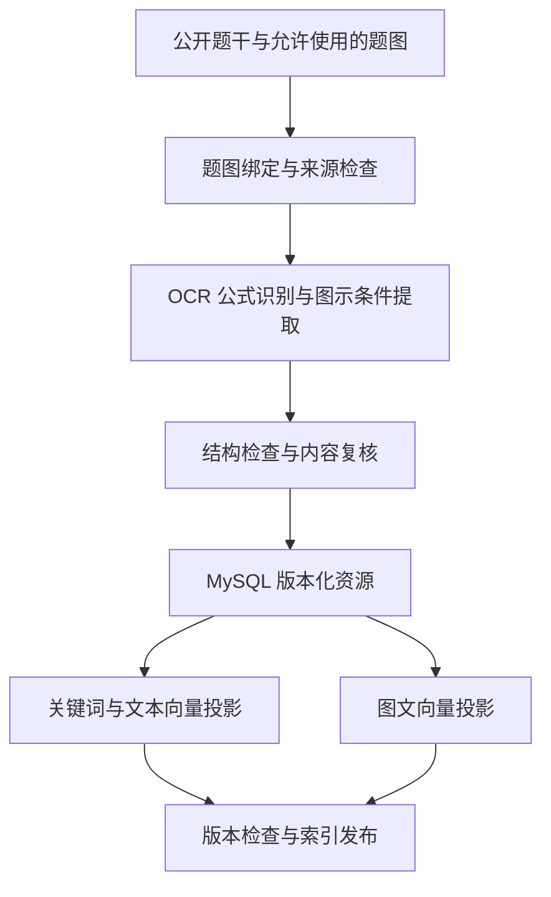

# 含图习题检索与多模态 RAG 方案

更新日期：2026-10-22。

状态：已按本方案实现后端链路并开展真实小规模试点。本文第二节保留实施前基线，其余设计约束继续适用；当前代码、运行方式、验证结果与未覆盖范围见 [实现与验证](21_multimodal_exercise_retrieval_implementation.md)。试点索引与完整课程索引隔离，尚未全量发布。

含图习题的检索目标是找到数学任务相关的题目。题图展示、模型读图、图片参与召回分别属于不同环节。当前系统已有文本混合检索与题图读图，需要补齐题图中的条件进入检索、图文联合召回，以及针对数学关系的相关性评估。

本方案采用两阶段实施：先把有来源的图示条件接入现有文本检索，再增加兼容的图文向量与多模态重排。MySQL 和原始图片保留业务事实，Elasticsearch 保存可重建的检索投影。

## 一 业务目标与检索意图

习题检索至少区分三种意图。相关性标注、排序和验收都应使用同一个意图定义。

| 意图 | 需要找到的题目 | 不能混同的情况 |
|---|---|---|
| 找原题或近重复题 exact | 题干、数值、条件和所求一致，允许截图、缩放等表示变化 | 图形相似但条件不同 |
| 找同构练习 isomorphic | 数值、字母或情境变化，数学关系与求解结构相近 | 仅属于同一知识点 |
| 找同方法例题 same_method | 能示范目标方法，题面和部分条件可以不同 | 外观相似，或只有宽泛标签相同 |

查精确题号时优先使用确定性查找，不增加读图和生成模型调用。找新练习时仍应用已见题与内容重复排除；换题号、换图片分辨率不自动成为新题。

同方法检索可以使用经过复核的参考解析归纳方法，但方法资源与公开题面使用不同投影，不能把参考答案直接返回给正在作答的学生。

## 二 实施前代码基线

以下是当前源码中的处理方式，不代表后文新增能力已经交付。

| 环节 | 当前行为 | 源码依据 |
|---|---|---|
| 习题索引输入 | 使用题干、选项构造文本，并附课程、知识点、题型和来源 | [indexing.py](../../backend/app/domains/courses/retrieval/indexing.py) 的 snapshot |
| 索引向量化 | 将标题与文本传给 ModelClient.embed | [indexing.py](../../backend/app/domains/courses/retrieval/indexing.py) 的 index_documents |
| 向量接口 | 接收字符串列表，调用文本 embeddings 接口；缓存区分模型、维度和输入 | [llm.py](../../backend/app/infrastructure/clients/llm.py) 的 embed 与 embedding_key |
| 向量字段 | 现有索引使用单个 embedding 字段 | [search.py](../../backend/app/infrastructure/clients/search.py) 的 ensure_indices |
| 在线召回 | 精确题号、BM25、文本 kNN 与 RRF；应用课程、公开可见性、知识点和题目排除条件 | [service.py](../../backend/app/domains/courses/retrieval/service.py) 的 retrieve |
| 题图读图 | 读取当前 math 课程允许的本地公开题干或选项 PNG，转为 Base64 image_url；排除答案与解析配图 | [images.py](../../backend/app/application/agent/images.py) 的 QuestionImageContext |
| 教材多模态提取 | 按小节结合原页图像提取资源并保存来源；与习题视觉索引是不同链路 | [教材多模态提取](16_textbook_multimodal_extraction.md) |

现有 embedding 输入即使包含 Markdown 图片链接，也只是链接字符串；该文本向量调用不会因此下载或编码图片像素。题图送进讲题模型发生在另一条上下文构建链，不能补救召回阶段漏掉的题目。

现有教材提取结果也不能直接批量索引：应先通过原流程的复核与公开目录投影，再按本方案构建检索表示，保留资源版本和来源关联。

## 三 图片类型与处理单位

### 3.1 按信息作用处理图片

| 图片作用 | 典型内容 | 处理方式 |
|---|---|---|
| 整题载体 | 拍照题、截图题，含题干、公式和图示 | 恢复题目区域与小问，关联同题文字和图像 |
| 必要条件 | 几何图、函数图像、电路图、统计图表 | 保留原图，提取可确认条件，并提供视觉召回表示 |
| 公式载体 | 扫描的分式、根式、方程 | 保留原图与识别表达式，记录符号或布局歧义 |
| 情境辅助 | 人物、河流、生活场景 | 保留关联；根据是否贡献条件决定检索权重 |
| 主要用于装饰 | 背景、吉祥物 | 保留原页；默认不单独建立视觉召回条目 |

分类可以多标签，并允许 unknown。不能仅按卡通、照片或边框样式决定教学作用；无法确定时保留原图及待复核项。

### 3.2 以完整习题组织资源

一个检索对象对应一道顶层习题，保存题干、选项、小问、所求、同题配图及明确条件。配图可以有多个，但都关联到同一个 question_id。共享一张图的小问应保留父子关系，不能拆成缺少条件的孤立文本。

优先使用题目级图文裁剪。整页混有其他习题、旁注或答案时，应分别识别和保存；裁剪不能丢掉图注、坐标轴单位或题干中的指代。题目跨页时保存多个来源区域，不假定一页就是一道题。

视觉检索可以使用多张同题配图或多个裁剪视图，但候选聚合时按题目去重，不因配图多而获得重复加分。

## 四 数学相关性难点

考虑两张外形近似的三角形图：

- 题目 A 明确给出 AD 垂直于 BC。
- 题目 B 明确给出 D 是 BC 的中点。

两者不能仅因图形相似而判为原题或同构题。反过来，同一道题旋转图形、重命名顶点或改变数字后，仍可能具有相同求解结构。

条件提取遵循以下边界：

1. 题干明示条件、图中明确标记和可读数值分别记录来源。
2. 图形看起来垂直、等长、平行，不能直接作为已知条件。
3. 由已知条件推导的结论与原始条件分开保存，不能用于伪装题面。
4. 无法读清的标记保存 unknown，不以模型自报置信分数代替复核。
5. 同方法检索允许题面条件不同；条件过滤不能机械地要求所有条件完全一致。

通用图文向量能提供候选，但不等于几何关系、物理约束或公式语义已经可靠建模。多模态重排同样是相关性判断，不是数学正确性证明。

## 五 离线构建流程



### 5.1 绑定图片与保存原件

为图片保存稳定资产 ID、内容哈希、题目 ID、原件位置、来源页和区域。数据库保留业务关联，图片原件保存在文件或对象存储中。

区分公开题干图、选项图、解答图和整页原件。用于习题公开检索的输入只从允许的题面区域生成；不能直接把带有解答的整页送去生成公开描述或向量。

图片路径、文件名和 URL 不是数学内容。图片缺失时记录状态，不根据链接猜图意。

### 5.2 提取检索用文字

输入包含完整题干与对应图片，输出以下内容：

- OCR 原始文本与规范化文本。
- 识别公式及其来源区域。
- 图中对象、明确标记、数值、单位和对象间关系。
- 原题所求目标与小问结构。
- 待确认符号、条件和图片关联。

保留原始输出及后续修订。模型输出先接受结构检查，再按内容风险复核。程序可以检查来源是否存在、公式字段是否为空、数值是否冲突及必要字段是否齐全，但这些检查不等于提取内容全部正确。

### 5.3 形成文本检索表示

文本检索表示由公开题面与通过检查的描述组成：

\[
R_t = T_{\text{stem}} + T_{\text{options}} + T_{\text{OCR}} + T_{\text{grounded diagram}} + T_{\text{goal}}
\]

其中加号表示按固定模板组合文本。先去掉图片 URL 等无语义占位，不修改原始题干存档。原生文字与 OCR 重复时去重；模型推测与未确认条件不混入确定条件字段。

同时保存完整文本哈希、实际送入向量服务的文本和截断策略。超长题按结构拆分为同题多个子表示，避免截断后漏掉题目末尾的条件或所求。

### 5.4 生成两类向量

阶段一继续使用文本向量：

\[
v_t = E_t(R_t)
\]

阶段二增加同题图文融合向量：

\[
v_m = E_m(T_{\text{public}}, I_1,\ldots,I_n)
\]

融合模型必须明确支持相应的图文输入方式；不能把字符串形式的图片路径当成图片输入。是否额外保存独立图片向量，由对照评测决定。

文本通道与多模态通道分别维护自己的模型空间。多模态查询编码必须与库内多模态向量兼容：

\[
s_m(q,d)=\frac{E_m(q)\cdot v_m(d)}
{\lVert E_m(q)\rVert\lVert v_m(d)\rVert}
\]

即使两个模型输出维度相同，也不能据此跨模型比较余弦相似度。模型版本或表示规则变化时建立新投影，不覆盖旧向量后继续使用旧查询编码器。

## 六 数据结构与索引

以下为拟新增的逻辑实体，名称不代表已有数据库表。

| 实体 | 核心内容 |
|---|---|
| QuestionAsset | 题目与图片关联、图片角色、文件哈希、原件位置、页码和区域、读取状态 |
| QuestionRepresentation | OCR、公式、明确条件、所求、待确认项、来源、提取模型与提示版本、复核状态 |
| QuestionSearchProjection | 检索文本、表示哈希、关联资源版本、向量模型与索引版本、构建状态 |
| QuestionMethodReference | 复核过的方法摘要及内部解析来源，使用独立权限与读取投影 |
| RetrievalReceipt | 查询意图、实际通道、各通道排名、融合和重排结果、耗时、用量与降级原因 |

条件记录示例：

```json
{
  "relation": "perpendicular",
  "objects": ["AD", "BC"],
  "evidence_kind": "explicit_diagram_marker",
  "asset_id": "asset_001",
  "source_region": [0.32, 0.40, 0.46, 0.58],
  "region_coordinate_system": "normalized_image_xyxy",
  "review_status": "pending"
}
```

上述坐标仅演示字段格式，实施时必须由真实资产区域产生。条件记录的复核状态不等于向量条目的发布状态；待复核条件不能进入确定条件过滤字段。

原始题目与资源版本保存于主库。现有 ES 单 embedding 字段不能同时表示不同向量空间。阶段一为增强文本建立新的版本化索引；阶段二为图文向量使用独立版本化索引，使用相同 question_id 与资源版本进行候选合并。向量字段维度与相似度配置属于索引版本，迁移时不直接修改现有索引维度。

缓存至少区分模型版本、向量维度、表示版本、题目内容哈希和图片内容哈希。图片更新而题干不变时，也必须使旧图文向量失效。

索引发布应校验各通道的资源版本，再切换配置或别名。重试幂等键覆盖题目版本、资产版本和处理配置；恢复任务只重建缺失或失效步骤。撤回或删除题目时同步撤回所有通道，避免旧视觉索引仍返回题目。

## 七 在线检索流程

### 7.1 查询输入与意图

支持三种输入：纯文本、图片、文字与图片组合。阶段一可以先支持已有题目 ID 及其受控资产；用户上传图片入口另行接入资源服务，不能因为检索契约有 asset_ids 就视为上传功能已实现。

拟新增的查询内容契约：

```json
{
  "intent": "isomorphic",
  "query_text": "找一道利用数轴比较有理数大小的题",
  "asset_ids": ["validated_query_asset_001"],
  "top_k": 5
}
```

课程、用户、会话、可读资产范围、已见题排除与答案读取权限，由服务端上下文产生并验证。模型或请求体不能通过自报权限提升访问范围。临时查询图片不自动进入共享题库。

### 7.2 查询路由

| 输入情况 | 检索行为 |
|---|---|
| 精确题号 | 先确定性查找，成功后不调用读图 |
| 纯文本 | BM25、文本向量；启用阶段二后，可用同一多模态空间的文本编码查询视觉索引 |
| 图片为主 | OCR 与图示条件形成文本查询，阶段二补充视觉查询 |
| 文字加图片 | 联合理解完整任务，文本查询与图文查询分别进入兼容通道 |
| 图片无法读取 | 保留可用文字通道并标记降级；无有效题意时返回无法完成相应检索 |
| 缺少可靠知识点标签 | 使用宽范围召回，不把模型猜测标签作为强制过滤条件 |

所有通道应用一致的课程、可见性和排除约束。模型识别出的题型与知识点可先作为软排序特征；只有可信业务条件才作为硬过滤。

### 7.3 召回与融合

并行执行已启用通道，再按 question_id 聚合：

- 精确题号或经确认的原题匹配。
- BM25 关键词召回。
- 题干与图示描述的文本向量召回。
- 阶段二的图文向量召回。

同题多个视觉视图在单一通道内部先聚合，默认采用最佳匹配视图，防止图片数量影响排名。各通道的原始分数不直接相加，先使用 RRF：

\[
S_{\text{RRF}}(d)=\sum_{c\in C}\frac{1}{k+r_c(d)}
\]

其中 C 是本次实际成功使用的通道，r 是题目在该通道中的排名；未召回时该通道不贡献分数。k 初始沿用现有实现的 60，后续只在验证集上调整。RRF 分数不是正确率或条件匹配概率。

每个通道候选规模、重排范围和最终条数由配置控制，并随评测记录。精确题号命中保持优先，不被视觉推荐排名覆盖。

### 7.4 多模态重排

对有限候选同时提供查询题干、查询原图、候选题干、候选原图和有来源的描述，判断其在当前意图下的相关性。返回：

- 匹配类型：exact、isomorphic、same_method、topic_only 或 unrelated。
- 匹配依据及来源。
- 影响当前意图的明确条件差异。
- 未确认信息。
- 可供检索排序使用的相关性结果。

重排不要求生成完整答案。原题模式需要重点检查数值和条件一致；同构模式检查关系与操作结构；同方法模式可以接受部分条件不同，不能照搬原题模式的否决规则。

只有高可信、与当前意图相关的差异才用于排除候选。模型没看清的标记应作为待确认项，不能自动改判为“不存在该条件”。

## 八 生成与返回边界

检索结果返回题目公开结构、原图资产、来源、实际检索通道、匹配类型和适用范围。讲题模型需要原图像素时，通过受控资源服务读取，不依靠图片 URL 字符串猜测。

公开题面索引和回执不包含标准答案、完整解析及解析配图。对同方法例题，需要使用内部方法资源时，由业务服务按教学阶段读取，向学生发布的内容仍由教学流程决定。

新建图示描述也遵守相同边界：描述不得把模型求出的结论或原解内容混入已知条件。教材整页原件可能包含答案，其访问与题面裁剪分开管理。

建议在回执中区分以下信息，避免将不同分数混为一谈：

- 各通道原始排名与可选原始分数。
- rrf_score。
- rerank_score 及重排模型版本。
- match_kind 和关键差异。
- extraction_status、channels_used、degraded、reason。
- OCR、向量、召回、融合、重排的分项耗时和用量。

## 九 降级与成本控制

| 故障或限制 | 处理方式 |
|---|---|
| OCR 或公式识别失败 | 保留原图；记录失败区域，继续可用通道，不补造符号 |
| 图示描述不可靠 | 不作为确定条件发布；图片完整时可继续视觉召回 |
| 图文向量服务失败 | 使用文字通道并明确本次未使用视觉召回 |
| 文本向量服务失败 | 使用 BM25 或其他可用通道，保留原有范围约束 |
| 重排失败或预算不足 | 返回融合排序，并注明未完成重排 |
| 图片是唯一有效条件且所有读图路径失败 | 返回受限结果或无法完成，不能回退为随机同章题 |
| 资产或索引版本不一致 | 重新核对主库；过期投影不得以当前版本返回 |

离线提取和向量生成按内容哈希缓存。在线只处理新查询图片，限制候选重排范围，并记录真实请求、重试和 Tokens。已有题图读图限额属于讲题上下文实现，不能直接当作新检索任务的容量基准。

试点可以依次比较“融合候选不重排”“文本重排”“多模态重排”的效果和成本，再决定何时启用更贵的路径。每次模型排序仍是一次相关性判断，不叠加成未经验证的高置信结论。

## 十 模块接入建议

遵守当前 API、应用编排、领域规则与基础设施分层，以下为拟议职责：

| 模块位置 | 职责 |
|---|---|
| domains/materials 下的资产与提取模块 | 原件、题图角色、来源、提取版本和复核状态 |
| domains/courses/retrieval | 查询意图、条件匹配策略、候选聚合和公开结果 |
| application 下的检索构建任务 | 提取、复核、向量生成、索引发布、恢复和用量收据 |
| infrastructure/clients | 独立的图文 embedding 与重排客户端，复用连接、限流与错误约定 |
| infrastructure 下的索引适配 | 版本化文本和图文索引、别名切换、撤回与重建 |
| API 与 Agent 工具 | 接收查询内容，使用可信上下文调用统一检索入口 |

不将 OCR、资产读取、模型调用和所有排序策略堆入现有 service.py；也不把应用层的 QuestionImageContext 直接反向依赖进领域服务。可抽取共同的受控资产读取设施，分别供讲题和检索使用。

教材提取提供三类教学资源及来源，本方案消费其中通过复核的习题与必要图示。讲解模式和方法资源可以用于同方法检索，但不以教材提取完成自动代表索引发布完成。

## 十一 实施阶段

| 阶段 | 交付内容 | 完成条件 |
|---|---|---|
| P0 现状与评测集 | 含图题清单、图片作用、三种意图标签、原文及来源、基线回执 | 能重放现有检索并逐题解释命中和漏召回 |
| P1 图示文本增强 | 资产绑定、条件提取、复核、增强文本索引、来源回溯与降级 | 与 P0 使用同一查询集对照，完成失败样例审查 |
| P2 图文补充召回 | 兼容的图文模型与独立索引、候选去重、RRF、多模态重排 | 完成消融实验，报告增益、退化、耗时和成本 |
| P3 受控接入 | 按课程和意图启用、旧路径回退、资产及索引版本治理 | 新旧路径均可重放，权限、撤回与失败恢复符合契约 |

先建设一个能够逐题检查的含图检索试点，再扩大课程和题量。没有给出固定的正确率或延迟承诺；验收阈值应在 P0 基线后、查看最终测试结果前确定。

原方案交付时未改变索引与代码；后续实现使用独立试点命名空间构建新索引，保留原课程索引和回退路径。

## 十二 评测与验收

### 12.1 评测数据

按检索意图建立独立的相关性标签，覆盖：

- 纯文字题、文字加必要配图、整题截图、公式图片和含装饰图片的题。
- 几何、函数图像、数轴、物理图示与图表。
- 外形近似但关键条件不同的困难负例。
- 图形旋转、顶点改名、数值改变后的同构题。
- 外形不同但使用同一方法的题。
- 图中文字、单位、负号或角度标记不清的题。
- 多图、共享图、多小问及跨页题。

原题截图、裁剪、缩放和近重复版本按题目来源组分配到数据划分中，避免同一来源的变体同时进入调参集和最终测试集。评测标签需逐题审查；模型生成标签只作为候选。

### 12.2 对照实验

固定题库版本、查询、可见性、排除条件、候选规模及运行预算，比较：

| 组别 | 检索链路 |
|---|---|
| A | 现有题干与选项的 BM25 和文本向量 |
| B | A 加有来源的 OCR 与图示条件描述 |
| C | B 加图文向量补充召回与 RRF |
| D | C 加多模态重排 |

分别报告纯文字与含图子集、不同学科及三种检索意图，避免总体平均掩盖几何题退化。每组记录真实模型、索引版本、耗时、请求、重试和成本；缓存命中与冷启动分开统计。

### 12.3 指标

- Recall@K：相关题集合进入前 K 的覆盖情况。
- 原题查找使用 Top1 和 MRR；同构与同方法排序使用分级相关性及 nDCG@K。
- 关键条件误召回：按照当前意图的标签统计被判为相关、但关键关系不成立的结果。
- 提取质量：负号、数值、单位、公式和关键关系的遗漏或误写，来源能否定位。
- 去重质量：同题多图、换题号和近重复是否造成重复结果或错误的新题证据。
- 运行质量：成功率、降级率、重试、P50 与 P95 耗时、查询成本和重建成本。

### 12.4 必须检查的行为

1. 题干原题查找不被图片 URL 或其他通道推荐覆盖。
2. 文本模型和视觉模型的向量不跨空间比较。
3. 同题多图不重复加分。
4. 未确认关系不进入确定条件字段。
5. 公共检索与图片裁剪不泄露答案或解析图。
6. 课程、资产可见性和已见题排除对所有通道生效。
7. 任一通道失败均如实标注，纯图失败不伪装为成功理解。
8. 资产或表示变化能够触发重新构建，任务恢复不重复写入相同版本。
9. 题目撤回后，文本和视觉索引均不能继续返回旧公开结果。
10. 对照报告保留失败题原图及回执，不能只给平均分。

## 十三 面试表达边界

实施前可据源码说明：项目已有题干与选项的 BM25、文本向量与 RRF，以及将受控题图送给模型读图的链路；当时图片像素尚未进入 embedding 调用。当前新增的融合向量、重排和真实试点证据见实现文档，不应继续使用该历史表述描述新链路。

方案可说明：将题干与必要题图关联，一路提取明确条件增强文本检索，一路使用兼容图文向量补充召回，融合后结合原图重排。以同图异条件、异图同方法的题集检验数学相关性。

只有 P1 和 P2 完成后，才将对应能力表述为“已实现”。具体效果必须附对照数据，不使用“解决了所有几何关系”“图片检索准确率高”等无测量结论。

## 十四 参考资料

- [阿里云多模态向量接口](https://help.aliyun.com/en/model-studio/multimodal-embedding-api-reference)：共享语义空间、独立与融合表示及图文输入契约。模型支持相应输入不代表对中文数学题的效果已验证。
- [Elasticsearch RRF 文档](https://www.elastic.co/docs/reference/elasticsearch/rest-apis/reciprocal-rank-fusion)：使用各通道排名融合候选，避免直接相加不同量纲的相关性分数。
- [现有检索专题](03_retrieval_and_graph_rag.md)：现有文本检索与范围约束的项目背景，具体实现以第二节源码入口为准。
- [教材多模态提取](16_textbook_multimodal_extraction.md)：教材三类资源、原页来源、复核和公开目录的接入边界。

