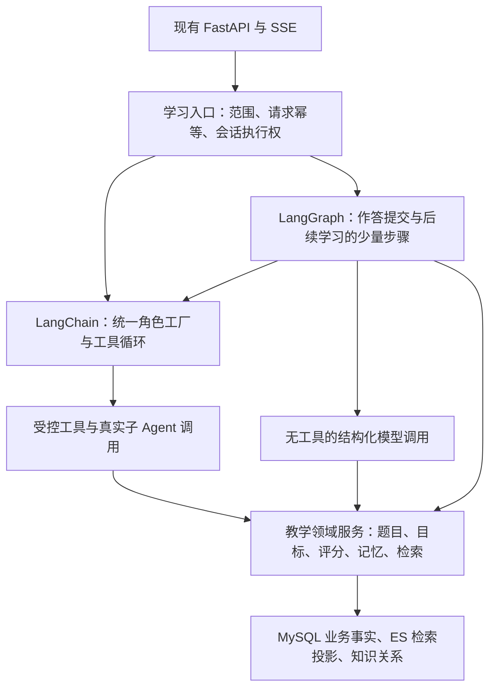

# 核心学习业务优先的系统与数据库简化计划

初稿：2026-10-22；本次更新：2026-10-23。历史阶段状态：**F0～F4、S01～S13、S15/S16 已完成本批验收；S14 按用户要求暂不实施**。第一至四批分别见 [24 号](24_f0_p0_implementation_and_acceptance.md)、[25 号](25_p1_s05_s09_implementation_and_acceptance.md)、[26 号](26_p2_s10_s13_implementation_and_acceptance.md)、[27 号记录](27_p3_f3_f4_s15_s16_implementation_and_acceptance.md)。该阶段实验库 28 表；第四批生产源码净减 254 行，不增删表，主要减少重复协议、执行分支和 JSON 副本。

**后续实现**：[28 号原生化计划](28_langchain_langgraph_native_architecture_plan.md)的 N0／N1 历史成果见[29 号记录](29_native_n0_n1_implementation_and_acceptance.md)；N2～N6 已完成，当前实现与验收见[30 号记录](30_native_remaining_implementation_and_acceptance.md)。旧模型／工具桥、独立控制器和请求内作答图已退出，实际 MySQL 为27表、SQLite另有2表；831项完整回归、前端15项及构建、真实模型全链和运行服务v2切换通过。本文保留第一至四批的设计与边界，不把请求内检查点描述为当前持久恢复实现。

本次修订：在保留三级递归记忆、知识点 GraphRAG、会话主子目标、并发生成与整组提交、基础语义压缩和 SSE 的基础上，纳入 **LangChain `create_agent` 替换自定义模型工具循环、LangGraph 承接少量业务步骤编排**的方案。具体旧代码去向、分阶段迁移和验收见第 13 节。上一版通过取消部分核心能力得到的 20 表目标已撤回。

本计划基于代码、主库核验和前端调用。目标是减少业务状态、重复持久化和运行依赖，让初学者能够沿少数几条调用链理解项目；不以目录改名、增加通用框架或压缩代码排版作为精简成果。2026-10-23 用户已授权 F0／S01～S04，并明确允许修改当前实验数据库；后续按阶段继续验收。

本文是系统简化与框架迁移的统一计划。[13 号旧框架迁移提案](13_harness_framework_migration_plan.md)仅保留历史背景，其中评估预测反思子图、额外通用操作账本等扩张项不自动纳入本次范围。当前生产角色入口已切换为标准 Agent 工厂；保留业务权限、来源覆盖、固定任务投影与硬预算策略，不把这些规则交给框架默认行为。旧循环、运行器和批调度文件已删除，F3/F4 与 S15/S16 已收敛，实际删除和保留边界见 27 号记录。

## 1. 推荐的产品边界

推荐把学习版固定为以下闭环：

> 教材原页 → 定义与教学模式、习题、方法提取 → 来源复核 → 主子目标驱动的讲解与知识点 GraphRAG → 单题或并发习题组 → 真实原答评估 → 分层记忆归纳与长会话接续。

| 必须保留 | 保留理由及边界 |
|---|---|
| 教材三类提取与原页来源 | 定义和教学模式、习题、方法技巧是产品重点；保留页码、区域、原件哈希、复核与撤回，仍只处理已约定的第一章 |
| 文本、题图与多模态检索 | 保留精确题号、BM25／向量、图文召回和可选重排；来源、图像角色和编码器版本仍校验 |
| 课程讲解、粘贴新题、连续追问 | 保留两个业务入口，迁到同一个 LangChain 角色运行入口；不为讲题再维护第二套模型工具循环 |
| 四个业务角色 | 保留主助手、知识讲解、练习、评估的职责；自主工具角色共用 `create_agent` 工厂，纯评分等无工具调用使用结构化模型；不增加独立 Agent 服务 |
| 单题与并发习题组 | 题库优先；保留限流并发生成、每题独立求解与复核、整组提交和逐题反馈，不通过取消题目验证来降低复杂度 |
| 作答与历史正确性 | 保留原答、冻结题目、帮助标记、评分依据、请求幂等、未知掌握度和刷新恢复 |
| 学生／课程／知识点三级记忆 | 保留有来源的观察与递归归纳；实际归纳从知识点逐级到课程和学生，读取按需要选择层级；摘要不直接修改掌握度 |
| 知识点 GraphRAG | 保留“种子知识点→关系扩展→限定材料召回→引用”的完整检索链，而不只是显示图；底层 Neo4j 可在等价验收后换成现有 MySQL 关系 |
| 同会话主目标与子目标 | 保留有界多级目标树、单个活动路径、暂停与补救后返回；简化任意跨分支依赖调度 |
| 基础长会话压缩 | 保留历史语义摘要＋近期原文＋完整当前任务，不以只取最近 N 条消息替代压缩 |
| 基础 SSE 流式输出 | 保留正文增量、心跳、断线后的后台执行与刷新恢复；无需 SQL 逐事件保存，Redis 临时缓冲可选 |

**推荐裁掉或收缩的实现**：新旧记忆双流水线、固定三级之外的通用依赖图、重复状态表、任意跨分支目标 DAG、无界检查点历史、SQL 历史 SSE 事件库、跨失败延续只读工具额度、多口径难度比较，以及完成框架替换后的自定义模型工具循环／通用修复和调度代码。主子目标、习题组、递归归纳和基础压缩不列为裁掉项。

六项保留能力已经由用户明确。本版其余实现取舍仍是待评审建议；允许少一些通用性或精确局部重算，不允许退化为没有分层记忆、没有子目标、只能单题或只截历史。

## 2. 当前基线与本轮核验

| 项目 | 上一轮只读审计基线 |
|---|---|
| MySQL `stem_tutor` | 49 张实际表，与 ORM 49 张一致 |
| 后端业务源码 | 237 个 Python 文件，24,027 行，含注释和空行 |
| 模型记忆模块 | 27 个文件，3,114 行 |
| 原始业务记录 | 124 个会话、739 条消息、48 次作答、32 条学生状态 |
| 题目与资料 | 7,973 道题、1,457 份材料、1,386 个知识点 |
| 教材 | 旧原件 8 行、新 PDF 1 行、小节与任务各 15 行、拆分资源 395 行、旧教学包 52 行 |
| 图文检索 | 13 个资产、29 个表示、48 个投影；已有试点为 16 题 |

关键代码事实：

1. [小节提交](../../backend/app/domains/materials/extraction/store.py)重复保存完整小节与拆分资源；[公开读取](../../backend/app/domains/materials/extraction/queries.py)及[课程发布](../../backend/app/domains/materials/extraction/catalog.py)直接读小节。资源表的读取只见测试与验收脚本。
2. 15 对小节与任务全部同 ID；[create_job](../../backend/app/domains/materials/extraction/store.py)当前没有一个小节关联多份独立任务的实现。
3. 52 个教学包均有对应 Question，未发现同 question_id 多包；这支持将每题教学参考并入题目，但仍要核对完整内容及冻结引用。
4. 旧文档 8 行只有 3 组不同的 `(course_id, content_hash)`，包含同原件的不同解析快照；新 PDF 与旧文档无相同哈希。不能去重原件时把不同解析档案丢掉。
5. [SSE 输出](../../backend/app/api/streaming.py)写 `run_events`，但前端恢复使用[会话轮询](../../frontend/src/streaming/recovery.ts)，未发现前端消费 `/sessions/{id}/events`。
6. [启动装配](../../backend/app/bootstrap.py)已接入新版记忆，但仍有旧分支和旧摘要依赖。新记忆若干表为空不代表写入机制不存在。

本节数字是 P0 前的审计基线。2026-10-23 实施后数据库已由 49 表变为 44 表，生产源码净减少 197 行；F0 真实模型、归档还原、两次初始化与完整回归结果见 24 号记录。不得把这里的旧行数当作实施后的当前数量。

2026-10-23 迁移前源码核对（历史基线，当前结果见 27 号记录）：`agent/runtime`、`agent/context`、`application/agent` 的非初始化 Python 文件分别为 9／6／11 个，共 3,209 行（含空行和注释）。它们包含权限、公开字段和记忆撤回等保留逻辑，不能将 3,209 行全部当作可删除代码。生产 [requirements.txt](../../backend/requirements.txt) 尚未声明 LangChain／LangGraph；[F0 锁定文件](../../backend/requirements-agent-f0.lock.txt)仅供隔离验证，生产框架替换收益仍待 F1～F4 验证。

## 3. 目标规模与数据归属

推荐最终使用 **28 张运行表**：保留 27 张现有表，22 张现有表退出运行库，新增 1 张合并后的 `model_calls`。其中 22 张不是全部直接删除：包含归档、合并和退役重复机制。

该表数适用于本版默认的基础恢复模式：正式业务事实和压缩摘要仍在现有 MySQL 表，LangGraph 执行态默认只用有界进程内检查点，不额外创建持久化执行表。若后续选择持久化 checkpointer，必须单列其新增的 N 张基础设施表及其他存储对象，实际总表数为 28＋N（完整难度系统为 31＋N），不得把表移到其他存储后仍宣称物理总数为 28。第 13.4 节说明恢复边界。

相对旧版 20 表，恢复 5 张模型记忆表、目标状态表、整组提交表和薄摘要缓存表，共加 8 张。模型记忆从 11 表收敛为 5 表，`memory_items` 仍独立保存错因证据。若额外保留完整难度系统则为 31 表。数字是合并验证通过后的目标，不能为了凑表数而取消六项核心能力。

| 最终数据所有者 | 运行表 | 数量 |
|---|---|---:|
| 课程与公开资源 | `courses`, `concepts`, `questions`, `materials`, `concept_relations` | 5 |
| 会话与主子目标 | `learning_sessions`, `messages`, `session_goal_states` | 3 |
| 原答、整组与能力证据 | `attempts`, `batch_submissions`, `evidence_concept_links`, `student_states` | 4 |
| 错因观察 | `memory_items`，保留带正式证据的错因记录 | 1 |
| 递归模型记忆 | `memory_facts`, `session_concept_observations`, `session_memory_extractions`, `scope_memories`, `memory_jobs` | 5 |
| 长会话压缩 | `context_checkpoints`，压薄为每会话／角色的有效摘要缓存 | 1 |
| 教材 | `textbook_documents`, `textbook_import_receipts`, `textbook_extraction_sections` | 3 |
| 图文检索 | `exercise_search_assets`, `exercise_search_representations`, `exercise_search_projections` | 3 |
| 索引状态 | `index_tasks`，接管图文构建租约 | 1 |
| 教材及题检模型调用 | `model_calls`，由两张调用表合并，包含临时读图和在线重排 | 1 |
| Agent 运行诊断 | `agent_runs`，保留必要私有诊断 | 1 |
| **合计** | | **28** |

题目业务的核心仍是 `questions`、`attempts` 与评分归因；图文检索另外保留资产、审核表示和发布投影。后者确有不同生命周期，不能为了宣称“两张题目表”而把来源审核、答案和索引状态全部塞进题目 JSON。

`questions` 是题目事实；`attempts` 是学生真实提交；`evidence_concept_links` 是评分贡献；`student_states` 是能力汇总。`materials` 与 ES 是检索投影，不能反过来修改原件或历史评分。

## 4. 第一批：直接退出重复记录和退役机制

### S01 删除教材拆分资源副本

- **位置**：[extraction/models.py](../../backend/app/domains/materials/extraction/models.py)、[store.py](../../backend/app/domains/materials/extraction/store.py)，以及 [test_textbook_extraction.py](../../backend/tests/test_textbook_extraction.py)、[验收脚本](../../scripts/evaluation/check_textbook_extraction.py)。
- **减法**：去掉 `ExtractedResource` 模型和提交时按 definitions/exercises/methods/teaching 拆行的写入。小节完整 payload 和复核后的 `questions/materials` 投影保留。
- **数据库**：`textbook_extracted_resources` 395 行导出后退役；逐条验证可从对应小节还原 kind、source_id、内容哈希。不能只比较总行数。
- **核心影响**：现有学生读取、教材原页复核和目录发布应无行为变化；验收改为核对真实返回与来源，不再断言冗余表有多少行。

### S02 删除没有业务消费的检索方法表

- **位置**：[question_retrieval/cli.py](../../backend/app/application/question_retrieval/cli.py)、[search/models.py](../../backend/app/domains/courses/questions/search/models.py)。
- **减法**：取消 `method` 登记命令及 `QuestionMethodReference`，退 `exercise_search_methods`。当前 0 行，但仍需检查迁移时是否新增人工记录。
- **核心影响**：**不删除教材 methods 提取，也不删除 same_method 检索意图**；线上同方法检索目前不读此表。

### S03 取消 SSE 事件逐条持久化

- **位置**：[api/streaming.py](../../backend/app/api/streaming.py)、[sessions 路由](../../backend/app/api/routes/sessions.py)、[execution_models.py](../../backend/app/infrastructure/persistence/execution_models.py)。
- **保留与减法**：正文增量、心跳和完成／错误事件继续通过 SSE 输出；默认沿用现有进程内队列，退 `RunEvent` 和 SQL 历史 `/events` 查询。前端迁移完成后旧接口明确退役，不返回伪造的空历史。
- **数据库**：`run_events` 9,231 行作为诊断归档，不迁进学生消息；保留 `agent_runs`。
- **队列边界**：队列必须有容量上限；客户端断开后停止向无人消费的队列投递，不能因为缓冲满而阻塞业务提交。后台任务继续完成，正式消息、题目和作答仍写 MySQL。
- **Redis 可选**：只有需要短时重连回放时才用 Redis 保存按会话／运行隔离的有界临时事件，设 TTL 与数量上限；Redis 不作学习事实来源，也不引入消费者任务引擎。缓存丢失或不可用时回到权威会话快照，不重复执行出题或评分。
- **核心影响**：保留基础流式显示和刷新恢复；取消 SQL 逐帧历史，但当前前端没有依赖它。临时事件回放不等于从任意模型位置恢复，后端重启仍如实标记未完成运行中断。
- **框架衔接**：F2 将 LangChain 的公开正文／状态事件适配到既有 SSE 协议；S03 只改变事件存储，不绑定框架切换。S03 先实施时仍使用旧生产者，F2 完成后只保留新生产者。不得同时向前端输出两套重复流。

### S04 旧专用辅导完全退出在线系统

- **位置**：原 `backend/app/domains/students/legacy.py` 与 `legacy_models.py` 已删除，固定摘要由 [archive.py](../../backend/app/domains/students/archive.py)承接；[学生查询](../../backend/app/domains/students/service.py)、[学习入口](../../backend/app/application/learning/service.py)、[会话查询](../../backend/app/domains/sessions/service.py)、[Workspace](../../frontend/src/features/Workspace.tsx)已切换。
- **减法**：取消旧表实时统计、专用状态解释和旧入口跳转。旧会话原题转成通用讲题输入；历史统计固定为带版本的归档展示。
- **数据库**：`tutoring_actions`、`tutoring_evidence` 各 120 行完整归档；保留原学生、会话、原答／原观察、模拟标记和来源。不能把旧模拟证据升级为正式掌握证据。
- **核心影响与实施**：新讲题保留；旧记录可查，在线不再运行旧统计。P0 已把旧观察迁入 `memory_facts` 并断开补扫依赖，再物理退表；历史统计从固定档案读取。
- **避免误删**：不能按 `_tutoring_*` 名称批量清理状态；当前通用讲题仍使用 `_tutoring_order` 处理消息排序，须保留或在同一变更中迁为中性顺序字段。

## 5. 第二批：统一实体和状态，不再自建通用业务框架

### S05 统一教材原件、小节与任务

- **位置**：[materials/models.py](../../backend/app/domains/materials/models.py)、[textbooks.py](../../backend/app/domains/materials/textbooks.py)、[extraction/models.py](../../backend/app/domains/materials/extraction/models.py)、[store.py](../../backend/app/domains/materials/extraction/store.py)、[queries.py](../../backend/app/domains/materials/extraction/queries.py)、[提取编排](../../backend/app/application/textbooks/extraction.py)、[TextbooksPage](../../frontend/src/features/TextbooksPage.tsx)。
- **原件合并**：PDF 与 HTML/Markdown 的原件都进入 `textbook_documents`；页数、页图根目录及 manifest 是 PDF 来源元数据。保留两种解析策略，不保留两套原件注册。旧 8 份 parsed 快照保留解析版本及来源映射，不能按相同原始哈希覆盖。
- **任务合并**：当前小节记录本身是带 fingerprint 的提取版本，将任务状态、尝试次数、错误、租约和回执并入该记录，取消同 ID 的 Job 副本。明确区分 `extraction_status` 与 `review_status`；提取完成不等于复核通过。
- **ID 与接口**：优先保留原 book/section/job ID；确需归一化时提供一次性映射，覆盖来源 URI、题目 validation、图片绑定、旧消息和教学包引用。迁移期 `/textbook-extraction/jobs/{id}` 从小节投影返回，不能让现有 CLI 或脚本失去任务查询。
- **拆开去重与合表**：本阶段可以将 PDF 按原 book ID 迁入 documents，先保留旧 8 份解析记录；不能立即新增 `(course_id, content_hash)` 唯一约束。原始二进制去重是后续独立优化，不与删除解析版本绑定。
- **来源指纹**：题号、版本、知识点、source_ref、section ID、资产身份或像素变化，都可能使 `source_hash` 变化。逐题对照指纹，变化项必须做受影响的重新构建／必要复核；失败时保留旧可用发布。不修改身份的缓存合表可以要求 0 新模型调用，来源归一化不能一概承诺 0 重建。
- **数据库**：退 `textbook_extraction_books`、`textbook_extraction_jobs`；保留 `textbook_import_receipts` 的请求幂等，不为少一张表改成无界 request_id 数组。
- **验收**：原始字节与哈希一致；页码/BBox 可定位；中断后复用完成的分页请求；过期 token 不能提交；复核不通过仍撤回目录。当前前端主要依赖旧 `/textbooks` 与 `/teaching-packs`，必须同时迁移读取，不能直接删旧链路。

### S06 每题教学参考归回题目

- **位置**：[textbooks.py](../../backend/app/domains/materials/textbooks.py)、[teaching_packs.py](../../backend/app/domains/materials/teaching_packs.py)、[resources/access.py](../../backend/app/domains/materials/resources/access.py)、[read.py](../../backend/app/domains/materials/resources/read.py)、[课程模型](../../backend/app/domains/courses/models.py)。
- **减法**：当前每题一包，将不重复题干和答案的教学路径、方法、来源、校验信息放入明确类型的 `Question.teaching_reference`；取消 Question→Pack→Document 三段联查和双份题面。这里是每题的附属数据，不是万能 payload。
- **数据库**：迁出 52 份包后退 `teaching_analysis_packs`；保留旧 pack_id、内容哈希与来源版本可寻址。若实施前发现一题多包或独立编辑需求，则保留该表，目标数加 1，不强行吞掉独立实体。
- **影响控制**：冻结题目中的 pack ID／hash 不变或有确定映射；旧 `/teaching-packs` 迁移期从题目参考生成公开结构，内部答案和推导仍不公开。前端最终直接以 question_id 开始讲题，再移除旧读接口与兼容代码。
- **双版本哈希**：旧 payload_hash 与包内 catalog hash 对应完整原包；迁移后分别保存 legacy pack ID／hash 和新参考 schema 的 hash。冻结引用按对应旧版本校验，不能用新裁剪结构反算旧 hash，也不能仅由转换后的 Question.answer 反拼原档案。

### S07 两类教材及题检模型调用合一

- **位置**：[教材 model_calls](../../backend/app/application/textbooks/model_calls.py)、[提取 store](../../backend/app/domains/materials/extraction/store.py)、[图示 vision](../../backend/app/application/question_retrieval/vision.py)、[search/store.py](../../backend/app/domains/courses/questions/search/store.py)。
- **减法**：`textbook_extraction_calls` 与 `exercise_search_calls` 合为薄 `model_calls`；字段包含 purpose、所属资源、stage、page、request_hash、model、status、error、response、metrics 和时间。只共享请求缓存与审计，不抽象 prompt 工作流、任务 DSL 或新的队列引擎。
- **缓存约束**：完成结果按业务目的和请求指纹查找；失败不得命中成功缓存；保留同请求多次尝试，不能把 request_hash 直接设成“只能有一行”。迁移保留旧请求身份、模型、版本、用量和所有失败回执。
- **核心影响**：同配置重放应仍为 0 次新增上游请求；教材分页恢复和图文构建缓存不退化。`agent_runs` 记录 Agent 执行，粒度不同，继续独立。
- **在线路径**：当前 `vision.py` 也为在线查询临时读图、在线重排写调用记录；`cache=False` 仅表示不复用缓存，不表示没有审计。本方案由 `model_calls` 承接这些记录，不能声称删除检索回执表后整个检索完全无 SQL 诊断写入。

### S08 收缩检索构建的独立管理机制

- **位置**：[search/store.py](../../backend/app/domains/courses/questions/search/store.py)、[build.py](../../backend/app/application/question_retrieval/build.py)、[service.py](../../backend/app/application/question_retrieval/service.py)、[IndexTask](../../backend/app/domains/courses/models.py)、[health](../../backend/app/api/routes/health.py)。
- **减法 A**：构建租约进入 `index_tasks`，主键范围明确包含课程、命名空间和目标；新增必要 token／lease_until 标量，保留原子 claim、renew 与失效拒绝提交。退 `exercise_search_build_leases`，不以本地文件标志代替并发控制。
- **减法 B**：查询回执仍随响应返回，完整诊断按 trace_id 进入有保留期的结构化日志；退 `exercise_search_receipts` 的每查询数据库写入。日志写失败不得令有效检索失败。代价是取消 SQL 历史回执查询；若它成为正式产品要求，则保留表，目标数加 1。
- **保留**：资产归属／题面裁剪、审核表示、当前索引投影三表，以及源版本拦截、编码器匹配、文本／图文别名发布。它们不是当前应强行合并的重复实体。

### S09 取消呈题前预测，收回生成专用诊断表

- **位置**：[LearningService.pose_contract](../../backend/app/application/learning/service.py)、[AssessmentService](../../backend/app/domains/assessment/service.py)、[assessment/rules.py](../../backend/app/domains/assessment/rules.py)、`predict Skill`（原计划路径，当前已无此文件）、[practice/service.py](../../backend/app/domains/practice/service.py)、[reviews.py](../../backend/app/domains/practice/reviews.py)。
- **预测减法**：取消每次呈题固定发生的作答前预测模型调用、Prediction Schema、预测偏差反思及相关提示词；呈题仍冻结版本、目标和帮助状态。失去预测展示，不影响基于真实原答判分。
- **生成减法**：保留“生成→独立解答→语义复核”的数学检查；接受题目的审阅 run_id 已可关联 Question。必要私有诊断使用 `agent_runs` 的受控私有字段，失败过程不再另做完整业务账本，退 `exercise_generation_attempts`。
- **隐私与历史**：54 条旧诊断先完整归档；扩展运行记录时，`/runs` 和 SSE 明确排除私有诊断，不把它放入公开 tool_calls 字段。若无法证明诊断可定位且不泄露，先保留该表，不直接删审核。
- **审计寻址**：冻结题目内的 generation_attempt_id、旧 SSE audit_id 仍能定位归档；新诊断需关联生成、独立解答和复核三个 run、候选身份及尝试序号。公开 output_summary、error 和 tool_calls 也不得间接混入答案。

## 6. 第三批：保留核心能力，收缩状态与实现

S10～S12 不再取消分层记忆、压缩、主子目标或习题组。保留原有核心契约与专项测试，只裁重复流水线、状态副本和不必要的通用性。

### S10 保留三级递归归纳，十一张记忆表收敛为五张

- **主要位置**：[domains/memory](../../backend/app/domains/memory/service.py)、[concepts/service.py](../../backend/app/domains/memory/concepts/service.py)、[scopes/service.py](../../backend/app/domains/memory/scopes/service.py)、[recording/jobs.py](../../backend/app/domains/memory/recording/jobs.py)、[bootstrap.py](../../backend/app/bootstrap.py)、[memory API](../../backend/app/api/routes/memory.py)、[LearningMemory](../../frontend/src/components/LearningMemory.tsx)、[ScopedMemoryView](../../frontend/src/components/ScopedMemoryView.tsx)。
- **保留流程**：原始消息／评分事实→`memory_facts`→会话知识点观察→知识点级记忆→课程级记忆→学生级记忆。保留跨会话的递归归纳及按层级读取，记忆不直接修改掌握度。
- **只留一条流水线**：保留新版 BusinessMemoryPipeline，移除旧自由文本 MemoryExtractor 的完整处理分支与双轨写入；旧 extractor 中仍被新版使用的 fact_chunks／token 辅助先迁出，不能按文件名直接全删。
- **表合并**：`student_memories` 的总体正文迁入学生级 `scope_memories`；`session_experiences` 的经历与来源、`memory_session_states` 的序号／水位／关闭和失效版本合入 `session_memory_extractions`；`memory_scope_states` 的 generation、enabled、遗忘截止点与屏蔽条目合入对应 `scope_memories`。空正文的 scope 行仍保留撤回墓碑，不能删除后让旧来源复活。
- **观察独立保存**：保留 `session_concept_observations`，按会话／概念查询与版本化；不把一个超长、多主题会话的全部观察塞入单个 extraction JSON。`memory_facts` 保留独有纠正原话、发生时间与评分修订历史，不能当成全可重建缓存。
- **任务合并**：`memory_scope_jobs` 迁入 `memory_jobs`，只定义 `session_extract` 与 `scope_aggregate` 两种类型、一个有限并发调度器和两个明确处理函数。分别保留原会话水位／关闭版本、作用域 generation／输入指纹等幂等条件；同资源的过期任务不得提交，不能合表后让不同任务共享错误去重键。不新建万能任务引擎。
- **固定三级失效**：以“概念变化→该课程和学生摘要失效；课程变化→学生摘要失效”替代通用 `memory_dependencies` 图。保留子级版本／输入指纹的提交前核对、读取失效判断和重建次序；未受影响的其他课程和下层事实不删除。相比精确依赖图可能多重算，须统计额外模型调用，不能承诺所有场景成本都降低。
- **归纳质量不裁**：保留独立任务去重、跨概念／跨课程的晋升门槛、反例、帮助条件和待验证状态；一道综合题不能算成多个独立任务。明确偏好按其授权作用域进入对应层级，不把课程偏好推广为总体能力。保留 [promotion.py](../../backend/app/domains/memory/scopes/promotion.py)、[preferences.py](../../backend/app/domains/memory/scopes/preferences.py) 和来源验证的核心规则，允许简化调度与表示。
- **迁移与遗忘**：同一消息可包含多个不同作用域偏好，保留原子条目 ID、来源版本、原话片段和作用域；遗忘一条不屏蔽同源全部条目。历史无充分证据的旧总结标为历史参考。模型运行中发生纠正／遗忘时，旧上下文及旧聚合结果必须拒绝发布，不仅是下一轮读取时过滤。
- **目标表**：`memory_facts`、`session_concept_observations`、`session_memory_extractions`、`scope_memories`、`memory_jobs`，共 5 张；6 张合并／被固定层级失效替代的表退出。`memory_items` 仍独立保存错因证据，不用它冒充三级模型记忆。

### S11 保留语义压缩，压薄摘要缓存

- **位置**：`application/agent/checkpoints.py`（原计划路径，当前已无此文件）、`checkpoint_models.py`（原计划路径，当前已无此文件）、[builder.py](../../backend/app/agent/context/builder.py)、`compactor.py`（原计划路径，当前已无此文件）、`summarizer.py`（原计划路径，当前已无此文件）、[policy.py](../../backend/app/application/agent/policy.py)。
- **保留机制**：超过上下文阈值后，对较早且闭合的对话／工具组生成有来源的语义摘要，保留近期原文；当前题目、原答、主子目标活动路径和帮助状态作为固定上下文，不被摘要替代。不能退化为只取最近 N 条。
- **缓存减法**：保留 `context_checkpoints`，压薄为每会话／角色的一份当前可失效摘要，保存覆盖消息范围、来源／工作区指纹、规则版本和摘要。取消重复存放可从 messages 重建的整份 source_units，不累计无界历史缓存；读取必须匹配来源，多个并发习题不能误用另一题的摘要。缓存冲突可丢弃候选，不将摘要缓存当成学习事实提交协议。
- **解耦旧记忆**：取消 CheckpointStore 对 StudentMemory／SessionExperience／MemorySessionState 的特判，改用统一的记忆版本／撤回校验。先完成兼容新旧字段的验证读取，再在 S10 退旧表；保留工具继续执行和正文发布前的运行中撤销检查。
- **预算与失败**：保留工具调用组闭合、来源覆盖、实际 Token 回收及最终请求预算检查；摘要失败不得编造历史或静默丢弃当前原答。完整当前任务本身仍超限时明确拒绝；不无限重试摘要模型。原始 messages 完整保存，摘要是可重建缓存，不是唯一历史。
- **可选回读**：当前没有通用消息分页工具；确有需要时增加一个仅限当前会话、数量／字节／字段有界的薄读取能力，不把它当成压缩的替代，也不声称已实现。完整长原答不能静默截断后评分。
- **恢复与字段归属**：摘要独立于频繁覆盖的题目 pending_context，不能顺手塞进去导致切题丢失；刷新／重启保留正式结果和基础摘要，失效时从消息重建。不承诺从任意模型执行位置继续。
- **框架承接**：与 F2 合为一次交付，优先使用 LangChain `SummarizationMiddleware` 接管通用摘要触发和消息替换，业务侧保留当前任务投影、覆盖范围／指纹校验和最终请求预算。不能直接接受会静默裁掉未覆盖历史的默认配置；若标准机制无法通过原有覆盖与撤回验收，先保留必要的薄校验／分段归纳实现，不先删旧保护逻辑。不得先重写一套自定义压缩器，再为框架复制一遍。

### S12 保留主子目标与并发习题组，减少通用图和重复评分代码

- **目标位置**：[sessions/goals.py](../../backend/app/domains/sessions/goals.py)、[sessions/schemas.py](../../backend/app/domains/sessions/schemas.py)、[learning/planning.py](../../backend/app/application/learning/planning.py)、[learning/schemas.py](../../backend/app/domains/learning/schemas.py)、[SessionGoals](../../frontend/src/components/SessionGoals.tsx)。
- **保留**：`session_goal_states`、主目标、有界多级子目标树、单个活动路径、成功标准及补救后返回；继续提供 `get_session_goal` 与专用版本校验。完成子目标是流程进展，不直接写成知识掌握。
- **减法**：限制节点数、深度和返回栈，收缩任意跨分支 depends_on DAG 与重复拓扑调度；保留树的循环／归属校验，不把所有目标挤进 pending_context。旧 22 份目标保留 goal_id、活动节点、证据、未完成依赖和返回题指纹；复杂旧依赖先完成或明确迁为前置条件，不能直接删掉或标为完成。
- **习题组位置**：[practice/batches.py](../../backend/app/domains/practice/batches.py)、[batch_state.py](../../backend/app/domains/practice/batch_state.py)、[assessment/batch.py](../../backend/app/domains/assessment/batch.py)、[学习路由](../../backend/app/api/routes/learning.py)、[ExerciseBatchCard](../../frontend/src/components/ExerciseBatchCard.tsx)、[Workspace](../../frontend/src/features/Workspace.tsx)。
- **保留并发生成**：沿用现有 Semaphore／TaskGroup 的有限并发、每题独立复核、同组去重和全部通过后发布；一题失败不发布半组，允许明确重试。继续保留单题入口，不引入每题 Job 表或另一套生成队列。
- **保留整组提交**：`batch_submissions` 保存整组 payload_hash 和幂等回执，逐题原答写 attempts；缺题、多题、重复题和同键异答拒绝，评分贡献与能力更新同一事务提交。生成并发不等于允许多个提交并发覆盖同一会话。
- **实际代码减法**：整组服务只做限流、编排和整体事务；与单题复用校验、评分定稿、证据构造和序列化的纯函数，不逐题调用会单独提交的 answer API。保留整组模型评估策略，避免“复用代码”意外变成 N 次额外模型调用。
- **前端与迁移**：保留 [App.tsx](../../frontend/src/App.tsx) 的 batch 事件／提交、题数选择、pending_batch、目标栏及相关工具参数。只调整被裁掉的跨分支 DAG 细节，提示词和 Schema 同步；已有 batch_id、题序、冻结契约、帮助状态和目标返回点继续可提交，无需拆成顺序单题。

### S13 单一题目难度替代多口径难度子系统

- **位置**：[courses/difficulty](../../backend/app/domains/courses/difficulty/service.py)、`build_difficulty.py`（原计划路径，当前已无此文件）、[courses/queries.py](../../backend/app/domains/courses/queries.py)、[difficulty API](../../backend/app/api/routes/difficulty.py)、`工具定义`（原计划路径，当前已无此文件）、[前端类型](../../frontend/src/types.ts)。
- **减法**：保留题目已有难度标签和一套明确来源的估计值；取消多 profile 并存比较、标注次数加权的概念难度与专用构建／迁移链。普通查题仍能按已有题目难度排序，未知仍为空，不能把原始认知维度冒充已标定难度。
- **数据库**：归档并退 `difficulty_profiles`、`difficulty_scores`、`question_concept_weights`。选择保留的口径要按课程明确，复制 value、status、method、version、source_hash、reference_group、量纲上限、难度方向及必要 model/confidence 到题目难度元数据；不可混合不同口径后称为可比较分数。题面版本变化后旧估计失效，不能删构建链后永久显示旧分数。原始知识路线仍保留，考点关联继续用 `Question.concept_ids`。
- **接口与前端**：停用 profile 比较和知识点难度排序／聚合的工具、提示词与回退分支，迁移 Badge 的数据来源，旧 profile API 最终明确退役。不能只删三表，却留下 CourseQueryService 中另一套隐含概念难度算法。若需要保留完整难度研究能力，跳过此项，最终为 31 表。

## 7. 第四批：代码和运行依赖继续做减法

### S14 保留知识点 GraphRAG，简化图存储依赖

- **位置**：[GraphClient](../../backend/app/infrastructure/clients/graph.py)、[课程检索](../../backend/app/domains/courses/retrieval/service.py)、[indexing.py](../../backend/app/domains/courses/retrieval/indexing.py)、`Agent 工具注册`（原计划路径，当前已无此文件）、[bootstrap.py](../../backend/app/bootstrap.py)、[health API](../../backend/app/api/routes/health.py)。
- **核心保留**：仍由当前问题／目标确定种子知识点，扩展知识关系，再用扩展知识点限定材料 BM25／向量召回并返回来源；保留 GraphRAG 工具和知识地图，不退化为仅展示节点或普通向量检索。
- **可选存储减法**：现有 GraphClient 只执行预定义关系的 1～2 跳扩展，可在课程查询中使用 `concept_relations` 做有界邻居查询，复用原节点／边结果。等价验收通过后才删 Neo4j 客户端、同步、健康检查和配置依赖；若现有业务查询无法等价承接，则保留 Neo4j，不以少一个服务为由取消 GraphRAG。
- **影响控制**：仍可调用关系增强检索工具，分类、相关、已确认先修不混淆；匹配当前“无向到达、保留原边方向”的语义，同课程、1～2 跳、每层最多 60 条／总节点最多 70。未触发上限的种子对照节点与边集合；原 Cypher LIMIT 无确定排序，超限场景采用明确截断顺序并验证语义，不承诺与旧随机截断逐项一致。旧 Neo4j 若有未落入 MySQL 的独有关系，先导回再下线。
- **不删除**：`concept_relations`。目标减少一个运行服务及一条同步链，不靠删除知识结构完成减表。

### S15 取消父子资料转交引用池及非必要执行位置恢复

- **位置**：`learning/materials.py`（原计划路径，当前已无此文件）、`materials/transfer.py`（原计划路径，当前已无此文件）、`agent_tools.py`（原计划路径，当前已无此文件）、[工具协议](../../backend/app/agent/tools/contracts.py)、[delegation.py](../../backend/app/application/learning/delegation.py)、`runtime/tool_batch.py`（原计划路径，当前已无此文件）。
- **减法**：子 Agent 用可信课程／会话范围自行检索；当前题目由服务提供公开快照。取消 `mat_*` 引用池、父子继承链、转交回执与失效协议。代价是少量重复只读检索，统计实际用量，不掩饰为零成本。
- **执行收缩**：只读工具可以先串行执行，用当前运行的简单计数和有界重试；不再跨失败持久化只读工具失败次数、在途仲裁和剩余额度。移除未被真实消费的纯转发方法、总由调用方传 True 的空转授权检查。
- **并发边界**：本项只调整只读工具执行细节，不取消 S12 的多习题并发生成，也不把整组提交拆成多次单题提交。
- **每请求费用边界**：业务幂等不等于费用有界。仍需限制同一逻辑 request_id 的总重试／子运行次数，可由已有 agent_runs 的请求关联统计；不能每次失败就重置整轮额度，不引入新表或无限自动重试。
- **仍保留**：角色工具白名单、服务端身份和课程范围、内部答案遮蔽、已生成题／已冻结练习／已评分请求的业务幂等；模型规划允许重新开始，提交过的事实不能再次执行。
- **框架承接**：通用工具并发、消息回填和重试归 F1 的标准 Agent；必要的限额与错误分类使用框架中间件加薄业务钩子。S15 删除资料引用池，与 F4 清除旧调度／恢复副本协调；已有业务回执尚不能可靠承接时保留 `delegation_checkpoint`，不能仅因引入 LangGraph 就删除。

### S16 收缩讲题状态副本，保留两个业务入口

- **位置**：[guidance/service.py](../../backend/app/application/guidance/service.py)、[workspace.py](../../backend/app/domains/guidance/workspace.py)、[feedback.py](../../backend/app/domains/guidance/feedback.py)、[evidence.py](../../backend/app/domains/guidance/evidence.py)、[publication.py](../../backend/app/domains/guidance/publication.py)。
- **减法**：工作区只保存当前题、待答问题、帮助状态、私有参考解和关联消息／作答 ID；去掉与 `messages` 重复的整份 dialogue、support_history、prior_observations，以及消息 metadata 中整份 previous workspace 副本。历史按 ID 读回，避免每次提交成倍复制。
- **影响控制**：当前反馈依赖片段定位，先将消息 ID／原答片段作为事实引用，再删除副本。普通学习和粘贴新题讲解并不是两套内核，不删除其中一个入口；四角色迁到统一框架运行入口，纯评分保留无工具模式。
- **帮助回执不可当纯副本**：support_history 中的 problem_id、help_level、exposure_types、detection_method 及提交前快照具有独立评分含义。先把有类型回执迁到关联消息／作答的受控 metadata，再删工作区重复记录；混合正文中原题示范与新题帮助必须分别归属，不能只凭消息正文重新猜测。
- **公开输出**：讲题目前是验证后正文分段发送，不能通过直接透传原始模型流绕过公开校验。普通主助手正文流式显示继续保留；内部参考解仍私有。

## 8. 全部 49 张现有表的最终去向

下面的“退役”均指完成迁移／归档及验收后退出运行库，不是现在执行 DROP。阶段对应第 9 节。

| 当前表 | 当前行数 | 推荐去向 | 项目／阶段 |
|---|---:|---|---|
| `courses` | 4 | 保留 | 核心 |
| `concepts` | 1,386 | 保留 | 核心 |
| `questions` | 7,973 | 保留，承接每题教学参考与单一难度来源 | S06/S13 |
| `materials` | 1,457 | 保留，仍为公开教学检索投影 | 核心 |
| `concept_relations` | 2,362 | 保留，接管有界图查询 | S14 |
| `index_tasks` | 5 | 保留，接管图文构建租约 | S08 |
| `difficulty_profiles` | 4 | 归档，选定口径迁到题目后退役 | S13/P2 |
| `difficulty_scores` | 10,615 | 同上，未知和失效状态保留 | S13/P2 |
| `question_concept_weights` | 9,329 | 归档，退出加权难度机制 | S13/P2 |
| `learning_sessions` | 124 | 保留会话生命周期与当前练习状态；主子目标归专用目标表 | 核心/S12 |
| `messages` | 739 | 保留，作为原始对话的唯一主要存储 | 核心/S16 |
| `session_goal_states` | 22 | 保留主子目标树、活动路径与专用版本；收缩跨分支 DAG | S12/P2 |
| `attempts` | 48 | 保留原答、冻结评分与幂等 | 核心 |
| `batch_submissions` | 3 | 保留整组提交哈希、事务幂等与结果回执 | S12/P2 |
| `evidence_concept_links` | 0 | 保留；综合题逐点评分与修订边界仍需要 | 核心 |
| `exercise_generation_attempts` | 54 | 归档，必要新诊断回到受控运行记录后退役 | S09/P1 |
| `student_states` | 32 | 保留，掌握度与记忆分开 | 核心 |
| `memory_items` | 14 | 保留错因证据，不代替分层模型记忆 | 核心 |
| `student_memories` | 13 | 迁入学生级 scope_memories 后退役，旧无证据总结标参考 | S10/P2 |
| `session_experiences` | 15 | 经历及来源合入 session_memory_extractions 后退役 | S10/P2 |
| `memory_session_states` | 15 | 序号、水位、关闭／失效状态合入会话提取记录后退役 | S10/P2 |
| `memory_facts` | 89 | 保留事实、独有纠正与评分修订历史 | S10/P2 |
| `memory_jobs` | 27 | 保留，承接会话提取与作用域归纳两种任务 | S10/P2 |
| `scope_memories` | 0 | 保留三级归纳正文，承接状态与遗忘屏障 | S10/P2 |
| `session_concept_observations` | 0 | 保留会话／概念观察与独立版本 | S10/P2 |
| `session_memory_extractions` | 0 | 保留，承接会话经历、偏好和处理状态 | S10/P2 |
| `memory_scope_states` | 10 | 状态与屏障并入对应 scope_memories 后退役 | S10/P2 |
| `memory_dependencies` | 0 | 以固定三级祖先失效替代通用依赖图后退役 | S10/P2 |
| `memory_scope_jobs` | 0 | 任务迁入 memory_jobs 后退役，保留递归归纳 | S10/P2 |
| `textbook_documents` | 8 | 保留，原件身份统一；不同解析快照另行保全 | S05 |
| `teaching_analysis_packs` | 52 | 每题教学参考迁入 Question，保留旧引用后退役 | S06/P1 |
| `textbook_import_receipts` | 11 | 保留导入请求幂等 | 核心 |
| `textbook_extraction_books` | 1 | 原件及 PDF 元数据迁到 documents 后退役 | S05/P1 |
| `textbook_extraction_sections` | 15 | 保留，承接本次提取状态与原页复核 | S05 |
| `textbook_extraction_jobs` | 15 | 同 ID 状态并入小节后退役 | S05/P1 |
| `textbook_extraction_calls` | 137 | 合入新 model_calls 后退役 | S07/P1 |
| `textbook_extracted_resources` | 395 | 验证可从小节重建，归档后退役 | S01/P0 |
| `exercise_search_assets` | 13 | 保留题图归属、角色、裁剪审核与哈希 | 核心 |
| `exercise_search_representations` | 29 | 保留独立读图表示与审核状态 | 核心 |
| `exercise_search_projections` | 48 | 保留当前发布校验，旧代次按策略清理 | 核心 |
| `exercise_search_methods` | 0 | 无业务消费，归档后退役 | S02/P0 |
| `exercise_search_calls` | 75 | 合入新 model_calls 后退役 | S07/P1 |
| `exercise_search_receipts` | 216 | 诊断转结构化日志后退役 | S08/P1 |
| `exercise_search_build_leases` | 1 | 租约迁到 index_tasks 后退役 | S08/P1 |
| `agent_runs` | 634 | 保留必要用量、错误及受控私有诊断 | 核心/S09 |
| `run_events` | 9,231 | 归档，取消逐事件数据库写入 | S03/P0 |
| `context_checkpoints` | 37 | 保留基础压缩摘要缓存，去掉无界历史与冗余输入副本 | S11/P2 |
| `tutoring_actions` | 120 | 退役业务历史归档 | S04/P0 |
| `tutoring_evidence` | 120 | 保全原证据与历史统计后归档 | S04/P0 |

默认新增仅一张合并后的 `model_calls`；不得再额外引入通用事件表、通用任务实例表、迁移任务状态表或第三套记忆表。LangGraph 检查点不是第 50 张现有业务表，也不是 `context_checkpoints` 的同义词；可选持久化所增加的基础设施表按第 3 节另计，不能借框架迁移掩盖净增。

## 9. 分阶段实施与依赖

| 阶段 | 内容 | 全部完成后的运行表数 | 放行条件 |
|---|---|---:|---|
| P0（已完成） | S01–S04：冗余资源、无消费方法、事件库、旧辅导在线依赖 | **44（实际）** | 见 24 号记录：五表已物理退役，旧观察已迁出补扫依赖，790 项回归通过 |
| P1 | S05–S09：原件／任务／教学参考合并、调用合并、构建状态合并、回执日志化、生成审计收回 | **37** | 真实原页、教材进入讲题、含图查询、生成复核和索引缓存重放全部通过 |
| P2 | S10–S13：记忆 11→5、压薄语义压缩缓存、有界目标树、复用整组评分、单一难度 | **28** | 六项保留能力全部验收；归纳／遗忘、主子目标、并发组、长对话与评分不回退 |
| P3 | F3/F4、S15/S16 已验收；S14 暂不实施 | **28** | GraphRAG／Neo4j 保留，五节点恢复图、资料池退出和引用式讲题历史通过，见 27 号记录 |

这些数字是整阶段验收并物理退表后的目标。停写或从 ORM 删除但表还在时，只能报告“待退役”，不能宣称数据库已经少表。备份文件及只读档案不计为运行表，物理存储量也不会因归档立即消失。

每个 S 项单独交付，避免一次改数据库、模型运行、前端和评分全部机制。P2 按 **S11→S10→S12→S13** 实施：先让摘要校验兼容合并后的记忆字段，再合记忆表；S12 的目标与整组优化分别验收。不能为了独立提交破坏过渡版读写兼容。S13 仍是额外产品取舍，可跳过并保持 31 表；S10～S12 不再以删除核心能力作为可选捷径。

框架主线按 **F0→F1→F2→F3→F4** 推进，详见第 13.5 节；不与每批退表绑成一次大切换。建议 F0 先冻结基线和验证模型接口，完成 P0／P1 后，在表结构不变的窗口交付 F1，再交付 **F2＝S11**，随后继续 S10／S12／S13。F3 在核心状态契约稳定后引入小型作答接续图，F4 与 S15／S16 协调清理。S14 的可选图存储替换独立验收，不是使用 LangGraph 的前置条件。

## 10. 迁移与回滚规则

1. **冻结基线**：记录当前源码、表定义、精确行数、业务内容哈希、ID 引用和资产清单。现有工作区有大量未提交内容，不能用一次 Git reset 或旧分支覆盖它们。
2. **只迁一个边界**：先做带版本的迁移工具并在数据库副本演练。工具可以暂时增加代码，完成验证后退出正常启动链；不做长期双写框架。
3. **保全独有事实**：教材原字节、解析快照、旧评分版本、用户纠正原话、遗忘截止点、模拟标记和冻结契约都纳入迁移。迁移不是只做行数相加。
4. **受控切换写入**：待切换时停止新请求并等活跃会话／任务提交或明确中断；基线中 36 个 awaiting_answer 会话的题面与答案快照必须继续可用，不能因迁移跳题。存量习题组、主子目标和返回点保持原 ID／契约，验证可接续后再切换，不自动拆组、取消子目标或标记完成。
5. **先新读验证，再新写切换**：对同一条业务记录比较公开返回与内部评分结果；切换窗口外不双写。旧表短期只读用于回滚，验收后做物理退役。
6. **删除全部复活入口**：[model_registry.py](../../backend/app/application/model_registry.py)、[application/persistence.py](../../backend/app/application/persistence.py)、业务 migrations、启动 seed、CLI、测试 fixture 必须同步更新。当前启动会 create_all，若旧模型仍注册，DROP 后下次启动会把表重新建回来。
7. **回滚包含新数据**：只读验证期可直接切旧读；放开新写前，演练将新增原答、组回执、目标状态、纠正／遗忘、记忆任务和各层版本转换为旧版本可消费的格式，先应用撤回屏障。仅导出文件不等于旧版本恢复可用。合并状态或收缩通用依赖／难度口径时，若没有无损逆映射，只能承诺数据完整归档、暂停相关写入并向前修复；对应阶段未具备处置方案不得放开新写。
8. **一次性兼容要有退出点**：旧 URL、pack ID、book ID 只在迁移期间适配。仓库内前端、CLI 和验收迁完后删除兼容分支；确需永久来源别名，只保留小型身份映射，不保留旧业务执行系统。
9. **框架切换按运行边界隔离**：迁移测试可分别执行新旧底座，但同一真实请求只由一个底座执行。候选结果对照使用隔离数据，禁止双份真实出题／评分。失败后不得自动把已经产生副作用的新请求转给旧底座重跑。
10. **回滚只回到明确业务边界**：先停接新请求并清理／中断在途运行，校对已提交回执和记忆撤回，再由选定底座重建当前任务。进程内 LangGraph 检查点不迁给旧执行器；不得声称可以跨底座接续任意模型步骤。F1／F2 不更改业务表，需与 P2 表合并分别留验证窗口。

## 11. 每阶段验收清单

| 验收场景 | 必须观察到的结果 | 当前可复用的入口 |
|---|---|---|
| 教材 1.1 原页与第一章档案 | 三类提取、图片作用、页码／区域可追溯；未复核不进入正式目录；后续章节不新增 | [教材提取测试](../../backend/tests/test_textbook_extraction.py)、[真实验收](../../scripts/evaluation/check_textbook_extraction.py) |
| 含图查题 | 精确题号不调用向量／读图；文本、图文通道与降级如实报告；撤回、错图、跨课程、过期版本被拒绝 | [多模态测试](../../backend/tests/test_multimodal_exercise_retrieval.py)、[API 与重放](../../scripts/evaluation/check_exercise_retrieval_api.py) |
| 主学习闭环 | 主子目标→讲解→单题／习题组→原答→评分→状态与历史接续 | [学习不变量](../../backend/tests/test_learning_invariants.py)、[委派](../../backend/tests/test_learning_delegation.py)、[生成复核](../../backend/tests/test_exercise_reviews.py) |
| 主目标与子目标 | 同会话切换子目标，补知识后回原题／原步骤；刷新保留树和活动路径；旧版本拒绝，进度不冒充掌握 | [会话目标测试](../../backend/tests/test_session_goals.py)、[SessionGoals](../../frontend/src/components/SessionGoals.tsx) |
| 并发习题组 | 并发上限有效；失败不发布半组；每题复核；整组缺／多／重复项拒绝；同键同答回放、异答拒绝；全组评分一次提交，刷新可续答 | [练习组测试](../../backend/tests/test_exercise_batches.py)、[整组评估](../../backend/app/domains/assessment/batch.py) |
| 粘贴新题与追问 | 不要求预置答案；提示、原答片段和帮助条件保留；公开接口不包含私有参考解 | [讲题测试](../../backend/tests/test_guided_teaching.py)、[帮助曝光](../../backend/tests/test_guidance_exposure.py) |
| 幂等与历史 | 重复提交只产生一次作答；同请求不同原答拒绝；旧题改版不改历史判分 | [冻结练习](../../backend/tests/test_exercise_context.py)、[课程范围](../../backend/tests/test_course_scope.py) |
| 能力状态 | 未观察概念仍为 null；综合题不把总分广播给所有概念；看过帮助不能算独立掌握 | [逐点证据](../../backend/tests/test_concept_evidence.py)、[学生归约](../../backend/app/domains/students/mastery.py) |
| 递归记忆与迁移 | 跨会话概念归纳→课程→学生完整发生；单题错误不晋升、综合题不重复计任务；课程偏好不越权推广，反例可降级；纠正／遗忘和运行中撤销有效；重启可续任务 | [分层记忆测试](../../backend/tests/test_hierarchical_memory.py)、[概念记忆](../../backend/tests/test_concept_memory.py)、[来源屏障](../../backend/tests/test_legacy_memory_barriers.py)、[概念纠正](../../backend/tests/test_concept_corrections.py) |
| 基础会话压缩 | 超长历史触发语义压缩，早期确认事实／未解事项可继续使用；当前题／原答完整，工具组闭合，撤回使摘要失效，压缩失败不伪造历史；同会话并发题目按来源／工作区指纹校验摘要，不误用另一题的缓存 | [压缩测试](../../backend/tests/test_context_compaction.py)、[上下文集成](../../backend/tests/test_memory_context_integration.py) |
| 知识点 GraphRAG | 种子扩展后的关系真正限定材料召回并返回来源；关系类型／方向／跳数／课程范围正确；替换存储前做语义对照 | [课程范围](../../backend/tests/test_course_scope.py)、[图客户端](../../backend/app/infrastructure/clients/graph.py)、[检索编排](../../backend/app/domains/courses/retrieval/service.py) |
| SSE 与恢复 | 正文逐段可读、心跳正常；断线不取消后台任务也不阻塞提交；刷新看到正式结果且不重做；若启用 Redis，缓冲失效可回快照；重启不丢已提交原答／组契约 | [流式 API](../../backend/tests/test_streaming_api.py)、[前端恢复](../../frontend/src/streaming/recovery.ts)，前端 `npm run test:streaming` |
| 构建恢复 | 相同请求重放 0 新模型调用；两构建不能同时发布；旧 token 拒绝提交；失败保留可用别名 | 教材／多模态上述测试及真实重放 |
| 启动与退表 | 连续启动两次，退役表不复活；迁移重跑无新增业务记录，归档可恢复 | [应用持久化测试](../../backend/tests/test_application_persistence.py)、[模型注册](../../backend/app/application/model_registry.py) |
| 框架替换与旧代码退出 | 真实主助手→知识→习题→原调用者回执链继续运行；纯评分无工具；新旧公开契约相容；无旧循环入口或动态回退，六项能力均通过 | 第 13.6 节，复用 [执行契约](../../backend/tests/test_agent_kernel_contracts.py)、[委派恢复](../../backend/tests/test_delegation_recovery.py)和上列专项测试 |

阶段改动后跑相关测试；全阶段合并前跑后端回归、前端流式测试和构建，再做真实数据库／ES／模型的核心场景。790 项是上轮版本的测试结果，不是本计划的验收承诺。事件“必须写 SQL”的存储断言可以退出，分层归纳、主子目标、并发组、长会话压缩和流式行为测试继续保留；不能因删表就整套删除这些核心测试。

## 12. 完成标准与暂不推进项

每阶段交付应报告：业务源码净增减、完整删除文件、取消状态／模型调用、运行表的真实增减、外部依赖和前端功能变化。测试、文档、一次迁移工具和业务代码分开统计；不能再只报几个入口变短。最终运行模块数和业务源码应较实施前刷新后的基线实际减少，237 文件／24,027 行仅为现有审计参考，不通过合并成巨型文件或删中文注释达标。框架迁移还需单列新增适配代码、被替代的旧机制和第三方依赖；过渡期净增不视为完成收益，不能删除必要功能来凑净减。

纳入范围：第 13 节的 LangChain／LangGraph 底座替换。暂不叠加 Deep Agents、独立 Agent Server／云执行平台、LangSmith 托管依赖、任务消息队列／微服务、全量事件溯源、新的万能任务引擎、全教材向量化、学校级多租户和多工作进程恢复，也不恢复 S09 已取消的呈题前预测或新增研究型预测反思子图。Redis 默认仅作为 SSE 临时缓冲；如需持久化图执行态，按第 13.4 节单独评审存储与恢复保证。

`evidence_concept_links` 后续可能从 `Attempt.assessment.grading_packet` 直接归约而退表，但当前还保存 legacy_baseline 和修订贡献。只有先迁出基线与历史版本、证明旧新能力重算一致后，才单独讨论 28→27；本轮推荐不把它算作可以立即删掉的冗余。

建议实际开工先做 **F0 基线与模型兼容验证、S01／S02／S03**：范围较清楚，可分别验证框架可用性与持久化减法。随后依第 9 节协调实体合并和框架迁移；不要先重写最复杂的记忆系统，也不要在兼容性尚未确认时删除旧底座。

## 13. LangChain／LangGraph 替换自定义 Agent 底座

### 13.1 目标架构与责任边界

迁移目标是**删除自维护的通用模型工具循环，并只在有恢复价值的业务步骤使用 LangGraph**。不是在旧 runner 外包一层框架，也不是把所有业务函数画成节点。

- **LangChain**：自主工具角色使用 `create_agent`，共享工厂、模型适配、标准消息、工具定义、结构化输出、摘要和有限重试／调用限制。它本身基于 LangGraph 运行，不再另写相同的 model→tools→model 循环。
- **LangGraph**：第一轮只显式编排作答后的几个阶段；不将每个知识点或子目标变成执行图节点，不另建四套调度器。知识点 GraphRAG 是领域检索能力，与这个执行图分开。
- **领域服务**：拥有冻结题目、真实原答、能力证据、目标状态、递归记忆、来源与事务。框架节点和工具调用这些服务，不能直接任意写业务表。
- **四角色按行为选择运行方式**：主助手、知识和需要工具的练习角色走标准 Agent；当前 `use_tools=False` 的单题／整组评分、盲解、复核和归纳等调用可用结构化模型。具体以调用点为准，不因角色名一律套 Agent，也不取消独立求解／复核。
- **调用语义保留**：主助手→知识→习题的实际执行回执返回发起调用的同一模型循环，父级继续决策；框架工具不是只返回一个待执行 action。角色层级、并发和子运行费用仍有界。

使用现有 Python／FastAPI 进程和现有领域接口；不引入 Node 服务或新 Agent 平台。`application/agent/runner.py` 可在迁移期保留现有调用签名，但实现必须最终直接调用框架，不能继续继承旧 RuntimeRunner。最终保持一个运行入口：框架调用在该入口，业务策略在现有 `policy.py`／`purposes.py`，工具绑定可集中到薄 `tools.py`，公开事件在现有 `streaming.py`；少量作答流程节点可放 `application/learning/workflow.py`。这是待实施的职责划分，不是现在创建这些文件；不保留第二套平行的 `agent/runtime` 执行入口。

### 13.2 六项核心能力在新底座中的保留方式

| 核心能力 | 框架承接 | 项目保留及不可退化项 |
|---|---|---|
| 学生／课程／知识点递归记忆 | 共用模型适配与结构化归纳调用 | S10 的五张表和两类记忆任务；会话观察→知识点→课程→学生归纳、晋升门槛、反例、来源、纠正／遗忘。通用 Store 不替代这些规则，也不再复制一套长期记忆 |
| 知识点 GraphRAG | 作为受控检索工具供 Agent 调用 | 种子→关系扩展→限定 BM25／向量召回→引用；知识关系、课程范围及答案遮蔽不变。S14 是否替换 Neo4j 单独决定 |
| 主目标与子目标 | Agent 读取目标和提出受约束更新 | `session_goal_states` 仍是目标事实；活动路径、补救返回、成功标准、版本校验继续由目标服务负责。执行图状态不成为另一份目标树 |
| 并发生成与整组提交 | 子 Agent 共用运行入口；必要时使用框架并发能力 | 优先保留现有有界 TaskGroup／Semaphore，逐题盲解与复核、去重、全组通过后发布；整组哈希、原答、证据和能力同事务提交，不默认重写成逐题 Send 子图 |
| 基础会话压缩 | 标准摘要中间件与消息模型 | 语义摘要＋近期原文＋完整当前任务；工具组闭合、来源覆盖／撤回、题图按需读取、并发指纹隔离与硬预算。S11 的薄摘要缓存继续保留 |
| 基础 SSE | 框架流式正文和状态事件 | 薄 SSE 转发、心跳、断线后台完成、正式结果恢复；公开字段投影、草稿撤回与验证后讲题发布不变。Redis 短时回放可选，不依赖 SQL 事件历史 |

### 13.3 旧代码删除与保留清单

以下“可删除”均有前提：对应行为由框架／薄业务钩子承接、调用方迁完且专项验收通过，才删除文件和全部入口。F0 要冻结逐文件内容哈希及引用清单；不能按目录名整删，也不能用复制到新文件冒充净减少。

**A. 候选整文件退役：通用执行机制。**

| 迁移前文件 | 接管方式／允许删除的条件及实际结果 | 阶段 |
|---|---|---|
| `runtime/loop.py`（原计划路径，当前已无此文件） | 标准 Agent 承担模型工具循环、消息回填；Schema 修复改用标准策略，业务校验和总重试上限已接入 | F1／F4 |
| `runtime/runner.py`（原计划路径，当前已无此文件）、[runtime/contracts.py](../../backend/app/agent/runtime/contracts.py) | 旧运行器已删除；当前 PreparedRun 仍由统一工厂真实使用，保留薄类型契约，删除空 started_details。生命周期归 application/agent/execution.py | F1／F4 |
| `runtime/tool_batch.py`（原计划路径，当前已无此文件） | 工具执行、结果关联与并发由框架承接；独有业务限制先迁到受控工具，移除旧批调度，不影响 S12 的习题组并发 | F1／F4 |
| [runtime/tool_policy.py](../../backend/app/agent/runtime/tool_policy.py) | 保留本次运行内故障分类／熔断保护；删除跨失败计数恢复与持久化回调。评分、接续与子运行按稳定请求ID共用 agent_runs 费用上限 | F1／F4 |
| `runtime/invocations.py`（原计划路径，当前已无此文件） | 已改用框架 RunnableConfig 传播，删除独立 ContextVar；可信元数据薄适配保留，嵌套、取消与会话隔离通过 | F1／F4 |
| `runtime/payloads.py`（原计划路径，当前已无此文件） | 已整文件删除；未被消费的聊天裁剪函数退役，必要工具输出投影进入现有 application/agent/registry.py | F1／F4 |
| `context/compactor.py`（原计划路径，当前已无此文件）、`context/summarizer.py`（原计划路径，当前已无此文件） | 标准摘要替代自定义控制循环与总结器，来源覆盖／分段和固定任务校验已由薄策略承接；未满足 S11 就不提前删 | F2／F4 |
| [context/policy.py](../../backend/app/agent/context/policy.py)、`context/storage.py`（原计划路径，当前已无此文件） | storage.py 已删除，以 None 表达不持久化；移除无决策作用的 target_ratio。来源／固定任务／硬预算所需策略保留，不宣称已删除 | F2／F4 |

**B. 局部替换或迁移：这些文件不是整份冗余。**

| 当前文件／模块 | 可以删掉的部分 | 必须保留的部分与落点 |
|---|---|---|
| [application/agent/runner.py](../../backend/app/application/agent/runner.py)、[policy.py](../../backend/app/application/agent/policy.py) | 对旧 RuntimeRunner 的继承、旧 PreparedRun 构造和双分支准备胶水 | 单一角色运行入口；上下文用途、来源校验、超时和调用前后的记忆撤回检查 |
| `definitions.py`（原计划路径，当前已无此文件）、`registry.py`（原计划路径，当前已无此文件）、`agent_tools.py`（原计划路径，当前已无此文件） | 重复 function JSON schema 拼装、标准消息包装和旧 dispatcher | 框架工具绑定＋现有业务处理函数；保留 Pydantic 严格参数、extra 禁止、角色／范围复核和标准错误分类。全部迁完才删除旧声明／分发文件，避免两份 Schema 长期并存 |
| `agent/tools/validation.py`（原计划路径，当前已无此文件）、[contracts.py](../../backend/app/agent/tools/contracts.py)、[errors.py](../../backend/app/agent/tools/errors.py) | 框架／严格参数模型已覆盖的通用验证与错误包装 | 服务端创建的可信 ToolContext 及项目错误语义；可压薄或调整位置，不能由工具参数覆盖学生／会话／课程身份 |
| [context/builder.py](../../backend/app/agent/context/builder.py)、[validation.py](../../backend/app/agent/context/validation.py)、`application/agent/checkpoints.py`（原计划路径，当前已无此文件） | 重复消息构造、无界缓存和旧记忆特判 | 固定当前任务、工具组闭合、摘要来源／版本／指纹校验、薄缓存。迁为框架策略后可退旧文件，独有规则继续存在 |
| [runtime/streaming.py](../../backend/app/agent/runtime/streaming.py)、[application/agent/streaming.py](../../backend/app/application/agent/streaming.py)、[api/streaming.py](../../backend/app/api/streaming.py) | 旧执行器事件绑定；可由框架结构化流替代的解析胶水；S03 的 RunEvent 写入 | public_fields 白名单、未知 Schema 默认不公开、text_reset、验证后发布与薄 SSE。若仍需结构化正文解析器则保留薄实现，禁止为删文件而直接透传原始流 |
| [learning/planning.py](../../backend/app/application/learning/planning.py)、[delegation.py](../../backend/app/application/learning/delegation.py)、`continuation.py`（原计划路径，当前已无此文件）、[service.py](../../backend/app/application/learning/service.py) | 重复调用准备、通用委派调度、F3 已接管的步骤分支和可靠替代后的回执副本 | 目标保护、真实委派返回、合法 action、题目发布、请求幂等与执行权校验；领域提交仍调用现有服务，不能整文件机械删除 |
| [llm.py](../../backend/app/infrastructure/clients/llm.py)、[llm_streaming.py](../../backend/app/infrastructure/clients/llm_streaming.py)、[llm_metrics.py](../../backend/app/infrastructure/clients/llm_metrics.py) | 已由选定模型集成覆盖的聊天请求／SSE 合并和重复重试 | 当前部署 URL／模型参数兼容、图片块、全局并发、超时、用量；教材提取／检索及 embedding 的在用接口先保留或逐个薄适配。未追完这些消费者前不能整删客户端 |
| [runtime/skills.py](../../backend/app/agent/runtime/skills.py)及 [prompts.py](../../backend/app/application/agent/prompts.py) | 旧运行路径下的重复技能注入 | 现有技能资源和角色目录／路径穿越校验可迁到工具绑定；移出旧 runtime 仅算迁移，不算功能删除，不另造技能平台 |

**C. 继续作为业务所有者，不交给通用框架重写。**

- [purposes.py](../../backend/app/application/agent/purposes.py) 的评分输入白名单：评分仅依据冻结题目、当前原答和提交前帮助条件，不注入历史能力标签、教学记忆或预测。无工具评分必须使用独立输入和执行命名空间，不能复用教学 Agent 的检查点历史。
- [practice/context.py](../../backend/app/domains/practice/context.py)、[reviews.py](../../backend/app/domains/practice/reviews.py)、[assessment/service.py](../../backend/app/domains/assessment/service.py)、[batch.py](../../backend/app/domains/assessment/batch.py)、[students/mastery.py](../../backend/app/domains/students/mastery.py)：冻结契约、独立验证、原答、逐知识点评分、未知掌握度、帮助条件和原子事务；按 S09／S12 精简内部重复。
- [sessions/goals.py](../../backend/app/domains/sessions/goals.py)、[leases.py](../../backend/app/domains/sessions/leases.py)、[memory/service.py](../../backend/app/domains/memory/service.py)：目标版本、会话执行权、记忆来源／晋升／撤回。框架 `thread_id` 不替代授权或执行权。
- 教材解析与三类提取、原页与题图校验、知识关系和多模态检索、索引发布等仍按 S01～S14 优化；框架工具只是调用入口。保留 [images.py](../../backend/app/application/agent/images.py) 的资产范围／读图预算、[records.py](../../backend/app/application/agent/records.py) 的必要私有诊断，以及 [llm_budget.py](../../backend/app/shared/llm_budget.py) 的最终请求预算能力，允许删除重复实现。

### 13.4 状态、幂等与存储：不再形成第二套业务真相

| 状态 | 唯一主要来源 | 执行层允许保存什么 |
|---|---|---|
| 正式消息、冻结题目、原答／整组回执、评分证据和能力 | 现有 MySQL 业务表，按原 S 项合并 | ID、版本、必要输入快照及提交结果引用；提交前重新核对执行权和当前版本，不复制整份业务库 |
| 主子目标与活动路径 | `session_goal_states` | 读取版本和当前任务引用，不能在 GraphState 中另行维护独立目标树 |
| 三级递归记忆与任务 | S10 的五表及独立 `memory_items` | 经筛选的读取上下文和记忆版本／撤回指纹；不再配置一套平行的长期记忆 Store |
| 历史语义摘要 | 压薄后的 `context_checkpoints` | 摘要缓存身份／覆盖范围；这是可失效的压缩缓存，不是 LangGraph 执行 checkpoint |
| 当前执行位置和必要中间结果 | LangGraph 运行状态 | 默认有界进程内检查点，完成／过期后清理；不向正式业务表逐模型步骤写快照 |
| SSE 临时帧 | 有界内存队列；可选 Redis TTL 缓冲 | 公开事件及顺序号；不作为恢复评分或学习事实的依据 |

**默认恢复保证**：单进程内可从有效执行检查点继续；进程重启后，旧执行标为中断，下一次接续根据 MySQL 正式消息、冻结契约和提交回执重建到明确业务边界。已提交作答、组契约、目标与记忆不丢；不承诺恢复未提交的模型思考或逐 Token 位置，也不保证重做未提交推理时 0 模型调用。进程内检查点只保留必要、受限的消息／中间值，评分和不同子任务命名空间隔离。

确实需要跨重启恢复更细执行步骤时，再选择并验证**一个**兼容锁定版本的持久化后端，列明表／键、保留期、清理和私有数据权限；不为接入框架额外部署另一种关系数据库，不同时复制到 MySQL、Redis 和另一套 Store，不自建第二个通用 checkpointer。此选项不计入默认 28 表目标，未通过恢复验证不得宣传该能力。

**外部写入的幂等仍由业务服务保证**：

1. 服务端生成稳定的逻辑请求和子任务标识，关联学生、会话、操作类型、规范化参数哈希及相关题目版本。框架本次随机 tool_call_id／run_id 不能直接充当跨重试业务幂等键；身份和范围不由模型填写。
2. 写节点／写工具先核对执行权和已有回执。同键同参数回放已提交结果，同键不同原答／参数拒绝。原答、证据和能力更新继续同一事务；整组同样只提交一次。
3. 出题发布、评分和正式消息的可重放回执须与相应事实原子提交，优先复用现有冻结契约、消息／作答的稳定 ID 和受控 metadata。只有证明这些回执足够承接后，才能删除重复的 `delegation_checkpoint`；未证明前保留过渡机制，不新增万能 operation／event 表。
4. 节点在外部提交后、写入图检查点前失败时，恢复先查业务回执，再决定跳过写入。LangGraph 节点可能从头重跑，checkpoint 不等于数据库事务或“外部效果恰好一次”。生成角色的标准自动重试也不能绕过这个边界。
5. `agent_runs` 保留父子关联、模型／工具次数、Tokens、耗时与失败，仍为诊断记录；它不替代业务回执。只读重试可精简，但同一逻辑请求的总尝试仍有限。

### 13.5 框架迁移阶段与退出条件

| 阶段 | 范围与具体动作 | 放行条件及旧代码处理 |
|---|---|---|
| F0：基线与模型兼容 | 冻结源码、公开契约、工具范围和六项场景；选定 LangChain／LangGraph／模型集成的具体版本并锁定依赖；在隔离场景验证当前 DeepSeek 部署的文本／图片、工具调用、结构化输出、流式、用量、关闭思考参数、取消和错误 | 给出真实接口结果与限制、兼容缺口及适配代码规模。未通过就不切生产、不删旧循环；不同时换模型或 embedding。此阶段不迁表 |
| F1：统一角色与工具循环 | 用唯一工厂迁移主助手、知识与练习角色；无工具评分改为结构化模型；现有 Pydantic 业务契约和可信范围接入框架工具／中间件，保留必要上下文投影和公开流适配 | 真实父→子→父继续执行、权限与评分隔离、有限修复／费用／取消通过。按角色切换但同一请求只走一路；通过后删除旧 loop、runner、批工具调度等已无引用的部分，剩余过渡项登记到 F4。保持业务表不变 |
| F2：摘要与流式标准化＝S11 | 标准摘要承担通用触发和消息替换，薄策略承担固定任务／来源／预算；薄缓存先兼容 S10 合并字段；框架事件映射既有 SSE，讲题保留验证后分段发布 | 长会话、工具组闭合、实际压缩回收、撤回失效、并发题隔离、断线与刷新通过。退自定义压缩控制循环和重复流绑定；S03 已退事件表则不得复活。F2 通过后才能实施 S10 退旧记忆表 |
| F3：小型作答接续图 | 从现有单题／整组服务抽出“准备评分→提交评分→发布评估反馈→主助手接续→发布接续结果”；按正式回执选择起点，各节点调用现有领域函数。默认只用进程内检查点，重启从业务边界重建 | 提交后异常只补缺少的反馈／安排，不重复原答、证据或出题；原答已保存时即时评估反馈仍可见。不能把整个 `LearningService.answer()` 包成一个节点后声称细粒度恢复，不新增预测反思或完整评估研究子图 |
| F4：清除旧底座与收敛 | 核对第 13.3 节逐文件删除／保留结果；与 S15／S16 协调资料引用池、可靠替代后的回执副本和讲题副本；删除旧导入、开关、启动装配、独有配置、Schema 和仅测旧实现的断言 | 一个底座、一份工具声明和一套主要业务事实；没有新底座失败后转旧底座自动重跑。后端回归、前端流式与构建、真实教材／习题／记忆／目标链均通过，交付完整删除清单及净增减。必要保护未替代的项目不得写成已删除 |

F1 可以短期复用已有业务投影／校验，但不得再写一套覆盖 F2 的新自定义压缩器。F0 可先开展；生产 F1 尽量安排在 P0／P1 后，F2 与 S11 是同一项，F3 不与退记忆表／评分事务结构同时切换。原 S01～S16 的数据库收益只统计一次，F 阶段不重复计为框架收益。

开发验证可保留短期新旧选择开关；迁移验收完成即退出。禁止同一请求同时调用两个模型底座做真实写入对照；对照使用隔离副本或预录制模型／工具回执。回滚遵循第 10 节，已产生真实副作用不能自动重跑另一底座。

### 13.6 框架专项验收与精简收益

以第 11 节为总验收，追加以下检查；现有行为测试应迁到新入口继续验证，旧目录不再存在不等于对应测试可以整批删除。

| 场景 | 验收标准与证据 | 可复用入口 |
|---|---|---|
| 模型部署兼容 | 当前部署真实处理文字与原题图，正确关联 tool_call／工具回执；结构化结果与用量可取，取消／超时／错误如实报告；不以纯文本 mock 证明多模态兼容 | [模型流](../../backend/tests/test_model_streaming.py)、[模型用量](../../backend/tests/test_model_metrics.py)、[题图](../../backend/tests/test_question_images.py)；F0 增加必要集成检查 |
| 循环与真实委派 | 主→知识→习题→知识→主的回执可核对，原调用者继续决策；字段、引用与公开返回保持契约。重复工具／无效参数／无效最终 Schema 的修复有上限 | [自主循环](../../backend/tests/test_agent_autonomy.py)、[委派](../../backend/tests/test_learning_delegation.py)、[执行契约](../../backend/tests/test_agent_kernel_contracts.py) |
| 权限、评分与私有信息 | 伪造学生／会话、跨课程、越权角色、额外参数被拒绝；评分不读取教学历史／记忆；答案、私有参考解和诊断不从正文、工具流、运行接口泄露 | [工具](../../backend/tests/test_agent_tools.py)、[课程范围](../../backend/tests/test_course_scope.py)、[学习不变量](../../backend/tests/test_learning_invariants.py)、[流式](../../backend/tests/test_agent_streaming.py) |
| 预算与失败处理 | 请求级与全局并发、模型／工具／子运行次数和总重试有上限；质量拒绝不算网络故障；提交成功后丢响应不能造成重复写入或无界模型消费 | [工具预算](../../backend/tests/test_tool_budget_recovery.py)、[故障策略](../../backend/tests/test_tool_failure_policy.py)、[并发](../../backend/tests/test_tool_concurrency.py) |
| 压缩与在途撤回 | 真实超长会话触发语义压缩；早期确认事实和未解事项仍可用，当前完整原答不丢；多题摘要不串用；模型运行中纠正／遗忘后，旧上下文和旧结果拒绝发布 | [压缩](../../backend/tests/test_context_compaction.py)、[上下文](../../backend/tests/test_memory_context_integration.py)、[纠正](../../backend/tests/test_concept_corrections.py)、[原验收入口](../../scripts/evaluation/check_business_compaction.py) |
| 图步骤恢复与幂等 | 注入：①评分事务提交后丢响应；②题目发布后子回执丢失；③下一步模型失败；④正式消息已写但 SSE 断开；⑤进程内检查点丢失／重启；⑥旧执行权失效。按正式回执补缺，原答／证据／正式题只产生一次，重启如实从业务边界恢复 | [委派恢复](../../backend/tests/test_delegation_recovery.py)、[整组](../../backend/tests/test_exercise_batches.py)、[冻结题目](../../backend/tests/test_exercise_context.py)、[流式 API](../../backend/tests/test_streaming_api.py)；F3 补故障注入 |
| 原页与六项完整闭环 | 教材 1.1／第一章已接受内容仍可追源；GraphRAG 真正限定召回；跨会话三级归纳、目标补救返回、并发组、长会话与 SSE 均有证据；不新增后续章节 | 第 11 节所有核心场景，不仅检查框架示例能运行 |
| 旧机制实际退出 | 搜索业务代码、启动装配、脚本和测试，无 `run_agent_loop`／旧 RuntimeRunner 执行引用；无两套 Schema 和隐式回退；逐文件记录完整删除、迁移或薄保留，不能只报调用入口变短 | F0 的引用与文件清单对比；[依赖边界](../../backend/tests/test_backend_dependencies.py)、[结构检查](../../backend/tests/test_backend_layout.py)按新目标更新 |

比较分两层：固定回执／确定性规则验证状态和公开契约；真实模型验证教学语义、原页引用和执行链，不要求两次自然语言逐字一致。对同组场景记录请求数、Tokens、并发、首个可读正文时间、总耗时、重试和失败；与旧基线同口径报告，不以少量成功样本承诺性能或学习增益。

F4 的交付清单必须同时列出：完整删除的旧文件、迁移后仍存在的规则、新增框架适配行数、临时迁移工具、生产 Python 净增减、直接／传递依赖、表与其他存储对象、唯一执行入口。若新增适配基本重写了旧循环，或最终保留两套底座，视为尚未达到精简目标；先修正迁移边界，不靠删核心保护或合并巨型文件达标。

### 13.7 官方能力依据与实施限制

以下为评估时核对的官方文档；F0 已完成当前部署的真实验证，具体版本与限制见 24 号记录。F1 需显式使用已通过的工具调用式结构化输出或 JSON mode，不能默认采用已被部署拒绝的原生 JSON Schema。

- [LangChain Agent](https://docs.langchain.com/oss/python/langchain/agents)与[中间件](https://docs.langchain.com/oss/python/langchain/middleware/overview)：标准模型工具循环和可配置的运行钩子。
- [结构化输出](https://docs.langchain.com/oss/python/langchain/structured-output)：Schema 和工具／供应商输出策略；不替代项目的业务验收。
- [内置摘要和调用限制](https://docs.langchain.com/oss/python/langchain/middleware/built-in)：摘要、有限模型／工具调用与重试。摘要是文本压缩，不等于图像压缩，也不自动实现本项目的来源、遗忘和完整当前任务约束。
- [流式输出](https://docs.langchain.com/oss/python/langchain/streaming)：正文／执行增量仍需经过项目公开投影后转 SSE。
- [LangGraph 持久化](https://docs.langchain.com/oss/python/langgraph/persistence)与[重执行和幂等](https://docs.langchain.com/oss/python/langgraph/graph-api#re-execution-and-idempotency)：执行检查点、长期 Store 与业务事实分工；节点重跑仍需外部写入幂等。

本节除已完成的 F0 外仍为待实施设计，不表示生产底座已经替换，不包含跨重启细粒度恢复或迁移性能结论。
