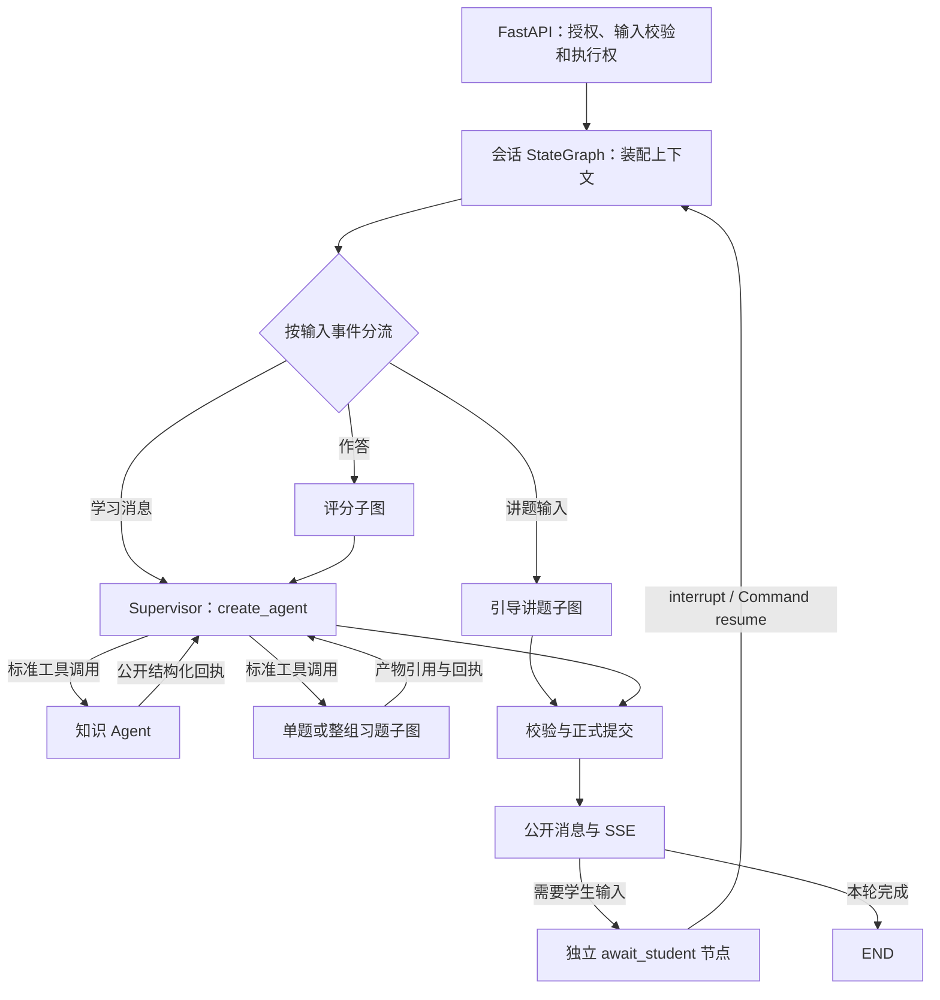

# LangChain／LangGraph 原生编排与教学 Harness 修改计划

日期：2026-10-23。状态：**N2～N6 已实施，831 项完整后端回归、前端测试与构建通过，真实模型及实际数据库迁移已验收。** 当前实现、删除、成本与限制见[30 号记录](30_native_remaining_implementation_and_acceptance.md)，N0／N1 保留在[29 号历史记录](29_native_n0_n1_implementation_and_acceptance.md)，不重复计入本次成果。

用户已授权实施剩余计划。本文后续保留原始设计、N0 前基线及迁移理由；**当前实现状态、实际字段和最终删除以第 16 节及 30 号记录为准**。N2 已一并接管工具、消息、摘要和公开事件，N5 不再承担旧执行器首次删除；不存在等待 N6 再退出的在线兼容执行路径。

## 1. 目标与适用范围

目标是让 LangChain／LangGraph 成为教学系统的执行主体：标准模型和工具协议、唯一的消息执行状态、可检查的业务图和子图、会话暂停恢复、上下文生命周期与原生事件。项目代码保留教学规则、权限、来源、事务和数据接口。

完成后应能用实际代码与运行证据回答：

> LangChain 如何管理模型、工具与子 Agent？LangGraph 如何组织状态、分支、并发和恢复？教学 Harness 如何限制权限、预算、上下文和公开输出？发生提交后中断时，如何保证真实学习记录不重复？

这不是引入更多框架层，也不以节点数量或框架 import 数作为成果。保持本机个人使用、**单个应用 worker**；保留 FastAPI、React、MySQL、Elasticsearch、Neo4j 和现有课程／题库，不在本轮扩大课程或后续教材章节。

与旧文档的关系：

- [23 号系统简化计划](23_core_system_simplification_plan.md)及[24](24_f0_p0_implementation_and_acceptance.md)、[25](25_p1_s05_s09_implementation_and_acceptance.md)、[26](26_p2_s10_s13_implementation_and_acceptance.md)、[27 号实施记录](27_p3_f3_f4_s15_s16_implementation_and_acceptance.md)保留已完成裁剪及验收事实。
- 本文是下一轮原生化的执行范围，覆盖旧计划中仅请求内检查点、适配式模型／工具执行等实现取舍；不推翻已保留的教学不变量。
- [13 号历史提案](13_harness_framework_migration_plan.md)中的预测反思研究子图、通用操作账本和完整 Deep Agents 平台不自动纳入。
- S14 继续不实施；知识点 GraphRAG 和 Neo4j 保留。LangGraph 执行图不替代知识图谱。

## 2. N0 前历史基线与迁移依据

### 2.1 基线快照

下表是 N0 前审计快照；N1 后本批基线为 237 文件、23,130 行、核心三组约 3,440 行及 MySQL 28 表。不得把旧审计数字当作当前最终统计。

| 项目 | 审查结果 | 含义 |
|---|---:|---|
| MySQL 实际表／ORM | 28／28 | 已由 49 表完成裁剪，不是本轮再次减少的成果 |
| 后端 Python 文件 | 235 | 裁剪前 237；删除 17、新增 15 |
| 后端 Python 行数 | 22,899 | 裁剪前 24,027，净减 1,128，包含注释和空行 |
| runtime／context／application-agent 三组非初始化源码 | 3,342 行 | 裁剪前 3,209；框架接入尚未让该范围缩小 |
| 锁定框架 | LangChain 1.4.7、LangGraph 1.2.16 | 本轮先保持版本，避免同时升级框架 |
| 当前版本后端重跑 | 767 项通过 | 既有回归不能证明本计划的新恢复协议 |
| 前端流式／恢复、构建、依赖检查 | 15 项通过，构建与依赖检查通过 | 不等于多 worker 或学校级并发验收 |

N0 之前的源码与 `data/reports/simplification_p3/source_after.json` 的生产文件集合及哈希已对照一致；N0／N1 后的变化另见 29 号记录。正式基线须保存当前未提交工作区，不能只用 Git HEAD 代表运行版本。

### 2.2 已有可复用证据

[F0 模型探针](../../scripts/evaluation/check_agent_f0.py)直接使用标准 `ChatOpenAI`，已有[真实报告](../../data/reports/simplification_p0/f0_model_compatibility.json)验证文字、图片、function calling、JSON mode、`create_agent + ToolStrategy` 工具循环及流式输出。不支持的是原生 `json_schema`，不能据此认定必须继续使用 `WireChatModel`。

[第四批真实模型记录](../../data/reports/simplification_p3/real_model.json)覆盖实际委派、生成复核、评分后接续、摘要与偏好归纳。它基于隔离 SQLite 和自编素材，不证明本文的新会话图、持久化 saver、复杂混合工具或全库检索质量已经通过。

### 2.3 N1 时存在的旧机制（当前已退出，保留迁移依据）

| 当前位置 | 现状 | 原生化目标 |
|---|---|---|
| [application/agent/graph.py](../../backend/app/application/agent/graph.py) | `create_agent` 外仍维护 wire、graph_count、模型请求回调和输出处理 | 框架 messages 是唯一运行消息源；工厂只组合模型、工具和中间件 |
| `runtime/model_adapter.py`（历史源码位置，已退出） | 过滤输出工具，将普通 JSON 人工变成 structured 工具调用 | 使用真实 provider ChatModel 和显式结构化输出策略 |
| `tool_binding.py`（历史源码位置，已退出） | 工具函数是占位；middleware 绕过 handler 走自定义 execute | `@tool` 函数真实调用服务，ToolNode 正常执行和回填 |
| `context/summarizer.py`（历史源码位置，已退出） | 手工调用摘要中间件钩子，消息仍由独立控制器维护 | 摘要中间件进入实际 Agent 生命周期；保留业务 summarizer |
| `learning/answer_graph.py`（历史源码位置，已退出） | 每请求创建图和 InMemorySaver，以 turn_id 作线程 | 应用生命周期编译图，稳定会话 thread_id 和持久化检查点 |
| `runtime/invocations.py`（历史源码位置，已退出） | 直接操作框架内部 ContextVar 传递调用身份 | 公开的 runtime/context、config metadata 与 callbacks |

### 2.4 N0 事务问题及修复状态

[单题评分提交](../../backend/app/domains/assessment/service.py)在 N0 前接受 `active_turn_id` 为 None 或本次 turn。隔离 SQLite／模型替身已复现：外层图节点检查之后、事务开始之前清空执行权，仍新增 Attempt，之后下一节点才抛出 LearningTurnLost。N0 已改为事务内严格匹配，新增竞态回归保留修复前失败报告。

正式写入须在其所在事务内严格确认当前执行者；外层节点曾经校验过不构成放行依据。若确有无会话的评分用途，应提供明确分开的调用协议，不用 None 隐式绕过执行权。后续持久恢复迁移继续保留此约束。

## 3. 必须保留的六项能力与教学不变量

| 能力 | 目标实现 | 不允许的退化 |
|---|---|---|
| 学生／课程／知识点三级递归记忆 | 事实与观察→知识点→课程→学生；现有记忆服务／五表仍拥有正式状态 | 不改成普通聊天历史或只保存一份用户摘要；归纳不直接写掌握度 |
| 知识点 GraphRAG | 受控 `@tool` 调用种子扩展→知识关系→限定材料召回→来源引用 | 不仅显示图；不以 LangGraph 节点替代 Neo4j 概念关系 |
| 会话主目标与子目标 | 正式目标树、活动路径和补救返回仍由目标服务与版本校验管理 | 不取消子目标，也不把完整目标树复制进图后独立修改 |
| 并发习题生成与整组提交 | 复用习题子图，通过 Send 分发、归并完整结果，再事务发布／提交 | 不发布半组，不逐题独立提交代替整组事务，不取消盲解与复核 |
| 基础语义压缩 | 实际 Agent 中间件处理闭合历史；近期原文和完整当前任务保留 | 不以最近 N 条替代语义压缩，不截断原答后评分，不用文字摘要替代原题图 |
| SSE 与恢复 | 框架公开事件→薄 SSE；断线后台继续，重连读正式快照／图状态 | 不透传内部答案或全部图状态，不以断线重新执行评分／出题 |

同时保留：真实原答、冻结题目、提交前帮助条件、未知掌握度、逐知识点证据、请求幂等、来源版本、纠正／遗忘、内部答案隔离。教材仍只覆盖约定的第一章，不借本轮新增内容范围。

## 4. 目标组件和总调用链



### 4.1 一处教学决策，一处业务步骤编排

- **主 Agent**决定检索、讲解、练习、补救等教学动作；工具化子 Agent 返回后，同一主模型继续处理。
- **外层图**只处理有类型的输入分流、业务阶段、正式提交和停点；不再加一个 LLM router 重复决定调用哪个教学 Agent。
- **领域服务**验证动作、权限和版本，在短事务内提交；模型不能通过图状态直接覆盖题目、目标、记忆或掌握度。
- **API**保持现有网页入口的兼容适配，调用应用用例；不直接编辑 checkpoint 的 next 节点，不允许客户端指定任意 goto。

### 4.2 编译和运行生命周期

应用 lifespan 中创建模型／数据库／检索服务、持久化 saver，构造 Agent 与业务图并编译一次。编译对象允许被多个不同会话使用，输入上下文和可变预算必须按调用隔离。

图工厂只捕获服务依赖和静态配置，**不得捕获某个学生、session、turn、回答或请求内数据库 Session**。每次 invoke／resume 从服务端重新注入可信 RuntimeContext。所有运行内对象、连接、锁和 ORM 实例不进入 checkpoint。

保留单 worker 的明确边界；同一会话一次只能由一个执行尝试持有执行权，不同会话可并行。等待学生时返回控制权，不保留后台阻塞协程。

## 5. 状态和标识协议

### 5.1 正式数据、执行状态与可信上下文

| 数据类别 | 唯一主要所有者 | 图中允许保存 |
|---|---|---|
| 原始消息、冻结题目、Attempt／BatchSubmission、评分贡献与能力 | MySQL 领域表和事务服务 | ID、版本、当前必要快照、正式提交回执引用 |
| 主子目标与返回点 | session_goal_states 与目标服务 | 当前活动目标／路径投影、读取版本 |
| 三级记忆、纠正和遗忘 | 现有 memory 服务及五张表；错因 memory_items 独立 | 当前有效投影、来源 manifest 与失效版本；不另建平行长期 Store |
| 模型消息、工具回执、待执行步骤、当前等待点 | LangGraph State／checkpointer | 有界 messages、必要中间结果、产物引用、输入与等待状态 |
| 学生／课程／会话身份、当前 turn、服务对象、预算服务 | 服务端 RuntimeContext | 不由模型写入，不从旧 checkpoint 恢复授权 |
| SSE 临时事件 | 有界内存队列；可选 Redis TTL | 允许公开的正文／进度，不作学习事实来源 |

图状态中的业务快照是执行输入和重放依据，不具有独立写回权。读取到不同的正式版本时必须重装配或拒绝候选，不能用旧 checkpoint 覆盖新业务记录。

### 5.2 最小执行 State

拟用明确类型的 TeachingSessionState，字段建议如下，N0 冻结实际名称和 JSON Schema：

| 字段 | 内容与更新原则 |
|---|---|
| schema_version／workflow_version | State 格式和图行为版本；不兼容版本禁止盲目继续 |
| messages | 会话图持有唯一权威的标准消息状态；普通增量用 add_messages，主 Agent 完成后用原生 Overwrite 接回完整结果；消息 ID 稳定，工具组闭合 |
| input_event | 当前输入类型、逻辑 request_id、正式消息／提交引用和 payload_hash；事件消费后不得被当作下一轮新输入 |
| domain_refs | 目标版本、冻结题／组、工作区、当前帮助状态等引用；不保存全量表 |
| pending_interaction | 当前 wait_id、kind、题目／组／澄清引用及允许事件；可从正式停点记录验证／重建 |
| artifact_refs | 已接受的讲解／候选题／审核产物 ID、版本、来源与可公开回执；不混入任意运行对象 |
| assessment_ref | Attempt／BatchSubmission 的正式 ID 与结果引用；临时诊断提交后尽快从当前 State 清除 |
| memory_manifest | 输入记忆及摘要的来源／失效版本，用于恢复和在途校验；正文按预算选择 |
| response_ref | 本轮正式发布消息的稳定 ID、允许的公开回执；不让整个图状态直接成为 API 响应 |

消息接管方式在本计划中固定：主 Agent 节点读取会话图当前 messages，交给标准 create_agent 执行；Agent 内部由原生 reducer、工具节点和摘要中间件更新。成功返回时，节点用 `Overwrite(result["messages"])` 替换父图的执行消息，而不是把完整结果再次交给 add_messages 追加。这样摘要删除的前缀不会因父图仍保存旧历史而复活；稳定消息 ID 去重本身不能解决删除传播。

会话图是跨回合的权威消息状态，Agent 执行中的状态只是本次标准调用的工作状态，不另存手写 wire 或重建同步器。同一父图步骤只允许一个 messages 写入者；并发分支返回产物和回执，不同时 Overwrite。知识／习题子任务默认每调用隔离，只返回有限回执，不共享可变 messages。当前 LangGraph 1.2.16 已在本机最小内存图中验证 Overwrite 可替换带 add_messages reducer 的列表；跨 Agent、持久化和摘要后的连续回合行为仍须按 A12 验收。

### 5.3 五类标识不可混用

| 标识 | 生命周期 | 作用 |
|---|---|---|
| thread_id | 同一业务会话稳定，如服务端推导的 learning:{session_id} | 找到图线程；不是权限凭证 |
| request_id | 一次逻辑学生输入稳定 | HTTP 重试／恢复使用同一值，绑定规范化输入哈希 |
| turn_id | 一次实际执行尝试 | 重新 claim 时生成；旧 checkpoint 的 turn_id 不再具有写入权 |
| wait_id | 一个业务等待点 | 绑定冻结题／组／澄清的身份与版本，防止旧输入进入新题 |
| operation_id | 一个正式副作用稳定 | 关联请求、动作和子任务，防止重新发布题目、评分或消息 |

模型本次 tool_call_id、框架随机 run_id 和用户提供的 thread_id 都不能替代 operation_id 或授权范围。子任务逻辑身份应在首次受控分发时确定，并在恢复时复用，不能重规划后只换一个随机 ID 再执行相同写操作。

### 5.4 输入事件与等待点

当前生产协议为 v2，具体定义见 [protocol.py](../../backend/app/application/learning/protocol.py)。HTTP URL 保留，事件和必填字段同批更新，不保留 v1 执行器：

| 事件 | 当前行为 |
|---|---|
| message／followup／clarify／change_goal | 复用消息字段进入主助手或当前讲题，保留 intent、cognitive_type、generate、exercise_count、concept_ids 的真实显式偏好 |
| answer／batch_answer | 校验 request_id、wait_id、question_id／batch_id 和原答／帮助快照后评估 |
| practice_existing | 明确指定已有题及认知需求，不交给模型猜操作 |
| guidance_action | 明确 start／reply／hint／explain／transfer／close 与工作区版本 |
| skip | 经过执行权和 wait 验证，事务清除待答，不产生评分证据 |

wait_id 从正式待办计算，与框架 interrupt ID 分开。新写请求统一 request_id，不长期双收 idempotency_key；服务端计算输入指纹。讲题 close 只关闭工作区，memory/close 只关闭记忆采集，本轮没有泛化会话 close 事件。

### 5.5 N0 冻结的历史 v1 协议

[v1 JSON Schema](assets/native_protocol_v1.schema.json)冻结八类输入事件、TeachingSessionState 字段和接收／完成回执的字段约束。`schema_version=1`，`workflow_version=teaching-session-v1`；接收回执不带完成结果，完成回执必须引用正式结果。Schema 的顶层 state／input_event／receipt 仅用于分类校验，不是新增 HTTP 请求体。

该 v1 文件仅保留历史契约，不作为当前执行器；N3 已采用 v2 类型事件、wait_id 和稳定线程。权限、执行权、正式版本、原答哈希及已提交结果的核对仍由服务执行，不能仅靠 JSON Schema 推导。今后改动字段或行为必须升级契约并说明存量映射，不能静默重解释旧 checkpoint。

## 6. 标准模型、结构化输出和模型出口

### 6.1 模型工厂

优先沿用 F0 验证的标准 ChatOpenAI 配置：当前模型与 URL、Chat Completions 路径、关闭思考参数、异步客户端 `trust_env=False`、超时和流式用量。先保持 LangChain／LangGraph 锁定版本，显式声明生产 provider integration，不能依赖环境里偶然安装的包。

N0／N1 已显式声明 `langchain-openai==1.7.2`，并以隔离进程实测、锁定 `langgraph-checkpoint-sqlite==3.1.2`；LangChain／LangGraph 版本保持不变。这段记录描述 N1 交付。当前自主工具 Agent 与摘要已在 N2 一并切换，旧适配物理删除；真实 provider 的本批验收单独记录。

共享 provider 并发仍有明确上限，覆盖主／子 Agent、生成复核、摘要及归纳。一次标准模型请求的最后输入预算、图像估算、输出保留、截止时间和取消行为由少量受控中间件／模型工厂组合保证，不再绕回 WireChatModel。

### 6.2 输出策略

- 自主工具 Agent 显式使用 `ToolStrategy(PydanticSchema, handle_errors=...)`，避免自动策略误选本部署尚不支持的 ProviderStrategy。
- 纯评分、盲解、复核、摘要和有界记忆抽取统一使用标准 `with_structured_output(..., method="json_mode", include_raw=True)`，不开放业务工具。类型自动生成的 Schema 注入 system，服务严格校验原始 JSON。真实部署对复杂评分函数参数持续产生非法尾字符，而 JSON mode 已验证；原纯 function calling 路径已退出，没有双模式自动回退。
- 使用 Pydantic 明确字段类型、extra 禁止和必要 strict 约束，再执行领域 validator。原有接口允许的合法输入先做显式归一，不靠类型强制转换掩盖无效模型输出。
- raw JSON Schema dict 不能作为本项目结构校验的唯一来源；客户端严格校验与 provider 的 strict 参数支持是两回事。当前 ToolStrategy 构造器不使用不存在的 `strict=True` 参数。
- 无效 Schema、业务拒绝和修复分别有次数上限，不能通过重新创建 Agent 获得无限修复额度。保留来源／语义复核，不把合法 JSON 当正确教学结果。

### 6.3 在线与离线消费者分开迁移

[llm.py](../../backend/app/infrastructure/clients/llm.py)还服务 embedding、教材提取、检索和记忆，不能整文件删除。N0 要列全消费者；先退出在线 Agent 的自定义 chat／SSE 协议，再分别决定离线调用是否迁入同一标准模型工厂。向量编码器与检索空间版本不随聊天模型迁移改变。

## 7. 真正的工具与子 Agent 协议

### 7.1 一份声明、一条真实执行路径

每个 `@tool` 使用所属业务的 Pydantic 参数类型，函数真实调用领域服务。角色工具集合直接由这些工具对象组成，不再把手写 DEFINITIONS 转成假 StructuredTool，也不通过 middleware 跳过 handler 后进入另一套 execute。

ToolRuntime 注入 RuntimeContext；模型只能选择 query、concept_ids、题目需求等业务参数。学生、课程、会话、执行权、服务实例和预算不出现在可覆盖的模型 Schema 中。工具暴露白名单与服务端范围复核都保留。

| 工具组 | 示例职责 | 保留的执行检查 |
|---|---|---|
| knowledge tools | 概念读取、教材来源、GraphRAG、教学参考 | 概念／来源所属课程、公开边界、题图身份 |
| practice tools | 申请候选题、读取公开练习、调用生成子图 | 当前目标、排除已见题、冻结引用、独立复核 |
| goal tools | 读取目标、提交受约束更新提案 | 当前会话、expected_version、用户换目标原话 |
| memory tools | 读取当前有效观察／摘要 | 学生与作用域、来源版本和撤回，不任意修改能力 |
| subagent tools | 调用知识 Agent／习题子图 | 角色、层级、输入白名单、父子预算和可公开产物 |

### 7.2 子 Agent 真执行并返回原调用者

主 Agent 的工具调用知识 Agent／习题子图；知识角色可在允许范围调用习题能力。子任务使用隔离消息和执行 namespace，默认不另配独立持久 saver，由外层检查点体系承接；具体传播按锁定版本验证。

返回值是有限的结构化回执、来源和产物引用。私有参考答案留在服务／受控内部产物中，不把完整子 Agent 历史或答案塞进父模型 ToolMessage。父 Agent 收到真实回执后继续原循环，不能退回输出 action 后由服务执行一次就结束。

子图可以准备产物；正式发布待答题统一进入清晰的提交边界。已接受题库存储和学生待答发布的生命周期要区分：不得因候选已生成就当作学生已经收到题目。

### 7.3 异常与调用记录

参数／权限／质量拒绝返回可处理的有限反馈；执行权丢失、取消和截止时间终止当前执行，不能转换为普通工具消息让模型继续。只读缓存命中仍检查范围与参数。

Callbacks 记录状态和用量，不提交评分、不改目标。默认 AgentRun 每次业务角色调用一行；框架内部每个 Runnable 的细粒度轨迹进入有界诊断，不为每个内部节点新增 SQL 运行行。保留 root／parent／role／request 关联，移除对内部 ContextVar 的直接依赖。

## 8. 预算、并发、重试与取消

现有父子调用共享的是 ToolFailurePolicy，模型／工具上限仍有局部计数，不能描述成已经具备完整根请求总预算。本轮补齐一个薄的请求级预算对象，由可信 RuntimeContext 持有，不建立新任务引擎或费用表。

| 范围 | 规则 |
|---|---|
| 全应用模型出口 | 一个明确的并发限制；本轮初始沿用现有 3，再以实测决定 |
| 一个输入 request | 父子 Agent、生成／盲解／复核、结构化修复、摘要均计入共享尝试数与 deadline |
| 每个 Agent | 内置 ModelCallLimit／ToolCallLimit 作为局部保险，不代替根请求共享额度 |
| 并发工具／题目 | 调度前按稳定任务顺序预留额度；结果完成快慢不决定谁得到预算 |
| 失败与重试 | 选定 SDK 或 middleware 一层主责，禁止 SDK×middleware×HTTP 多层次数相乘 |
| 同一逻辑请求重试 | 复用 AgentRun/request 关联做保守总尝试限制，不因新建 Runner／新 turn 清零 |

预算对象只含运行内计数、锁和截止时间；checkpoint 保存必要的标识／快照，不序列化对象。等待学生后本次执行结束；新学生输入有新 request，重复 HTTP 输入仍归原 request。

Token 可采用估算预留和已报告用量结算；请求取消或响应丢失时，未报告用量是未知，不记录为零，也不承诺服务商零计费。现有记录不足以精确重建消耗时，用尝试数和 deadline 保守限制，不新增复杂计费系统。

只读临时网络错误可有界重试；写操作先有幂等和回执再讨论恢复。收到任何模型增量，包括推理、正文或工具参数后，不静默重放整个请求。响应截断、不完整 finish 或用量缺失需要显式判定失败／未知，不能把半条消息当成功结果。取消、失去执行权和质量拒绝不走网络重试。同名工具“失败＋在途”的并发熔断与技能去重若仍有业务价值，可保留薄策略，不声称内置中间件完全等价。

## 9. 会话级持久化、暂停与恢复

### 9.1 存储选择

首期采用官方 AsyncSqliteSaver，保存在项目数据目录下的独立执行检查点文件，图和 saver 由应用生命周期管理并复用。N0 确认异步、并发和清理接口后锁定具体依赖。不增加 PostgreSQL／Redis 任务服务，不自写通用 MySQL checkpointer。

这适用于当前本地、单 worker 范围，不作为多进程部署承诺。MySQL 28 表仍是业务正式存储；SQLite 表／文件是新增基础设施，必须报告数量、字节和保留范围，不能通过换存储隐瞒新增。单机文件持久化不等于高可用或备份。

### 9.2 invoke／resume 顺序

```text
授权 session 和当前输入
→ 按 request_id + payload_hash 查输入及完成回执
→ 预判 NEW_INPUT / RESUME / REPAIR
→ 短事务 claim 新 turn_id
→ 重读 checkpoint／interrupt、领域 pending、目标与记忆失效版本
→ 在执行权内重新决定入口，校验当前 request／wait，再构造 Command
→ 对同一 thread_id 调用图并重新注入 RuntimeContext
→ 图完成 END、持久化 interrupt 或记录失败
→ 确认本次图及子任务结束写入后，finally 仅 release 本次 owner
```

claim 前的判断只是预判：等待执行权期间图可能已经推进，不能执行事先缓存的 Command。只有在取得执行权后重新读取并验证的当前停点可以恢复；所有同 thread 的推进、修复和状态更新都必须经过同一所有权入口。

普通已结束回合使用新输入 invoke；存在有效等待点才使用 Command(resume=...)。客户端不直接发框架 Command 对象，API 验证后构造。处于 wait 的图也可能收到 followup／change_goal／skip，而不是把一切输入当答案。

`await_student` 是独立无副作用节点；题目、反馈、消息提交在前置节点完成。interrupt 保存状态并返回后释放 turn，不占数据库锁、模型槽或等待协程。使用普通异常处理时，框架暂停信号必须正确传播，不能记成模型失败。

取消后须等待图／子任务清理完成，才能释放本次执行权；不能让旧协程在新 owner 取得执行权后继续写 checkpoint。SSE 断开依旧不等于取消核心任务。此处只是统一入口和任务生命周期约束，不引入另一套工作流引擎。

### 9.3 重复和过时恢复

| 情况 | 响应 |
|---|---|
| 同 request_id、同 payload，已有正式结果 | 回放；只补缺少的接续，不重新评分／出题 |
| 同 request_id、同 payload，仅保存输入消息 | 复用输入并接续未完成步骤；不能当作已完成，也不能重复新增用户消息 |
| 同 request_id、不同 payload | 拒绝，不修改旧事实 |
| 旧 wait_id 已失效 | 拒绝并返回当前公开快照，不能把旧答案送给新题 |
| 两个请求同时恢复同一 wait | claim 只放行一个；另一个冲突／等待后必须重校验 wait |
| 同题追问后提交 | 保留题目身份，读取最新帮助快照，不能按旧“未帮助”状态评分 |
| 暂停时跳过／改目标／关闭工作区 | 通过统一事件入口及领域服务更新，关闭或替换对应等待；恢复先重装配，不继续旧分支 |

change_goal 不隐式等于 skip：有未答题时保留现有产品约束，明确要求处理旧题或保存补救返回，不自动记完成。等待节点不持有执行权，但真正继续模型／提交时必须重新取得。

### 9.4 每次恢复重新校验，而非信任旧 State

恢复入口、模型调用前、工具执行、模型返回后和正式事务分别校验对应的身份、执行权、题目／组／工作区版本、目标版本、资产范围及记忆 manifest。并非每处都重复全量查询，而是各写入／发布边界完成其必要验证。

记忆撤回后，不能只加载新记忆却继续使用 checkpoint 中旧的注入正文、摘要和未提交模型候选。清除／重建相关派生上下文；无法确定污染范围时，从安全节点重装配当前任务，复用已提交业务回执。原始消息和真实原答不是可随意删除的派生缓存。

### 9.5 checkpoint 生命周期和版本

- 当前稳定检查点用于继续运行；历史保留设定明确的数量／期限，N0 以实际 SQLite saver 的能力确定清理方式，不假设仅压缩 messages 就能回收旧 checkpoint。
- 检查点只保存图片资产 ID／哈希和来源引用；在实际模型请求覆盖层临时解析为图片块，不把 base64 题图或整本教材长期写入。不能通过 before_model 的 State 更新或持久 ToolMessage 注入 base64，否则仍会进入 checkpoint。
- API 不提供未经裁剪的 checkpoint 全量下载；内部答案和临时诊断也按私有数据管理。
- workflow_version 不兼容时停在安全业务边界，用正式事实重建；不把新代码直接套到旧暂停栈上。已提交的原答／题目／消息仍必须回放。
- 当前启动 recover 会清理占用，首期只允许单 worker，并在恢复前核对本实例没有活动运行；多 worker 需要 owner／到期／心跳等租约协议，另立阶段，不由本轮偷偷实现或宣称支持。

## 10. 跨存储提交、幂等与正式回执

checkpoint 和 MySQL 事务不具有跨库原子性，不能宣称 LangGraph 保证所有外部效果恰好一次。处理原则是稳定副作用身份、正式事务回执、恢复时核对。

| 正式副作用 | 回执与提交边界 |
|---|---|
| 单题评分 | Attempt 原有会话／提交键；原答、逐点证据、能力／错因状态同事务 |
| 整组评分 | BatchSubmission 的哈希与响应＋逐题 Attempt；全组一个事务 |
| 待答题／组发布 | 冻结契约、exercise／batch ID、对应正式消息与 pending 状态原子关联 |
| 用户／反馈／主助手消息 | 采用稳定 operation_id 派生的消息 ID 和 payload_hash，不以新的随机 UUID 代替去重 |
| 目标和记忆更新 | 现有服务的版本／代次、输入指纹和回执；不让模型直接写表 |

消息幂等优先复用现有 Message.id 主键：新发布记录可用服务端固定 namespace 的 UUIDv5 派生稳定 ID，在受控 metadata 保存 operation_id 与 payload_hash。同键同内容回放，异内容拒绝。既有消息 ID 不改，现有引用不重写；如实现中证明还需独立字段／索引，应先提交具体迁移说明，不能顺手新增通用操作表。

输入已接收与请求已完成必须分开：保存带 request_id 和 payload_hash 的用户消息只证明收到输入；完成还需对应的正式发布／评分结果和接续状态。写完用户消息、尚未调用模型就崩溃时，重试复用该输入继续执行，不能返回假成功。payload_hash 包含事件类型、业务引用与完整真实原答；只规范 JSON 外层编码，不 trim、改写或重排答案文本，也不因计算哈希改变正式保存的原答。

某条入口开放持久恢复前，其可达写步骤必须全部具有稳定 operation_id、事务内 owner 校验和正式回执，包括可能在子 Agent 中发生的题目发布／目标／讲题消息写入。不能在 N3 先开放重放，再等 N4 补齐这些保护；尚未满足的旧入口保持明确隔离，不能宣称支持持久恢复或在异常后自动切换执行器。

| 故障位置 | 恢复要求 |
|---|---|
| 评分准备／候选生成中 | 未提交计算可有界重做；承认可能再次发生模型消耗 |
| 题目或评分事务成功，checkpoint 未写成功 | 查正式回执，跳过已完成副作用，只补图状态／反馈／接续 |
| 子任务已发布题目，父 Agent 尚未保存 checkpoint | 根据稳定任务／操作身份复用原题／组与回执，不能重新规划并再次发布 |
| 用户消息已保存，尚无模型输出／正式完成结果 | 识别为已接收未完成，复用同一输入接续，不重复消息、不假回放完成 |
| 消息保存成功，SSE 或 checkpoint 失败 | 找到同一消息 ID，重发／回读，不新增正式消息 |
| checkpoint 显示完成，领域回执不存在 | 视为不一致，不能凭图状态补造原答／掌握度；受控修复或报错 |
| checkpoint 文件不可用 | 停止继续依赖其状态的写步骤，不伪报完成；暴露已提交正式结果，修复后恢复 |
| checkpoint 丢失或超过保留期 | 根据正式消息、待答契约、目标与作答回执重建安全入口；不承诺恢复未提交推理 |

只有正式回执和恢复实验证明可靠替代之后，才能删除 pending_context 中 delegation_checkpoint 的执行游标／工具回执部分。已提交题目、已评分结果和跨失败请求额度不能随缓存一起丢弃。AgentRun 是诊断，不是评分已提交的凭证。

## 11. 业务子图和并发策略

### 11.1 知识与引导讲题

知识角色使用标准 create_agent 和受控检索工具，返回有来源的 Lesson／产物引用。普通教学和粘贴新题两个入口保留，共用模型和工具底座。

引导讲题子图只表达有意义的阶段：加载工作区→准备／复用参考分析→回应与帮助判定→公开校验→提交消息／观察→等待。复用现有 feedback、exposure、publication 和消息引用存储；不把当前私有参考解发给主助手或 SSE。

### 11.2 单题生成子图

```text
读取任务与题库候选
→ 必要时生成候选
→ 独立盲解
→ 语义／数学复核
→ 接受或有界重试
→ 返回已验证产物引用
```

题库优先、课程范围、题面去重、认知类型、难度来源、题图身份、独立求解和复核仍由领域函数保证。生成／盲解／复核是独立输入，不能把标准答案偷偷带给盲解。重试只重做受影响的未提交部分，已接受产物通过稳定任务 ID 复用。

### 11.3 整组生成子图

规划有界任务列表→Send 分发单题子图→按 task_id 归并→完整性／重复检查→统一发布。继续支持 1～6 道的现有业务协议，初始生成并发仍为 3；由明确配置限制，不能把 max_concurrency 当成 provider 的跨请求全局上限。

reducer 应能按稳定 ID 幂等合并，拒绝同 ID 的冲突版本；结果顺序按输入序号确定，不按完成时间。只有接受集合与请求任务集合完全一致且全部复核通过才发布；一题失败不发布半组。

reducer 不执行数据库事务。单题 count=1 和整组共用子图，不保留旧 TaskGroup 编排作为长期旁路，也不为了 Send 引入每题 Job 表。

### 11.4 独立评分子图

校验提交／读取回执→准备评分→提交评分→公开反馈→回主 Agent 接续。当前五节点 answer_graph 的领域事务和恢复经验迁到这里，不叠加第二张同职责的作答图。

评分使用冻结题目、完整当前原答、deterministic_verdict、assessment_criteria 和提交前帮助快照；不注入历史画像、教学记忆、主助手推测或预测。评分 messages 与教学 messages 隔离。整组继续一次模型评估策略和一次正式事务，不能因逐题子图而意外增加 N 次评分调用。

### 11.5 后台递归记忆

保留现有两类任务及一个调度入口。可把“事实／来源读取→结构化抽取→规则验证→写观察”和“读取子级→归纳→晋升／版本检查→写摘要→请求祖先归纳”表达为可复用图／节点，但不复制新任务表、队列或 Store。

核心仍是跨会话的知识点归纳，再逐级到课程和学生；帮助条件、反例、偏好作用域、独立任务计数、纠正／遗忘与在途撤回继续存在。先完成前台原生工具和会话图，再迁后台模型调用；不能让记忆任务依赖一个学生正在等待输入的前台图。

## 12. 上下文与摘要的原生生命周期

### 12.1 一份消息执行状态

AgentState.messages 是实际模型工具历史，由框架 reducer／中间件更新；跨回合权威状态和主 Agent 返回时的 Overwrite 规则按第 5.2 节执行。删除独立 wire 历史、graph_count 增量对齐和手工 ToolMessage 回填；原始 MySQL messages 仍作为完整交互事实，并非第二套执行消息推进器。

当前原题／原答、目标活动路径、帮助条件、冻结版本通过固定任务投影和标准动态提示注入，不进入可任意压缩历史。模型调用前核对真实最终请求（包括 system、工具 Schema、图片和输出保留）的预算，不能只统计 messages 正文。

### 12.2 真正挂载 SummarizationMiddleware

中间件直接出现在 create_agent 的 middleware 列表，处理实际 Agent 消息生命周期。可保留 custom summarizer Runnable；它承担来源分块、结构化结果和覆盖校验，这些是教学规则，不需要为了“原生”删掉。

- 压缩只选择闭合工具组；调用与回执不能分开。
- 来源 ID 由服务端决定；模型返回短别名，检查缺失、重复和陌生来源，再映回正式 ID。
- 禁止默认裁掉未覆盖的历史前缀。显式禁用不适用的裁剪，或按完整来源分块；保留有界两层归纳、截断拒绝和实际 Token 回收验证。
- 来源集合完整只能证明覆盖集合，不能证明语义忠实；验收包含早期确认事实、未解事项和人工对照样例。
- 纠正／遗忘后摘要和相关 checkpoint 派生上下文同样失效；发布前再校验。
- 子任务及并发题上下文隔离，不让相同 role 共享错误摘要。

N2 已将来源保护与摘要生命周期一并接入原生 Agent，旧控制器物理删除。N5 只负责存储、残留适配和观测收敛，不再次实现压缩器。

### 12.3 当前摘要存储退出

所有在线入口已停止读写旧 context_checkpoints，旧 Store、ORM 和注册项已删除；语义摘要随原生 messages 保存。不存在原生入口与旧缓存长期双写，也不存在只读旧摘要的在线兼容分支。

本批[实际迁移报告](../../data/reports/native_remaining/migration.json)已确认 MySQL 28→27 表，转换 214 条完成回执与 20 条正式委派回执，原消息身份／正文／引用及受保护会话状态不变。不能仅凭 ORM 消失推导物理退役。SQLite 实际表数、行数、主文件及 WAL 字节由最终统计另报，不把跨存储移动算作总存储减少。

## 13. 原生流式、公开边界和可观测性

消费锁定版本已支持的 graph.astream：messages、updates 和必要的 custom 事件。不要因为最新文档出现新事件 API 就在本轮顺带升级框架。

| 输出 | 对外规则 |
|---|---|
| 普通主助手公开答复 | 允许正文增量；草稿有稳定 stream_id，失败／工具转向可撤回，正式消息为最终结果 |
| 知识／习题／评分内部输出 | 默认不公开 Token、工具参数、答案、私有参考分析和推理 |
| 引导讲题和生成题 | 先通过现有公开校验，再分段输出已验证正文 |
| updates／子图状态 | 仅投影节点状态、角色、耗时、允许 ID 等；不直接 JSON 序列化整个 State |
| custom 进度 | 显式字段白名单，不能绕过私有数据限制 |

若主助手仍使用包含私有字段的结构化输出，可暂留小型公开字段过滤器。更清楚的“私有决策→公开 writer”是可选设计；writer 若再调用模型，必须记录额外调用和 Token。公开发布节点也可只输出已验证正文，不强制每回合增加一个模型。

保留 API 有界队列 256、12 秒心跳、缓冲满不阻塞正式事务、断线后后台完成和刷新快照恢复。Redis 仅作为可选短时公开事件缓冲，容量／TTL／隔离明确；缓存失效不触发重新出题／评分。

Callbacks 关联 thread、request、turn、node、root／parent run、tool call、模型尝试和正式回执；不输出凭证、完整 prompt、原答、题图 base64 或私有解。生产路径不强制依赖 LangSmith 云服务，可先使用原生回调和本地有界诊断。业务提交不能由 telemetry callback 完成，诊断失败不能令已提交业务重新执行。

## 14. 目标源码职责

下面是目标职责，不是本次创建目录；可复用现有文件而非为了名称再搬一次。按业务拆工具，不把所有工具和所有节点堆进一个文件。

```text
application/learning/
  service.py                 API 用例门面：授权、输入、执行权、调用图
  graph.py                   会话业务图与条件边
  state.py                   执行 State、事件映射、reducer
  subgraphs/
    practice.py              单题与整组生成的组合
    assessment.py            评分步骤与回执恢复
    guidance.py              引导讲题阶段
application/agent/
  factory.py                 标准 Agent 的角色配置与组合
  tools/
    knowledge.py             真实知识／检索工具
    practice.py              真实习题与子图工具
    goals.py                 目标与会话工具
    memory.py                受控记忆读取工具
  context.py                 可信 RuntimeContext 与必要类型端口
  middleware.py              少量教学上下文／权限／预算扩展
  records.py                 原有 AgentRun 持久化与回调适配
  streaming.py               公开事件投影
infrastructure/
  clients/                   标准模型工厂、向量与现有检索客户端
  persistence/               MySQL 与执行 checkpoint 生命周期配置
domains/                     现有教学、事务、证据、目标、记忆与检索规则
```

节点是组合业务步骤的普通函数，不为每个节点建立 Service／Factory／Repository 三层空壳。状态协议、工具参数和持久模型各有边界，不重复定义相同字段的多套数据传输类型。

## 15. 现有代码的删除、迁移和保留清单

### 15.1 原生路径验收后整文件退出的候选

| 当前文件 | 接管方式 | 删除条件 |
|---|---|---|
| `runtime/model_adapter.py`（历史源码位置，已退出） | 标准 provider ChatModel | 模型／工具／图片／输出／取消完整验收，包含 summarizer 在内的全部消费者迁完，无 JSON 伪工具路径 |
| `application/agent/tool_binding.py`（历史源码位置，已退出） | 真正 @tool 和框架 ToolNode | 权限、并发、失败隔离与回填等效果承接，无占位 coroutine 和 BusinessTools.execute |
| `application/agent/definitions.py`（历史源码位置，已退出） | 工具函数与严格 Pydantic 参数 | 只剩一份工具 Schema，不长期维护手写 DEFINITIONS |
| `agent/tools/validation.py`（历史源码位置，已退出） | Pydantic 与领域校验 | 通用参数检查调用全部迁出，独有领域规则先保留 |
| `application/agent/agent_tools.py`（历史源码位置，已退出） | 标准子 Agent 工具 | 真实父子回执、预算和范围已迁入原生工具 |
| `runtime/invocations.py`（历史源码位置，已退出） | 标准 RuntimeContext／config／callback | 不再直接操作内部 ContextVar，父子运行与取消隔离验收 |
| `context/compactor.py`（历史源码位置，已退出） | 生命周期摘要＋固定任务与预算薄策略 | 来源／撤回／预算不回退，不再持有另一份消息历史 |
| `application/learning/answer_graph.py`（历史源码位置，已退出） | 统一会话图中的评分子图 | 旧请求内图与临时 saver 入口退出，故障恢复用例迁完 |

候选不是现在立即删除。若某项仍包含未迁出的独有保护，保留薄实现并登记未完成，不宣称整文件已退役。

### 15.2 局部重写或压薄

| 当前模块 | 删除／收敛 | 必须留下 |
|---|---|---|
| [agent/graph.py](../../backend/app/application/agent/graph.py)、`execution.py`（历史源码位置，已退出）、[runner.py](../../backend/app/application/agent/runner.py) | wire、模型回调循环、重复修复／消息推进和多层空转 wrapper | 唯一标准 Agent 工厂、超时／取消与业务生命周期；可保留一个短期兼容入口，最终只留一个运行入口 |
| `registry.py`（历史源码位置，已退出） | 名称分派、旧 Schema 包装和另一套 execute | 课程归属、公开结果、检索服务与输出大小策略先迁入真实工具／领域服务 |
| [learning/service.py](../../backend/app/application/learning/service.py)、[planning.py](../../backend/app/application/learning/planning.py)、[delegation.py](../../backend/app/application/learning/delegation.py) | 自定义步骤分支、委派调度和可靠替代后的执行回执副本 | 目标保护、action 合法性、稳定操作标识、发布事务与完成结果核对 |
| `context/summarizer.py`（历史源码位置，已退出）、[builder.py](../../backend/app/agent/context/builder.py)、[validation.py](../../backend/app/agent/context/validation.py) | 手工调用生命周期钩子、WireChatModel 和重复消息构造 | 来源分块、固定任务、覆盖和工具组校验，压薄成正式扩展点 |
| `agent/checkpoints.py`（历史源码位置，已退出） | 重复执行缓存／摘要缓存适配 | 迁出前的来源版本校验；最终由运行 State／摘要规则接管后退旧缓存 |
| [runtime/tool_policy.py](../../backend/app/agent/runtime/tool_policy.py) | 框架已接管的通用计数与重试 | 薄业务熔断、根请求预算与关键错误语义 |
| [runtime/streaming.py](../../backend/app/agent/runtime/streaming.py)及 [application/agent/streaming.py](../../backend/app/application/agent/streaming.py) | 旧事件绑定与可替代的 JSON 逐字解析 | 实际必要的公开字段过滤和撤回；不能为删文件直接透传模型流 |
| [llm.py](../../backend/app/infrastructure/clients/llm.py)／[llm_streaming.py](../../backend/app/infrastructure/clients/llm_streaming.py) | 消费者迁完的在线聊天／原始 SSE 协议与多层重试 | 向量、离线教材／记忆消费者先明确迁移状态；全局出口约束与用量能力 |
| [bootstrap.py](../../backend/app/bootstrap.py)、[api/streaming.py](../../backend/app/api/streaming.py) | 每请求构图、旧内核装配和重复流生产者 | saver 生命周期、单一图服务、薄 SSE 与后台任务回收 |

现有 Skill Markdown 和路径／角色限制继续保留；它们是方法资源，不是授权机制。PreparedRun、旧 ToolContext 等只在真实消费者迁完后退出，不能删除类型却复制一份新名的同等协议。

### 15.3 领域所有者继续保留

保留并复用 [评分事务](../../backend/app/domains/assessment/service.py)、[整组事务](../../backend/app/domains/assessment/batch.py)、[证据构造](../../backend/app/domains/assessment/evidence.py)、[掌握度归约](../../backend/app/domains/students/mastery.py)、[目标规则](../../backend/app/domains/sessions/goals.py)、[执行权](../../backend/app/domains/sessions/leases.py)、[三级记忆服务](../../backend/app/domains/memory/scopes/service.py)、[来源上下文](../../backend/app/domains/memory/context.py)、[题目冻结](../../backend/app/domains/practice/context.py)、[独立复核](../../backend/app/domains/practice/reviews.py)、[帮助暴露](../../backend/app/domains/guidance/exposure.py)和[课程检索](../../backend/app/domains/courses/retrieval/service.py)。

这些模块可以内部提纯／复用，不能为了框架占比把规则埋进 prompt、reducer 或 callback。教材解析、资产归属、审核与索引发布仍在现有业务模块，本轮不重写这些系统。

## 16. 当前阶段状态与放行条件

| 阶段 | 本批状态 | 退出与证据 |
|---|---|---|
| N0／N1 | 历史已完成，不重复计成果 | 29 号记录；N1 源码 +231 行及 28 表是本批起点 |
| N2 | 源码替换／隔离验收已完成 | 真实工具、唯一 Runner、消息、摘要和公开事件同批接管；旧 Wire、Schema、注册表、ContextController 物理退出 |
| N3A | 正式效果幂等已接入 | 生成题、题组、发题、评分与主回复稳定身份和回执；事务 owner／版本复核；received 不等于 completed |
| N3B | 会话持久图与 v2 协议已接入 | lifespan 装配官方 SQLite saver，完整 config 传父子图；跨进程实际 create_agent 用例和正式业务库转换已通过 |
| N4 | 习题及后台模型路径已收敛 | 单／多题共用三步图，Send 最多并发 3，全部合格后发布；后台沿用原 MemoryJob／worker |
| N5 | 旧执行态存储及物理表已退出 | 旧缓存 ORM／注册和委派执行 JSON 不再延续；实际迁移确认 MySQL 28→27，SQLite 另计 |
| N6 | 存量转换、旧格式退出及总体验收完成 | 最新完整回归 831 passed；前端 15 项及构建、真实题组提交／知识工具／SSE／压缩／图检索／递归记忆通过；生产净减 835 行，成本分类见 30 号记录 |

每阶段替换即退出对应旧路径，不把兼容期限延到总验收结束。N6 负责核对前面阶段已删除的执行器，不承担首次删除。对照仅使用隔离范围或录制模型／工具回执，真实学生状态不双写。

当前 30 号记录列出具体删除／薄保留／新增职责和验收文件；后续最后写入报告时补上最终源码、依赖、存储和模型用量统计。净行数没有强制下降比例，结构收敛是硬门槛。

## 17. 存量会话、切换和回滚

### 17.1 存量迁移

先盘点当前 pending_question／batch、引导工作区、目标版本、澄清、帮助记录、delegation_checkpoint 与摘要缓存。题目、消息、原答和目标 ID 保持不变。

存量转换后，老会话初次进入原生图时，从正式消息与当前待答契约构建安全入口；完整历史仍留 MySQL，按预算形成近期 messages／摘要，不把全部历史复制进 checkpoint。未答题进入对应等待点，不自动生成新题、拆组或标记完成；旧 API 请求由服务端映射到有类型输入，新写仅用 v2，旧完成回执只能核验回放或明确冲突。

旧 delegation_checkpoint 中需要的正式结果和累计预算通过一次转换进入统一回执格式；纯游标和工具结果副本退出。当前运行不再读取该旧 JSON；不能删除正式结果后依赖主模型猜测。实际转换数量以迁移报告为准。

### 17.2 切换步骤

1. 保存当前工作区源码、业务 DDL／类型化数据、资产身份与 checkpoint 文件；新旧储存分开标记版本。
2. 在数据库副本跑迁移，验证旧题、组、目标、原答和私有解引用。
3. 停接新写，等待活跃任务提交或明确中断；清理前核对 owner。
4. 切换一个清晰边界，初始化持久图但不批量启动模型，不自动补扫全部历史记忆。
5. 按代表性会话验证继续学习／提交／重试／刷新，再恢复写入；保留有期限的旧只读材料。
6. 验收通过后退出兼容和旧代码；表退役单独审核其来源和恢复对照，不能只是从 ORM 删除。

### 17.3 回滚要求

发生故障先停写并核对在途执行和正式回执。旧执行器已经删除，不允许自动回旧路径重跑；只能使用经过核对的备份或从正式事实支持的安全入口向前修复，不把 LangGraph 内部暂停栈交给其他执行器。

产生新写入／新引用后，必须提供旧入口可消费的映射；先应用纠正／遗忘屏障。若没有无损逆映射，明确采用暂停相关写入并向前修复，不能仅恢复旧源码或仅恢复旧 JSON。对外仍保留已经提交的原答、评分和正式消息。

SQLite checkpoint 与 MySQL 各自备份／恢复并核对版本，不能随意组合两份不同时点的数据。checkpoint 丢失允许退到已证明的业务恢复边界，不允许伪造更细恢复能力。

## 18. 验收矩阵与证据格式

### 18.1 核心验收

| 编号 | 场景 | 必须观察到的结果 | 可复用入口／需补充 |
|---|---|---|---|
| A01 | 标准模型含图、业务工具及结构化输出 | 模型真实工具协议；图片、Schema、流式用量和取消正确，无 JSON 伪工具 | [F0 探针](../../scripts/evaluation/check_agent_f0.py)、[题图测试](../../backend/tests/test_question_images.py)，补复杂混合工具 |
| A02 | 主→知识→习题→原调用者 | 子任务真实执行、有限回执，同一父模型继续；父子运行可关联 | [委派](../../backend/tests/test_learning_delegation.py)、[执行契约](../../backend/tests/test_agent_kernel_contracts.py) |
| A03 | 权限与参数 | 伪造身份、跨课程、额外字段、非法工具拒绝；缓存命中仍复核 | [工具](../../backend/tests/test_agent_tools.py)、[范围](../../backend/tests/test_course_scope.py) |
| A04 | 单题／整组生成 | 有界并行，每题盲解复核，结果顺序稳定，失败不发布半组，不重复产物 | [生成复核](../../backend/tests/test_exercise_reviews.py)、[整组](../../backend/tests/test_exercise_batches.py) |
| A05 | 原答／能力事实 | 不读历史标签评分；综合题按证据归因、帮助条件正确，未知仍未知，全组一次事务 | [学习不变量](../../backend/tests/test_learning_invariants.py)、[逐点证据](../../backend/tests/test_concept_evidence.py) |
| A06 | 清空／替换执行权 | 旧任务的 Attempt、消息、目标和记忆更新均零新增；不在下一节点才发现 | [会话图边界](../../backend/tests/test_native_session_edge_cases.py)，覆盖 None 边界和各正式写入口 |
| A07 | 稳定线程与真实重启 | 新建应用／进程后可读同一持久等待点并提交；原题／组与目标 ID 不变 | 新增持久 saver 集成测试，不以创建新 Runner 模拟真实文件重启的全部行为 |
| A08 | 有类型等待输入 | answer、batch_answer、followup、clarify、change_goal、skip、close 正确分流；等待无 owner／模型；跳过后刷新／重启不能恢复旧 interrupt | [目标](../../backend/tests/test_session_goals.py)、[讲题](../../backend/tests/test_guided_teaching.py)，补 resume 与旧路由协议 |
| A09 | 重复／并发 resume | 同键同答回放，异答拒绝；仅保存输入仍可接续；后取执行权者重读并拒绝已推进的旧 wait；两执行尝试只有一个提交 | 新增命令恢复、claim 前后竞态、原答哈希与请求幂等场景 |
| A10 | 事务与检查点之间崩溃 | 评分／发题／正式消息提交后故障不重复；子任务已发题但父检查点未保存时复用原题／组 | [会话图恢复](../../backend/tests/test_native_session_graph.py)、[委派恢复](../../backend/tests/test_delegation_recovery.py)、[父子进程恢复](../../backend/tests/test_native_child_restart.py) |
| A11 | 记忆与目标在暂停期间改变 | 旧 manifest、摘要和模型候选不再使用／发布；新目标 CAS 生效，真实原答保留 | [纠正](../../backend/tests/test_concept_corrections.py)、[分层记忆](../../backend/tests/test_hierarchical_memory.py) |
| A12 | 长会话与图消息一致性 | 一份权威 messages，工具组闭合；摘要后连续两回合及重启不再注入旧前缀；早期事实／未解事项和完整当前原答可用 | [压缩](../../backend/tests/test_context_compaction.py)、[上下文](../../backend/tests/test_memory_context_integration.py)，补 Overwrite 与持久化场景 |
| A13 | 根请求预算与取消 | 主子调用、修复与摘要计入；取消先结束图写入再 release；任何增量后不静默重放，截断／缺失用量显式处理，无跨失败无限额度 | [预算](../../backend/tests/test_tool_budget_recovery.py)、[故障](../../backend/tests/test_tool_failure_policy.py)、[并发](../../backend/tests/test_tool_concurrency.py) |
| A14 | SSE 隐私与断线 | 仅公开节点／字段外发；慢消费者不阻塞，断线后台完成，刷新不重新评分 | [后端流](../../backend/tests/test_streaming_api.py)、[Agent 流](../../backend/tests/test_agent_streaming.py)、前端 test:streaming |
| A15 | 原页、GraphRAG 与后台归纳 | 第一章三类内容及来源继续可读；知识关系实际限定召回；跨会话逐级归纳／遗忘有效 | [教材](../../backend/tests/test_textbook_extraction.py)、[真实记忆入口](../../scripts/evaluation/check_business_memory.py)及 GraphRAG 对照 |
| A16 | 旧路径与存储清理 | 无 WireChatModel、占位执行器、第二消息推进、私有 ContextVar 和隐式回退；退役表不复活，检查点保留期有效 | 引用扫描、[依赖边界](../../backend/tests/test_backend_dependencies.py)、[布局](../../backend/tests/test_backend_layout.py)按新职责更新 |

### 18.2 验证层次

1. **确定性契约／故障测试**：模型替身、预录制工具回执、隔离 SQLite；验证事务、状态、权限与恢复，不连接真实学生库。
2. **本地持久集成**：真实 checkpoint 文件、应用实例／子进程重建、受控 saver 失败；证明跨请求／跨重启行为，而非只看图上出现 checkpoint。
3. **真实模型链**：先用自编且明确标记的素材，验证含图工具、父子回执、生成复核、摘要与流式；真实教材验证遵守既有内容范围与数据边界。
4. **网页与实际依赖**：当前接口→图→领域服务→正式结果→刷新恢复；Neo4j／ES 只证明运行链可用，检索质量仍需独立样例。

每阶段先跑相关测试；完成切换前跑后端全量、前端流式／恢复和构建，再跑上述代表性真实链。不得将旧版 767 项通过写成新架构验收，也不能因移除旧目录整批删除行为测试。

### 18.3 证据记录

每次验收记录源码与依赖哈希、图版本、node path、thread／request／turn、父子 run、工具身份、恢复位置、业务回执、耗时、并发、模型请求数、重试、Tokens 与公开事件。生产日志只保存可公开／必要指标；测试报告也明确合成输入与数据隔离。

代表性演示至少有一条可审计链：**学生目标→知识 GraphRAG→并行生成与复核→等待→重启→整组作答→评分事务→主助手接续→递归记忆**。各边界可拆成多个用例验证，不要求一次长演示掩盖中间失败。

## 19. 完成标准和净收益统计

### 19.1 三条实施约束

1. **替换一条路径，就退出对应旧路径**。每阶段列出旧入口、工具 Schema、消息推进和兼容层的退役条件与最迟退出阶段；未迁消费者必须登记，禁止长期双轨。存在独有保护时先迁移保护，再删旧实现，不保留异常后自动回退。
2. **只把有分支、并发或恢复意义的步骤做成图节点**。普通业务函数继续复用，不为每个节点新增 Service／Factory／Repository 空壳；不把旧执行器整体搬进 middleware 后宣称原生化完成。
3. **分别统计替换成本与新增能力成本**。生产代码、测试、迁移脚本和文档分开计数；替换和删除重复机制、补齐持久恢复等新增能力分别登记。除净行数外，同时核对执行入口、状态副本、Schema 与调用层数，不能用新增能力掩盖清理未完成。

阶段验收报告必须逐条说明满足情况。新增文件／包装层要说明它承接的具体职责或替代的旧实现；短期兼容项给出退出阶段，不能只报告新增行数或框架 import 数。

### 19.2 完成标准

原生化完成必须同时满足：

- 一个会话业务图入口、标准 Agent 工厂和一份真实工具声明；没有旧自定义执行器自动回退。
- messages 与工具回填归框架；子任务真实执行并返回原调用者；纯评分不进入通用工具循环。
- interrupt、持久 saver 和跨请求／重启恢复有真实证据；授权、执行权和事务仍由业务边界保证。
- 六项能力和核心数据不回退；来源与遗忘在恢复后仍有效，公开流不暴露内部数据。
- 第 15 节逐项给出“已删除／迁移／薄保留／未完成”，未迁完的独有规则不能宣布删除。
- 报告生产源码、测试、一次迁移工具、文档、直接／传递依赖、MySQL 表、SQLite 表／文件和 Redis 对象的真实变化，不把目录移动重复计为减少。

不预先承诺减少某个百分比的代码、Token、时延或模型成本。阶段中净增允许作为迁移成本，但最终若只是把自定义循环整体搬进 middleware，或长期保留两套 Schema／执行器，则未达到本轮目标。也不能用合并巨型文件、压缩排版或删中文注释达标。

## 20. 实施后应能讲清的架构与面试证据

以下表述已对应当前源码结构；实际恢复和模型证据仍须按 30 号记录限定范围，不能将结构表述扩写为全部真实验收已通过：

> LangChain 负责标准模型、严格工具协议、结构化输出与主助手循环，知识和习题能力以受控工具／子图被调用。LangGraph 负责会话状态、输入分流、并发结果归并、暂停和检查点恢复。Harness 由可信 RuntimeContext、上下文中间件、根请求预算、执行权、幂等提交和公开事件共同构成；MySQL 拥有真实学习事实，图检查点拥有执行接续状态。

讲述时能打开实际图和 trace，演示一次子 Agent 回执、一次持久等待、一次提交后恢复，并说明为什么来源、帮助条件、评分事务和三级记忆不能交给通用框架默认处理。没有完成的机制如实标为待实施，不用未测性能或学习效果包装贡献。

## 21. 官方依据与版本限制

本计划沿用最近一次评估已查阅的官方文档，并以当前代码／F0 证据核对。实施 N0 时仍需按锁定版本复核，不把官网最新 API 当作本机已经支持。

- [LangChain Agent](https://docs.langchain.com/oss/python/langchain/agents)、[工具与 ToolRuntime](https://docs.langchain.com/oss/python/langchain/tools)、[结构化输出](https://docs.langchain.com/oss/python/langchain/structured-output)。
- [子 Agent 模式](https://docs.langchain.com/oss/python/langchain/multi-agent/subagents)及[旧 supervisor 方案迁移说明](https://docs.langchain.com/oss/python/migrate/langgraph-supervisor)：采用工具包装子 Agent，不额外引入一套 supervisor 包／调度器。
- [中间件](https://docs.langchain.com/oss/python/langchain/middleware/overview)、[摘要／调用限制／重试](https://docs.langchain.com/oss/python/langchain/middleware/built-in)、[流式](https://docs.langchain.com/oss/python/langchain/streaming)。
- [StateGraph API](https://docs.langchain.com/oss/python/langgraph/graph-api)、[Send／Map-Reduce](https://docs.langchain.com/oss/python/langgraph/use-graph-api#map-reduce-and-the-send-api)。
- [检查点与 SQLite saver](https://docs.langchain.com/oss/python/langgraph/checkpointers)、[interrupt／Command 恢复](https://docs.langchain.com/oss/python/langgraph/interrupts)、[节点重执行与幂等](https://docs.langchain.com/oss/python/langgraph/graph-api#re-execution-and-idempotency)。

N0／N1 的历史实现和收益以 29 号记录为准；N2～N6 当前实现、删除与最终验收以 30 号记录为准。
