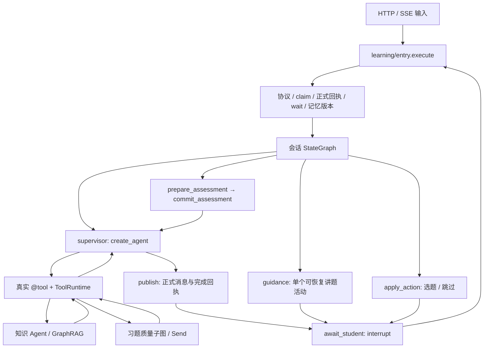

# LangChain／LangGraph 原生化剩余阶段实现与验收

日期：2026-10-23。记录范围：N2～N6。**实施、旧路径退出及本轮验收已完成：831 项完整后端回归、前端 15 项及构建通过；真实主子 Agent、题组生成与提交、SSE、连续两轮压缩、已有知识图检索和三层记忆均有证据。** N0／N1 成果不重复计入本批。

[28 号计划](28_langchain_langgraph_native_architecture_plan.md)说明原始目标，[29 号记录](29_native_n0_n1_implementation_and_acceptance.md)保存 N0／N1 的历史证据。N1 的标准模型接入、评分 owner 修复、7 项真实模型探针及净增 231 行不重复计入本批成果。

## 1. 基线、交付边界与约束

本批基线是 N1 后的实际工作区：后端生产 Python 237 文件、23,130 行；runtime／context／application-agent 三组约 3,440 行；MySQL 28 表。它不是 Git HEAD，也不是第四批裁剪前的版本。

六项能力继续保留：学生→课程→知识点递归记忆、知识点 GraphRAG、会话主子目标及补救返回、并行生成与整组提交、语义压缩、SSE。权限、原始答案、冻结题目、帮助条件、证据归因、记忆纠正与遗忘仍由领域服务负责。

本批采用以下完成口径：

1. 对应旧运行路径已经物理删除或在原文件内完成改写；不保留异常后回退旧执行器。
2. 会话图只包含七类有分支或恢复意义的节点；普通业务校验与事务函数继续保持函数。
3. 替换成本与新增持久恢复成本分开统计；没有代码净减比例门槛，但不能以新增能力掩盖双执行器、双工具声明和重复消息推进。

## 2. 当前架构与职责

核心源码：

| 边界 | 当前实现 | 负责的内容 |
|---|---|---|
| 唯一学习入口 | [entry.py](../../backend/app/application/learning/entry.py)、[protocol.py](../../backend/app/application/learning/protocol.py) | 先领取执行权，再重读回执、当前停点、目标与记忆版本；所有写操作入口进入同一会话图 |
| 会话编排 | [graph.py](../../backend/app/application/learning/graph.py) | 类型分流、评分候选保存、正式提交、公开发布及暂停／恢复 |
| 角色调用 | [runner.py](../../backend/app/application/agent/runner.py)、[graph.py](../../backend/app/application/agent/graph.py) | 一个调用入口；标准 `create_agent`／`ToolStrategy`、纯结构化模型、取消、用量与运行记录 |
| 真实工具 | [tools.py](../../backend/app/application/agent/tools.py)、[middleware.py](../../backend/app/application/agent/middleware.py) | 类型声明生成工具契约，真实函数调用业务服务；可信范围、预算、故障分类与公开投影 |
| 子 Agent 委派 | [delegation.py](../../backend/app/application/learning/delegation.py) | 校验任务范围和深度，使用稳定操作身份，返回正式产物回执，原调用模型继续 |
| 习题质量与并发 | [subgraphs/practice.py](../../backend/app/application/learning/subgraphs/practice.py)、[practice/service.py](../../backend/app/domains/practice/service.py) | 单／多题共用 draft→blind_solve→review；Send 最多并发 3，接受后再整体发布 |
| 压缩与消息保护 | [summary.py](../../backend/app/application/agent/summary.py)、[builder.py](../../backend/app/agent/context/builder.py) | 实际挂载摘要中间件，保护当前任务、来源覆盖和闭合工具组；没有独立 ContextController |
| 正式提交与执行存储 | [receipts.py](../../backend/app/application/learning/receipts.py)、[publication.py](../../backend/app/application/learning/publication.py)、[storage.py](../../backend/app/application/learning/storage.py) | MySQL 正式回执与领域效果；官方 SQLite saver；单 worker 生命周期与冷线程清理 |

### 七类节点为什么存在

| 节点 | 编排理由 | 不被拆为额外节点的函数 |
|---|---|---|
| supervisor | 标准 Agent 的自主工具循环 | 目录读取、上下文投影、目标候选校验 |
| prepare_assessment | 昂贵评分候选与正式写入之间的恢复边界 | 确定性判分、输出格式约束 |
| commit_assessment | 原答、Attempt／BatchSubmission、证据和会话转换的正式事务 | 证据构造、掌握度归约、帮助快照校验 |
| guidance | 讲题活动的幂等恢复边界 | 工作区读取、曝光判定、反馈校验、公开序列化 |
| publish | 主回复与完成回执的正式提交 | Plan 业务验证、消息字段投影 |
| apply_action | 选用已有题或跳过等确定性状态变更 | 题目归属、稳定身份与输入指纹计算 |
| await_student | 无副作用的 interrupt 停点 | wait_id 从正式待办计算 |

没有再增加 LLM router，也没有将递归记忆或整个 GraphRAG 查询包装成图。外层图负责业务步骤，Neo4j 仍负责知识点关系。

### 三类状态所有者

| 数据 | 主要所有者 | 恢复时的规则 |
|---|---|---|
| 原答、冻结题、评分、证据、主子目标、长期记忆 | MySQL 领域服务 | 正式事实优先；checkpoint 不能覆盖更晚的领域提交 |
| 模型消息、工具结果、未完成节点、等待点 | LangGraph State／SQLite saver | 会话 thread 为 `learning:{session_id}`；普通增量使用 reducer，主 Agent 返回通过 Overwrite 接回消息 |
| 学生范围、当前 owner、服务、预算、来源校验器和展示器 | 本次 RuntimeContext | 取得执行权后重新注入，不从旧 checkpoint 恢复授权 |

主／子 Agent 使用公开 RuntimeContext 和完整 config 传递父子关系，子图 `checkpointer=None` 继承父级 saver。消息由原生图管理；父质量图只保存候选与必要回执，不再复制子 Agent 完整 messages。`received`、`completed` 和 `abandoned` 请求状态分别表示已收输入、正式完成及由后续输入终止的旧计算。

评分、盲解、复核、摘要和后台记忆的唯一纯结构化接口为 `with_structured_output(method="json_mode", include_raw=True)`：Pydantic 自动生成 Schema、纳入 system 与预算，再对原始正文严格 `model_validate_json`。真实部署不支持 `json_schema`，且复杂评分的 function 参数持续出现多余右括号，不能截取前缀接受；原纯函数模式已退出。业务 Agent 仍通过 `create_agent + ToolStrategy` 调用真实工具，不增加 writer 模型。能力探针和旧失败均归档，没有在线自动回退。

讲题走独立活动时，将本轮已经正式发布的原答和公开反馈按业务 ID 增量加入同一父消息 State；不复制子 Agent 私有参考解。这样主模型在“讲题→关闭→回到原目标”后能继续读取刚才的真实交互。评分及主模型接续共用原始 request_id 的累计运行额度，稳定身份不再另加评分前缀。

## 3. 阶段结果与实际退出清单

| 阶段 | 当前源码交付 | 验收状态 |
|---|---|---|
| N2 | 标准模型／真实工具／单一 Runner／摘要中间件／原生公开事件已接管；旧工具桥和控制器退出 | 真实知识委派返回原主模型、公开 SSE、连续两轮压缩及当前完整回归通过 |
| N3A | 稳定操作 ID、输入指纹、同事务正式回执、owner／业务版本重检、累计失败预算 | 正式提交后丢失返回、同 key 改内容、失权与重放场景有隔离测试 |
| N3B | 会话 StateGraph、v2 输入、稳定 wait、SQLite saver、claim 后重读、来源失效／epoch 屏障 | SQLite 与实际 create_agent 新进程恢复已覆盖；实际业务库转换完成，身份与受保护会话状态核对不变 |
| N4 | 单题／整组共用三步图，Send 并发；后台三处模型调用使用标准结构化接口 | 真实两题生成、整组提交及无模型重放通过；三处记忆模型接口和三级作用域持久化已核对 |
| N5 | 原摘要表 ORM 和注册退出；旧委派执行缓存不再延续；统一公开流；冷线程策略 | 实际 MySQL 28→27；官方 SQLite 另增两表，实际大小与维护策略见存储报告 |
| N6 | 前端及活跃脚本使用 request_id／wait_id；历史请求、工作区和观察转换为统一格式；旧解析退出 | 831 项完整回归、前端15项及构建、实际迁移、真实模型和最终路径扫描通过 |

以下是本批**13 个生产文件的整文件物理删除**，不是改名继续执行；过时验收脚本另外统计：

- `backend/app/application/agent/execution.py`：原多层 Runner 合并进唯一 `runner.py`。
- `backend/app/application/agent/tool_binding.py`、`definitions.py`、`registry.py`、`agent_tools.py`：退出占位工具、手写 Schema 与字符串分派；真实声明在 `tools.py`。
- `backend/app/agent/runtime/model_adapter.py`、`invocations.py`：退出 WireChatModel 和私有调用身份 ContextVar。
- `backend/app/agent/tools/validation.py`：旧工具运行校验包装退出，参数校验由真实工具类型声明和领域边界负责。
- `backend/app/agent/context/compactor.py`、`summarizer.py`：退出独立消息控制器和旧摘要生命周期；来源分块等保护迁至挂载的 `application/agent/summary.py`。
- `backend/app/application/agent/checkpoints.py`、`backend/app/infrastructure/persistence/checkpoint_models.py`：退出旧 MySQL 摘要缓存适配与 ORM。
- `backend/app/application/learning/answer_graph.py`：退出每请求构建的五节点作答图和 InMemorySaver 生产路径。
- `scripts/evaluation/check_simplification_p0.py`、`check_simplification_p1.py`、`check_simplification_p2.py`、`check_simplification_p2_generation.py`、`check_simplification_p3_model.py`：旧阶段脚本退出，原报告与 maintenance 历史迁移档案保留。

在原文件内重写的内容另列：`practice/batches.py` 不再使用 TaskGroup／Semaphore 调度生成；`practice/service.py` 不再拥有另一套生成重试循环；`sessions/progress.py` 只跨题目切换保留正式学习进度。上述不算整文件删除。

保留且有独立职责的薄代码包括：领域评分和证据事务、角色工具范围、根请求预算、故障熔断、公开 JSON 字段过滤、摘要来源验证、图片资产检查、正式回执以及单 worker 存储生命周期。它们不是旧执行器的后备路径。

`ModelClient.chat` 当前只剩教材模型调用与题图检索增强两类独立消费者；它们不属于在线学习 Agent 的自动回退。向量调用、ES 和 Neo4j 客户端继续保留。

## 4. 验收证据与实际修复

| 证据 | 结果 | 能证明的范围 |
|---|---|---|
| [最终完整后端回归](../../data/reports/native_remaining/backend_complete.xml) | **831 passed，214.44 秒** | 当前冻结源码，包含最终恢复边界与旧格式退出；不是将多次专项数量相加 |
| [持久化／边界补验](../../data/reports/native_remaining/durable.xml) | 28 passed | 真实 saver 锁、冷线程和会话恢复等专项证据，已被后续完整回归覆盖 |
| [会话图初期回归](../../data/reports/native_remaining/session.xml) | 9 passed | 新会话入口与正式事实恢复的专项证据 |
| [实际 create_agent 跨进程测试](../../backend/tests/test_native_child_restart.py) | 2 passed，已由实施执行确认 | 新 Python 进程重建真实框架父子图，复用已提交工具回执；模型端为录制标准 ChatModel，属于隔离证据 |
| [记忆 epoch／HTTP／习题补验](../../data/reports/native_remaining/epoch_http_practice.xml) | 13 passed | 撤销后拒绝评分候选、缺失 owner 不可发题、HTTP409和统一习题图 |
| [真实知识工具与主子 Agent](../../data/reports/native_remaining/real_model.json) | `native_supervisor_tools_child_return` 通过 | 真实 DeepSeek 调用 read_skill、概念读取、RAG 和知识 Agent；原主模型继续读取工具回执，主运行 4 轮并记录子运行身份 |
| [真实公开 SSE](../../data/reports/native_remaining/real_model.json) | `actual_public_token_sse` 通过 | 实际 ASGI 响应体分块，100 个 text_delta，正文白名单为 message；本次首正文约 995 ms，不当作普遍延迟指标 |
| [真实连续压缩及重开 SQLite](../../data/reports/native_remaining/real_compaction.json) | 2 轮通过 | 每轮图中保留 4 条消息；压缩事件 1→2、摘要来源 4→7，删除的旧前缀不复活，当前原答逐字不变 |
| [实际业务库转换](../../data/reports/native_remaining/migration.json) | 已应用，MySQL 28→27 表 | 转换 214 条完成回执和 20 条正式委派回执；原消息 ID、正文、引用及受保护会话状态均不变 |
| [讲题存量格式归一](../../data/reports/native_remaining/guidance_normalization.json) | 9 个工作区、92 条观察输入来源、19 条公开等待回执已转换 | 原 ID／版本、历史证据、正文与引用不变；实际严格读取20个工作区和92条原答成功，无旧格式剩余 |
| [失权与过期候选故障回归](../../data/reports/native_remaining/recovery_guards.xml) | 28 passed | 帮助标记在同一事务锁定 owner／epoch；已入库但尚未发出的过期候选不能复用，正式发出的题仍回放 |
| [讲题返回主模型](../../data/reports/native_remaining/guidance_parent.xml) | 12 passed | 跨 SQLite 重开保留公开原答／反馈，无私有参考解或重复消息 ID |
| [旧路径扫描](../../data/reports/native_remaining/architecture_audit.json) | 13 个生产文件确已消失，禁止符号引用为0 | 一入口、七类会话节点、三步质量图、仅两类独立旧 chat 消费者 |
| [最终独占真实验收](../../data/reports/native_remaining/real_model_clean_final.json) | **5项全通过，53次HTTP尝试全部200** | 新隔离学生，完整知识委派、两题生成／一次整组评分／无模型重放、SSE、已有图种子和三层记忆；包含scope任务的其他学生事实指纹一致 |
| [未确认历史key转换](../../data/reports/native_remaining/unconfirmed_input_keys.json) | 125条转换且125条冲突校验通过 | 不伪造旧输入哈希或完成结果；旧key不能再次触发模型，原答／ID／引用不变 |
| [实际运行服务切换](../../data/reports/native_remaining/cutover.json) | 8008已运行v2；旧请求体422；MySQL仍27表 | 精确退出15:01启动的旧N1进程，在无owner／运行记忆任务窗口备份后重启；不只是源码变化 |

早期完整运行的 7 个等待协议迁移失败保留在 [backend_before_wait_test_migration.xml](../../data/reports/native_remaining/backend_before_wait_test_migration.xml)。它们被显式迁移到 v2 输入后才通过，没有删除旧冻结、原答和帮助条件断言来降低测试要求。

真实压缩验收使用夹具历史、真实 DeepSeek 和真实 SQLite，软水位 0.08 仅在验收进程设置，生产阈值没有改变。来源覆盖证明可追溯和当前任务保护，不证明任意历史语义零遗漏，也不据此报告全请求 Token 降幅。初次夹具装配失败保留于 [real_compaction_initial_setup_failure.json](../../data/reports/native_remaining/real_compaction_initial_setup_failure.json)。

实际库转换先备份再应用，消息内容与引用的核对指纹不变；讲题原答来源中 20 条取历史 `_guidance_input_text`、72 条取正式 content，保留原观察字段，只补齐来源绑定。214 条 completed 是转换的正式回执数量，不代表本批真实模型请求次数。

真实题组的早期函数模式输出失败记录保留在 real_model.json。切换唯一标准 JSON mode 后，用相同请求及 SQLite 线程恢复：已发布题不重生成，正式写入2条 Attempt 和1条 BatchSubmission，同请求重放不调用模型。报告中 `initial_run_passed=false` 表示原问题，`current_acceptance`、`supplemental_acceptance` 与最终 `passed=true` 表示修复后的结果；不删除历史失败来制造一次成功。

之后在无旧worker的独占窗口，以新学生完成最终正常验收：主模型4轮真实往返；两题Send、盲解、复核后，BatchDiagnosis仅一次调用，提交2条Attempt／1条BatchSubmission，重放零模型；SSE142个正文增量，首正文约999ms、完成约3441ms；四类记忆候选接口均有本脚本HTTP审计，概念／课程／学生作用域版本2／2／1、claim数4／2／1。此前补充报告 `real_model_clean.json` 曾受旧worker消费干扰，保留为排障证据，不用它冒充独占验收。

实际切换前发现8008仍在运行本轮之前启动的N1后端，其OpenAPI仍只有旧作答幂等字段。确认属于本项目且无在途业务后，停止该精确进程，备份并校验迁移后27表，完成最后的未确认历史key转换，再恢复新v2服务。运行API实测具有request_id／wait_id／question_id、跳过请求体和讲题wait；旧作答体在参数阶段422，不调用模型。备份、转换和运行协议证据分开保存。

真实图检索以已构图的 `mechanics:c1` 返回3节点、2边、3份资料，keyword／vector／neo4j 无降级；所选 `junior_algebra:signed_multiplication` 没有图投影，返回0节点，不据此声称该课程已有图增强。真实记忆审计包含 Extraction、AggregatedClaims、PromotionCandidate、PromotionReview，三级作用域均有带来源 claim；概念聚合的额外只读候选验证不会重复入库。验收使用隔离学生，定向运行其 MemoryJob，其他学生正式事实指纹一致。

前端 `npm run test:streaming` 为15项通过，`npm run build` 通过。真实 SSE 的首正文时间只是本次样本，不能推导普遍延迟或并发容量。图片临时展开、越权、取消和费用预算另由标准SDK MockTransport及SQLite专项覆盖；本次不把N1真实读图结果重复计为新成果。

## 5. 成本、存储与边界

| 分类 | 本批内容 | 最终新增／删除／净变化 |
|---|---|---|
| 替换生产代码 | 原生 Agent、真实工具、摘要与事件接管，旧底座删除 | **+1,882／−3,445／净−1,563行** |
| 新增能力代码 | 会话持久化、停点恢复、幂等正式回执、版本／epoch 恢复保护 | **+750／−22／净+728行**；混合文件按函数与行职责分类 |
| 测试 | 故障注入、原生模型测试桥、跨进程、v2夹具迁移 | +3,023／−1,409／净+1,614行，46文件；不计入生产净减 |
| 验收脚本 | 真实模型、压缩、图谱／记忆、静态路径与成本核对 | +1,108／−783／净+325行，31文件；临时排障脚本归档，活跃脚本无旧模式探针 |
| 一次迁移 | 停写备份、存量转换及核对 | 200行唯一逻辑脚本已归档且在线入口删除；讲题定向归一另有独立备份及核对回执 |
| 文档 | 当前调用链、状态所有权与证据说明 | 单列工程材料账本，最终数量见成本JSON；不计入生产简化收益 |
| 持久化 | MySQL 28→27，SQLite两张官方表 | **总逻辑表种类为29**，不是28→27的总存储减少；实际体积见下 |

[成本报告](../../data/reports/native_remaining/source_cost.json)以逐文件SHA核验的N1源码归档比较：后端237文件／23,130行→238文件／22,295行，**净减835行**；runtime／context／application-agent 3,443→2,128行。13个旧文件删除，14个职责文件新增，所以文件数并未下降。毛变更排除纯缩进和参数改名，代码移动不算简化收益；真正的收敛证据是旧执行器、桥、注册表与第二消息推进路径退出。

前端v2协议迁移另计+44／−10／净+34行、3文件，不混入后端净减。数量是源码材料变化，不是开发工时或性能收益。

生产和前端使用严格N1清单；测试／脚本／文档工程账本以执行开始副本为主，缺少的旧材料由明确标记的N0归档补充，未采集且无法证明新增的文件不计新增。它们不是同精度的N1生产基线，也不与生产净变化混合。脚本中逐函数／行的分类规则可复查，不把整个新文件一律归为新增能力。

[存储实测](../../data/reports/native_remaining/storage.json)：默认正式saver已初始化 `checkpoints`／`writes` 两表，采样时主文件4,096B、WAL24,752B，尚无正式线程；真实验收独立文件为3,215,360B，145条checkpoint、378条write。默认文件和验收文件不是重复执行路径，后者只用于隔离验证；后续真实线程体积会增长。

不保证任意 token 位置恢复，也不保证 MySQL 与 SQLite 构成同一个跨库事务。正式效果提交后 checkpoint 失败，由稳定回执重入核对；无法证明可恢复时回到正式事实支持的安全入口，不能伪造更细执行进度。

本机个人、单 worker 边界继续成立。启动文件锁限制同一 checkpoint 文件的并发应用实例；它不是多 worker 调度协议。30 天无业务更新、无等待点、无未完成输入且图无后续任务的冷线程允许整线程清理；活跃线程不自动删除。主文件＋WAL 超过 256 MiB 只提醒维护，长期活跃历史没有硬上限。

SSE 仍为 256 项临时队列、12 秒心跳；断线和背压关闭临时流，后台业务继续，前端读取正式快照。它没有变成逐 token 持久事件日志，也未新增 Redis 或任务服务。

## 6. 交付后的测试材料清理

2026-10-23 按长期维护价值清理 `scripts/evaluation/` 中 **10 个一次性验收或排障脚本，共 1,448 行**。生产代码与 `backend/tests/` 均未改动，这些删除不计为生产架构净减。上节成本与前面的验收数字保留为交付时快照，不用本次删除重新包装旧成果。

| 删除脚本 | 删除原因与保留替代 |
|---|---|
| `check_native_baseline.py`、`check_simplification_p3.py` | 固定旧 28 表／阶段快照，当前已是 27 表；保留原报告与当前架构检查 |
| `check_native_checkpoint.py` | 玩具图兼容探针已由真实会话、子 Agent 跨进程与存储测试接管 |
| `check_native_models.py` | N1 一次性兼容探针已结束；保留原真实图片等证据，当前使用标准模型测试和 N2～N6 验收 |
| `check_simplification_p1_generation.py` | 旧生成服务构造契约已退出；当前单题／题组共用生成图验收 |
| `debug_concept_candidate.py` | 绑定单个合成学生的一次性模型排障 |
| `probe_exercise_answer_order.py`、`probe_exercise_output_contract.py` | 已完成的字段顺序与输出格式对照实验，不能作为当前生产验收入口 |
| `recheck_memory_context.py`、`final_audit.py` | 历史轨迹纠正与固定旧数据集汇总已完成；保留历史报告 |

逐文件删除原因、原内容 SHA 和历史源码位置见[清理回执](../../data/reports/native_remaining/test_cleanup.json)。9 个脚本与既有源码档案逐字节一致；排障脚本的当前变体单独追加到原档案的 `retired_test_cleanup/`，再核对后删除。没有另建替代脚本，没有删除历史验收报告；17／29 号历史文档已注明入口退役。

保留[当前真实链路验收](../../scripts/evaluation/check_native_remaining.py)、[真实压缩验收](../../scripts/evaluation/check_native_compaction.py)、[静态退出检查](../../scripts/evaluation/check_native_architecture.py)和[成本统计](../../scripts/evaluation/report_native_remaining.py)。后端持久恢复、幂等、owner／epoch、原答与隐私、并发题组和流式测试具有独立失败边界；离线审计与验收客户端辅助器测试也有独有检查，未为减少数量而删除。

清理后完整后端回归 **831 项通过，205.44 秒**，见[独立 XML](../../data/reports/native_remaining/backend_after_test_cleanup.xml)；静态架构检查通过，保留脚本全部通过 AST 解析。没有调用付费模型或操作实际业务数据库与运行服务。
