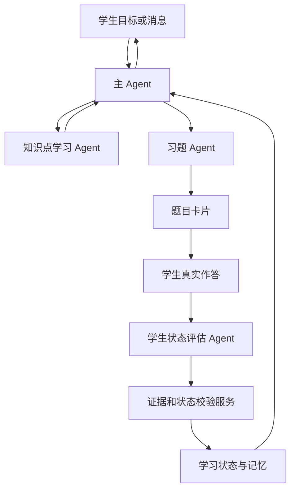

# 理科学习系统第一版开发计划

更新日期：2026-10-26。

2026-10-26：[PostgreSQL 与 LangGraph 记忆迁移实施与验收](32_postgresql_langgraph_memory_implementation_and_acceptance.md)。P0～P4 已完成：资源 13 表、13,493 行迁入 PG；业务库、官方 Saver／Store 和记忆图已切换；完整后端 865 项、前端 15 项及构建通过，真实模型三级记忆、连续摘要与检索回放通过，前后端已启动。[31 号计划](31_postgresql_langgraph_memory_migration_plan.md)保留冻结契约和阶段记录。

2026-10-23：[N2～N6 原生化实现与验收记录](30_native_remaining_implementation_and_acceptance.md)。当前源码已接入唯一会话图、真实工具、持久 SQLite、Send 习题子图及标准摘要，13 个旧生产文件物理退出；完整隔离回归 806 passed，后续故障补验分开记录。实际 MySQL 28→27 表，真实知识委派、SSE 和连续压缩已通过；真实题组评分与最终全量／成本验收仍在完成。

2026-10-23：[N0／N1 原生模型底座实施与验收](29_native_n0_n1_implementation_and_acceptance.md)。已修评分事务执行权，完成基线／v1 协议冻结及 SQLite saver 隔离验证；纯评分、求解、复核切到标准 function calling。当时生产代码净增 231 行、业务库 28 表不变；当时尚未替换的工具桥接与会话持久化现见 30 号记录，N1 成果不重复计入本批。

2026-10-23：[LangChain／LangGraph 原生编排与教学 Harness 修改计划](28_langchain_langgraph_native_architecture_plan.md)。N0／N1 历史已交付，N2～N5 源码及隔离验收已完成，N6 最终验收进行中；保留六项核心能力，列明旧代码去向、执行权与幂等协议、存量迁移、回滚和验收矩阵。新增三条约束：替换即退出旧路径、必要步骤才上图、替换与新增能力分项核算。

2026-10-23：[第四批 F3/F4、S15/S16 历史验收](27_p3_f3_f4_s15_s16_implementation_and_acceptance.md)。当时作答接续五节点图、资料引用池退出和讲题副本收缩已验收，实验库保持 28 表；当时保留的自定义模型／工具／上下文适配及请求内检查点后由 30 号记录中的实现替换。S14 暂不实施。

2026-10-23：[第三批 F1/F2、S10～S13 实施验收](26_p2_s10_s13_implementation_and_acceptance.md)。数据库 37→28 表，生产角色接入标准 Agent 工厂，递归记忆与难度设计收敛；这是已完成阶段的记录，与下一轮原生化计划区分。

2026-10-23：[S05～S09 第二批实施验收](25_p1_s05_s09_implementation_and_acceptance.md)。数据库 44→37 表，实际删除 8 表、新建 1 表；生产源码净增 10 行，完整删除两份生产文件。后端 794 项、最终专项 100 项、前端 15 项通过；三阶段真实模型生成与本地含图检索缓存重放通过，六项核心能力保留。

2026-10-23：[F0 与 S01～S04 实施验收](24_f0_p0_implementation_and_acceptance.md)。实验库实际由 49 表减为 44 表，生产源码净减少 197 行，两个旧辅导文件完整删除；F0 模型兼容验证和后端 790 项回归通过。当时生产 Agent 底座尚未替换，后续进展见 26／27 号记录。

2026-10-23：[系统与数据库简化计划及阶段记录](23_core_system_simplification_plan.md)。F0～F4、S01～S13、S15/S16 已完成本批验收，实验库已为 28 表，六项核心能力保留；S14 暂不实施。后续更深的框架原生化按 28 号计划推进，持久化执行存储单独计数；13 号旧提案仅作历史参考。

2026-10-22：[题库与练习职责重构](22_question_and_practice_refactor.md)。题库资源归入 `courses/questions`，练习过程归入 `practice`；新旧检索共用范围过滤、召回执行与融合，讲题和检索共用题图校验。

2026-10-22：[含图习题检索方案](20_multimodal_exercise_retrieval_plan.md)及[实现与验证](21_multimodal_exercise_retrieval_implementation.md)。补充图示条件增强文本、独立图文向量、RRF与多模态重排；16题真实试点与完整题库隔离。

2026-10-21 新迭代：[业务分层记忆实现与验证](19_business_memory_implementation.md)、[面试问答](../interview/02_business_memory_and_evidence.md)。采用总体、课程、知识点和会话内四个作用域，增加会话知识点观察、逐概念证据归因及作用域治理；[18 方案](18_business_memory_and_assessment_plan.md)保留设计背景。

2026-10-21 上一版：[学生记忆与会话上下文压缩实施计划](16_memory_and_context_plan.md)、[实现与验收](17_memory_and_context_implementation.md)和[面试问答](../interview/01_memory_and_context_compression.md)。两种跨会话记忆划分由新迭代替代；会话内目标与上下文压缩继续使用，历史验收仅代表对应版本。

2026-10-21：[教材结构化解析与历史教学分析包](15_textbook_structure_and_teaching_packs.md)保留早期实现和验收。方程求解与固定提示规则已退役，当前教材原文目录和通用讲题流程见[项目说明](../../README.md)。

2026-10-20：[初中一元一次方程 P0/P1（历史）](14_equation_tutoring_p0_p1.md)曾以合成样题和模拟学生回答完成真实后端闭环验收。专用计算链路与界面现已退役，下文保留早期范围，不代表新课程的当前实现边界。

> 实施状态（2026-10-19）：应用已接入力学与数学两门课程，当前事实、数据口径和本轮验收见 [物理与数学数据库扩展](05_physics_math_database.md)；启动见 [项目说明](../../README.md)。[04 文档](04_implementation_and_acceptance.md) 保留早期力学 V1 快照。本文正文保留四门课程的总体规划及最初环境调查记录，其中“当前准备情况”等时间表述不代表本轮状态；逻辑学、PHP、视频检索和偏好编辑尚未交付。

本项目在 `D:\Projects\tutor` 开发网页端学习系统，以主 Agent、习题 Agent、知识点学习 Agent、学生状态评估 Agent 为四个业务角色。第一版交付可持续使用的完整学习流程，并以真实作答、持久化状态和可追溯内容验证效果。

## 已确定的产品范围

用户已明确：逻辑学、力学、PHP、数学四门课程采用相同完成标准；本机个人使用；保留本系统产生的学习记录；视频和动画生成暂不开发；数学数据从官方来源获取。

“不需要历史交互”落实为不导入公开数据集中的学生档案、答题序列及训练测试集。当前用户在本系统中的目标、对话、答案、评估结果和学习记忆需要保存。

四门课程同等完成度指全部支持浏览、目标选择、诊断、讲解、练习、评估、状态更新和会话恢复，不表示四门课程的题目数量或知识点数量相同。题库未提供的知识点详解和题目解析需要另行构建，并标记来源。

用户补充：若数据难以获取，先保证至少一个完整数据集和一门课程的完整体验。实施时先以力学验证整个流程，再将相同功能用于其他课程；不为等待数据而延迟第一条可运行链路。目前四门课程所需的基础教学元数据均已取得。

本目录保留第一版开发范围与迭代说明。`docs/learning_harness/` 已按 2026-10-23 原生化源码更新为[当前实现学习指南](../learning_harness/README.md)，用于学习现有组件、流程与设计思想；旧设计中的更多 Specialist、评分模型等不自动视为已实现。

- [基础数据与环境](01_data_and_environment.md)
- [四个 Agent 与学生评估](02_agents_and_assessment.md)
- [RAG 与 Graph RAG 及题目检索](03_retrieval_and_graph_rag.md)

## 用户可体验的完整流程

1. 从课程首页进入逻辑学、力学、PHP 或数学，浏览知识点和题目。
2. 选择单个知识点，或输入覆盖多个知识点的学习目标。
3. 新知识点显示“待评估”；系统通过少量诊断题取得初始证据。用户可以先学习，未测状态不会伪装成低掌握度。
4. 主 Agent 根据目标和证据选择当前内容；知识点 Agent 按类型、学习层级和错误模式讲解，并允许连续追问。
5. 习题 Agent 提供记忆、理解或应用练习，先检索题库，必要时生成并校验新题。
6. 用户提交答案，评估 Agent 独立判分和诊断；页面显示结果、依据、知识点层级变化以及建议。
7. 主 Agent 决定继续练习、补先修、提高层级、转到下一个知识点，或安排复习。
8. 关闭并重新打开页面后，可以恢复当前题目、未完成目标、历史会话和学生档案。



## 页面与交互

| 页面 | 第一版功能 | 完成标准 |
|---|---|---|
| 课程首页 | 四门课程、知识点与题目规模、数据完整性、继续学习 | 四门课程均能进入真实内容 |
| 学习工作台 | 左侧目标与知识点，中间对话和题目卡片，右侧学习状态与资料 | 完整完成讲解、作答、反馈、下一步 |
| 知识结构 | 分类层级、相关知识点、经确认的先修关系 | 不把包含关系和共现关系显示成先修 |
| 练习页 | 选择、判断、填空、文本解答；答案提交与解析 | 正确、错误、部分正确、无法判定均有清晰反馈 |
| 学习档案 | 三层级掌握情况、证据数量、错因、复习列表、记忆 | 能回看某次状态变化的原题和答案 |
| 会话历史 | 多个目标、知识点切换、返回先前目标 | 刷新、关闭后恢复未完成题目 |

默认中文界面，支持 LaTeX、题目图片和 PHP 代码块。四个 Agent 通过同一个学习界面协作，展示当前活动和简短依据。详细调用轨迹、模型耗时及 Tokens 放入可展开的调试视图。

视频检索保留为知识点 Agent 的辅助工具：返回真实的视频标题、来源和链接；没有结果时明确说明。视频播放使用来源允许的嵌入或打开链接。视频生成、动画生成和配音不在本版范围内。

## 技术与模块

已确定采用 Python 作为统一后端语言，以 FastAPI 提供接口和 SSE 运行事件。前端使用 React、TypeScript、Vite，负责页面展示、用户输入、公式与题图渲染以及流式交互。交互状态与题库使用 MySQL 独立库 `stem_tutor`；Elasticsearch 保存文本和 embedding 向量，执行快速查题和混合检索；Neo4j 保存课程知识结构，参与 Graph RAG；文件目录保存题图、来源信息和导入报告。依赖版本将在初始化工程时锁定。

四个 Agent 的编排与执行、模型适配、技能加载、工具调度、题目生成与校验、学生评估、状态更新、学习记忆、会话恢复及数据导入均由 Python 后端实现。前端通过接口读取公开学习状态和提交用户操作；模型密钥、参考答案与最终判分规则由后端管理。

后端按 API、Agent Runtime、领域服务、数据访问分层。Agent 调用受控工具，工具委托领域服务，领域服务通过仓储访问数据库；技能内容可使用 Markdown 或 YAML 配置，由 Python 加载和执行。第一版采用模块化单体，将这些模块部署在同一个后端应用中。

四个 Agent 共用执行器和模型适配层，分别拥有独立提示词、上下文、技能和工具白名单。不为四个角色分别部署服务。先使用现有配置中的文本模型，验证真实模型调用、结构化输出与工具调用后再决定是否需要更换模型。Embedding 与 ES 混合检索为第一版必需能力，优先使用已验证的 text-embedding-v4 与 1024 维配置。

MySQL 为业务事实来源，ES 索引和 Neo4j 图为可重建投影。内容导入先写入 MySQL，再通过带版本的任务同步至 ES 和 Neo4j；失败可以重试，各侧进度分别记录。

普通 RAG、Graph RAG 和题目搜索分别封装为 `rag_retrieve`、`graph_rag_retrieve`、`search_exercises` 工具。查题页面直接调用同一检索服务；精确与关键词查题无需额外调用生成模型。详细流程、索引和权限见检索专题。

```text
backend/app/
  main.py              稳定的 app.main:app 启动入口
  bootstrap.py         生命周期、对象装配与后台任务
  api/                 按业务拆分的 HTTP 路由和 SSE
  domains/             九个业务域，聚合服务、模型与契约
  agent/               模型循环、上下文、工具与技能资源
  infrastructure/      配置、数据库与外部客户端
  shared/              通用严格协议基类和并发辅助
frontend/src/
  features/            courses、workspace、practice、profile、history
  components/          公式、题卡、知识图、来源、状态卡片
  api/                 类型化接口与 SSE 客户端
scripts/data/          数据获取、清洗、审计、导入和投影
tests/                 后端关键行为与网页完整流程
data/                  原始教学资料、规范化内容与导入报告
```

代码按业务模块划分，注释采用中文。模型提示词、技能、数据导入和业务状态更新分别管理。

## 开发阶段与交付

| 阶段 | 工作 | 可检查的交付 |
|---|---|---|
| 0 数据与依赖核验 | 取得 XES3G5M；审计四份内容；验证文本模型、embedding、MySQL、ES 和 Neo4j | 来源清单、字段映射、缺失图片报告、连接结果 |
| 1 基础库与检索及网页骨架 | 数据库迁移、幂等导入、ES 文本与向量索引、图投影、快速查题、课程接口和工作台 | 先在一门课程上验证真实内容与检索，再覆盖四门课程 |
| 2 四个 Agent 完整流程 | 执行器、技能、RAG 与 Graph RAG 工具、出题判题、证据状态、会话持久化 | 先跑通一门课程，再逐一验证四门课程的完整流程 |
| 3 教学与个性化完善 | 多知识点目标、分层教学、生成题质量校验、长期记忆、复习、视频检索 | 可连续追问、补先修、恢复原目标，历史状态可追溯 |
| 4 整体验收 | 浏览器操作、失败恢复、统计真实调用、使用说明和启动入口 | 可在本机启动、操作、重启恢复的第一版系统 |

以阶段交付管理进度，不先给未经验证的日期承诺。阶段 2 是首个可完整操作的集成版本；阶段 4 才是本计划定义的第一版完成。

## 第一版验收

1. 四门课程逐一通过“选目标—讲解—检索或生成题—提交答案—评估—状态变化—下一步”的真实网页流程。
2. 四门课程逐一通过多知识点目标切换和返回，避免跨课程 ID 或记忆串用。
3. 选择题、多选题、判断题、填空题和文本解答有明确判题协议；缺图、缺答案、歧义题会进入待处理状态。
4. 每次掌握度更新均能关联唯一作答证据；重复提交、断线重试不会重复增加证据。
5. 出题和教学不能直接修改最终学生状态；生成题答案在作答前不通过网页接口泄露。
6. 初次进入、提示后作答、看过答案后作答、模型不可用、低置信判断均有明确状态。
7. 关闭重启后，课程、学习记录、当前题目、学生状态和目标进度仍在。
8. 记录每轮调用次数、耗时、Tokens、重试及失败原因；真实接口验证与使用桩模型的自动化测试分别报告。
9. 模型给出的掌握度作为诊断估计展示；没有校准实验时不声称是精确成功概率或学习效果提升。
10. 普通 RAG、Graph RAG 与题目搜索通过真实索引查询验证，返回可追溯来源；分别报告命中质量与端到端延迟，并验证课程隔离、答案可见性和依赖故障降级。

## 当前准备情况

已经核对两篇论文的相关正文及评估附录，并检查本机 DeepTutor 的编排、掌握规则、判题和页面结构。三份本地题库合计 488 个知识点名称和 416 道题，均已审计。XES3G5M 已取得 7,652 道题、1,175 条知识层级映射及 3,869 张配图，全部已识别图片引用均有对应文件，未解包学生交互文件。四门课程共有 8,068 道原始题目；取得元数据不等于已经完成题库导入或内容正确性审核。

现有配置可读，文本模型的真实工具调用和 embedding 的真实向量请求均已成功，没有把密钥写入文档。ES 已验证为 9.3.2、green、Basic 许可；MySQL 和 Redis 的 TCP 端口可连接。Neo4j 默认 HTTP/Bolt 地址在此前检查中超时，服务状态和密码尚未验证。当前尚未完成网页应用、业务数据库导入、本项目 ES 索引或完整 Agent 检索链路。

本轮形成开发计划并完成先行数据准备。后续实现按上述阶段推进，不以文档、下载成功或单次模型响应替代完整系统验收。
